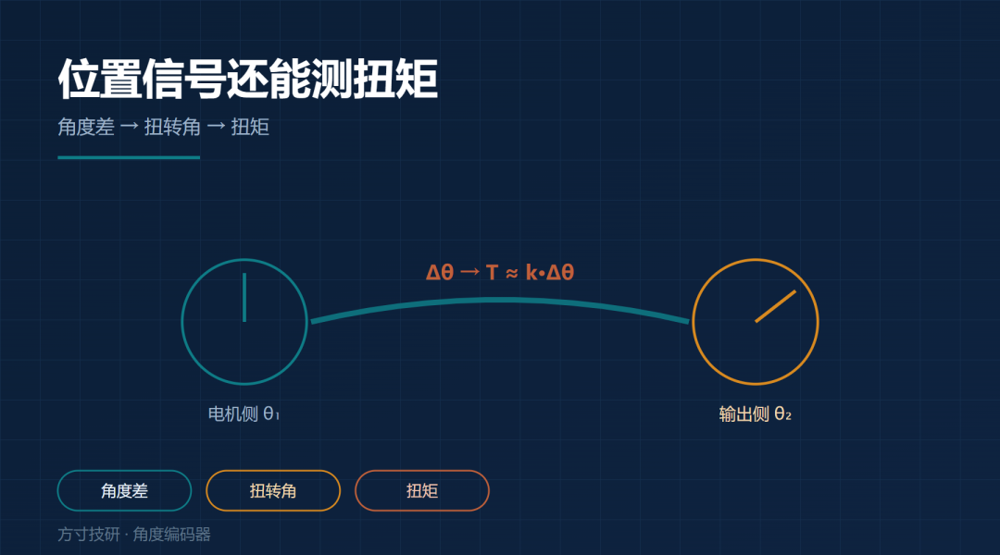
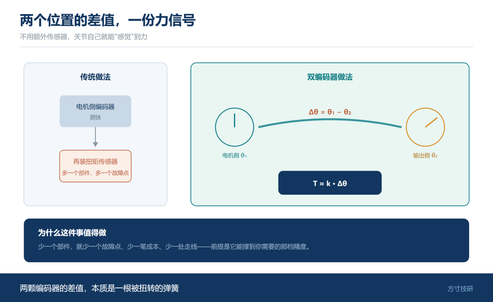
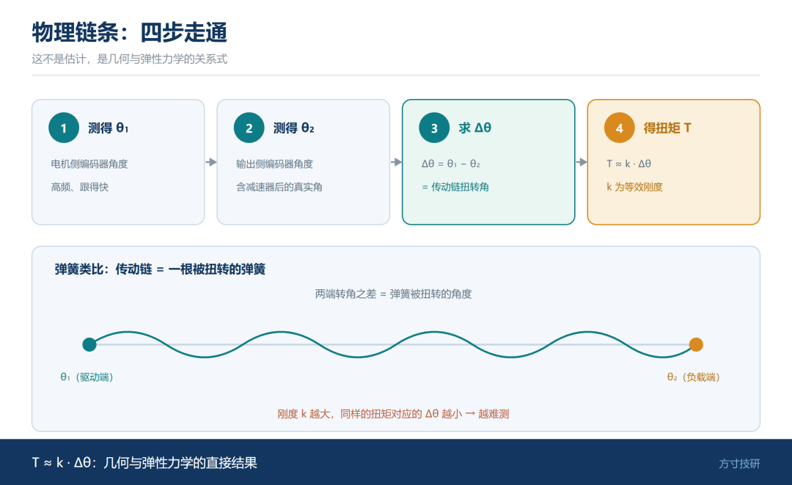
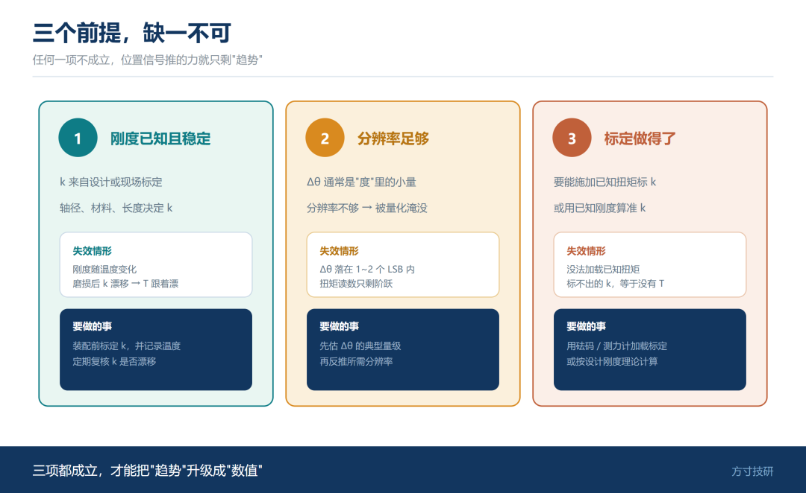
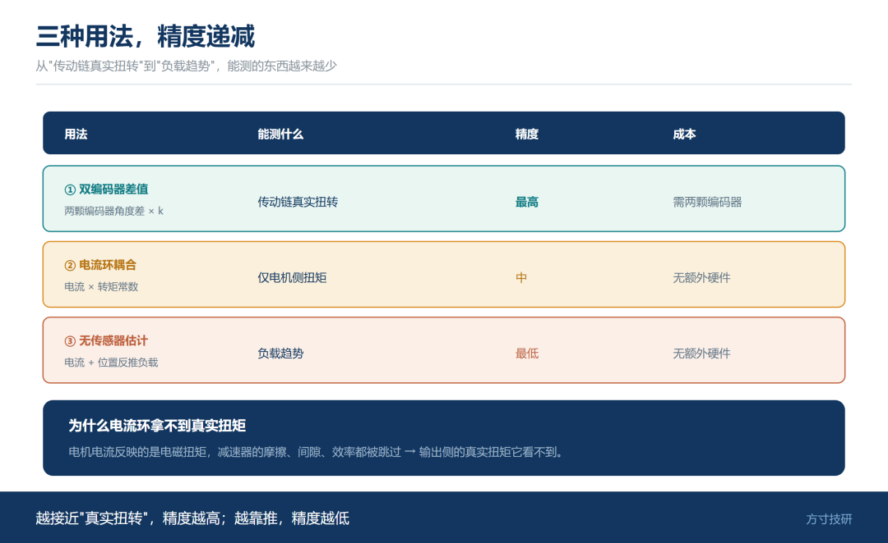
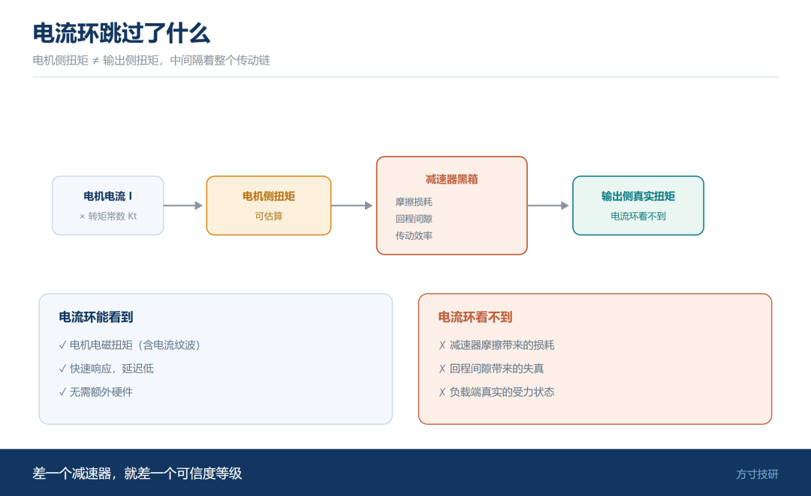
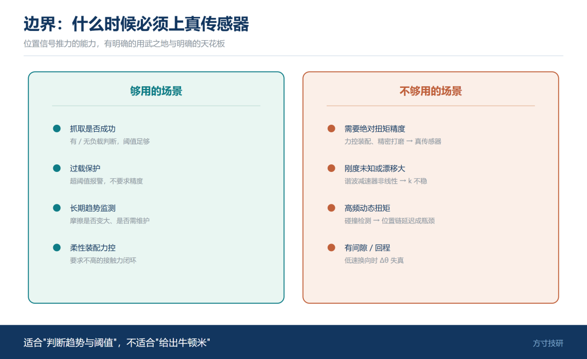
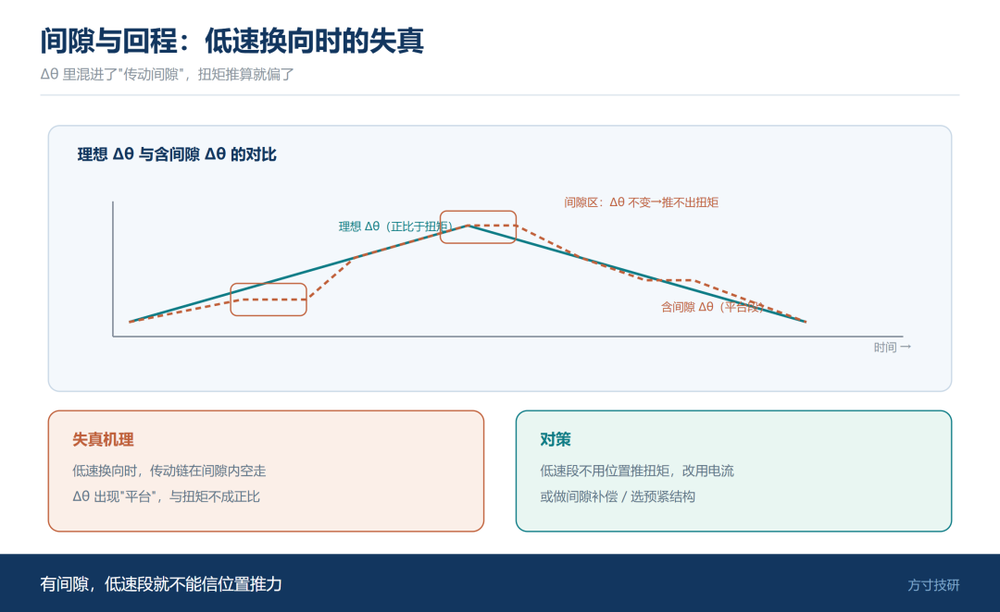
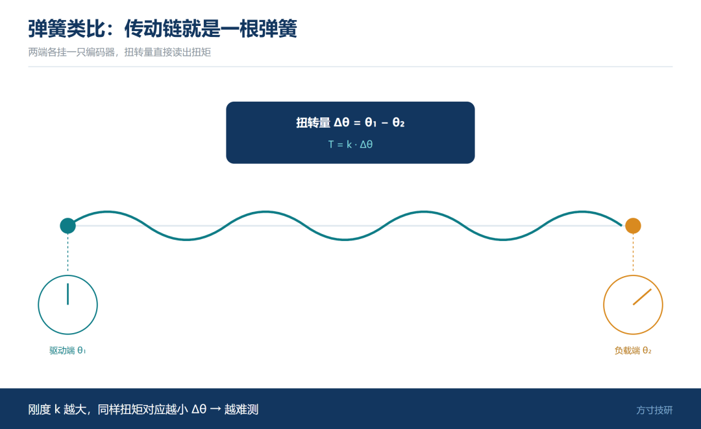

一个关节里，通常有两个位置：电机侧、输出侧。

两者的角度差，乘上一个已知的刚度，就是扭矩。

图 1｜两个位置的差值 | 电机侧 / 输出侧两个角度，差值引出"力矩信号"

**这是一份不用额外传感器就能拿到的力信号。**

问题只剩两个：它准不准？什么工况下能用？

## 一、物理链条：角度差 → 扭转角 → 扭矩

图 2｜物理链条四步 | θ₁、θ₂ → Δθ → T ≈ k·Δθ，配弹簧示意

链条很短：

· 电机侧编码器测得角度 θ₁；

· 输出侧编码器测得角度 θ₂；

· 两者之差 Δθ = θ₁ − θ₂，就是**传动链的扭转角**；

· 扭转角乘上传动链的等效刚度 k，得到扭矩：**T ≈ k · Δθ**。

这就是双编码器能"顺手"给出力信号的原理。

**它不是估计，是几何与弹性力学的关系式。**

一句话：**两颗编码器的差值，本质是一根被扭转的弹簧。**

## 二、三个前提，缺一不可

图 3｜三个前提卡片 | 刚度已知 / 分辨率够 / 标定可做，缺一不可

**前提一：刚度已知且稳定**

k 要么来自设计（轴径、材料、长度），要么现场标定。若刚度随温度、磨损变化，T 就跟着漂。

**前提二：分辨率够**

Δθ 通常是"度"里的小量。若编码器分辨率不够，Δθ 会被量化台阶淹没，扭矩读数只剩下阶跃。

**前提三：标定做得了**

需要能施加已知扭矩来标 k，或者至少在装配前用已知刚度算准。**标不出来的 k，等于没有 T。**

三个前提任何一个不成立，位置信号推的力就只剩"趋势"，不能当"数值"用。

## 三、三种用法，精度递减

图 4｜三种用法精度阶梯 | 双编码器 > 电流环 > 无传感器，阶梯式精度递减

**用法一：双编码器差值测力**

精度最高，因为它直接测扭转。前提是两颗编码器都在、且同步。

**用法二：单编码器 + 电流环耦合**

图 5｜电流环跳过了什么 | 电流→电机侧扭矩，但减速器摩擦与间隙被跳过

电机电流 ≈ 电磁扭矩。电流乘转矩常数，可得电机侧扭矩估算。

但它**拿不到输出侧的真实扭矩**——减速器摩擦、间隙都被跳过。

**用法三：无传感器估计**

用电流与位置反推负载。成本最低，精度也最低，多用于保护与趋势判断。

| 用法 | 能测什么 | 精度 | 成本 |
|---|---|---|---|
| 双编码器差值 | 传动链真实扭转 | 最高 | 需两颗编码器 |
| 电流环耦合 | 电机侧扭矩 | 中 | 无额外硬件 |
| 无传感器估计 | 负载趋势 | 最低 | 无额外硬件 |

## 四、边界：什么时候必须上真传感器

图 6｜边界判断表 | 能用 / 不能用 两侧对照清单

位置信号推力矩，在这些情况下就**不够用**：

· **需要绝对扭矩精度**（力控装配、精密打磨）——要真扭矩传感器；

· **刚度未知或漂移大**（谐波减速器的非线性）——k 不稳定，T 就不可信；

· **要测高频动态扭矩**（碰撞检测）——位置链的延迟成为瓶颈；

· **有间隙 / 回程**——低速换向时 Δθ 失真。

反过来，这些场景位置信号足够：

· 抓取是否成功（有/无负载判断）；

· 过载保护（超阈值报警）；

· 长期趋势监测（摩擦是否变大）。

一句话：**位置信号适合"判断趋势与阈值"，不适合"给出牛顿米"。**

## 总结

· **物理链条**：角度差 → 扭转角 → 扭矩，T ≈ k·Δθ，是弹性力学关系式而非估计。

· **三个前提**：刚度已知稳定、分辨率足够、标定可做——缺一项，就只剩趋势。

· **用法精度递减**：双编码器差值最高，电流环耦合只到电机侧，无传感器估计仅作趋势。

💬 你的项目里用位置信号做过力反馈吗？精度和真扭矩传感器差多少？

如果这篇对你有用，点个关注。下一篇进入避坑系列：**线缆屏蔽接了地，为什么干扰还在**——EMC 的四个层次。

—— 方寸技研 · 下期预告：B1《编码器线缆的屏蔽接了地，为什么干扰还在》

图 7｜残余误差示意 | 间隙与回程在低速换向时使 Δθ 失真的示波形态

图 8｜判断句卡 | 收口三条金句 + 深蓝横幅

图 9｜弹簧类比图 | 传动链等效为一根被扭转的弹簧，两端各挂一只编码器
