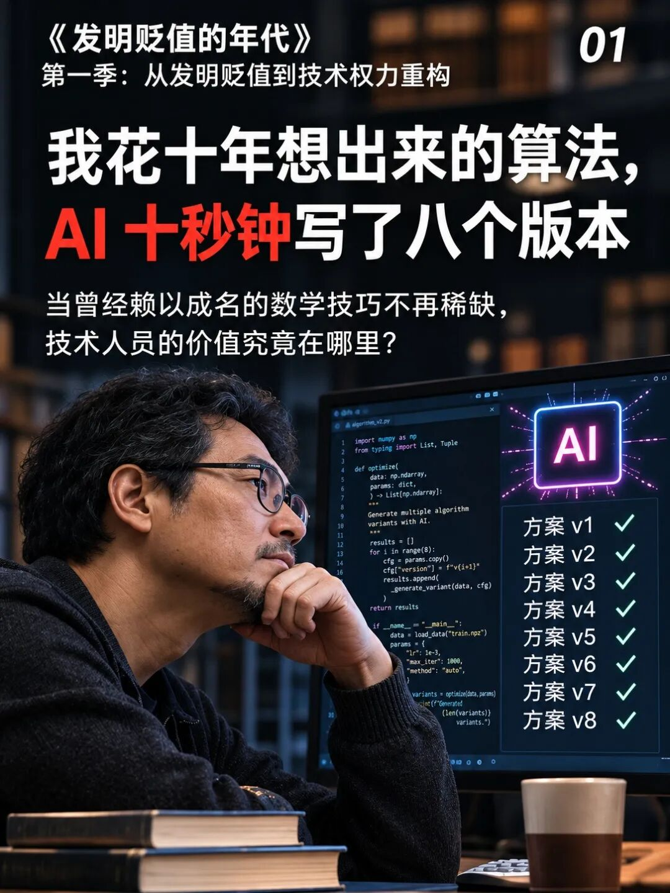
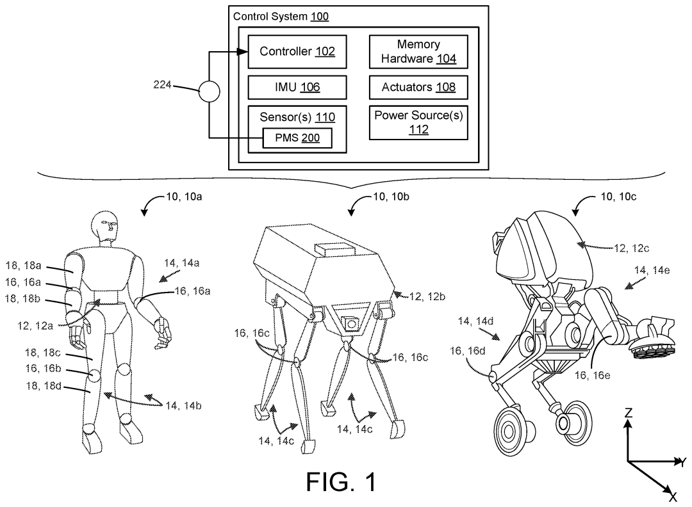

工程师最难受的一个时刻：曾经花很长时间才弄懂的办法，现在AI随手就能列出来。

更难受的是，它列的还不是胡话。有些公式是对的，代码也能跑，连自己当年绕过的弯路，它都能解释。

你花了十年攒下的本事，对面几次问答就拿到了入场券。那十年的价值，究竟去了哪里？

我觉得，有一部分确实在降价。承认这一点，才谈得上剩下的部分值在哪里。

## 过去难找到的办法，现在变得好找了

拿编码器校准来说。编码器是电机上的“角度尺”，校准就是找出哪里量得不准，再把偏差修掉。

过去，工程师要自己查资料、辨别方法、推公式，还要把论文变成代码。只做到“我知道有哪些办法，而且能写出来”，就已经花了不少功夫。

现在问AI，它能列出拟合、查表、逐项补偿等路线。继续追问，还能解释适用条件，生成一份初版程序。

以前这段路走得慢，熟悉路线的人就稀缺。现在工具把路铺平了一些，这部分本事的价格自然会受到挤压。

这不说明当年的学习没有意义。它说明市场不会因为你当年学得辛苦，就一直按当年的难度付钱。

**别人今天取得同样知识的成本变了，你过去的投入不会自动变成今天的报价。**

## 八个版本，究竟是八个想法，还是八项发明

这里最容易吵起来。有人说，AI只会拼凑旧知识，根本不算创新。也有人看到八段不同代码，就宣布AI一口气完成了八项发明。

两种说法都跳得太快。

如果只是把公开方法换一种写法，当然不能按八个新名字计算创新。可如果它提出的具体办法，确实解决了此前没解决的问题，也不能因为来自AI就假装它没有价值。

要比的是内容：解决了什么矛盾，相对已有方法改了哪里，结果能否验证。人写的和AI写的，都该回答这些问题。

波士顿动力有一件公开的磁编码器校准专利，编号US12270686B2。它把误差修正放进了具体的机器人位置测量结构。

*图源：Boston Dynamics，US12270686B2公开附图。*

它可以帮助理解这个差别：“给我几种校准算法”是一项宽泛请求；在特定测量结构里，找到可用的信息、识别反复出现的偏差，再修正结果，是一项具体方案。

专利公开了后一类内容，不代表它垄断所有校准方法，也不等于已经证明全部量产性能。但讨论发明，至少要具体到这一层。

## “最后还得靠人”，不是一份永久保险

面对AI，技术人员很容易找到一句安慰：它能写代码，最后上机器还得靠我。

今天有些工作确实如此。但这句话不能替十年经验永久保价。AI也会参与测试、分析结果，甚至帮助排查过去很难找的错误。

如果把价值全押在“机器暂时不会做”，工具进步一次，就得再往后退一步。

更可靠的做法，是看自己能把什么问题推进到结果。

比如，两种方法都能把静态误差修好，一种却要多花产线时间，另一种在转速变化时容易出错。谁能把这些代价提前查明，让团队作出选择，谁就在创造当前项目需要的价值。

如果某项工作已经能由工具稳定完成，就让工具做。继续亲手重复，不会因为更辛苦而自动更值钱。

## 十年经验，得让别人看到它改变了什么

多年经验里有几类东西。记住公式，是一类；见过某种故障，是一类；能从不完整的信息里找到关键问题，又是一类。

它们不会以同样的速度降价。也不能把“我有经验”四个字当成一个不可拆开的整体。

对一个真实项目，更有用的介绍是：原来卡在哪里，我提出了什么改变，证据怎样，最后省了什么、做成了什么。

这比“研究十年”更难写，却更接近客户和企业付钱的理由。

发明人认定也不能只看谁花了时间。美国专利商标局2025年更新的AI辅助发明指引，仍按既有标准判断人类的构思贡献。付了工具订阅费，或者把生成代码跑通，都不能单独回答谁作出了发明贡献。

工程能力、发明贡献和最终收益，需要分别说清。

所以，标题里的落差不该用“AI不懂工程”草草挡回去。AI确实能让一部分曾经值钱的劳动变便宜，工程师也需要重新证明自己的价值。

如果AI列出的八个版本，已经包含我准备交付的全部内容，我的报价就得面对这个变化。如果我还能指出关键差别、解决剩下的问题，就把那部分结果拿出来。

十年不是一张别人必须照付的账单。它应该成为今天把事情做对的依据。

**公开来源** ：Boston Dynamics，US12270686B2，2025年授权文本；美国专利商标局，AI辅助发明人认定修订指引，2025年11月。
