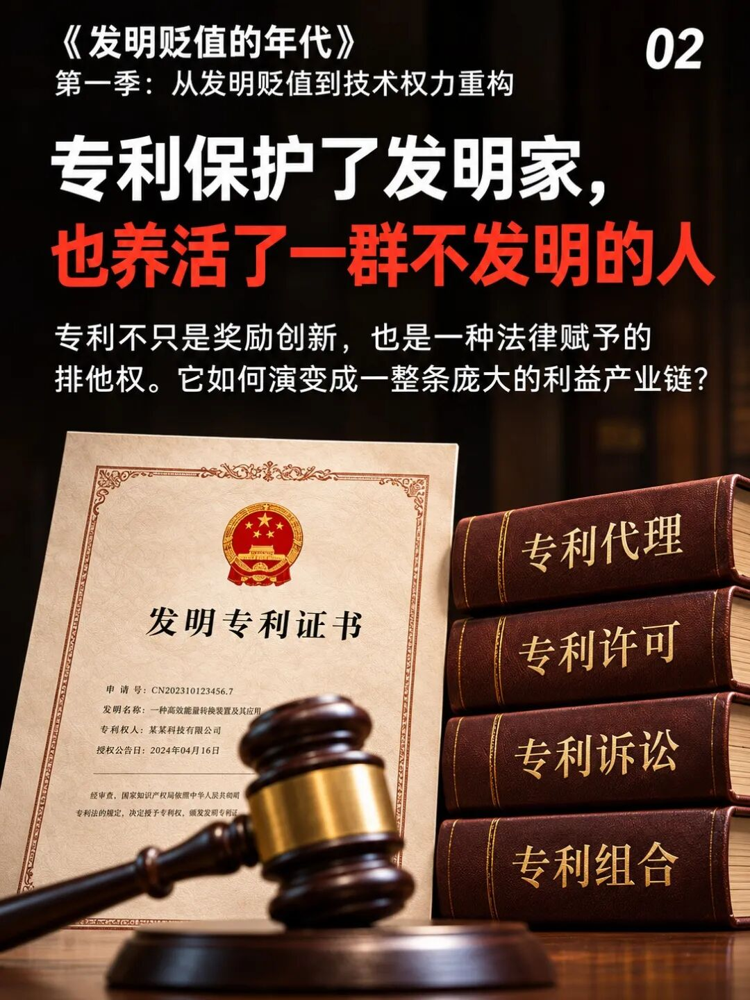
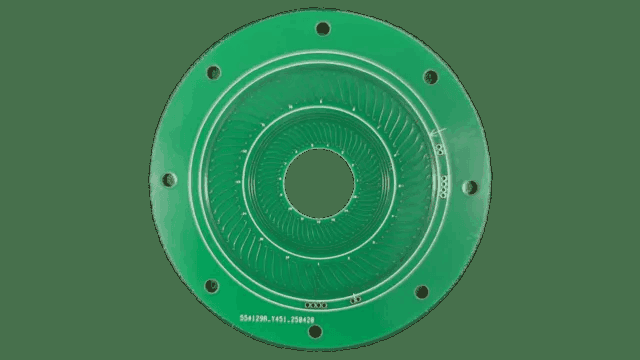

一个人没发明那项技术，也没生产相关产品，却能靠专利收钱。这件事在专利生意里，并不稀奇。

美国联邦贸易委员会在2016年发布过一份研究，调查了一类企业：从别人那里取得专利，再通过许可或诉讼获取收入。

它们经营的首先是一项权利。技术是谁想出来的，和今天谁拿着这项权利谈价格，可以是两回事。

这也是专利制度最容易让工程师困惑的地方：奖励发明的制度，为什么会养出一条并不都在做发明的产业链？

## 做出一项技术，和持有它的权利，是两件事

先看一块实物。下面是TI公开的电感编码器参考设计线圈板，它参与把旋转位置变成信号。

*图源：TI，TIDA-010961参考设计。*

工程师看到的是线圈怎么画、信号怎么读、角度怎么计算。做出这些东西，需要技术劳动。

但如果其中一项具体技术受专利保护，经营它还涉及另一组问题：权利归谁，能许可给谁，能够转让什么。

这不是在判断图中设计的具体许可状态。这个例子只是把两种对象分开：一边是能工作的实物，另一边是围绕具体技术形成的权利。

发明人能够与企业作出权利安排，专利也能够依法转让。于是，最初完成发明的人，与后来经营这项权利的人，不必始终是同一个。

**专利是一种围绕发明产生的权利，不是一张只有发明人本人才能使用的收款码。**

## 有人帮发明卖出去，也有人把争议做成生意

围绕一项发明，合理的分工很多。代理人把技术写清楚，检索人员找已有方案，律师处理争议，许可人员寻找采用方。

发明人不会卖，产品企业又找不到合适技术，中间有人把双方接上，能够创造价值。不能因为这些人不亲手做研发，就认定他们都在寄生。

麻烦在于，权利经营也能沿另一条路赚钱：对方为了处理争议，要花多少成本？如果和解更便宜，会不会干脆付钱？

FTC那份研究使用了2009—2014年的资料，涉及22家专利主张实体，并区分了不同经营模式。其中一类更依赖诉讼后取得许可。

研究指出，样本中这类许可的收入通常低于早期应诉成本的下限。这支持一种担忧：有些企业付钱，是为了少花应诉的钱，并不等于它认可对方技术有同样高的价值。

这是特定年份和样本的研究，不能据此把所有许可企业、所有专利诉讼都归为一类。它揭示的机制却很清楚：能收费，与创造了同等规模的技术价值，不是同一个判断。

## 技术做对了，还得说清权利边界

做技术的人习惯问：你比已有方法好在哪里？误差降了多少？成本省了多少？

权利争议还会问：对方产品是否落入具体保护范围，相关权利是否成立，证据怎样取得。

两组问题有关，却不能互相替代。产品做得好，不会自动回答全部权利问题；拿着一项专利，也不能只凭技术名称相同就要求别人付钱。

如果工程师只管把东西做出来，完全不理解后一组问题，就会发现自己熟悉的技术，突然被换了一套语言谈价。

企业也会犯另一种错误：只按申请件数采购服务。文件写得多，证书拿得多，看起来每一项都完成了，却没人解释这些权利究竟保护哪个产品、同行怎样绕开、实际用途是什么。

这时，最稳定的收入已经先流向了按件收费的人。研发有没有得到相应保护，还得另查。

## 钱该花，每一笔都要知道买到什么

专利专业服务不该只用“办下来没有”验收。还可以问得更具体：有没有把真正的新东西找出来，保护范围有没有依据，发现了哪些已有技术，产品面对的关键问题有没有讲清楚。

一次检索没有带来新申请，却让团队及时换方向，也能值钱。一份申请页数不多，却讲准了关键结构，也不能因为纸少就被低估。

同样，一项许可的价值，要看企业实际需要哪些权利、能省下什么成本。别把“对方愿意付钱”直接换算成“这项发明一定很先进”。

AI会帮助生成更多技术材料和申请初稿。但若企业仍只按件数评价成果，增加的首先会是文件产量，未必是技术控制能力。

我愿意保留一个很具体的问题：研发预算花出去以后，最后增加的是产品的能力，还是围绕产品收费的人？

FTC那份研究里，“许可收入低于早期应诉成本”这个比较，就值得放在“专利创造了多少价值”旁边一起看。两笔钱都真实，含义却并不相同。

**公开来源**：美国联邦贸易委员会，Patent Assertion Entity Activity，2016年研究及10月6日说明。国家知识产权局，专利申请权转让公开说明；TI，TIDA-010961参考设计。
