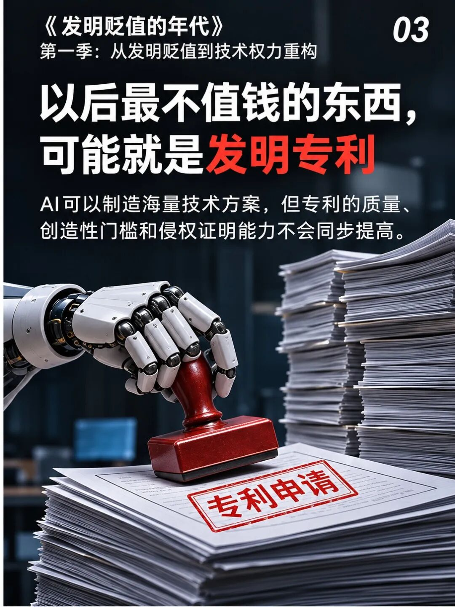

如果一家企业原来一年申请十件专利，借助AI以后能整理出一百份申请初稿，它的技术资产就涨了十倍吗？

这个问题，比“AI会不会发明”更接近企业已经在花的钱。

标题里说的“最不值钱”，针对的是一种东西：内容容易替代，却被按证书数量计价的专利。方案和文书更容易生产以后，靠数量撑起来的价值就需要重新检查。

至于真正控制重要技术、客户又确实需要的权利，不会因为别人多写了几份申请，就自动失去价值。

## 证书多了一倍，产品的账还得重算

客户买编码器，想知道角度准不准、响应快不快、能不能稳定供货。研发部门的专利数量，不会直接出现在电机的运行结果里。

专利要进入这笔生意，得再接上一步：它保护的具体办法，对产品究竟有什么用？

假设一个标定流程，每件产品总共花3秒，理想情况下每小时能做1200件。为了改善误差，再增加1秒测量，就变成每小时900件。

这是假设算例，但账很直白：多采一圈，会少做四分之一的产品。

如果一种新方法不用增加这一秒，还能达到同样验收要求，它解决的就是具体成本。若别人想绕开，又得多花这笔时间，相关权利才有值得谈的经营用途。

相反，换个算法名字、把同样内容分成几份申请，并不会自动多省出一秒。

**专利价值要接到别人需要付出的代价上，不能只接到自己的申请数量上。**

## AI拼出一个组合，法律还要继续问

AI很擅长快速列出方法组合。先滤波再查表，先测温度再修正，发现异常就换参数，转眼就是一批方案。

这确实能帮助研发起步。但一个组合值不值得申请，还得看它相对已有技术做出了什么。

2007年，美国最高法院在KSR诉Teleflex案中，审理过可调汽车踏板与电子传感器的组合争议。

争论的关键不是“两样东西能不能装在一起”，而是面对当时的问题，这种组合是不是本领域技术人员容易想到的做法。

这个案件不能直接决定某套编码器算法的结论。它提醒的是：把已知部件写进一份复杂文件，不会自动长出很强的排他权。

但也不能反过来说，部件都见过，组合就没有创新。困难常常在配合关系里：同样要修正误差，怎样少用存储，怎样减少运算，怎样在转速变化时继续工作？

这些具体改变，需要被写出来、证实，而不是被“采用智能算法”遮过去。

## 把最好的样品挂在墙上，也替不了量产

专利里提出了改进，产品又做出了一个好样品，仍然没走完这条链。

客户要的通常是一批货。接下来的芯片、装配和测试，能否稳定达到要求，决定了这项技术能服务多大范围的生意。

*图源：NIST工程统计手册。两侧竖线是规格边界，中间曲线表示过程值的分布。*

看这张图，可以把两根竖线当成门柱。一批产品的结果散得太开，会出界；结果整体偏向一边，也会更靠近一侧边界。

工厂常用的Cpk，描述的是在过程已经稳定等条件下，结果离边界有多少余地。它不是证明一切的万能分数，却比“最好的一颗有多好”多看了一层。

某项权利能创造多少经营收益，离不开它所服务的真实产品和真实需求。稳定交付把技术效果接到了客户订单上，也给相关权利提供了具体的使用对象。

量产能力不会自动变成专利权，专利权也不会自动补齐量产能力。两者需要接上，不能互相冒充。

## 越容易生产的成果，越不能只按件数奖励

如果技术人员的考核仍然是“每年交多少件申请”，AI会让这项任务更容易完成。

但文件变多以后，检索、审查、维护、比较的工作也跟着来。企业不只是在增加资产，也在增加需要继续付钱管理的对象。

有些申请值得保留，因为保护了在用产品；有些是未来路线储备；有些用于许可或应对争议。用途不同，评价方法也应该不同。

不能回答用途的那部分，先把问题留在纸上。别用“技术储备”四个字，给所有空白自动盖章。

这个标题不是宣布专利制度即将失效。我的担心是：当方案和初稿更容易取得，企业却还用旧办法奖励数量，最先增加的会是最好生产的那类成果。

下次评审一项专利，不妨在证书旁边放一张产品账：保护了哪种办法，解决什么需求，别人不用它要多付出什么。

那一秒究竟省没省下来、1200件还是900件，是能追问的。相比之下，“今年又多申请了十件”，只回答了文件有多少。

**公开来源**：美国最高法院，KSR International诉Teleflex，550 U.S.398，2007年；NIST/SEMATECH，过程稳定性与过程能力工程统计手册。
