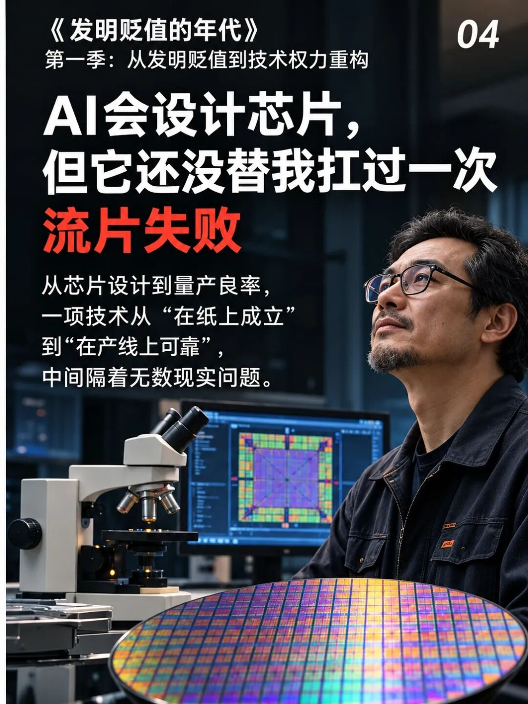
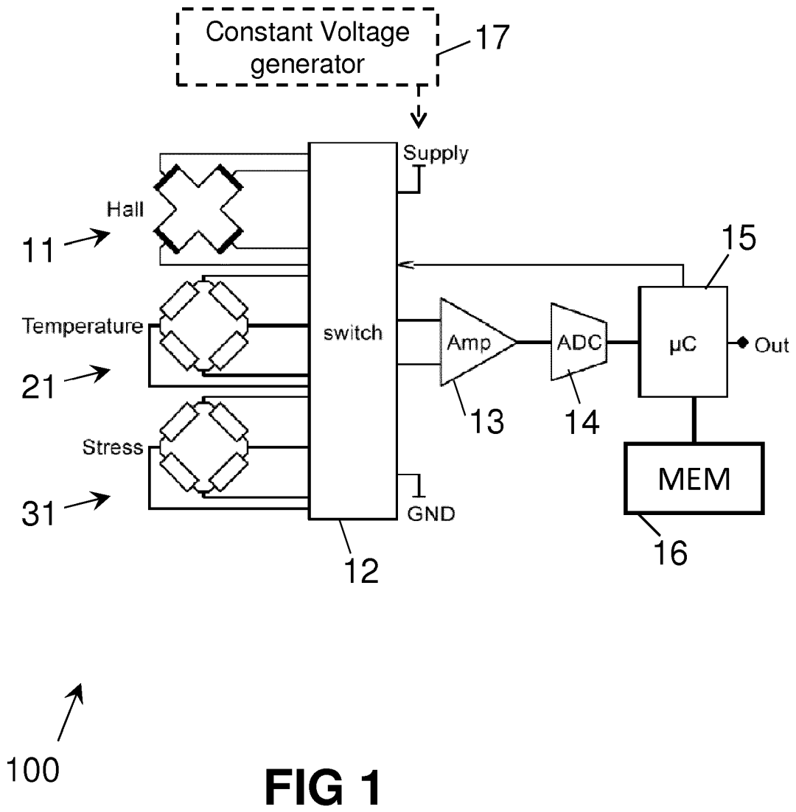

芯片设计有一道很贵的分界线：电脑里改错，和硅片做出来以后改错，代价完全不同。

前者能继续调整、重跑验证。后者往往要连着改设计、重新制造、重新测试，还要解释为什么交付又晚了。

AI把设计过程加快，是好事。但如果团队因此更快地走到制造环节，却没有更早发现错误，节省的前期时间就会被一次返工吃回去。

我在意的是这笔账。设计快了多少，要和失败一次会付出什么放在一起看。

## 屏幕里正确，只回答了模型里的问题

用磁编码器举例。编码器负责读电机转角，程序可以修正一些测量偏差。

在仿真里，传感信号长什么样，噪声多大，温度怎样影响结果，都由设计者先给出条件。程序在这些条件下通过，只说明它回答了所设定的问题。

实际芯片却还要面对制造差异、封装、装配和环境。哪个影响没被纳入模型，就有机会在样片上重新出现。

这也不是说仿真没有用。恰恰相反，模型里能提前发现的错，越早找出来越便宜。需要防的是把模型没覆盖到的事情，也顺手写成“已经验证”。

## 少了一项信息，多写几百行代码也不够

假设一颗编码器室温下读数正常，温度升高以后，整圈角度都多报0.1°。这里的0.1°是讨论用的数字。

它像一块刻度盘：各条刻度之间的距离没变，整块盘相对轴转了一点。

如果程序只知道这块盘自己的读数，不知道外部方向，就得先问：它有没有足够的信息判断整体偏了？

这时，增加修正表点数，未必是在补真正缺的东西。对一个信息不足的问题，代码写得更细，也不能保证得到正确答案。

Melexis公开的一件应力和温度补偿专利，提供了一个具体对照。

*图源：Melexis，EP3109658B1图1。左侧有Hall、Temperature、Stress三类测量信息。*

霍尔传感器感受磁场。图里除了磁场，还把温度和应力相关信息送去处理，给修正提供额外依据。

这相当于给受热会变化的尺子添了一项测量。原来只能看见“量错了”，现在开始知道哪些状态在影响它。

专利展示了具体思路，不能据此认定所有温漂都能修好。它真正有启发的地方，是把原来缺少的信息，当成设计里要解决的问题。

## 一次试验，最好能排除一种原因

读数随温度变化，原因也得分开查。传感器在变，固定它的结构在变，或者参考仪器的零位在动，都会影响比较结果。

可以把温度升上去再降回来，比较同一温度的读数。如果不一样，说明只知道当前温度还不够，还得继续查之前的状态。

也可以固定温度重新安装，看看偏差是否跟着装配变化。或者保持安装不动，等待后再测，检查读数是否仍在缓慢变化。

每次试验都在区分不同原因。一次把好几项全改掉，结果即使变好了，下一次也不容易复现。

制造以前没弄清的因果关系，不会因为设计文件交出去了，就停止影响产品。它们留到硅片上再暴露，团队就得承担更贵的修正。

## AI省下来的时间，值得先花在这里

增加一种测量结构，要占面积、耗电，还会增加测试工作。只改算法，也要说明原来的信息为什么够用。

工程决策要比较这两边。不能只看哪种方案更快生成，也不能为了展示“全靠算法”，把必要的信息取得步骤省掉。

AI可以协助找反例、生成测试、分析数据。越能帮忙，团队越应该利用它提前挑战那些关键假设。

如果一次返工主要来自没有覆盖某个温度或安装状态，那么更快地生成一套新算法，并没有自动解决这个教训。下一版应当补上能暴露问题的验证。

标题说“扛过失败”，指向的是后果由谁承担。制造费用、延期、客户解释和下一次决策，最终都需要具体的人和组织接住。

一项技术是否值得投片，不能只展示最漂亮的成功曲线。还应交代测了什么、没测什么、哪些问题一旦判断错误，就要付出重新制造的代价。

Melexis那张框图里，多出来的温度和应力信息，是可以检查的设计动作。类似这样的动作，比一句“AI已经把设计完成了”，更能帮助团队作出投片决定。

**公开来源**：Melexis，EP3109658B1，2021年授权文本；Udo Ausserlechner等，机械剪切应力影响霍尔器件的公开研究，2020年。
