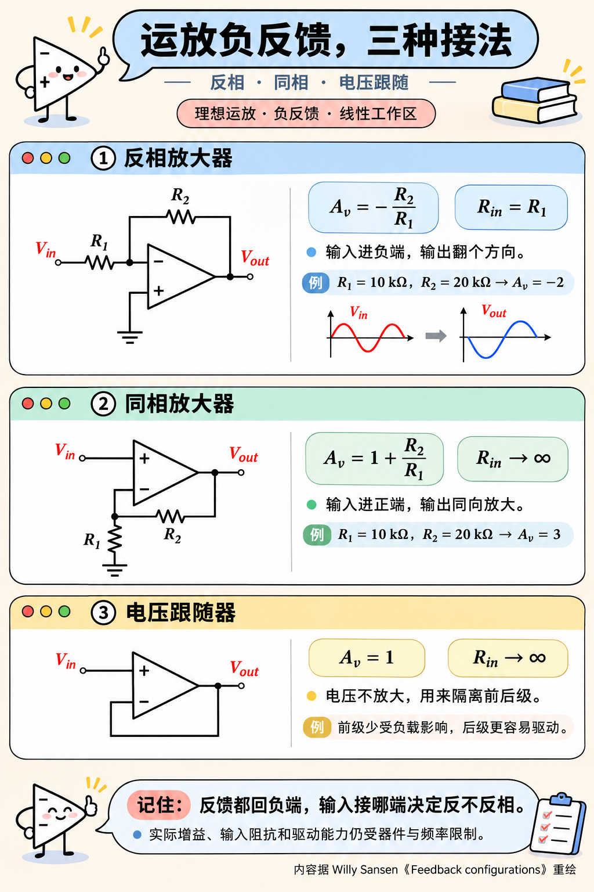

反相放大器常用，核心原因是它能把运放输入端稳在一个近似固定的电位，方便用反馈网络处理信号。

看图中第一种接法，正端接地，负反馈让负端也接近零伏，形成“虚地”。输入电压经过R₁变成电流，输出通过R₂平衡这股电流，增益就由−R₂/R₁决定。多接几路输入电阻，就能做加权求和；

在反馈里加入电容，还能做积分和滤波。运放输入端的共模电位也基本不随信号变化，有利于减少相关误差。这些特点，让反相结构在模拟信号处理电路里很常见。不过，它会通过R₁给前级增加负载，噪声也不一定更低。

图中第二种同相放大器输入阻抗高，适合放大不宜被加载的电压信号；

第三种电压跟随器增益为1，适合缓冲和隔离前后级。

三种接法都用负反馈，具体选哪种，取决于这一级要完成什么任务。
