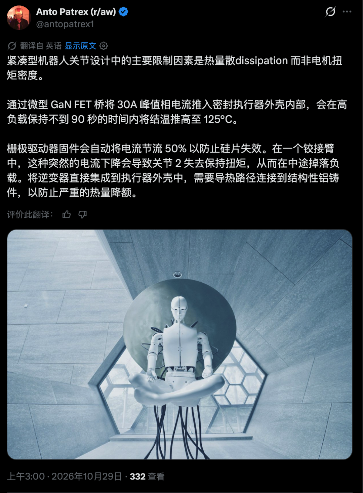

有人把机器人关节的热问题写得很具体：微型氮化镓功率级被装进密封壳体，在约30 A峰值相电流工况下运行，不到90秒便达到约125℃的结温估计或保护阈值，随后固件把电流上限降低约一半，以避免功率器件继续升温。

这组数字来自公开帖子，不是本文复现的台架结果。目前还不知道125℃是片上测得的结温、热模型估算值，还是固件采用的保护阈值；也缺少母线电压、相电流RMS值、开关频率、负载占空比和具体散热结构。

但它提出了一个值得单独检查的问题：

**关节触发热降额以后，位置环还能不能按原轨迹运行？**

2026年10月28日，@antopatrex1 发帖给出约30 A、不到90秒、约125℃以及电流上限降低约50%等描述。

能够确认的是，该账号公开提出了这一组工程判断。尚不能确认的是：它对应哪一款关节、哪种试验边界，以及125℃的取得方式。原帖也没有给出编码器在同一热轨迹下的位置漂移数据。

因此，这组数字适合作为验收问题的入口，不能直接当成某款量产关节已经验证的性能曲线。

## ▶ 限流保护了功率器件，不保证轨迹不受影响

电机能够输出的力矩通常受到电流限制。固件降低电流上限后，关节的可用力矩范围也会随之收缩。

这不代表限流一发生，位置误差就必然变大。

如果实际负载和轨迹所需力矩仍低于降额后的能力，关节可能继续正常跟随；如果原轨迹的加速度、外载或保持力矩需求超过新的上限，位置环即使继续增加控制指令，也无法得到原来那么大的驱动力矩，跟随误差便可能上升。

因此，验收不能只记录“是否触发过温保护”，还要把下面几项放到同一条时间轴上：

功率级、PCB、壳体或其他温度测点；

限流触发时刻及解除时刻；

限流前后的电流上限和实际相电流；

目标位置、实际位置及跟随误差；

当时的速度、加速度、外载和工作姿态。

**热降额是器件保护策略，不是轨迹保持承诺。**

## ▶ 磁体变弱，不等于编码器零位同比漂移

温升不仅影响功率器件，也可能传到磁体、位置传感器、PCB、支架和轴系。

公开磁材资料显示，NdFeB磁体剩磁的可逆温度系数常见量级约为−0.09%～−0.11%/K，具体数值取决于牌号和工作点。这意味着温度升高时，磁场强度通常会下降。

但这里不能直接画等号：

**磁场幅值变化，不等于编码器角度或零位按相同比例变化。**

磁角度传感器通常根据两个正交磁场分量计算方向。如果两个分量随温度同比缩放，理想的比值解算结果可以保持不变；部分传感器还会通过自动增益控制补偿温度和磁场强度变化。

真正可能改变角度结果的因素包括：

传感器通道失调、增益失配及其温漂；

磁体与芯片之间的气隙、偏心或倾斜发生变化；

磁体、支架、PCB和轴系的热膨胀不一致；

局部温度梯度使正交通道不能同比变化；

磁体接近工作温度或工作点边界，出现不可逆磁性能损失；

原有室温标定参数不足以覆盖实际温区。

所以，磁体温度系数只能说明磁路会随温度变化，不能代替编码器全温角度测试。

## ▶ 壳温、芯片附近温度和结温不是同一个数

密封壳体如果缺少通向外壳或机器人机架的低热阻导热路径，内部功率器件可能已经很热，而壳外空气和部分壳体表面仍没有同幅度升温。

测温时至少要写清楚测到的是什么：

环境空气温度；

关节外壳表面温度；

PCB近功率器件温度；

位置传感器附近温度；

磁体附近温度；

器件内部温度遥测或根据热模型估算的结温。

贴在器件附近的热电偶测到的是附近温度，不等于半导体结温。壳外测点更不能直接代表密封腔内部所有敏感元件的温度。

如果报告只写“关节温度125℃”，却不说明测点、测量方式和估算模型，这个数字无法复核。

## ▶ 热—位置联测应该怎样写

可以把热过程中的位置表现拆成两类。

第一类是温度导致的位置测量变化：

静止保持时，编码器零位读数是否随温度变化；

在若干已知机械角度下，角度误差如何随温度变化；

升温与降温过程是否重合，是否存在热滞回；

断电重启或温度循环后，零位能否回到原值。

第二类是热降额导致的运动跟随变化：

限流前后的最大跟随误差；

限流触发瞬间是否出现误差跳变；

不同速度、加速度、外载和姿态下是否仍能完成轨迹；

降温解除限流后，性能是否恢复；

反复热循环是否改变保护阈值或位置结果。

测试还应区分三个阶段：

功率级正在升温，但尚未限流；

已经限流，关节能力下降；

降温恢复，限流解除。

这样才能判断偏差究竟来自位置反馈的温漂，还是来自电流受限后力矩不足。两者可能同时出现，但不能只看一条位置误差曲线便混在一起解释。

## ▶ “全温可用”必须写清楚适用边界

“全温可用”至少应说明：

环境温度范围；

关节内部允许温度或相关测点上限；

连续电流、峰值电流及允许持续时间；

壳体、散热界面和安装姿态；

负载、速度、加速度及工作循环；

热降额曲线和恢复条件；

全温范围内的位置误差及跟随误差限值。

系统不一定必须永久安装多个温度传感器。如果供应商已经给出覆盖实际安装、负载和温区的验证证据，也可以据此验收。

但在缺少适用的全温规格、温度记录或热—位置联测结果时，不宜把25℃条件下的编码器精度和关节性能直接外推到密封、高负载工况。

**没有热轨迹，就不知道位置指标是在什么温度下成立；没有限流记录，也不知道误差变大时关节还剩多少力矩。**

## 如是证据

@antopatrex1 公开帖：讨论密封关节的热耗散约束，并给出约30 A、不到90秒、约125℃和电流上限降低约50%等表述，具体含义以原帖为准。

信越化学磁材术语资料：NdFeB剩磁温度系数常见量级约为−0.09%～−0.11%/K。

ams OSRAM AS5173数据手册：说明传感器利用CORDIC计算磁场矢量的角度和幅值，并使用AGC补偿温度及磁场变化。

尚不清楚：原帖对应的具体产品、台架配置、125℃的测量或估算方法，以及编码器在同一热轨迹下的漂移数据。

图片与来源：正文图片为公开配图及账号既有主人公图。

## 有为行动

① 把温度、电流上限、实际电流和位置跟随误差记录在同一条时间轴上。 ② 分别测试“升温未限流”“已经限流”和“降温恢复”三个阶段。 ③ 区分环境温度、壳温、近器件温度与结温，不用一个“关节温度”混写。 ④ 磁材温度系数只能作为磁路输入，不能直接换算成编码器零位漂移。 ⑤ 缺少适用工况下的全温证据时，不把25℃指标直接外推到密封关节。

**如是有为｜网站 SENSOR.FANS**
