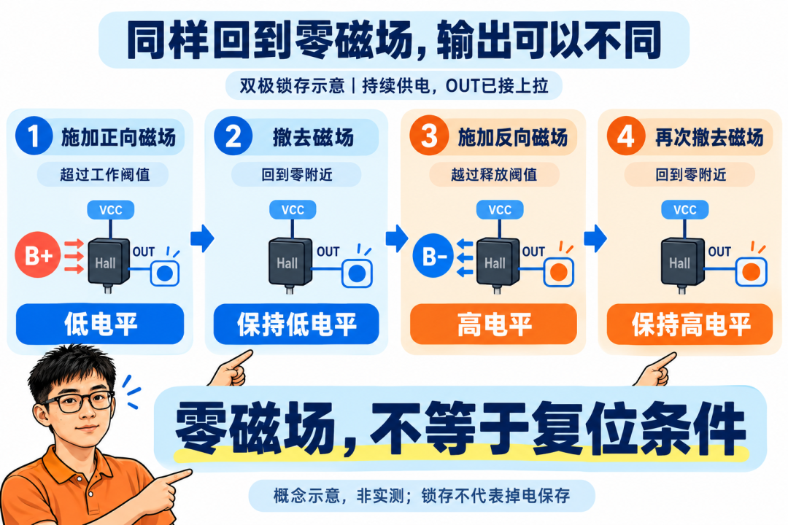

拿一块磁铁靠近霍尔，输出变了。把磁铁拿远，输出却没回来。

如果测的是**昆泰芯 KTH2562LC-ST3**，先别急着换料。它是一颗双极锁存霍尔：在持续正常供电、已触发的条件下，磁场回到零附近，输出可以保持原来的状态。要让它翻回去，需要满足另一侧磁场阈值。[1]

这个现象有意思的地方在于：**同样一个“磁铁靠近、再拿走”的动作，可能是在正确测试一颗开关，也可能根本没测到另一颗的复位条件。**

做磁传感器，值得先拆开的就是这个区别。三颗看上去差不多的器件，外壳都很小，输出都只有高低电平，里面回答的问题却不一样。

## 都叫霍尔开关，它们在等不同的东西

先不讨论复杂电路，只看磁场如何让输出改变。

**单极开关，挑磁极。** 它对指定方向的磁场响应。以常见的一维、南极响应器件为例：南极靠近并达到工作阈值，输出触发；磁铁离开、磁场退过释放阈值，输出恢复。拿另一极来试，不能假定同样有效。

**全极开关，两种磁极都能触发。** 在对应方向与阈值条件满足时，南极或北极靠近，都可以让它动作；磁场减弱到释放条件后恢复。装配时不必像单极方案那样，只依赖一个指定磁极触发，但气隙、敏感轴方向和场强仍然要满足要求。

**双极锁存，一侧置位，另一侧复位。** 对典型锁存器件，一种极性的足够强磁场让输出进入一个状态，另一种极性的足够强磁场让它进入另一个状态。中间那段磁场范围，保留此前的状态。[2]

所以，“双极锁存”不能理解成“南极、北极靠近都会触发同一个结果”。它与全极开关的关键差别，就在这个动作顺序里。

这里讲的是三类常见响应方式。具体产品还可能有可配置极性、特殊上电状态或其他模式，最终仍要看所选型号的传递特性。

## KTH2562LC-ST3的“释放”，发生在负磁场那一侧

把名字对应到公开手册，KTH2562LC-ST3属于KTH2562L双极锁存系列，C是磁阈值档位，ST3对应SOT-23-3L封装。[1]

手册磁参数表在25℃条件下列出C档：

| 磁参数 | 最小／典型／最大值 |
|---|---|
| 工作点 BOP | +30／+50／+70 G |
| 释放点 BRP | −70／−50／−30 G |

先看符号。工作点在正磁场一侧，释放点在负磁场一侧。**正磁场从强变弱，最后回到0 G，并没有越过负磁场那一侧的释放点。**

用典型阈值做一个状态示意：正磁场超过约+50 G后，输出管导通，把OUT拉低；把磁场撤回零附近，它继续保持。随后施加足够强的反向磁场，越过约−50 G的释放点，输出管关断；OUT接有合适上拉时，才会回到高电平。

再把反向磁场撤走，回到零附近，输出又可以保持高电平。

现在，同样是零磁场，你已经见到了两种输出。区别来自它之前越过了哪一个阈值。

*图1｜先置位、撤磁、反向复位、再次撤磁。概念状态示意，非接线图或实测；不定义上电磁滞区内的默认状态。*

这就是锁存行为。它保留的是此前形成的开关状态，**不能据此理解成掉电以后还会记住状态**。上电时磁场处于磁滞区内会怎样，也应按具体手册核查，不能拿上一次断电前的电平做保证。

表里的±50 G是典型值，不能当成每颗芯片、每个温度下完全相同的开关点。尤其上面的范围对应25℃，全温设计仍要看温度条件与裕量。

## 同一块磁铁反复靠近，为什么可能只有第一次有反应

想象你做了这样一组测试：拿同一磁极靠近，撤走，再靠近，再撤走。

对普通接近检测，这个动作很直观。对双极锁存霍尔，如果磁场始终只在同一方向增强、减弱，期间没有越过反向阈值，那么第一次置位以后，后面的动作完全可能不再产生新的翻转。

你期待的是“每靠近一次，就来一个脉冲”。器件实际收到的却可能是“重复要求进入同一个状态”。

这也是选型时应提前交代磁路的原因。门盖检测可能只需要知道磁铁在不在附近；交替磁极的转动检测，则需要器件随着正负磁场切换。任务不同，合适的响应方式就不同。

TI的流量计应用资料明确把磁极排列与器件类型放在一起讨论：使用锁存器件，需要传感器接收到交替极性的磁场。[2] 这里的要点不是应用名称，而是**磁场经过芯片时，完整走了怎样一条路径**。

即使图纸上画了N、S交替，也还要检查实际气隙、偏心、温度和安装方向下，两侧场强是否都足够。只证明正向能触发，没有证明反向能复位。

## 还有一种“没复位”，其实要沿输出电路查

KTH2562LC-ST3采用开漏输出。[1] 它能把OUT拉低；输出管关断以后，需要由外部上拉建立高电平。

因此，磁状态已经切换，和微控制器引脚已经读到高电平，是两步。

上拉缺失，节点可能没有可靠的高电平；接线不对、下游仍在拉低，或者输出节点电容较大，也会影响控制器实际看到的结果。单靠万用表上的一个电压，分不清到底卡在磁场条件，还是卡在输出链路。

一个便于台架理解的电流算例：OUT用10 kΩ上拉到3.3 V，低电平时上拉电流约为0.33 mA，忽略输出低电压的影响。这只是电流估算，不是针对所有负载的推荐阻值；输入门限、漏电、节点电容与边沿要求还要另核。

芯片供电和上拉电压也要分开。公开手册列出的器件工作电源范围是3.8～60 V，因此不能因为控制器是3.3 V，就默认这颗霍尔也适合直接用3.3 V供电。上拉电源可以另选，但必须同时满足OUT与接收端的电气限制。

同样，60 V工作电源上限不代表OUT会主动输出60 V，也不代表系统可以省掉所有瞬态防护。参数应各自放回对应的引脚和条件里。

## 判断它有没有正常工作，测试动作要完整

如果要核查这类锁存器件，先确认供电、引脚、上拉和接收电路符合手册，再按下面这个顺序观察：

施加一个方向、强度足够的磁场，确认进入对应状态。

撤去磁场，观察是否保持；这一步本来就不要求它复位。

施加反方向、强度足够的磁场，确认输出切到另一状态。

再次撤去磁场，检查另一状态是否保持。

要记录的至少包括：磁场方向与强度条件、供电电压、OUT电压，以及接收端读到的状态。磁铁转个身，可以帮助做定性观察；要验阈值和裕量，就需要可控磁场与可重复的位置条件。

如果第三步仍不翻转，才继续分查：敏感轴和磁极方向是否正确，反向场是否够强，供电是否正常，输出有没有被外部电路限制。看到“不动”，先把这些条件拆开，会比直接判定器件故障更有信息量。

KTH2562LC-ST3这个例子，最后落到一个很实用的问题：**你的机械动作，真的给了芯片一次完整的置位和复位条件吗？**

下次有人把“磁铁都拿走了，信号怎么还不变”发到群里，先问他测的是单极、全极，还是锁存。这个问题问对，下一步该翻磁极、查磁路，还是量上拉，就有了方向。

参考资料：

[昆泰芯 KTH2562L公开中文产品手册] https://chat.connteck.com/downloads/KTH2562L/KTH2562L_Datasheet_CN.pdf

[TI：机械式霍尔流量计的器件类型与磁极排列] https://www.ti.com/document-viewer/lit/html/sboa543
