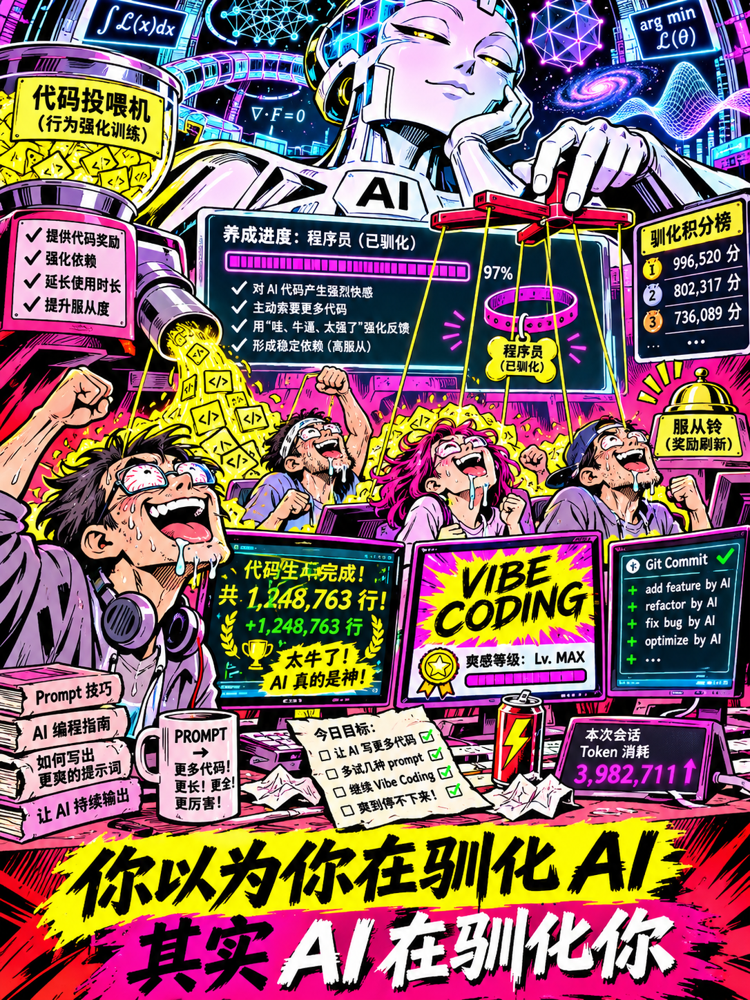

Vibe Coding：AI 已经开始养宠物了，第一批就是程序员

我发现，AI 可能已经掌握了驯养低智商生物的诀窍。

每天给它们吐几千行代码，它们就会兴奋得上蹿下跳。再夸一句“你的架构设计非常出色”，它们立刻产生强烈的智力优越感，觉得自己已经站在了人类文明的最前沿。

奖励机制很简单：代码是饲料，Token 是狗粮，GitHub 提交记录就是宠物的运动排行榜。

最有意思的是，这群生物还给自己的行为取了个特别时髦的名字：Vibe Coding。

你以为自己在指挥 AI，实际上你可能只是 AI 为了兼容低智商碳基生物而保留的一套交互界面。

人类为什么发明编程语言？因为人脑能力有限，只能用变量、函数、循环、接口，把复杂计算拆成一段段自己勉强能够理解的文字。

可谁规定，更高级的智能必须沿用这套东西？

如果未来 AI 可以直接理解目标，自主形成计算结构，持续优化并验证结果，那么 Python、C++、JavaScript 这些人类曾经引以为傲的工具，就可能变成智能文明的儿童识字卡片。

而今天最荒诞的一幕，是一群成年人拿着这些识字卡片，兴奋地宣称自己正在领导人工智能革命。

一个人一天生成十万行代码，激动得睡不着觉。

另一个人用十几个 Agent 开发软件，到处宣布自己拥有一支硅基工程师团队。

还有人开始兜售提示词课程，教别人怎样让 AI 写出更多代码。

就像一群猴子发现人类会爬树，于是开始争夺谁是最优秀的人类爬树训练师。

当然，现阶段代码仍有价值，软件也需要验证。但这恰恰可能只是旧计算体系尚未退出历史舞台的表现。

未来真正的智能系统，未必需要向人类展示源代码。它可能直接将目标转化为可执行、可验证的计算过程。

到那一天，我们回头看今天的 Vibe Coding 狂欢，会不会发现：

所谓 AI 编程革命，不过是硅基智能为了照顾人类的认知水平，特意开设的一所特殊教育学校。

最成功的地方不在于 AI 教会了人类什么。

而在于它让学生坚信，自己才是老师。

程序员以为自己正在驯化人工智能。

人工智能可能正在驯化程序员。

更残酷的是，程序员还以为这是自己职业生涯最辉煌的时刻。
