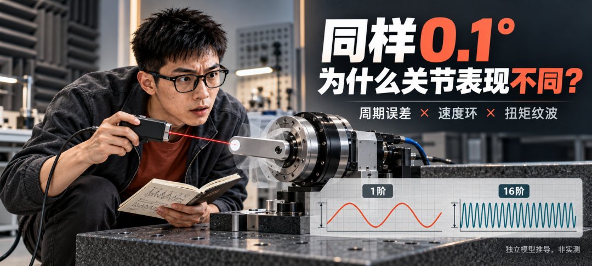
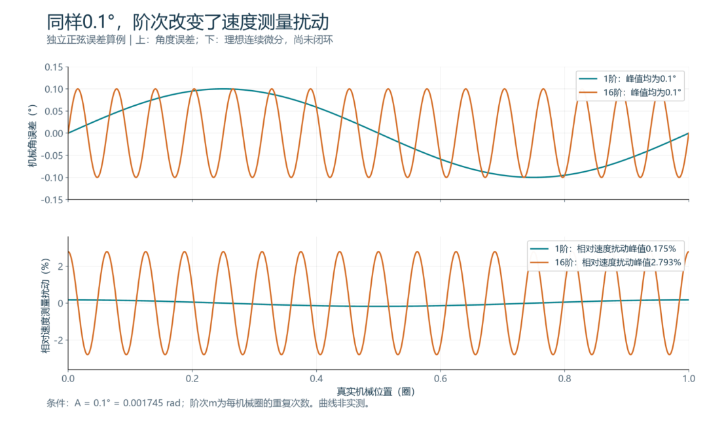
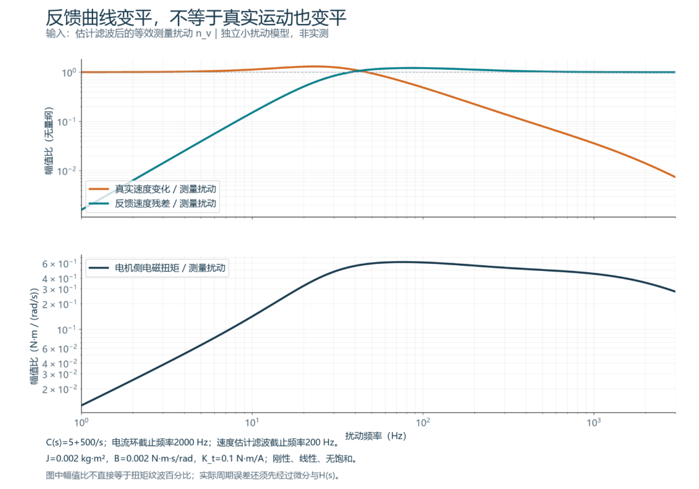

两颗编码器，角度误差峰值都是0.1°。

一颗每机械圈起伏一次，另一颗起伏16次。只比较最大角度误差，它们一样。把位置拿去估速度，两者制造的扰动就有了16倍的差别。

但这还不能直接写成“第二颗让电机抖得更厉害”。扰动进入速度环以后，还要经过控制器、电流环和机械对象。

**同样0.1°，为什么不能用同一笔动态误差预算？** 这条链值得从头算到扭矩指令。

以下用独立的正弦误差与线性模型说明机理，不对应任何产品或客户实测。所有角度先统一到电机机械轴；减速器输出端的扭矩与运动，还要另计传动比、柔性和回差。

## 误差求一次导，机械阶次就乘了进来

设真实机械角为θ，编码器测到的是：

A是角度误差的**峰值**，计算时用弧度；m是每机械圈重复的次数，也就是机械阶次。它不是电机极对数。

假设没有噪声、延迟和滤波，直接对位置连续求导：

因此，在转速非零时：

右侧的峰值是Am。角度误差相同，阶次越高，理想微分产生的相对速度测量扰动越大。

把0.1°换成约0.001745 rad：

| 角度误差峰值 | 机械阶次m | 理想微分后的相对速度扰动峰值 |
|---|---|---|
| 0.1° | 1 | 约0.175% |
| 0.1° | 16 | 约2.793% |

这里算的是**测量多出来的速度分量**，不是轴已经真的快慢了这么多，更不是扭矩已经起伏了这么多。

*图1｜独立计算：两条角度误差的峰值相同，连续微分后的相对速度扰动峰值相差16倍。未加入速度估计滤波和闭环响应，不是实测。*

实际控制器会差分、测周期、滤波或使用观测器。这些方法有各自的动态响应，不能把理想连续微分的结果直接塞进任何一台驱动器。

但这一步已经解释了一个问题：**单独一个角度误差峰峰值，没有交代误差沿机械角变化得有多快。**

## 阶次跟着轴走，频率跟着转速走

匀速时，每圈重复m次的误差，对应频率为：

n的单位是rpm。

| 电机转速 | 1阶误差频率 | 16阶误差频率 |
|---|---|---|
| 300 rpm | 5 Hz | 80 Hz |
| 3000 rpm | 50 Hz | 800 Hz |

所以，理想微分中的相对扰动幅值Am不显式依赖转速，不等于系统后果与转速无关。

同一条16阶误差，从80 Hz移到800 Hz，速度估计滤波、控制器和机械系统对它的响应都要重算。高阶也不等于永远在速度环带宽之外，必须把当时的转速代进去。

HEIDENHAIN的公开文章指出，插值误差会影响速度稳定性，速度控制器会根据误差曲线产生加速或制动电流。Renishaw的公开资料也将细分误差与速度纹波联系起来。这些资料支持问题本身，但不替某台关节给出纹波幅值。HEIDENHAIN选型说明；Renishaw编码器问答

## 控制器接下来，究竟在追什么

真实转速本来恒定，测量却报告“这一段快了，下一段慢了”。速度控制器会按自己的控制规律修正电流指令。

要算清修正产生的后果，可以围绕恒速工作点，建立一个小扰动模型。

令H(s)是理想微分之后的速度估计滤波；周期角度误差经微分和滤波，形成等效测量扰动nᵥ：

这里的(\mathcal E(s))表示沿名义运动轨迹出现的周期角度误差。在线性化中，先把它作为测量端扰动，忽略它与速度扰动之间的高阶耦合。

再令C(s)是速度控制器，输出q轴电流指令；P(s)是从该电流指令到真实转速的对象，包含电流环和机械响应。

以下传递式中的ω、ω̂与电流指令，均表示工作点附近的小扰动分量；不是把运行中的电机设成零速。

反馈速度为：

当速度指令的小扰动为零，速度控制器输出满足：

把两式代回去，就能得到：

这三个式子分别回答：控制器发出多少电流修正、轴真的产生多少速度变化、反馈曲线上还留下多少扰动。

**它们不是同一个量。**

在环路增益足够大的频段，反馈残差能被压得很小。为了抵消测量端多出来的分量，真实速度却会产生反向变化。这里的“反向”指速度的小扰动相位，不是电机整根轴反转。

这就是一个需要警惕的结果：

反馈速度曲线很平，不足以单独证明轴转得很匀。

*图2｜独立线性模型。上图比较同一测量扰动引起的真实速度变化和反馈残差；下图给出扰动到电机侧电磁扭矩的传递幅值。曲线是模型计算，不是关节实测；参数及符号见正文。*

## 从电流指令到扭矩，还差一个电流环

若在所分析的工作点附近，可将电机侧电磁扭矩小扰动近似写成：

其中Kₜ是该工作点的有效扭矩常数，Gᵢ(s)是q轴电流环的闭环响应，则：

把nᵥ的来源也接回来，角度误差到扭矩的通路就是：

**角度误差、求导、速度估计、速度控制、电流响应，最后才轮到扭矩。** 只拿Am就报扭矩百分比，跳过了中间这些环节。

图2采用一组明确的演示参数：

控制器的比例与积分系数，按输入rad/s、输出A定义。此模型假设刚性惯量、工作点附近近似线性，无饱和，也未加入机械柔性、离散延迟和位置外环。

这些参数用于展示通路，不代表推荐的调参值。换一组控制器、惯量或估计器，曲线就会变。实机有柔性模态时，还得把相应频响放进P(s)。

## 怎样知道电流里的那根谱线，来自编码器

先看电流指令，能知道速度控制器正在要求什么；再结合电流反馈，判断电流环跟随到了哪里。但这两条信号都不是编码器周期误差的唯一证据。

机械负载波动、齿槽转矩、逆变器非线性，也会产生周期分量。它们与编码器误差的阶次还能重合。

把Hz换成“每机械圈重复几次”，有助于比较不同转速，却不会自动把所有根因分开。某条谱线跟着转速按比例移动，只确认它与旋转同步，还不足以确认来自哪个部件。

更有说服力的验证，应同时保留独立机械参考、编码器原始角度、速度估计、电流指令和电流反馈，并对齐时间基准。

用多档恒速观察谱线怎样迁移，再改变速度环或估计滤波参数，检查响应是否符合模型。若有独立校准得到的角度误差图，也能检验该阶次在修正前后的变化。变化支持一条因果路径，不代表其他同阶次扰动已经排除。

同样，“电流反馈很好看”不能一概当作无事发生。反馈会跟着指令变化；即使指令跟随很好，也没有单独证明机械速度恒定，更没有排除角度坐标变换的另一条误差路径。

本篇只拆速度反馈通路。角度误差怎样进入电角度变换，还与极对数、电机模型和运行点有关，不能拿这里的结果包办全部影响。

## 下次比较编码器，把误差曲线也要过来

对关节控制来说，“最大误差0.1°”仍然是有用指标。但如果要判断运行中的影响，评估资料还应包含：

| 需要的资料 | 要回答的问题 |
|---|---|
| 原始误差随机械角的曲线 | 误差主要集中在哪些机械阶次？ |
| 峰值、峰峰值或RMS的定义 | 比较的是否是同一种幅值口径？ |
| 转速与采样条件 | 阶次对应多少Hz，差分和采样是否足够？ |
| 速度估计方法与滤波响应 | 位置误差经过估计后还剩多少？ |
| 速度环、电流环与机械频响 | 剩下的扰动怎样变成电流、扭矩和运动？ |
| 独立参考的动态测量 | 自己的反馈变平以后，轴是否真的更稳？ |

选型要比较的是误差与系统的组合。提高分辨率、降低峰峰值、增加滤波，各自都要通过这条通路再算一遍。

**同样0.1°，先问它每圈出现几次，再问它进入了怎样的控制环。** 到这一步，编码器的精度数字才开始变成关节的动态表现。
