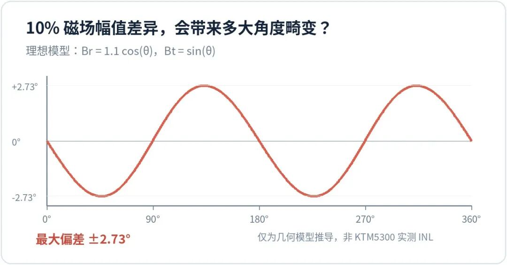
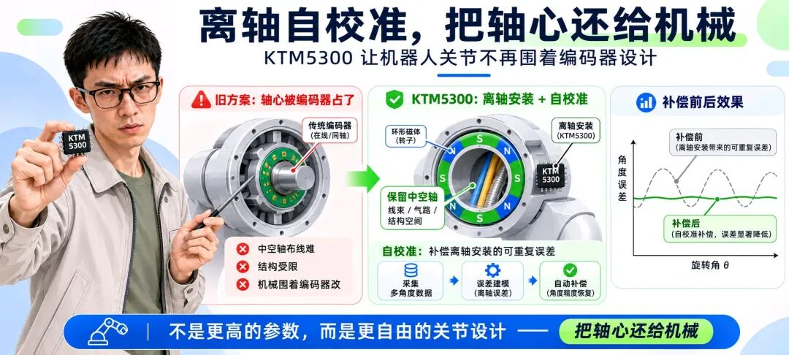

如 是 有 为 / ENGINEERING NOTES

磁编码器 · 机器人关节 · 工程判断

DEVICE STUDY / KTM5300

机械工程师辛苦做出一根中空轴，不该最后再为了编码器改掉结构。

| CORE RESOLUTION21 bit核心角度分辨率 | CALIBRATED INL±0.02°典型值，指定条件 | ANGLE MAP64 点周期角度补偿节点 |
|---|---|---|

机器人关节中间那点地方，越来越贵了。

减速器要空间，线束要穿过去，电源和通信要走线，有时还要给气路和其他机构留通道。偏偏传统磁编码器喜欢把磁铁和读头安排在旋转中心附近。

机械工程师辛辛苦苦设计了一根中空轴，最后还得为一颗测角芯片调整结构。

THIS COST DESERVES A SECOND LOOK

这笔账，早就该重新算了。

昆泰芯的 KTM5300，是一颗采用 AMR 技术的离轴磁性角度编码器。它把读头从旋转中心挪到侧面，利用垂直霍尔、AMR 和数字信号处理实现整圈绝对角度测量。

官方给出的指标包括：21 bit 分辨率、最高 60,000 rpm、离轴校准后典型 INL ±0.02°，并且支持一键自校准。这里的最高转速与特定输出接口的最高分辨率，不能未经核对就理解成可同时达到。

我更感兴趣的并不是这几个漂亮数字，而是它试图解决的工程问题：

THE REAL ENGINEERING OPPORTUNITY

以前靠机械安装精度解决的麻烦，现在有机会交给芯片和算法。

| 01 | THE MAGNETIC GEOMETRY |
|---|---|

## 读头离开轴心，麻烦才刚刚开始

在轴磁编码器的磁路比较直观。把径向充磁磁铁放在旋转轴上，让磁场方向跟随磁铁转动，芯片测出磁场方向，就能推算机械角度。

离轴测量复杂得多。读头站在磁铁旁边，看到的是局部磁场。随着磁铁旋转，径向和切向磁场分量不一定拥有相同幅值。磁铁本身的加工误差、实际气隙和装配偏差，也会改变磁场分布。

**机械轴匀速转动，不等于传感器看到的磁场方向也匀速转动。**

这里可以做一个极简数学实验。假设径向磁场分量的幅值仅比切向分量大 10%，两路磁场仍然保持理想正交。用理想椭圆磁场模型计算，磁场方向相对真实机械角度的最大偏差约为 2.73°。

理想椭圆磁场模型推导，比例 1.1∶1；这是磁场方向偏差，不是芯片 INL 测试。

只有 10% 的幅值比例差异，就可能在这个理想模型里形成约 2.73° 的磁场方向非线性。这个算例描述的是磁场方向的几何畸变，并非 AMR 电桥输出幅度失配，更不是 KTM5300 的实际测量误差。真实磁路是否符合这个模型，需要另外验证。

一颗芯片能够分辨百万分之一圈，并不意味着未经补偿就能把机械角度测到同样精度。

| 02 | FROM HARDWARE TO CALIBRATION |
|---|---|

## 自校准，减少机械与产线的反复调试

传统解决办法往往很直接：提高磁铁加工精度，控制安装间隙，反复调整读头位置，最后再用高精度参考编码器逐点标定。

这些办法可以有效，但量产成本不会因为工程师技术娴熟就自动消失。

**一台样机可以慢慢调，一万台产品怎么办？**

KTM5300 的思路，是利用芯片内部的数字校准能力，对磁路和装配引入的重复性角度误差进行补偿。公开资料显示，它采用 AMR 与霍尔相结合的测角架构，支持线性校准和非线性自校准。规格书还给出了 64 点角度校准表，用于补偿整圈的周期性非线性。

一键自校准，背后的工程流程

| **安装与配置** 磁路 / 信号条件 | → | **启动自校准** 计算 / 补偿 | → | **保存并验证** 断电 / 复测 |
|---|---|---|---|---|

以上为工程过程抽象，不是芯片内部算法框图。

64 个节点，相当于每隔 5.625° 设置一个角度校准节点，再通过插值形成连续的角度映射。这类方法很适合处理同一个机械位置反复出现、而且能够稳定复现的角度偏差。

不过，磁场几何畸变、传感器信号本身的失调和增益失配、剩余的角度非线性，并不是完全相同的误差。不能简单把所有问题都归结为一张查找表。

所谓“一键”，也不是磁铁随便放、按一下就保证达到目标精度。真正有价值的，是在确定磁路、装配和工作条件后，把复杂的补偿过程变成能够触发、计算、保存和验证的工程流程。

LESS MECHANICAL REDESIGN

机械精度没有免费获得，只是其中一部分误差可以通过测量与补偿来管理。

| 03 | REAL MOTOR CONDITIONS |
|---|---|

## 非匀速自校准，值得认真看一眼

许多编码器校准方案要求电机保持稳定转速。没有独立角度基准时，算法必须找到办法区分机械运动和传感器非线性。

如果把等时间间隔近似当作等角度间隔，电机本身的速度起伏就可能混进校准结果。

机器人关节显然不是一台理想匀速转台。它可能存在齿槽转矩、负载波动、传动阻力变化，甚至根本无法长时间稳定地按一个转速运行。

KTM5300 官方资料明确写有“支持非匀速自校准”，这一点值得关注。

当然，支持非匀速，不等于任意加速、减速、反转甚至停转都能保证成功。具体允许的运动条件和精度表现，仍要看对应版本的规格书及应用验证。

**对于机器人关节，这可能比单纯再增加几位角度分辨率更有实际意义。**

| 04 | RESOLUTION IS NOT ACCURACY |
|---|---|

## 21 bit 很漂亮，精度要另外算

KTM5300 的核心角度分辨率为 21 bit。一圈被划分为 2,097,152 个数字刻度，最小角度步距约为 0.000172°。

官方网站给出的校准后典型 INL 是 ±0.03°。换算一下，这个典型误差幅值大约相当于 175 个最小数字刻度。

两组数字，两种含义

| 21 bit0.000172°最小码位，仅表示数字刻度 | 校准后典型 INL±0.03°指定条件下的非线性指标 |
|---|---|

约 175 LSB 是按标称数值换算，不是额外测试结论。

这两个数字并不矛盾。21 bit 说明角度能被报告得多细；±0.03° 描述的是特定校准与测试条件下，输出角度偏离理想角度的程度。前者是数字刻度，后者才涉及测量准确性。

**常温校准后典型 INL，不能直接当成全温、全气隙、全装配偏差下的保证精度。**

磁铁的热膨胀、机械结构变形、传感器温漂，都有可能改变校准时建立的误差关系。只有把误差补偿的作用范围说清楚，才能真正发挥它的价值。

| 05 | PRODUCTION VALIDATION |
|---|---|

## 真正的验收，从断电以后开始

假设一台机器人关节首次安装后完成了 KTM5300 自校准，测得整圈误差明显下降。如果只看这一步，实验似乎已经成功。

但我会继续做几项测试：保存校准参数、完全断电重启，检查参数是否正确恢复；改变转速，看校准结果是否仍成立；做正反转测试，排除机械回差和方向相关误差；最后在目标温度范围内复测误差与信号状态。

01 / 保存校准参数，断电重启后复核

02 / 改变转速，检查残余周期误差

03 / 正反转测试，检查回差与方向项

04 / 目标全温范围复测并记录条件

这些测试不会因为芯片增加了自校准按钮就变得多余。校准状态显示成功，只能说明相应算法流程完成，不能替代独立角度基准下的精度验收。

FROM SAMPLE TO MASS PRODUCTION

量产最怕的不是校准失败，而是软件显示成功，整机却在另一种工况下失准。

| 06 | THE DESIGN FREEDOM |
|---|---|

## 把轴心还给机械

KTM5300 最值得关注的地方，正是它把离轴安装和用户侧自校准结合在了一起。前者提供机械结构自由度，后者尝试降低这种自由度带来的精度代价。

这种组合，对中空关节、伺服电机以及需要紧凑布置的旋转机构都有现实意义。当然，离轴编码器并不会因此自动取代在轴编码器，更不意味着可以取消机械公差设计。

但它改变了一个长期存在的思维习惯：过去为了获得高精度角度反馈，往往先要求机械设计满足传感器最喜欢的安装方式；现在，可以反过来考虑，让传感器适应整机真正需要的结构。

FINAL ENGINEERING JUDGEMENT

一颗优秀的编码器芯片， 不应该要求整台机器 围着自己设计。

资料依据与口径

昆泰芯微电子 KTM5300 产品资料；《KTM5300 21 位高分辨率、高精度离轴磁性角度编码器 IC》产品手册。10% 磁场幅值失配算例来自理想模型推导，非器件实测。文中精度为指定条件下的典型值；封面与结构插画均为概念图。

如 是 有 为

ENGINEERING × EVIDENCE × JUDGEMENT
