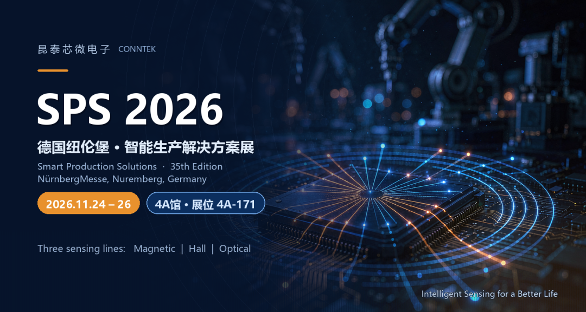
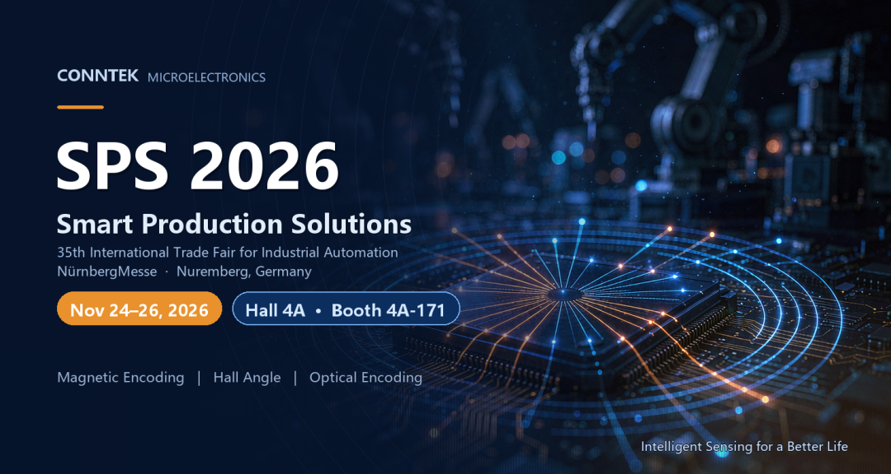

<strong>2026年11月24日至26日，第35届 SPS – Smart Production Solutions（德国纽伦堡国际智能生产解决方案展览会）将在纽伦堡展览中心举行。</strong>昆泰芯微电子（CONNTEK）确认参展，**展位号：4A馆 · 4A-171**。

这是昆泰芯继2026中国工博会之后，今年再一次在国际舞台上完整呈现**磁编码、霍尔角度、光学编码**三条感知技术路线。从上海到纽伦堡，"中国工博会"与"德国SPS"这对工业自动化领域的双标杆展会，将在同一年出现在昆泰芯的参展名录上——对一家专注位置/角度感知的国产芯片厂商而言，这不只是一次亮相，更是一次面向全球自动化客户的"现场验证"。

诚邀欧洲及全球的工程师、系统集成商与合作伙伴，届时莅临 **4A馆 4A-171 展位**，现场体验昆泰芯的感知芯片产品与评估方案。

## 01 关于SPS About SPS

SPS – Smart Production Solutions 创办于1990年，由德国美赛高法兰克福展览有限公司（Mesago Messe Frankfurt）主办，是**全球工业自动化领域最具影响力的专业展会之一**。2026年恰逢SPS创办**35周年**，本届展会呈现几个关键看点：

- <strong>35周年盛典：</strong>从1990年首届至今，SPS已陪伴全球自动化行业走过35年，是欧洲智能生产解决方案的年度风向标；
- <strong>全球展商云集：</strong>预计超过1000家全球展商参展，汇聚众多全球市场领导者；
- <strong>全产业链覆盖：</strong>展品涵盖**传感技术、控制技术、电气驱动与运动控制、工业软件与信息技术、工业通讯**等智能与数字自动化全栈方案；
- <strong>工业AI唱主角：</strong>工业人工智能（Industrial AI）将成为本届SPS的核心议题，聚焦数据驱动制造与全面互联的生产系统。

对传感器与运动控制厂商而言，这里是接触欧洲伺服、机床与机器人客户最直接的窗口。

## 02 展台看点 On Display

本届SPS，昆泰芯以"**智能感知世界，传递美好生活**"为主线，集中展示三条感知技术路线的代表产品——与2026中国工博会展出一脉相承。

### 1. 磁编码路线 ·KTH71/78和KTM52/53与KTM58/59

面向机器人关节与伺服电机的高速、高精度位置反馈，昆泰芯带来Hall、AMR与TMR 三条磁编码产品线：

KTH71/78 · Hall 磁编芯片

- **16位绝对角度输出，XYZ 三轴任选两轴；离轴校准后 INL < ±0.2°；**
- **1μs 数据更新率，SPI 至高 10Mbps、SSI 至高 5Mbps；**
- 可编程 ABZ 4~16,384步/圆、UVW 1~32对极，另有12位 PWM 输出与校准状态指示；
- 3.3V~5V，**-40℃~125℃**，QFN3×3-16L；典型应用：BLDC 控制、离轴角度测量、轨道交通屏蔽门控制。

KTM52/53 · 在轴/离轴 AMR 磁编芯片

- **21位核心角度分辨率，0~360° 绝对角度检测，支持最高 60,000转/分钟，输出延时仅 2μs~10μs；**
- 闭环一键自校准：在轴校准后 INL 可达 **±0.015°**，支持非匀速自校准；
- 同时支持 **ABZ、UVW、PWM绝对值、4线SPI** 输出，脉冲数/对极任意整数可编程；
- **-40℃~125℃ 宽温；典型应用：伺服电机控制、闭环步进、替代部分光电编码器。**

KTM58/59 · TMR 磁编芯片

- 基于TMR原理优化设计，最高24bit分辨率输出，支持最高转速180,000 转/分钟
- 增量输出ABZ支持1~65536线任意分辨率，非线性误差经校准后可达<0.02°
- 系统延时可低至0.5us
- 配合多对级磁铁可以替代光编

### 2. 霍尔角度路线 · 车规级3D霍尔 KTH6365

KTH6365 · 车规级高精度线性3D霍尔

- **X、Y、Z 三轴独立检测，XY/XZ/YZ 平面角度可选，CORDIC 支持在轴/离轴绝对角度解算；**
- 支持 **SAE J2716 SENT 接口**，另有 PWM、模拟输出，16bit ADC 保障分辨率与线性度；
- 汽车应用：**AEC-Q100 Grade 0**，通过 **ISO 26262 ASIL-B** 等级要求，支持功能安全设计；
- 过压、反接保护，**SOP8/TSSOP16** 可选；典型应用：换挡/踏板/方向盘/节气门位置检测。

值得一提的是，昆泰芯已于2024年5月获得ISO 26262功能安全管理体系最高等级的“ASIL D”认证证书，今年9月获得 **ISO 26262 汽车功能安全产品证书“ASIL B”产品认证**——车规感知赛道的"入场券"正在一张张集齐，这也是我们希望与欧洲客户现场深入交流的重要话题。

### 3. 光学编码路线 · 相位阵游标光编 KTO9348

KTO9348 · 相位阵游标高精度光编芯片

- **紧凑型超高分辨率绝对位置编码器，适用于直径33mm光栅码盘、适配 2048刻线游标码盘；**
- 单片3通道相位阵列，信号匹配优秀；2位格雷码扫描、嵌入式扇区检测；
- 专利自有图形，适中码道间距减少串扰；**超低暗电流**，高温工况依然适用；
- 差分电压输出、低输出阻抗，抗干扰强；**0.95MΩ 互阻增益**低噪声光电流放大器保障信噪比；
- 模拟 4.1V+ / 数字 2.5V+，**-40℃~+125℃**，**32-pin optoQFN** 封装；
- 典型应用：交流伺服反馈、机床主轴/数控转台、机器人关节与精密减速器、光电转台/稳定平台。

KTO9512 · 相位阵游标光编芯片

- **紧凑型高分辨率绝对位置编码器，适用于直径 26mm 光栅码盘**
- **单片 3 通道相位阵列，信号匹配优秀**

- **差分电压输出，短路保护**

- **适中码道间距，减少串扰**

- **超低暗电流，高温操作适用**

- **低噪声光电流放大器，1 MΩ 互阻增益**

## 03 一套感知底座 Product Matrix

把三条路线放在一起看，昆泰芯展台的逻辑非常清晰：

| 技术路线 | 代表产品 | 核心价值 | 典型场景 |
|---|---|---|---|
| 磁编码 | KTH71/78（Hall）、KTM52/53（AMR）、KTM58/59（TMR） | 高速、高精度、抗污耐用 | 机器人关节、伺服电机 |
| 霍尔角度 | KTH6365 | 车规级、功能安全、三轴线性 | 换挡/踏板/节气门位置检测 |
| 光学编码 | KTO9348/9512 | 超高精度、游标细分 | 精密减速器、数控转台、精密仪器 |

从磁场感知到光学感知，从工业级到车规级，昆泰芯正在把"位置/角度感知"做成一条**可按精度、环境、成本自由组合的产品谱系**。这一次，我们把它带到全球自动化工业的心脏地带——纽伦堡。

## 04 参展信息 Visit Us

展会名称SPS – Smart Production Solutions 2026（第35届）

展会时间2026年11月24日 – 26日

展会地点德国纽伦堡展览中心 NürnbergMesse

昆泰芯展位4A馆 · 展位号 4A-171

展示内容KTM52/53 · KTH71/78 · KTH6365 · KTO9348

<strong>智能感知世界，传递美好生活。</strong>欢迎莅临展位洽谈

English Version

## CONNTEK Goes Global SPS 2026

**From 24 to 26 November 2026, the 35th SPS – Smart Production Solutions will take place at the NürnbergMesse exhibition center in Nuremberg, Germany.** CONNTEK Microelectronics will be exhibiting at **Hall 4A, Booth 4A-171**.

Following our appearance at the 2026 China International Industry Fair (CIIF), this will be CONNTEK's next major international showcase — presenting our three sensing technology lines of **magnetic encoding, Hall angle sensing, and optical encoding** in full. From Shanghai to Nuremberg, CONNTEK will appear at both of the industry's flagship automation events in a single year — not just an exhibition, but an on-site validation in front of automation customers worldwide.

Engineers, system integrators, and partners from Europe and around the world are cordially invited to visit us at **Hall 4A, Booth 4A-171** to experience CONNTEK's sensing chips and evaluation solutions first-hand.

### About SPS: The Annual Barometer of Global Industrial Automation

Founded in 1990 and organized by Mesago Messe Frankfurt, SPS – Smart Production Solutions is **one of the world's most influential trade fairs for industrial automation**. The 2026 edition marks the fair's **35th anniversary**, with several highlights:

- **35th anniversary edition:** spanning 35 years since 1990, SPS remains the annual barometer of smart production solutions in Europe;
- **A global exhibitor line-up:** more than 1,000 exhibitors expected (1,175 in 2025), including numerous global market leaders;
- **Full value-chain coverage:** from **sensor technology, control technology, electric drives and motion control to industrial software, IT, and industrial communication**;
- **Industrial AI in the spotlight:** Industrial AI will take center stage at SPS 2026, focusing on data-driven manufacturing and fully connected production systems.

The 2025 edition drew some **55,938 professional visitors** across **122,000 square meters** and **15 exhibition halls** — for sensor and motion-control vendors, it is the most direct gateway to European customers in servo drives, machine tools, and robotics.

### On Display: Three Technology Lines, One Sensing Foundation

At SPS 2026, under the theme "**Intelligent Sensing for a Better Life**", CONNTEK will present flagship products consistent with our display at CIIF 2026.

KTH71/78 · High-speed, high-precision Hall encoder chips

- **16-bit absolute angle output; any two of the XYZ axes selectable; off-axis INL < ±0.2° after calibration;**
- **1 μs data update rate; SPI up to 10 Mbps, SSI up to 5 Mbps;**
- Programmable ABZ of 4–16,384 steps/rev, UVW of 1–32 pole pairs, plus 12-bit PWM output with calibration status indication;
- 3.3 V–5 V, **-40 °C to +125 °C**, QFN3×3-16L; typical applications: BLDC control, off-axis angle measurement, metro platform door control.

KTM52/53 · High-speed on-axis / off-axis AMR encoder chips

- **21-bit core angular resolution, 0–360° absolute angle detection, speeds up to 60,000 rpm, angle output latency of only 2 μs–10 μs;**
- One-click closed-loop self-calibration: on-axis INL down to **±0.015°** after calibration; non-uniform-speed self-calibration supported;
- Simultaneous **incremental ABZ, incremental UVW, PWM absolute, and 4-wire SPI outputs**, with any-integer programmability of pulses/rev and pole pairs;
- **-40 °C to +125 °C; typical applications: servo motor control, closed-loop stepper control, replacement of certain optical encoders.**

KTM58/59 · High-speed, high-precision TMR magnetic encoder IC

- Optimized design based on the TMR principle, with a maximum 24-bit resolution output, supporting a maximum speed of 180,000 rpm

- The incremental output ABZ supports resolutions of 1 to 65536 lines, and the nonlinear error can be calibrated to be less than 0.02°

- The system delay can be as low as 0.5us

- Cooperating with multiple pairs of level magnets can replace optical encoding

KTH6365 · Automotive-grade high-precision linear 3D Hall sensor

- **Independent X, Y, Z axis sensing** with selectable XY/XZ/YZ plane angles; CORDIC supports on-axis and off-axis absolute angle calculation;
- **SENT interface compliant with SAE J2716, plus PWM and analog outputs; 16-bit ADC ensures resolution and linearity;**
- **AEC-Q100 Grade 0 compliant, meeting ISO 26262 ASIL-B requirements for functional safety design;**
- Overvoltage and reverse-polarity protection; **SOP8/TSSOP16** options; typical applications: gear-shift knob, pedal, steering-wheel, and throttle position detection.

Notably, CONNTEK obtained the "ASIL D" certification, the highest level of ISO 26262 functional safety management system, in May 2024, and in September this year, it obtained the "ASIL B" product certification for ISO 26262 automotive functional safety products. The "entry tickets" to the automotive perception track are being collected one by one, which is also an important topic we hope to discuss in-depth with our European customers on-site.

KTO9348 · Phased-array vernier high-precision optical encoder chip

- **Compact ultra-high-resolution absolute position encoder**, designed for **33 mm optical disks** and compatible with **2,048-line vernier disks**;
- **Single-chip 3-channel phased array** with excellent signal matching; 2-bit Gray-code scanning and embedded sector detection;
- Proprietary pattern with moderate track spacing to reduce crosstalk; **ultra-low dark current** for reliable high-temperature operation;
- **Differential voltage output with low output impedance**; low-noise photocurrent amplifier (0.95 MΩ transimpedance) ensures signal-to-noise ratio;
- Analog supply from 4.1 V, digital supply from 2.5 V, **-40 °C to +125 °C**; **32-pin optoQFN** package;
- Typical applications: AC servo feedback, machine-tool spindles and NC rotary tables, robot joints and precision reducers, optoelectronic gimbals / stabilized platforms.

### From Magnetic to Optical: A Complete "Sensing Foundation" Puzzle

| Technology Line | Products | Core Value | Typical Applications |
|---|---|---|---|
| Magnetic encoding | KTH71/78 (Hall),KTM52/53 (AMR),KTM58/59(TMR) | High speed, high precision, contamination-resistant | Robot joints, servo motors |
| Hall angle | KTH6365 | Automotive-grade, functional safety, tri-axis linear | Gear-shift / pedal / throttle position detection |
| Optical encoding | KTO9348/9512 | Ultra-high precision, vernier subdivision | Precision reducers, NC rotary tables, precision instruments |

From magnetic field sensing to optical sensing, from industrial to automotive grade, CONNTEK is building position/angle sensing into a **product family that can be freely combined by accuracy, environment, and cost**. This time, we are bringing it to the heart of global industrial automation — Nuremberg.

### Visit Us

EventSPS – Smart Production Solutions 2026 (35th edition)

Dates24–26 November 2026

VenueNürnbergMesse, Nuremberg, Germany

CONNTEK BoothHall 4A · Booth 4A-171

On displayKTM52/53 · KTH71/78 · KTH6365 · KTO9348

**Intelligent Sensing for a Better Life.** We look forward to welcoming you at our booth. To schedule a meeting in advance or request samples, please contact us.
