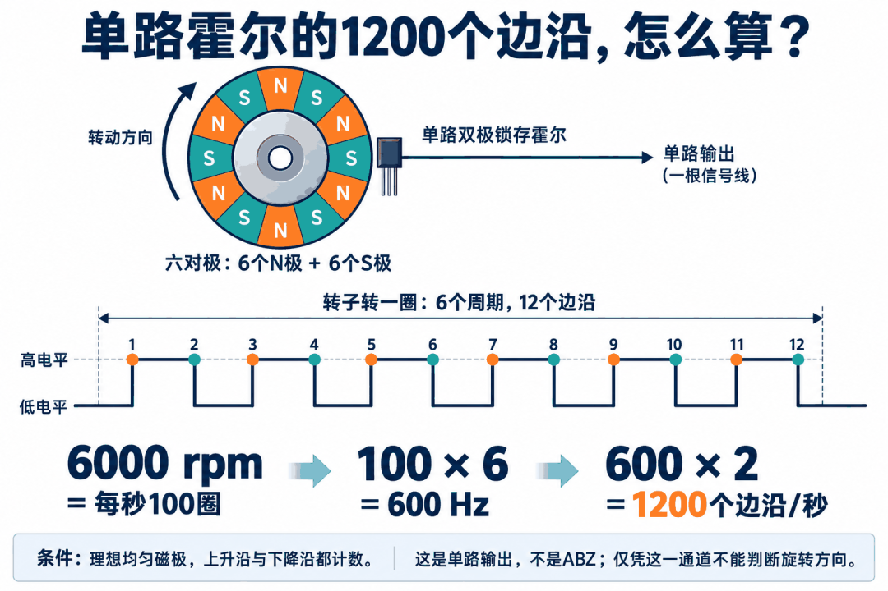
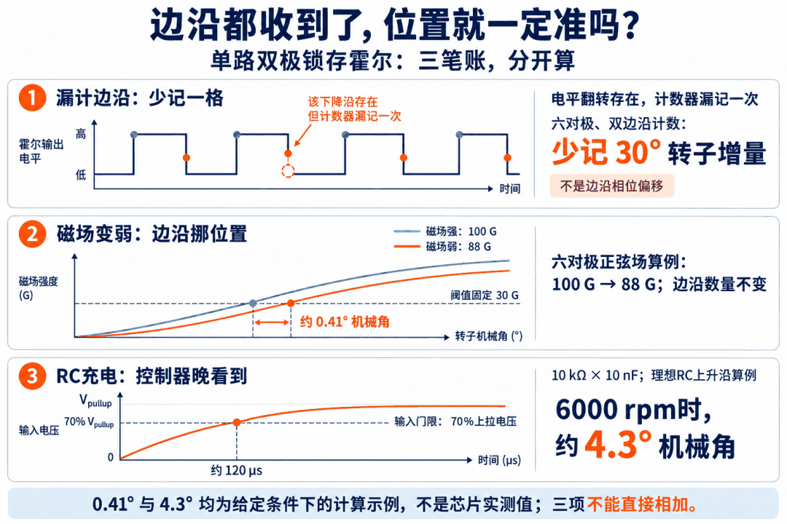

在一台六对极、6000 rpm 的电机旁，KTH2502 这样的双极锁存霍尔每秒要给控制器交出1200个电平边沿。这条信号链有两笔误差账：计数器要防漏边沿，位置算法还要防边沿相位随磁场和电路条件移动。

电动座椅、天窗、尾门里的电机位置反馈，经常靠这样的脉冲累计完成。磁钢决定边沿在什么机械角度出现，霍尔芯片决定磁场达到哪个阈值才翻转，输出电路又决定微控制器究竟在什么时候看见翻转。三处位置只要有一处变化，同一个磁极经过，时间戳就会受影响。

我更关心的是这条从磁场到计数器的链路，而不只是数据手册上的“30 kHz”。

## 十二个边沿把电机一圈切成十二格

假设转子装有六对交替磁极，一颗双极锁存霍尔每经过一对磁极输出一个完整周期。如果控制器同时计数上升沿和下降沿，一圈正好是12个边沿。

**这里讨论的是单路双极锁存霍尔、双边沿计数，不是ABZ编码器。**

电机以6000 rpm匀速旋转，相当于每秒100圈。霍尔输出频率是600 Hz，每秒1200个边沿，平均每隔约833 μs出现一次。相邻两个边沿对应的名义转子角度是30°。

*图1｜六对极对应单路霍尔每圈6个周期。上升沿、下降沿都计数，才是每圈12个边沿、6000 rpm时每秒1200个边沿。磁极与波形为理想示意，单凭这一通道不能判断旋转方向。*

漏掉一个边沿，在这种单通道、双边沿计数的简化模型里，就是少记了一个30°的转子位置增量。若后面接着60:1的减速器，折算到输出轴是0.5°。实际系统能靠限位、回零或其他传感器纠正，但误计数为什么值得防范，这个数字已经够直观。

KTH2502的双极锁存结构，正是为稳定形成交替磁场下的开关信号服务。以典型磁场阈值绝对值约30 G的B档为例，正负两侧的切换阈值相隔约60 G。磁场在中间区域扰动时，输出维持上一次状态，等真正越过另一侧阈值才翻转。这段磁滞让临界位置的噪声较难制造出额外边沿。

但磁滞只保证开关状态不会轻易来回抖动，它并没有承诺那个边沿永远出现在同一个机械角度。

## 磁场幅值下降，计数没丢也会改变边沿位置

假设霍尔敏感轴上的磁场近似正弦变化。暂时忽略磁钢高次谐波、安装偏心、气隙变化与芯片自身阈值温漂，只讨论磁场幅值这一项：

这里的θ是转子机械角度，六对极使磁场每转一圈重复六次。选取正向上升、跨过正阈值的一个边沿，其机械角度满足：

现在假设常温下传感器看到的磁场峰值为100 G，磁钢在升温100 ℃后峰值下降12%，变成88 G。这一幅值变化按假设的每摄氏度−0.12%线性温度系数计算，仅作为工程算例，不代表任何特定磁钢的实测数据。

100 G时，这个边沿处在约17.46°的电角度位置；88 G时移到约19.93°。相差约2.47°电角度，除以六对极，得到约**0.41°的转子机械角度偏移**。

这里的反正弦结果按角度制换算。偏移没有丢掉一个边沿，也不会让每圈12个边沿突然变成11个。它改变的是边沿相对于真实机械位置的相位。对只统计完整脉冲数的粗定位系统，表现为边沿附近的位置判定变化；对利用边沿时间戳插值的位置和速度估算，影响会更直接。

如果磁场峰值进一步降低，最极端的情况是峰值始终达不到某一侧切换阈值，那才会真正丢掉翻转。前一个问题是边沿挪位置，后一个问题是边沿消失，失效机制应当分开验。

## 霍尔补偿了芯片温漂，补不了整套磁路的温漂

KTH2502采用斩波稳定和温度补偿电路，目标是压低模拟前端失调与磁场开关阈值的温度变化。B档的典型阈值绝对值约30 G，典型磁滞宽度约60 G；不同样品的实际工作点，还要受规格书给出的阈值分布约束。

芯片的阈值温度稳定，和磁钢在芯片位置形成的场强温度稳定，是两份不同的指标。

沿用刚才88 G峰值的假设，假如芯片的切换阈值又额外移动1 G，局部线性近似下，对应约0.12°的转子机械角度变化。这个“1 G”只是灵敏度分析的输入，不是KTH2502实测漂移。

磁钢温漂、阈值温漂在不同条件下会抵消或叠加。单看芯片典型阈值、单看磁钢材料系数，都无法预测整机的最坏位置误差。实际还要计入气隙、装配公差和磁场波形畸变。

尤其要注意，典型阈值不等于精密的绝对角度基准。双极锁存霍尔适合做脉冲计数，但若控制器打算把某个边沿直接当作高精度机械零位，就得为样品间差异、温度和磁钢公差另做预算。

## 一只上拉电阻和滤波电容，也能挪走好几度

磁场过了阈值，账还没算完。KTH2502用开漏输出，后级需要上拉电阻。数据手册在规定磁场阶跃条件下给出的典型传播延迟约10 μs；按这个时间作换算，在6000 rpm下相当于0.36°转子转角。这个典型值不是整套系统在任意磁场斜率下的保证值。

固定的时间延迟也会随转速变化折算成不同角度，不能靠一个固定角度偏置覆盖全部转速。已知延迟与转速时，系统能针对性补偿；延迟本身随电气条件或温度变化，则还要计入补偿残差。

外围滤波选得重，影响甚至更大。

举一个故意放大的RC算例：上拉电阻10 kΩ，输出节点总电容10 nF，时间常数就是100 μs。假设微控制器的输入高电平判定门限为上拉电压的70%，从近似零电平释放后的理想RC上升沿，要经过约120 μs才跨过这个门限。

同样是6000 rpm，120 μs对应约**4.3°的转子机械转角**。这个数字只描述上述RC与输入门限模型，不能当成KTH2502芯片的输出延迟。上升沿受上拉电阻与电容限制，下降沿则主要由输出管下拉，两个方向不对称，脉宽会一起变形。

所以，芯片标称30 kHz典型检测带宽，并不保证加上任意滤波电容后，微控制器仍能获得同样的边沿时序。KTH2502在1 kΩ上拉、50 pF负载、3.3 V供电的规定条件下，典型输出上升时间是160 ns；那与上面10 kΩ、10 nF的系统已经不是同一个电气条件。

*图2｜计数器漏记一次、磁场幅值改变切换位置、RC使输入门限跨越变晚，属于三种不同机制。曲线只示意变化方向，不按比例绘制。0.41°与4.3°均为文中给定条件下的计算值，不是芯片实测；不能将三项直接相加作为整机误差。*

## 位置验收应该对准边沿，而不只看方波有没有出来

双极锁存霍尔的系统测试，不能拿磁铁晃一晃、示波器看到方波就算过关。真正需要记录的是同一机械位置上，跨样品、跨温度、跨转速，控制器收到的边沿会向前或向后移动多少。

测试时至少保留同步的转子参考位置和微控制器输入引脚边沿记录；要进一步分清磁场和阈值的贡献，还应记录霍尔位置处的磁场，或使用经验证的磁场模型。参考角度本身的延迟与时间基准也要校准。

然后分别检查磁场峰值有没有跌进阈值危险区、切换位置是否随温度漂移、上升沿和下降沿是否出现不同的延时。若芯片由车载电源直接供电，还要明确系统侧对抛负载等瞬态完成适当防护。2.7～32 V的连续工作范围，与36 V相关耐受条款，都不能代替整车瞬态验证。

对这类系统，计数、相位和时序应分别记账。漏一个边沿，按这个算例少记30°转子增量；磁钢幅值下降12%，在给定磁场模型下让边沿移动约0.41°；外围RC选得过重，又会引入约4.3°的上升沿门限延迟。

同样是一颗三脚霍尔，控制器最后看到的是三种完全不同的误差。只报“1200个边沿全收到”，还不足以交代位置反馈的质量。
