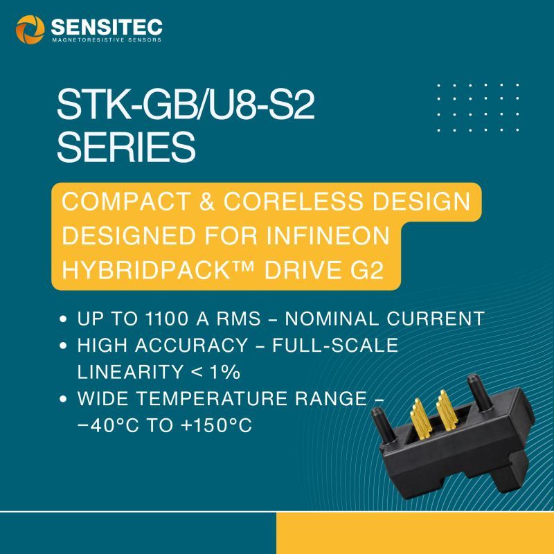

来源：Sensitec LinkedIn 发布（[原帖](https://lnkd.in/p/dGG3ub-D)）

<figure style="margin:24px 0;">

<figcaption style="font-size:13px;line-height:1.8;color:#647482;text-align:center;">图：Sensitec STK-GB/U8-S2 系列宣传图（来源：Sensitec）</figcaption>
</figure>

德国磁阻传感器厂商 Sensitec 近日发布 STK-GB/U8-S2 系列电流传感器模块，面向混动与纯电车型的牵引逆变器和电池管理系统，并专门为英飞凌 HybridPACK™ Drive G2 功率模块配套开发。

## 官方公布的关键参数

- 额定电流：900 A / 1000 A / 1100 A RMS 三档
- 可测直流、交流和脉冲电流
- 双霍尔芯片设计，抑制杂散磁场
- 霍尔芯片通过 AEC-Q100 认证，支持 ASIL B
- 满量程线性度偏差小于 1%
- 工作温度 −40°C 至 +150°C
- 无磁芯、轻量化结构，带电气隔离
- 集成过流检测（OCD）

## 我的看法

**一是 Sensitec 这次用的是霍尔方案。** Sensitec 一直以 AMR/TMR 磁阻技术见长，但这款千安级主驱电流传感器用的是双霍尔加无磁芯的结构。我的理解是，在大电流、高温工况下，霍尔芯片的车规生态更成熟，量程裕度也更足，磁阻器件的高灵敏度在这里反而不是首要需求。

**二是传感器围绕功率模块来设计，已经成为主流做法。** HybridPACK Drive 是主驱逆变器里装车量很大的模块平台。传感器直接适配它的母排和安装尺寸，就能省掉主机厂和 Tier1 自己做结构适配的工作。英飞凌、LEM 等厂商也在做类似的“模块配套型”电流传感器，Sensitec 这次算是加入了这条赛道。

**三是无磁芯差分结构抗干扰，代价是对装配精度和母排布局更敏感。** 去掉聚磁环以后，体积、重量和磁滞都降下来了，但抗外磁场干扰就要靠双芯片做差分。逆变器里三相母排靠得很近，相间串扰会有多大，标称的“小于 1%”是在什么条件下测出来的，都需要拿到 datasheet 再看。

**四是有几项信息目前还看不到。** 带宽和响应时间、OCD 的阈值和响应延迟、零点温漂，以及 ASIL B 是芯片级的支持还是模块级的认证，这些数据对主驱的电流环和保护设计更关键。等官方 datasheet 公开后，我会再补充。

> 注：以上参数均来自厂商宣传材料，非实测数据。
