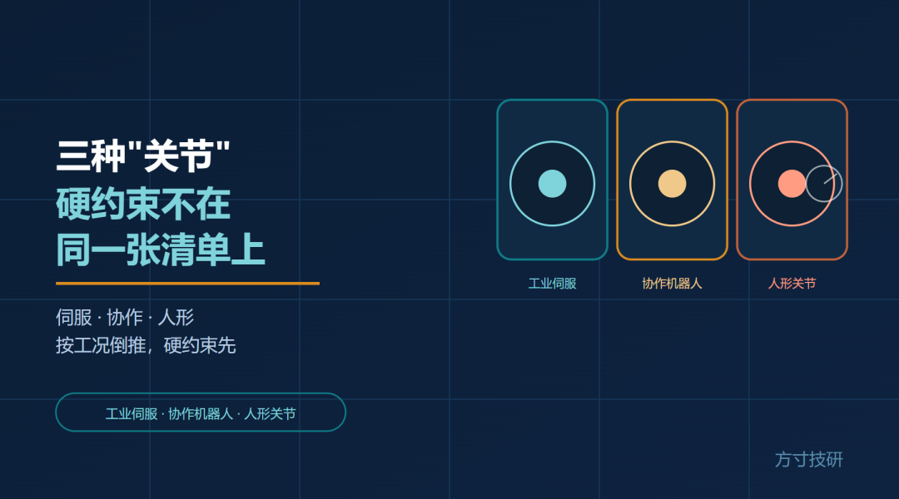
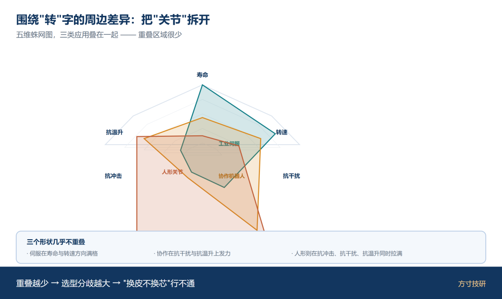
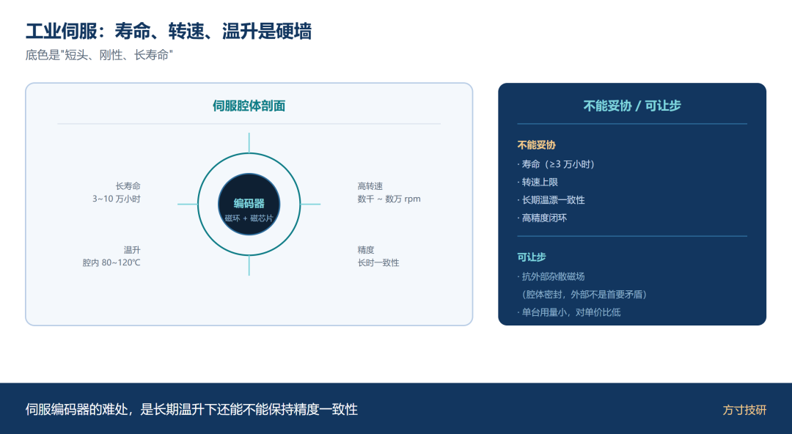
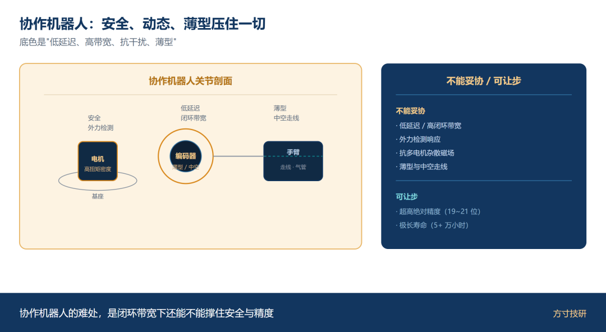
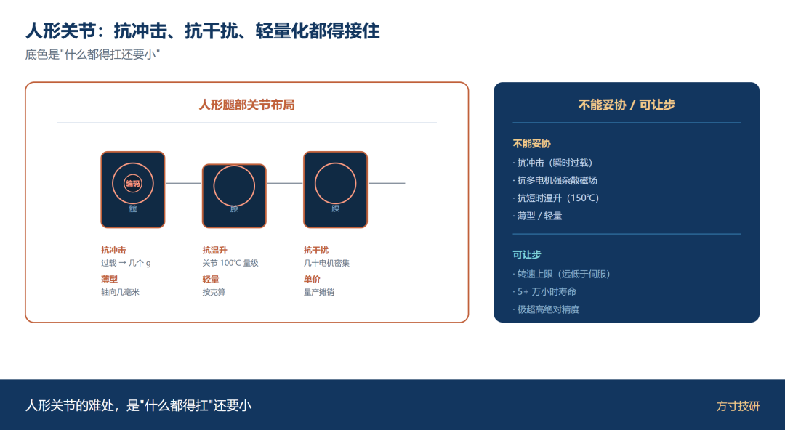
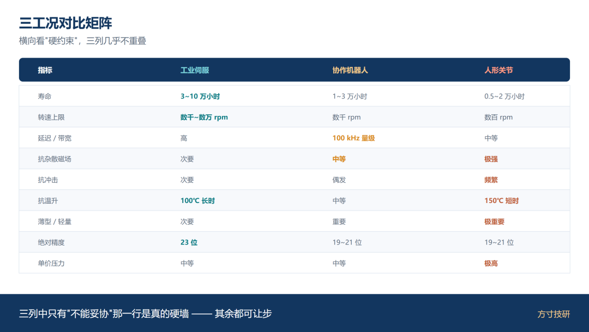
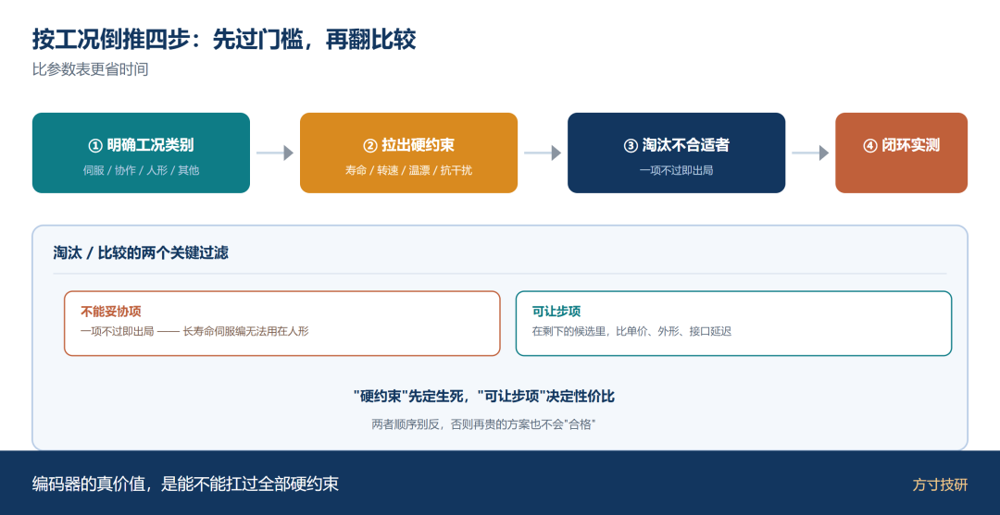
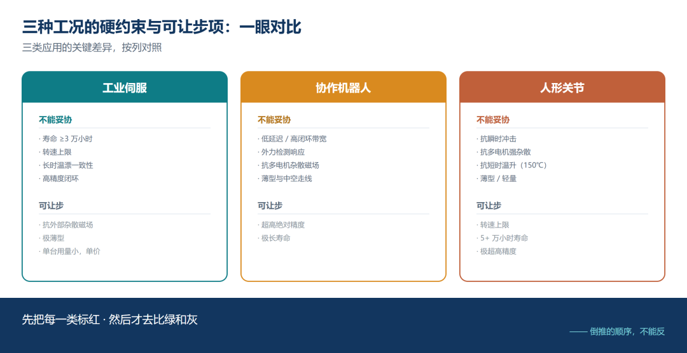
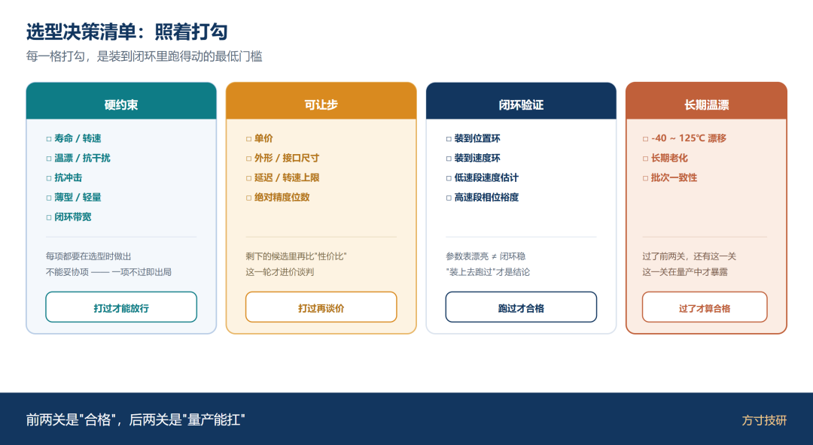

伺服上验证过的方案，搬到协作机器人上开始抖。

搬到人形关节上，又过不了温漂或冲击。

换皮不换芯，在编码器这行不通。原因很简单——

**同样叫"关节"的三类应用，硬约束根本不在同一张清单上。**

## 一、为什么"关节"不能当一类东西

只要被叫做"关节"，就意味着"转"。但共同点起来的特征只有这一个字。

围绕"转"的周边差异，每个工况都能拉出长长一条清单：

· **转动要持续多久？** 工业伺服每天转十几个小时、连转一整年；人形关节是间歇动作，每天实际通电时间不长。

· **转速上限多少？** 伺服主轴几千到几万转；人形关节的瞬时角速度很低，但加减速极猛。

· **负载什么性格？** 工业伺服抗切削力，负载稳；人形关节抗冲击、阻尼复杂。

· **环境温度什么样？** 伺服腔体里长期 80~120℃ 量级；人形关节机身内部约 50~80℃，但整机能达到 100℃ 量级。

· **能不能藏破谁做过屏蔽？** 伺服腔常密封、屏蔽良好；人形多电机密集，强电磁环境。

把这些差异拉直了，"关节"立刻分成三类工况，**每一类都有自己的硬约束**。

图 1｜五维蛛网图（寿命/转速/抗干扰/抗冲击/抗温升）三选三层叠加

## 二、工业伺服：寿命、转速、温升是硬墙

**工业伺服**是这三类里"看起来最容易、其实最考验底线"的一类。

它对编码器的硬约束有四条：

· **寿命：** 工业伺服要求数万小时起步，往五万小时看——这意味着轴承、磁环、封装的一致性都得扛得住这么长的疲劳。

· **转速：** 主轴几千到几万转，对芯片的转速上限与延迟都有门槛。

· **温升：** 电机绕组发热 + 整机长期运行，腔内 80~120℃ 量级是常态。这不是"工作温度上限"测试的题，是**"温漂 + 老化"**的题。

· **精度与重复性：** 加工与位置伺服要求非常高，闭环里位置误差不能跟着温度跑。

**短头、刚性、长寿命**是伺服编码器的底色。可让步项是抗外部杂散磁场——伺服腔通常封闭，外部干扰不是首要矛盾。

一句话：**伺服编码器的难处，是长期温升下还能不能保持精度一致性。**

图 2｜伺服腔体切片图，标出长寿命/高转速/温升/精度的硬约束位置

## 三、协作机器人：安全、动态、薄型压住一切

**协作机器人**要求的是"与人同处一档"。对编码器的硬约束是另一组：

· **安全优先：** 需要检测外力与人接触、动态响应要快——这要求编码器的**延迟低、采样率高**，闭环带宽必须够。

· **运动平滑：** 加减速曲线要顺，加减速段的相位滞后要小。这直接考验编码器的**延迟与转速上限**。

· **薄型与中空：** 协作机常常有走线 / 气管需求，关节里留给编码器的轴向空间被压得很紧。

· **抗杂散磁场：** 多电机密布、关节紧凑、外部电磁环境比伺服复杂得多。

· **寿命：** 一般比伺服短一档，但仍是数千小时**量级**。

**低延迟 + 高带宽 + 抗干扰 + 薄型**是协作机器人的底色。可让步项是绝对精度的高位数——协作级通常不需要 23 位，1 位 0.001° 级的精度就够了。

一句话：**协作机器人的难处，是闭环带宽下还能不能撑住安全与精度。**

图 3｜协作机器人关节剖面，标出安全/动态/薄型/抗干扰四项

## 四、人形关节：抗冲击、抗干扰、轻量化都得接住

**人形关节**是这三类里"难度密度最高"的一类——既要又要还要。

· **抗冲击：** 走路、跑步、摔倒，单关节的瞬时过载能到几个 g。这要求编码器的**机械结构**与**抗振性**扛得住。

· **高功率密度 / 轻量化：** 每个关节都要在极小的体积与重量里输出扭矩，留给编码器的轴向空间只有几毫米，重量也要按克算。

· **抗杂散磁场：** 几十个电机密集、密集母线、电机驱动器近邻——这是人形最强的外部杂散源。

· **温升：** 关节温升可达 150℃ 量级，加上整机的瞬时过载叠加，温漂成为隐性难题。

· **多自由度与小空间：** 单台机器几十个关节 + 紧凑走线 → 留个位置能装上就行，对外形与接口尺寸有非常现实的要求。

**抗冲击 + 抗干扰 + 抗温升 + 轻量化**是人形关节的底色。可让步项是转速上限（人形关节的实际转速远低于伺服）与单价（量产摊销后的 BOM 压力）。

一句话：**人形关节的难处，是"什么都得扛"还要小。**

图 4｜人形腿侧视+电机布局，标出抗冲击/抗温升/抗干扰/薄型四项

## 五、三工况对比矩阵

|  |
| --- |
|  |

|  |  |  |  |
| --- | --- | --- | --- |
| 指标 | 工业伺服 | 协作机器人 | 人形关节 |
| 寿命（万小时） | 3~10（不能妥协） | 1~3（次要） | 0.5~2（要看工况） |
| 转速上限 | 数千~数万 rpm（不能妥协） | 数千 rpm（次要） | 数百 rpm（可让步） |
| 延迟 / 带宽 | 100 kHz 量级 | 100 kHz 量级（不能妥协） | 中等 |
| 抗杂散磁场 | 整机屏蔽良好（次要） | 中等（重要） | 极强（不能妥协） |
| 抗冲击 | 极少冲击（次要） | 偶发（次要） | 频繁（不能妥协） |
| 抗温升 | 长时 100℃ 量级（不能妥协） | 中等 | 短时 150℃ 量级（重要） |
| 薄型 / 轻量 | 次要 | 重要 | 极重要（不能妥协） |
| 绝对精度（位数） | 23 位（不能妥协） | 19~21 位 | 19~21 位 |
| 单价压力 | 中等 | 中等 | 极高（量产摊销） |
| 抗振 | 高频振（数控一般） | 数控一般 | 强到中等（重要） |

**三列中能直接看出来的规律是：**

· "不能妥协"那一栏里 **价值在绝对硬约束上**。

· 协作机器人与人形关节在**抗干扰、抗冲击、薄型、抗温升**四项上同时拉满——但伺服几乎不在乎。

· **伺服的"长寿命+高转速"在人形上是几乎可以放弃的指标**——人形不靠这两样。

图 5｜9 行 × 3 列对比表 + 三列高亮"不能妥协"项

## 六、按工况倒推的选型顺序

**别按"哪颗芯片参数好"选型，先按"硬约束淘汰一批"。**

倒推顺序建议：

· **明确工况类别**（伺服 / 协作 / 人形 / 其他），把这一类的硬约束清单拉出来。

· **把"不能妥协"那一列当作门槛**：寿命、转速、温升、抗干扰——一项不过就直接出局。

· **在剩下的候选里，按"可让步项"二次筛选**：单价、外形、接口延迟，再做权衡。

· **带入整机闭环实测**：芯片指标再漂亮，装到位置环/速度环里跑不动，就是不行。

一句话：**编码器的真价值，是能不能扛过全部硬约束；扛不住的，再贵也不算合格。**

图 6｜明确工况 → 拉硬约束 → 淘汰 → 闭环实测

图 7｜三方框并排，每框内列硬约束 / 可让步项 / 典型指标

图 8｜四段决策卡（硬约束/可让步/闭环验证/长期温漂），每段可勾选

## 总结

· **"关节"不是一类东西**：伺服、协作、人形的硬约束清单不重叠；同一份"好方案"换工况就可能不行。

· **倒推优于横比**：先按工况把硬约束列出来过门槛，再在剩下的候选里做优劣——这个顺序比逐项比参数更省时间。

· **带闭环实测才是终点**：闭环里跑得动、扛得住温漂与冲击的那一颗，才是真正合格的编码器。

💬 你们项目上是哪一类"关节"？硬约束清单里最让你睡不着觉的是哪一项？评论区聊聊。

喜欢这类把工况拆开来讲的内容，点个关注。

**—— 方寸技研 · 下期预告：精度、刷新率、温漂、成本——伺服 / 云台 / 机器人关节先砍哪个。**
