## 目录

概述

## 1 系统架构

## 1.1 硬件架构

## 1.2 工装要求

## 2 软件实现

## 2.1 软件架构设计

## 2.2 STM32 Cube配置项目

## 3 软件功能实现

## 3.1 系统代码架构

## 3.2 代码功能介绍

## 3.3 源代码文件

## 4 测试

---

测试视频

## 概述

本文主要介绍使用STM32和AS5600实现一套完整的编码器设计方案，包括硬件设计，软件架构和软件设计。笔者基于STM32 F446作为主控芯片实现了编码器的主要功能，并在直流无刷电机上验证了编码器的功能。

## 1 系统架构

## 1.1 硬件架构

该编码器的主要硬件构成如下：

> 1）磁环贴在电机的正下方，当电机旋转式同时会带动磁环旋转
>
> 2）AS5600用于检测磁环的磁感线强度，使用I2C接口将数据信息，传送之控制器（MCU）
>
> 3）控制器端（MCU）通过I2C接口实时的读取AS5600中的角度数据值

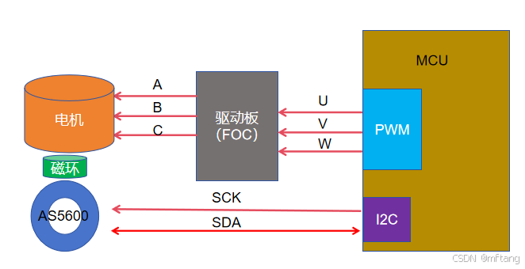

## 1.2 工装要求

磁环和AS5600的工装要求：磁铁在芯片正上方**0.5~3 mm**

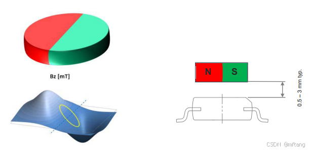

**角度值检测原理：** 当磁环旋转时，AS5600检测到的磁通量会发生变化，根据磁通量的值，就可以检测到当前的绝对位置。

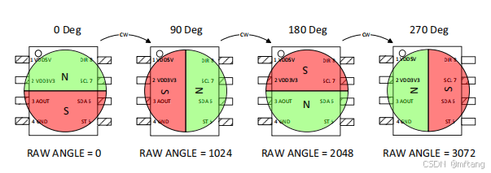

具体AS5600的详细参数和使用说明，可参考如下网站获取：

```
https://item.szlcsc.com/511984.html?lcsc_vid=EgcNBVBWQ1RdBABfQgVWAwBeFlJWBFYDQVdbUABfE1kSVVxURVJcU1BWRj5fUFdRR1lfX1RUQlJYOAwSAxEdXUtJFA9ABQ0IEE8NCAlJ
```

## 2 软件实现

## 2.1 软件架构设计

AS5600的编码器软件架构如下：

1）MCU驱动层部分

> -I2C驱动： 实现从MCU和AS5600的通信功能
>
> -TIMER驱动： 实现定时，用于精确的计算出电机运行的速度值
>
> - UART驱动： 用于数据的Debug功能，便于使用其他工具测试编码器数据的精确程度
>
> - IO驱动： 用于示波器获取逻辑分析仪计算一些重要的时间参数

 2） 中间层

> 计算角度：MCU通过I2C接口读取AS5600寄存器中的角度值，并对该值做数据转换
>
> 计算速度：通过定时器和位置的值计算当前电机的转动速度
>
> 计算位置：通过圈数和当前的角度值，计算出电机运行的具体位置

3）应用层

> 角度计算函数接口：应用层调用角度值计算的接口函数
>
> 数据出输出接口： 控制板可通过其获取编码器的参数

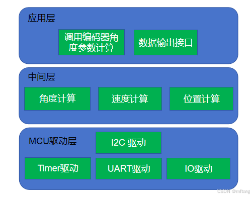

## 2.2 STM32 Cube配置项目

1）时钟配置

笔者选用Nucleo STMF446板卡作为主控电路，其时钟配置如下

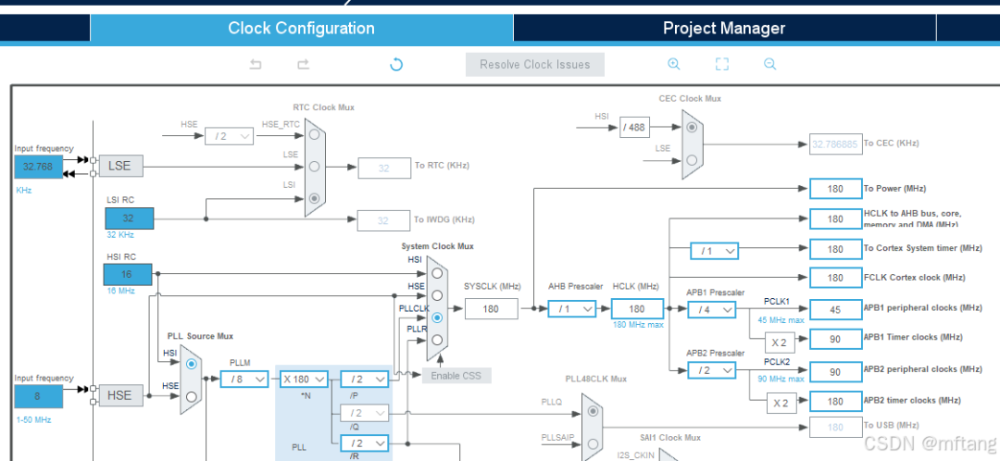

2）I2C接口配置

IO接口配置

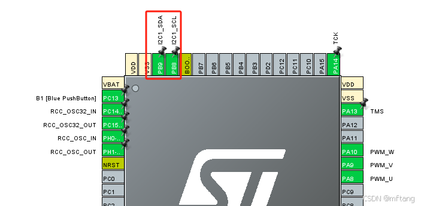 I2C参数配置

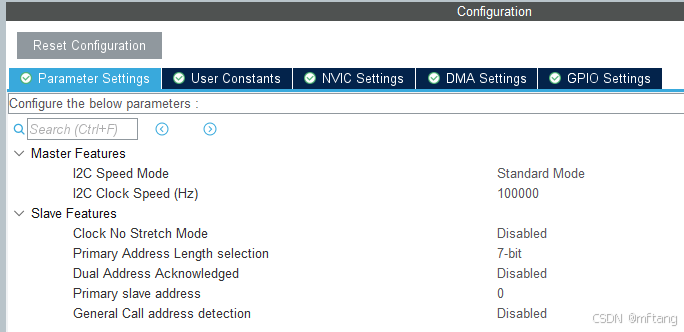

3）Debug串口配置

参数配置

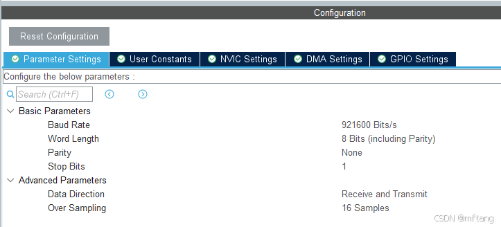 端口配置

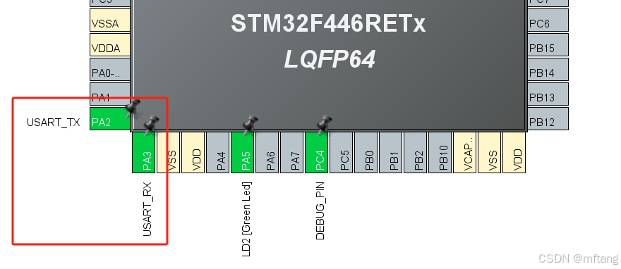

4） 定时器配置

配置定时器6，用于计算速度

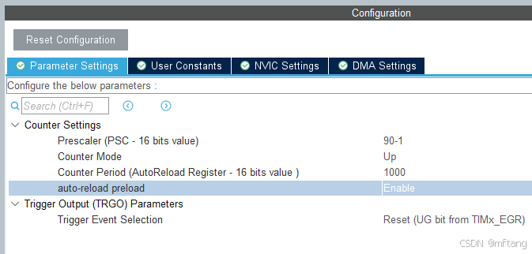

配置定时器实现1us的定时功能，用于计算速度

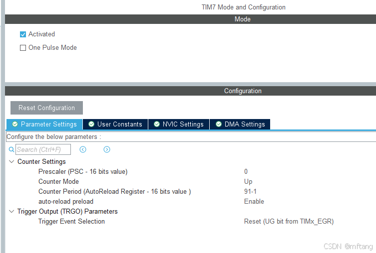

## 3 软件功能实现

## 3.1 系统代码架构

代码框架介绍

> 1） Application/User/Core： STM32Cube自动生成的代码，主要实现MUC资源初始化的函数
>
> 2）Product/Driver： 外围driver层的代码
>
> 3） Product/App： 应用侧的代码

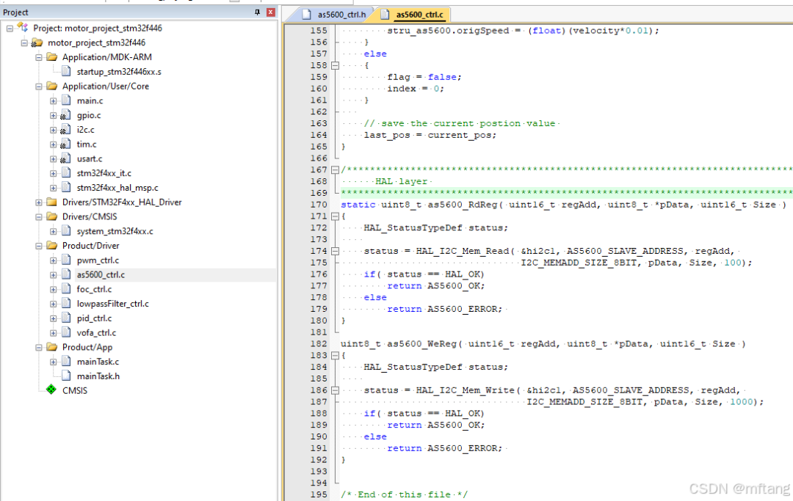

## 3.2 代码功能介绍

1） I2C底层驱动

> 代码170~180: 调用MCU的底层I2C驱动driver 接口，实现数据的寄存器的读功能
>
> 代码182~192: 调用MCU的底层I2C驱动driver 接口，实现数据的寄存器的写功能

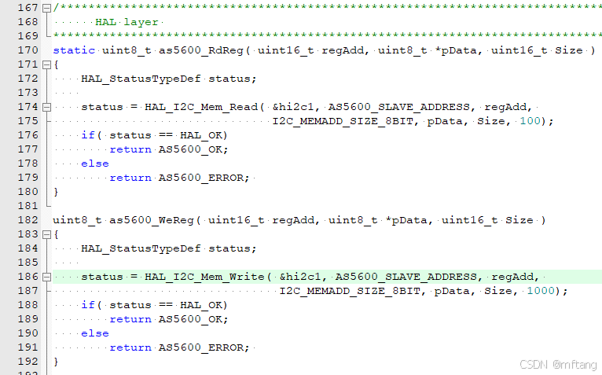

和I2C相关的参数定义如下：

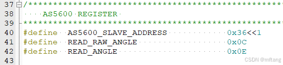

 2） 读角度函数

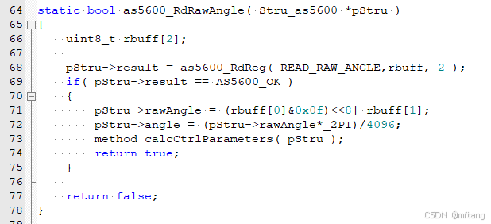

3）计算圈数函数

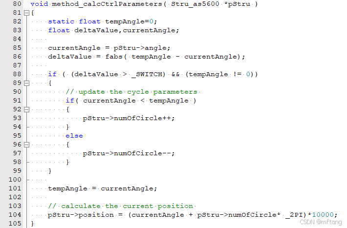

4）计算速度函数

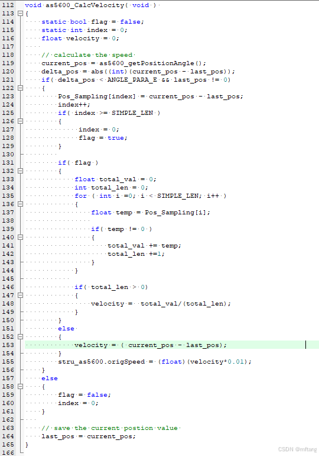

## 3.3 源代码文件

 1）as5600_ctrl.c 文件中的代码

```
/* USER CODE BEGIN Header *//<strong> * File Name : as5600_ctrl.c * Description : AS5600 driver base on stm32f446 </strong> * @attention <strong> COPYRIGHT: Copyright (c) 2024 tangminfei2013@126.com* DATE: JUL 05th, 2024 </strong> *//* USER CODE END Header *//* Includes ------------------------------------------------------------------*/#include "as5600_ctrl.h"#include "i2c.h"Stru_as5600 stru_as5600;/* Private variables ---------------------------------------------------------*/// time parameter //postion parameters static int32_t last_pos;/* Private function prototypes -----------------------------------------------*/static uint8_t as5600_RdReg( uint16_t regAdd, uint8_t *pData, uint16_t Size );static bool as5600_RdRawAngle( Stru_as5600 *pStru );void as5600_Init( void ){ as5600_RdRawAngle( &stru_as5600 ); HAL_Delay(500); last_pos = as5600_getPositionAngle(); HAL_Delay(1); last_pos = as5600_getPositionAngle();}void as5600_updatePara( void ){ as5600_RdRawAngle( &stru_as5600 ); printf("%.02f,%.02f, %.02f \n", stru_as5600.origSpeed, stru_as5600.position*0.001, stru_as5600.angle);}float as5600_getMechanicalAngle( void ) { return stru_as5600.angle;}int32_t as5600_getPositionAngle( void ) { return stru_as5600.position;}float as5600_getVelocity( void ) { return stru_as5600.origSpeed;}static bool as5600_RdRawAngle( Stru_as5600 *pStru ){ uint8_t rbuff[2]; pStru->result = as5600_RdReg( READ_RAW_ANGLE,rbuff, 2 ); if( pStru->result == AS5600_OK ) { pStru->rawAngle = (rbuff[0]&0x0f)<<8| rbuff[1]; pStru->angle = (pStru->rawAngle*_2PI)/4096; method_calcCtrlParameters( pStru ); return true; } return false;}void method_calcCtrlParameters( Stru_as5600 *pStru ){ static float tempAngle=0; float deltaValue,currentAngle; currentAngle = pStru->angle; deltaValue = fabs( tempAngle - currentAngle); if ( (deltaValue > _SWITCH) && (tempAngle != 0)) { // update the cycle parameters if( currentAngle < tempAngle ) { pStru->numOfCircle++; } else { pStru->numOfCircle--; } } tempAngle = currentAngle; // calculate the current position pStru->position = (currentAngle + pStru->numOfCircle* _2PI)*10000;}#define SIMPLE_LEN 5int32_t Pos_Sampling[SIMPLE_LEN+1] = {0};uint32_t delta_pos = 0;int32_t current_pos;void as5600_CalcVelocity( void ) { static bool flag = false; static int index = 0; float velocity = 0; // calculate the speed current_pos = as5600_getPositionAngle(); delta_pos = abs((int)(current_pos - last_pos)); if( delta_pos < ANGLE_PARA_E && last_pos != 0) { Pos_Sampling[index] = current_pos - last_pos; index++; if( index >= SIMPLE_LEN ) { index = 0; flag = true; } if( flag ) { float total_val = 0; int total_len = 0; for ( int i =0; i < SIMPLE_LEN; i++ ) { float temp = Pos_Sampling[i]; if( temp != 0 ) { total_val += temp; total_len +=1; } } if( total_len > 0) { velocity = total_val/(total_len); } } else { velocity = ( current_pos - last_pos); } stru_as5600.origSpeed = (float)(velocity*0.01); } else { flag = false; index = 0; } // save the current postion value last_pos = current_pos;}/<strong> HAL layer </strong>/static uint8_t as5600_RdReg( uint16_t regAdd, uint8_t *pData, uint16_t Size ){ HAL_StatusTypeDef status; status = HAL_I2C_Mem_Read( &hi2c1, AS5600_SLAVE_ADDRESS, regAdd, I2C_MEMADD_SIZE_8BIT, pData, Size, 100); if( status == HAL_OK) return AS5600_OK; else return AS5600_ERROR; }uint8_t as5600_WeReg( uint16_t regAdd, uint8_t *pData, uint16_t Size ){ HAL_StatusTypeDef status; status = HAL_I2C_Mem_Write( &hi2c1, AS5600_SLAVE_ADDRESS, regAdd, I2C_MEMADD_SIZE_8BIT, pData, Size, 1000); if( status == HAL_OK) return AS5600_OK; else return AS5600_ERROR; }/* End of this file */
```

 2）as5600_ctrl.h 文件中的代码

```
/* USER CODE BEGIN Header *//<strong> * File Name : as5600_ctrl.h * Description : AS5600 driver base on stm32f446 </strong> * @attention <strong> COPYRIGHT: Copyright (c) 2024 tangminfei2013@126.com* DATE: JUL 05th, 2024 </strong> *//* USER CODE END Header *//* Includes ------------------------------------------------------------------*/#ifndef __AS5600_CTRL_H#define __AS5600_CTRL_H/**//* Includes *//**/#include "main.h"#ifdef _cplusplusextern "C" {#endif #define ANGLE_PARA_E 131040#define _2PI 6.28318530718f#define _PI 3.14159265359f#define _SWITCH _2PI - 2#define _MSWITCH _2PI*2 - 1/<strong> AS5600 REGISTER </strong>/#define AS5600_SLAVE_ADDRESS 0x36<<1#define READ_RAW_ANGLE 0x0C#define READ_ANGLE 0x0Eenum A5600_STATUS{ AS5600_OK =0 , AS5600_ERROR};typedef struct{ uint16_t rawAngle; int16_t numOfCircle; float angle; bool result; // false: unuse true: used float origSpeed; float origSpeedExt; int32_t position;}Stru_as5600;extern Stru_as5600 stru_as5600;void as5600_Init( void );void as5600_updatePara( void );void method_calcCtrlParameters( Stru_as5600 *pStru );void as5600_CalcVelocity( void ) ;float as5600_getMechanicalAngle( void );int32_t as5600_getPositionAngle( void ) ;float as5600_getVelocity( void ) ;#ifdef _cplusplus}#endif #endif /* __AS5600_CTRL_H */
```

## 4 测试

1）角度值测试，蓝色的线为编码器的角度从: 0~ 2π的变化驱动

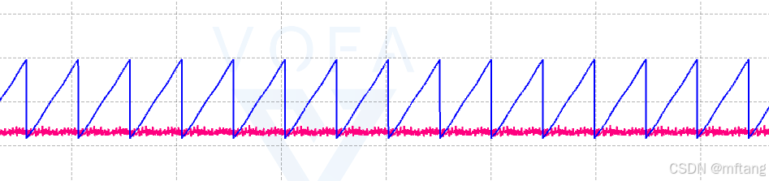2）速度值测试

红色线为速度的变化曲线，设置当前电机的运行速度为0.5, 红线是通过PID控制后，得到的速度变化曲线

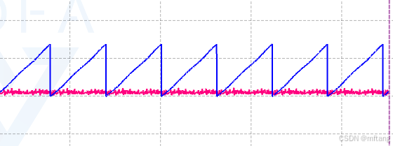

 如下波形没有经过低通滤波，毛刺非常明显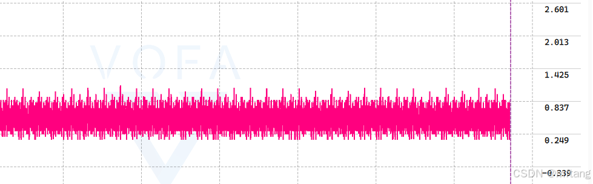

 3）位置曲线

位置式通过圈数和当前的角度计算出来的，所以其是一条斜线

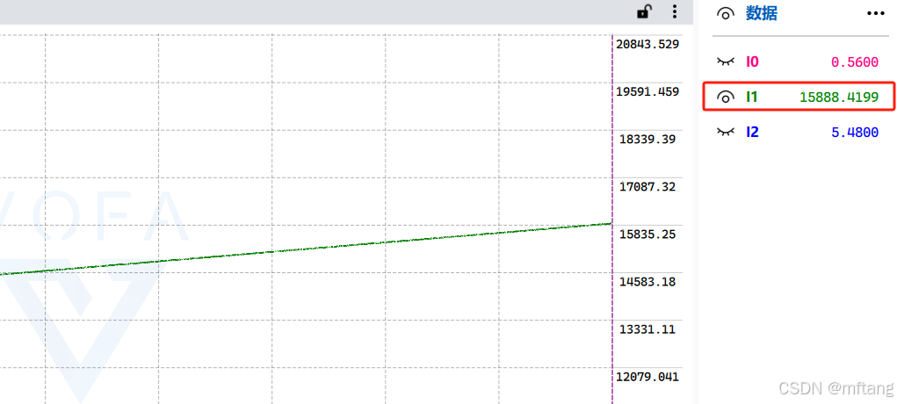
