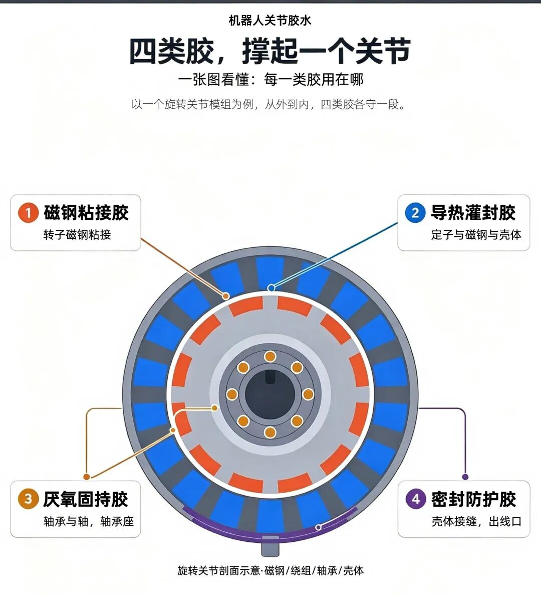
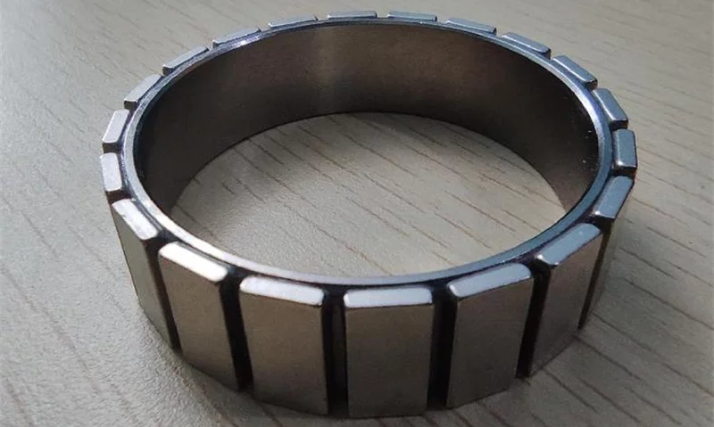
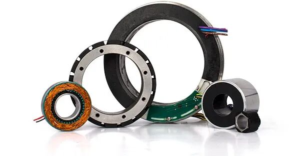
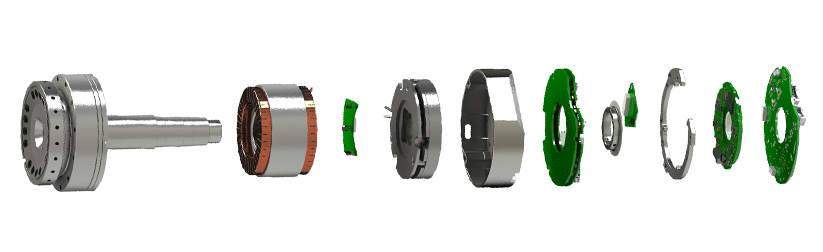
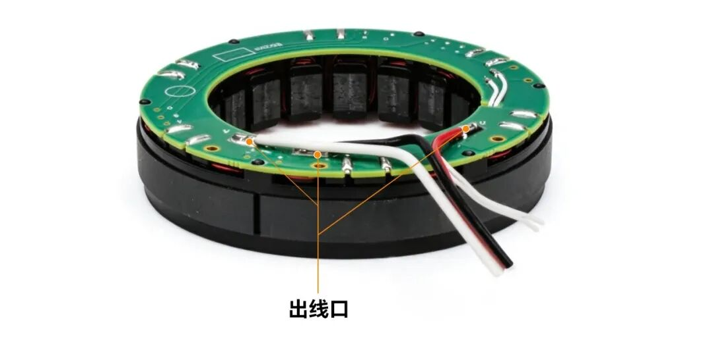

人形机器人关节电机很难依靠单一款胶水覆盖所有工况，定子绕组、转子磁钢、控制电路板、线束引出端，各自对应灌封、结构粘接、三防防护、壳体密封等不同胶材。高集成关节的胶料选型，核心不在于找一款通吃所有场景的万能胶，而是先厘清每一处点位要承受的热负荷、机械载荷、电气绝缘要求与环境考验，再针对性匹配材料方案。

无框力矩电机先天追求高扭矩密度、极致紧凑化，狭小的关节腔体里会叠加多重压力：温升集中、持续振动、交变机械应力，同时空间余量十分有限。定子绕组侧重导热散热灌封，转子磁钢则重在长效可靠的结构锁固。

人形机器人的应用场景，由其运动能力定义。运动系统的动态性能、负载能力、环境适应性与安全柔顺特性，是场景落地的前置条件。不同场景对步态、交互、抗干扰能力的差异化要求，进一步传导至关节电机、传动、粘接封装等底层材料与部件选型。

## 磁钢粘接

转子上贴了一圈钕铁硼磁钢，高速旋转的时候，离心力不小。更麻烦的是，人形机器人关节是反复启停、反复换向的，磁钢承受的不是持续稳定的离心力，而是一波又一波的冲击载荷。

这就要求磁钢粘接胶同时满足三件事：

第一，耐高温。关节电机连续运行起来，转子温度可能冲到150°C以上，普通环氧树脂到这个温度强度就掉了。得选H级耐温的体系，热变形温度够高，在高温下还能保持粘接强度。

第二，抗震动。反复换向、反复冲击，胶水层不能慢慢疲劳失效。剪切强度和剥离强度都得够，而且要有一定韧性，不能太脆。

第三，高粘接强度。磁钢和转子铁芯的表面能不一样，胶水得同时把两种材料牢牢粘住，不能界面脱粘。

## 定子线圈绕组灌封

定子绕组是电机发热的大头。人形机器人关节模组是密封的、微型化的，热量散不出去就麻烦了。

所以定子灌封胶的核心任务，是把绕组里的热量快速导到壳体上。这就要求：

第一，高导热。导热系数至少要到1.2W/m·K以上，好一点的能到2.0甚至更高。不然灌了跟没灌一样，热量还窝在绕组里。

第二，流动性好。定子里面密密麻麻都是铜线，上边还有PCB挡着，缝隙细得很，胶水得能灌进去、渗到底，不能有气泡、不能有空洞。不然那些没灌到的地方，就是散热死角。

第三，不龟裂。人形机器人关节一天热胀冷缩好几轮，灌封胶要是脆性大，冷热循环几十轮就开裂了。导热/绝缘立马打折扣。得选韧性好、热膨胀系数低的体系。

## 轴承固持

人形机器人关节里的轴承都是微型精密轴承，公差极严。轴和轴承内圈、轴承外圈和轴承座之间，配合间隙很小。

这种地方用什么胶？厌氧固持胶。

为什么选厌氧胶？两个原因：

第一，固化快。生产节拍紧，不能等胶水等半天。厌氧胶在金属间隙里、隔绝氧气的环境下，十几分钟到几十分钟就能初固，后面再完全固化。

第二，高渗透性。轴承和轴的配合间隙可能只有几微米到十几微米，胶水不能在组装时被挤出去，填满整个配合面。间隙里填满了，才能起到固持作用，防止微动磨损。

## 出线口固定

关节模组的出线口，是线束从电机内部穿到外部的地方。这个位置是整个模组的薄弱环节——既是线束出口，又是机械应力集中点，还是密封防线的缺口。

出线口固定密封胶要解决三个问题：

一是固定。线束在关节反复摆动的时候不能来回晃，晃久了线皮磨破、焊点松脱。胶水得把线束牢牢固定在壳体上。

二是密封。水汽、粉尘、油污不能从出线口钻进去，钻进去就是短路、腐蚀、失效。

三是耐弯折。关节运动的时候，出线口附近的线束会跟着弯折，胶水不能太硬把线折死，得有一定韧性，跟线束一起动而不是把它卡死。
