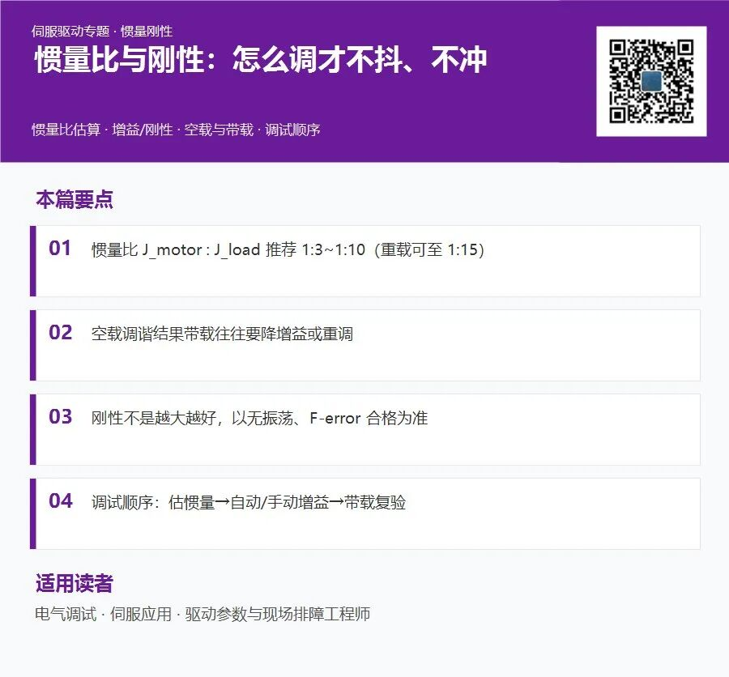
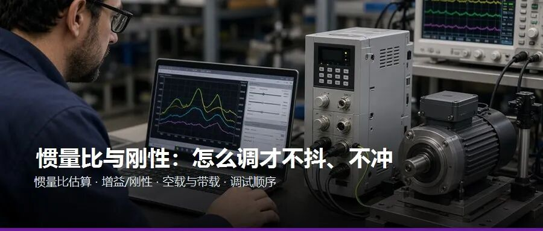

惯量比与刚性：怎么调才不抖、不冲

惯量比估算 · 增益/刚性 · 空载与带载 · 调试顺序

“空载好好的，一带料就啸叫”“刚性调到头还是抖”——多半是**惯量比 J_ratio** 与增益不匹配。本篇给估算公式、推荐范围 1:3~1:10、以及空载→带载的调试顺序。

## 📌 阅读建议：

## 阅读指引

先估惯量比再动增益；含自动调谐注意事项与振荡判定表。

## 一、概念：惯量比为什么重要

伺服增益本质是对**位置/速度误差**的响应强度。负载惯量越大，同样增益下系统越“软”或需更高积分；惯量估错，自动调谐会给出离谱参数。

| J_ratio 范围 | 含义 | 建议 |
| --- | --- | --- |
| 1:1 ~ 1:3 | 轻载 | 响应快，注意过冲 |
| 1:3 ~ 1:10 | 常规机械 | 多数应用目标区 |
| 1:10 ~ 1:15 | 重惯量 | 降增益或换大电机 |
| >1:20 | 严重不匹配 | 机械或选型复核 |

## 二、原理表：惯量估算公式

| 部件 | 近似公式 | 备注 |
| --- | --- | --- |
| 电机转子 | J_m 查手册 | kg·m² |
| 丝杠负载 | J = m×(L/2π)² | m 直线质量 |
| 转盘 | J = ½mr² | r 有效半径 |
| 减速机 | J_ref = J×i² | 折算到电机轴 |

J_ratio = J_load_ref / J_motor

## 三、原理表：增益与刚性层级

| 参数 | 作用 | 过高现象 |
| --- | --- | --- |
| 速度环 Kv | 速度响应 | 高频啸叫 |
| 位置环 Kp | 刚性/定位 | 过冲、振荡 |
| 积分 Ki | 消静差 | 低频振荡、饱和 |
| 前馈 Kff | 减跟随误差 | 对模型敏感 |
| 刚性等级 | 厂商打包增益 | 须带载验证 |

## 四、原理表：自动调谐 vs 手动

| 方式 | 前提 | 局限 |
| --- | --- | --- |
| 一键/auto tune | 空载或代表负载、可旋转 | 换料需重调 |
| 惯量识别 | 正反转测试 | 行程须足够 |
| 手动阶梯 | 理解各环 | 耗时但可控 |

## 五、现场步骤：惯量比识别（驱动自学习）

| # | 步骤 | 注意 |
| --- | --- | --- |
| 1 | 机械无干涉、限位 OK | 带代表工装 |
| 2 | 撤使能设惯量识别模式 | 查手册 |
| 3 | 启动识别，电机微动 | 人员远离 |
| 4 | 读 J_ratio 结果 | 记录到轴档案 |
| 5 | 若 >1:15 评估机械 | 减速机/电机 |
| 6 | 保存参数 | EEPROM |

## 六、现场步骤：增益调试顺序

| # | 阶段 | 内容 |
| --- | --- | --- |
| 1 | 空载 | 自动调谐或低刚性起步 |
| 2 | JOG 阶跃 | 看超调 <10~15% |
| 3 | 加代表负载 | 复测 J_ratio |
| 4 | 微调 Kp/Kv | 一次改 5~10% |
| 5 | 工艺速度带载 | F-error 合格 |
| 6 | 长时间跑片 | 温升、异响 |

## 七、参数对照：刚性等级参考

| 应用 | J_ratio 参考 | 刚性策略 |
| --- | --- | --- |
| 高速贴标 | 1:3~1:5 | 中高刚性+前馈 |
| 搬运龙门 | 1:5~1:10 | 平衡刚性 |
| 大转盘 | 1:8~1:15 | 偏低刚性、长加减速 |
| 精密压装 | 力控为主 | 位置环适度 |

## 八、常见错误：刚性调试坑

| 误区 | 后果 | 正解 |
| --- | --- | --- |
| 空载调最高刚性 | 带载振荡 | 带载终调 |
| 振荡继续加 Kp | 电机啸叫 | 降 Kp/Kv 或增阻尼 |
| 忽略机械间隙 | 反向死区大 | 修机械 |
| J_ratio 不估直接 tune | 参数离谱 | 先识别惯量 |

## 九、故障表：振荡类型判读

| 振荡特征 | 可能原因 | 调整 |
| --- | --- | --- |
| 高频啸叫 | Kv/Kp 过高 | 降速度环增益 |
| 低频摆动 | Ki 过大/惯量比高 | 降积分 |
| 换向瞬间抖 | 间隙/摩擦 | 机械+换向补偿 |
| 停止过冲 | 减速度不足/刚性高 | 加减速或降 Kp |

## 十、调试清单：带载验收

| □ | 项 | 标准 |
| --- | --- | --- |
| □ | J_ratio 记录 | 1:____ |
| □ | 额定速度 F-error | ≤ ____ mm |
| □ | 无 audible 振荡 | OK |
| □ | 参数快照归档 | OK |

## 十一、经验摘要

刚性够用即可；**1:3~1:10** 是多数产线的舒适区；换工装=重新识别惯量；振荡先降增益再查机械。

## 十二、小结

惯量与刚性 = **估对比 → 调增益 → 带载验**。下一篇用 JOG 与 TRACE 曲线把“设定/实际/误差/力矩”看出来。

要点速记

| # | 记住这句 |
| --- | --- |
| 1 | 惯量比 J_motor : J_load 推荐 1:3~1:10（重载可至 1:15） |
| 2 | 空载调谐结果带载往往要降增益或重调 |
| 3 | 刚性不是越大越好，以无振荡、F-error 合格为准 |
| 4 | 调试顺序：估惯量→自动/手动增益→带载复验 |

**下一篇：JOG 与 TRACE——曲线怎么看**

本文为伺服驱动现场调试技术分享，参数、报警码与接线因品牌与固件而异，请以厂商手册、项目规范及现场验证为准。
