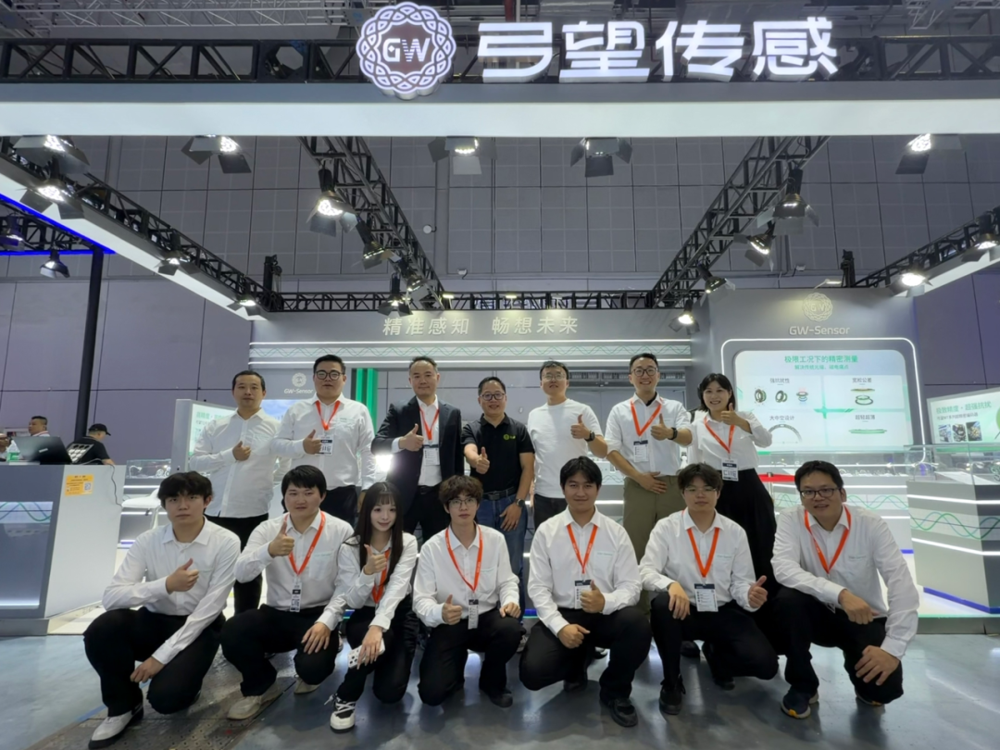
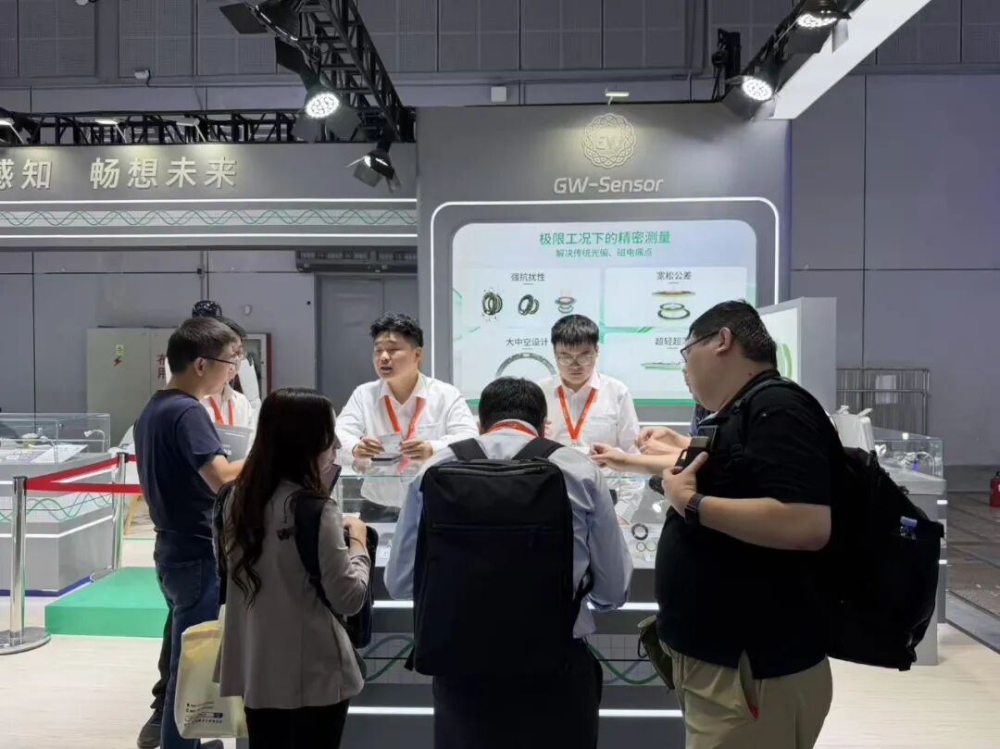
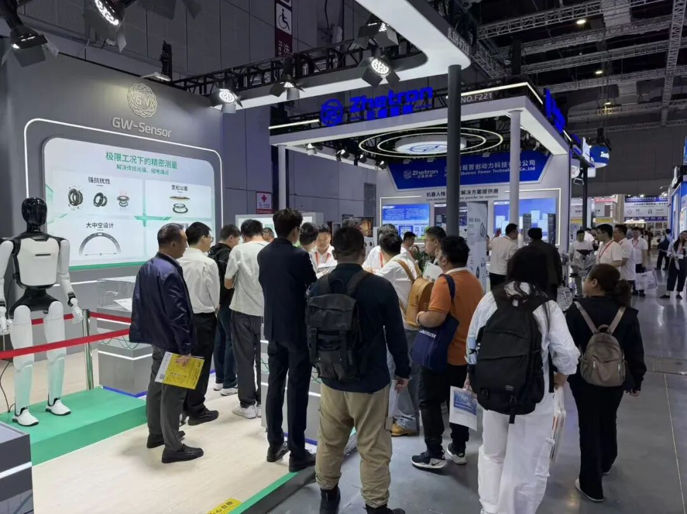
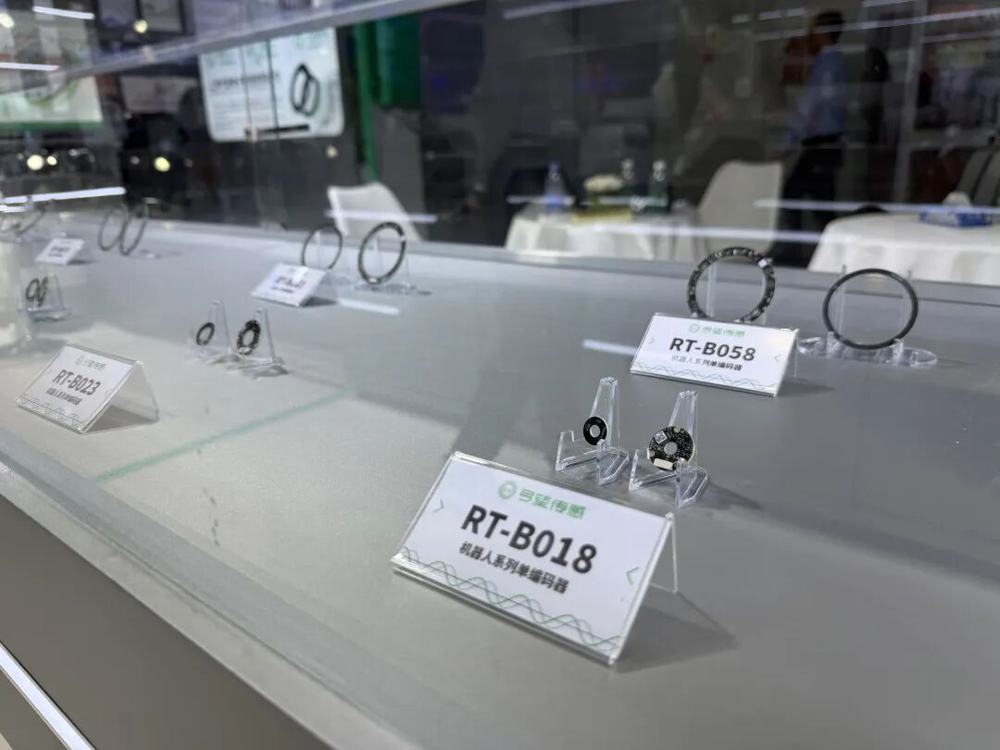
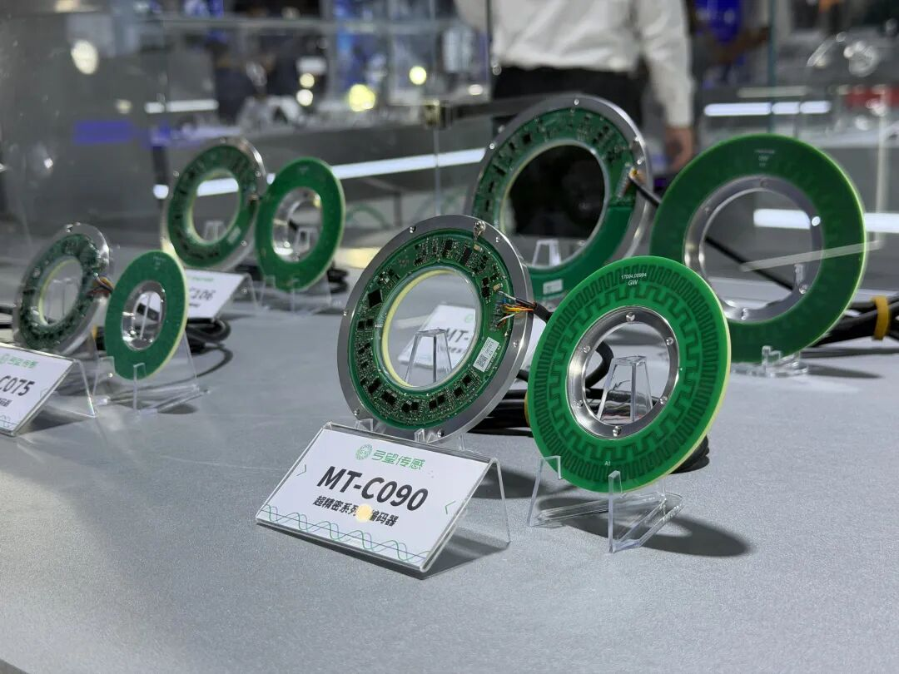
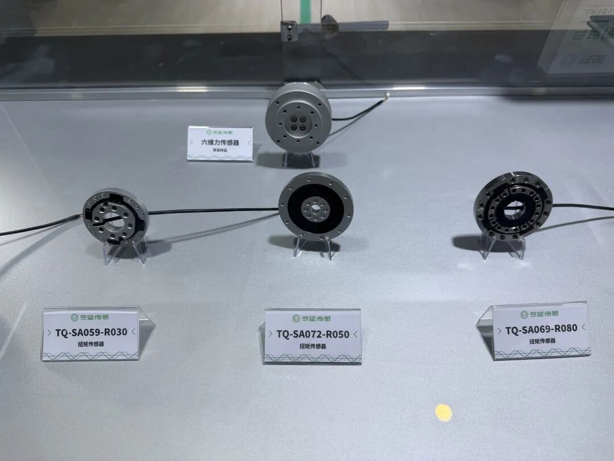

10月16日，为期五天的2026第26届中国国际工业博览会（CIIF）在上海国家会展中心圆满收官。弓望传感（展位号：8.1馆 F218）此次携核心传感技术及应用方案亮相，与各界行业同仁共话智能制造新未来。

## 展会盛况

## CIIF2026

展会期间，弓望传感72平方米的展台迎来了众多新老客户、合作伙伴及行业专家的驻足交流。现场交流氛围热烈，我们与众多业内人士围绕工业自动化领域的核心痛点与前沿需求，进行了深入的业务探讨与技术对接。

本次工博会，弓望传感重点展示了三大核心产品线：

- RT系列机器人传感器

专为下一代协作机器人与具身智能关节量身定制。该系列采用高集成度紧凑设计，无惧强磁干扰、油污飞溅与粉尘侵袭，在极端工况下依然能提供稳定、高动态响应的绝对位置反馈，彻底释放机器人关节的结构设计与运行自由度。

- MT系列超精密传感器

面向高端数控转台、半导体设备及精密直驱系统打造的核心测量部件。凭借卓越的抗偏心容忍度与极强的环境鲁棒性，能够在严苛工业环境中持续输出角秒级的高精度位置信号，为高端加工装备的精密闭环控制提供坚实保障。

- TQ扭矩系列传感器

赋予高端智能装备“敏锐力觉”的关键中枢。具备毫秒级极速动态响应与卓越的维间解耦能力，可精准捕捉微小且复杂的力学交互变化，为协作机器人的安全拖拽、精密柔性装配及高阶力控场景注入强劲的底层感知支撑。

落幕不散场。衷心感谢每一位在展会期间莅临弓望传感展台的朋友。展会现场收集到的宝贵建议与合作意向，我们的团队将在展后第一时间跟进落实。

未来，弓望传感将继续秉持“让中国传感器感知世界”的理念，持续深耕底层传感技术，用更优质、更可靠的产品赋能工业自动化进程。

---
