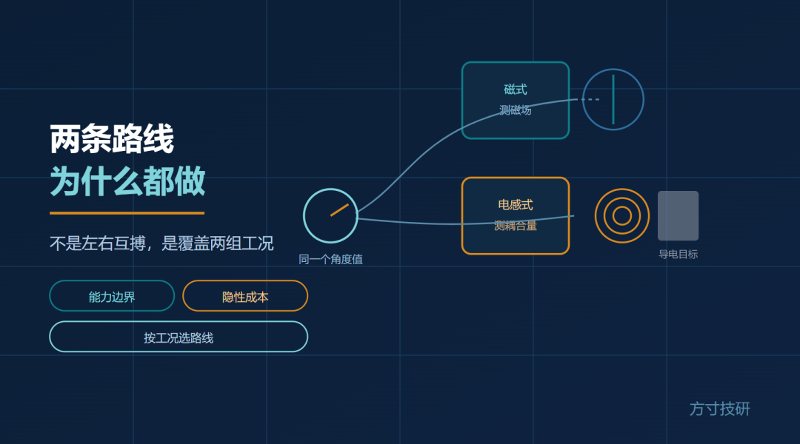
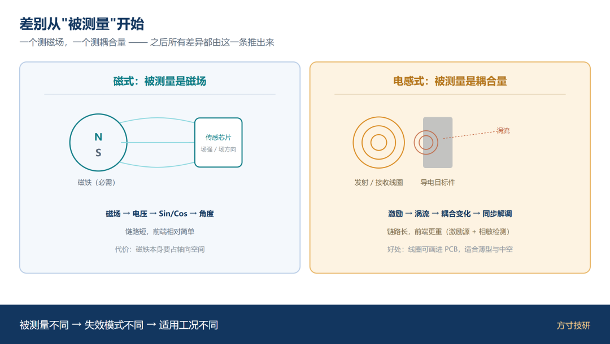
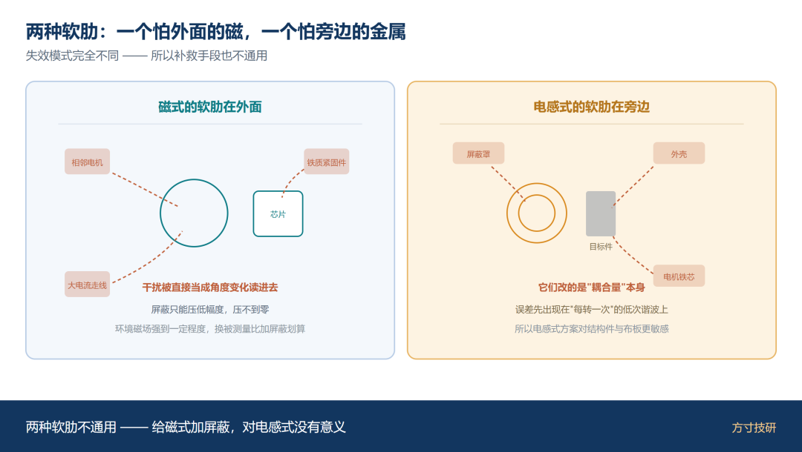
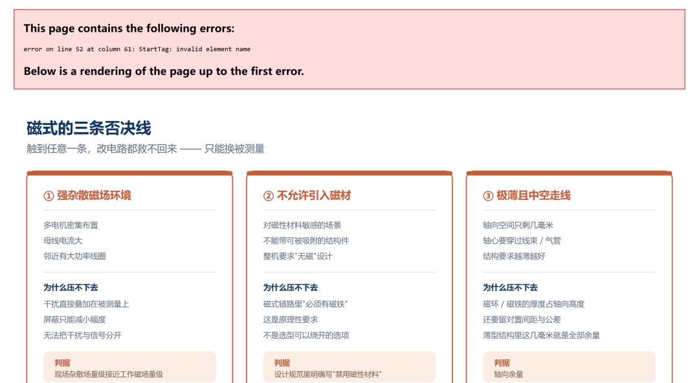
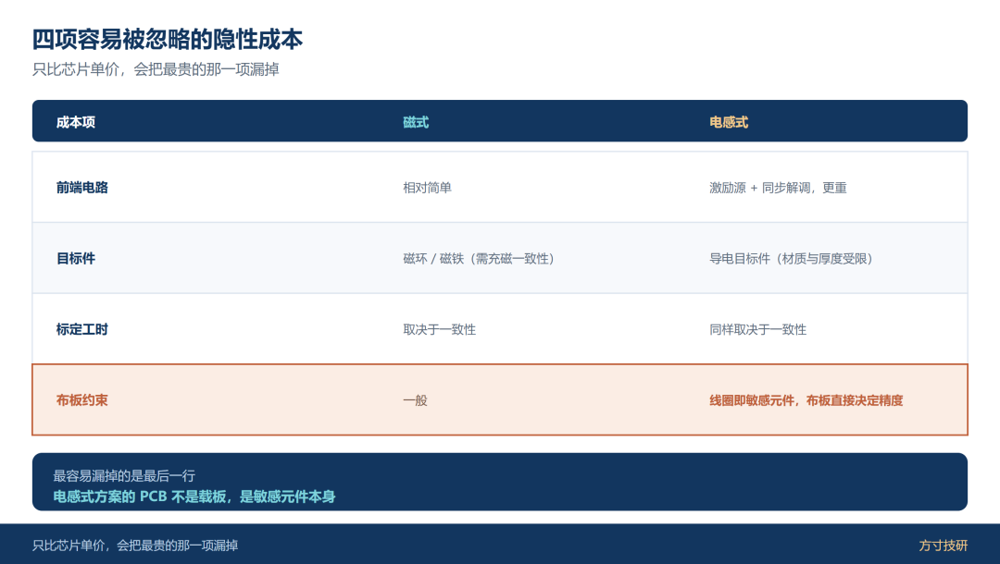
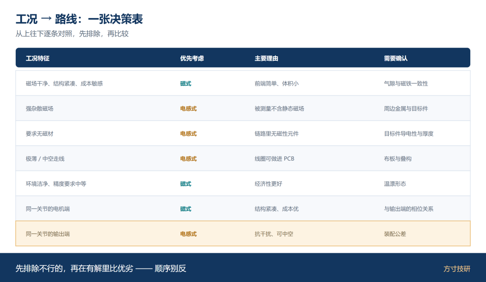

磁式与电感式，抢的是同一个位置：关节上的那个角度值。

按常理，一家公司应该押注其中一条，把另一条留给对手。但确实有芯片公司两条线同时做，而且都当主力推。

把两份资料并排看，你会更犹豫——参数各有优劣，条条都能对得上你的需求。

这个犹豫，来自问错了问题。**它们不是竞品关系。**

## 一、差别从"被测量"开始

磁式方案的被测量是**磁场**：芯片感应的是一块磁铁产生的场，从场强或场方向反推角度。

电感式方案的被测量是**线圈之间的耦合量**：芯片给线圈加交变激励，靠导电目标改变耦合，从耦合量的变化反推位置。

一个测磁，一个测耦合。这一个差别，决定了它们的失效模式完全不同。

**磁式的软肋在外面。** 相邻电机的漏磁、大电流走线、附近的铁质紧固件，都会直接污染磁场，被芯片当成角度变化读进去。

**电感式的软肋在旁边。** 外壳、屏蔽罩、电机铁芯这些导体，会改变线圈的耦合量；而它靠的就是耦合量本身。

一句话：**磁式怕"外面的磁"，电感式怕"旁边的金属"。**

图 1｜磁式"磁场 → 芯片"，电感式"激励 → 涡流 → 耦合量 → 芯片"

图 2｜外部杂散磁场侵入磁式

## 二、磁式做不了的三种工况

**第一，强杂散磁场环境。** 多电机密集布置、母线电流大、邻近有大功率线圈的场合，磁场干扰很难靠屏蔽压到可接受水平。这时候换被测量比加屏蔽更划算。

**第二，不允许引入磁材的场景。** 有些应用对磁性材料敏感（会被外部强磁场吸住、或本身不能带磁性）。

**第三，结构极薄且要中空走线。** 磁式链路里必须有一个磁环或磁铁，它要占轴向高度；薄型关节、穿线结构里，这几毫米往往就是全部余量。

一句话：**磁式的三条否决线，几乎都和"磁"这个物理量本身有关，改电路改不掉。**

图 3｜强杂散磁场 / 不允许磁材 / 极薄中空

## 三、电感式不划算的三种工况

反过来，电感式也不是万能解。

**第一，目标件不导电或太薄。** 没有足够的涡流，就没有足够的耦合变化。

**第二，周边金属无法控制。** 如果外壳、法兰、铁芯的形状与材料改不了，耦合量的基线就不稳定，误差会先出现在"每转一次"的低次谐波上。

**第三，成本敏感且精度要求中低。** 电感式前端更重：需要激励源、需要同步解调，模拟部分的工程量与器件成本都高于磁式。**用不上的精度去换抗干扰能力，是划不来的。**

还有一个常被忽略的前提：线圈是画在 PCB 上的，也就是说**这套方案的精度上限，有一部分在布板阶段就定死了**。

图 4｜目标件不导电 / 周边金属不可控 / 成本敏感且精度中低

## 四、产品逻辑不是替代，是分工

理解了上面的边界，双路线就不难解释了。

**它不是"押注两条路"，而是"覆盖两组工况"。** 客户需求本来就分成两堆：一堆场景磁场干净、结构紧凑、要便宜；另一堆场景干扰重、要薄、要中空。一条路线吃不下两堆。

有意思的是，这两个需求经常出现在**同一台设备的不同位置**上。

以关节为例：电机端的编码器测电角度，靠近绕组和母线，但结构尺寸小、对成本敏感；关节输出端的编码器测机械角，靠近结构件、走线复杂，还常常要中空过线。**同一个关节，两头选的路线可以不同。**

对供应商来说，这意味着双路线不是内耗，而是同一客户身上的两笔生意。

一句话：**它们不是同一场比赛的两个选手，而是两把不同用途的工具。**

图 5｜电机端标"磁式（电角度）"、输出端标"电感式（机械角）"

## 五、对选型工程师意味着什么

拿到两套方案时，别先比参数。先定工况，路线自然就出来了。

**三问：**

· **环境磁场强不强？** 相邻电机、大电流走线、强磁结构件——任何一项突出，就把磁式往下排。

· **结构允不允许用磁铁？周边金属能不能控制？** 不许用磁材 → 排除磁式；金属结构改不了 → 电感式要打问号。

· **精度与成本怎么取舍？** 精度要求中低且成本敏感，磁式通常更经济；需要抗干扰和薄型，电感式的溢价才划算。

**四项容易被忽略的隐性成本：**

|  |
| --- |
|  |

|  |  |  |
| --- | --- | --- |
| 成本项 | 磁式 | 电感式 |
| 前端电路 | 相对简单 | 激励 + 同步解调，更重 |
| 目标件 | 磁环 / 磁铁 | 导电目标件 |
| 标定工时 | 取决于一致性 | 同样取决于一致性 |
| 布板约束 | 一般 | 线圈即敏感元件，布板直接决定精度 |

最后一行值得单独记住：**电感式方案的 PCB 不是载板，是敏感元件本身。** 这意味着它的成本不只是器件成本，还包括一次成功的布板设计能力。

图 6｜三个问号分支卡片 + 各自指向的路线

图 7｜前端电路 / 目标件 / 标定工时 / 布板约束

## 六、工况 → 路线决策表

|  |
| --- |
|  |

|  |  |  |  |
| --- | --- | --- | --- |
| 工况特征 | 优先考虑 | 主要理由 | 需要确认 |
| 磁场干净、结构紧凑、成本敏感 | 磁式 | 前端简单、体积小 | 气隙与磁铁一致性 |
| 强杂散磁场 | 电感式 | 被测量不含静态磁场 | 周边金属与目标件 |
| 需要无磁材 | 电感式 | 链路里无磁性元件 | 目标件导电性 |
| 极薄 / 中空走线 | 电感式 | 线圈可做进 PCB | 布板与叠构 |
| 环境洁净但要求中等精度 | 磁式 | 经济性更好 | 温漂形态 |
| 同一关节的电机端 | 磁式 | 结构紧凑、成本优 | 与输出端的相位关系 |
| 同一关节的输出端 | 电感式 | 抗干扰、可中空 | 装配公差 |

图 8｜七行工况 → 路线决策表卡片

## 总结

· **差别从被测量开始**：磁式测磁场、电感式测耦合；一个怕外面的磁，一个怕旁边的金属。

· **双路线是工况驱动的分工**，不是左右互搏；同一台设备的不同位置完全可以用不同路线。

· **选型先定工况再定路线**：三问（磁场、结构、取舍）+ 四项隐性成本，比对着参数表逐行比较更省时间。

💬 你们项目上是单一方案，还是同一台设备混用两种路线？踩过哪种"换路线就能解决"的坑？评论区聊聊。

喜欢这类把选型逻辑摊开讲的内容，点个关注。

**—— 方寸技研 · 下期预告：工业伺服 / 协作机器人 / 人形关节——三种工况的选型分歧点。**
