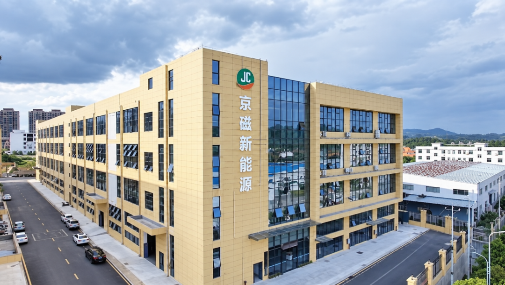
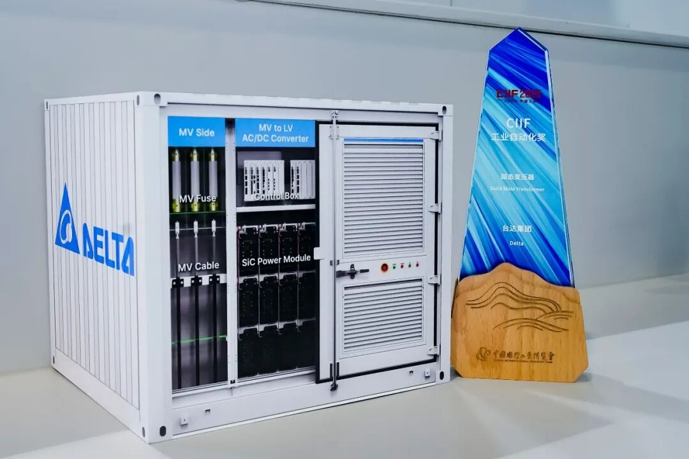
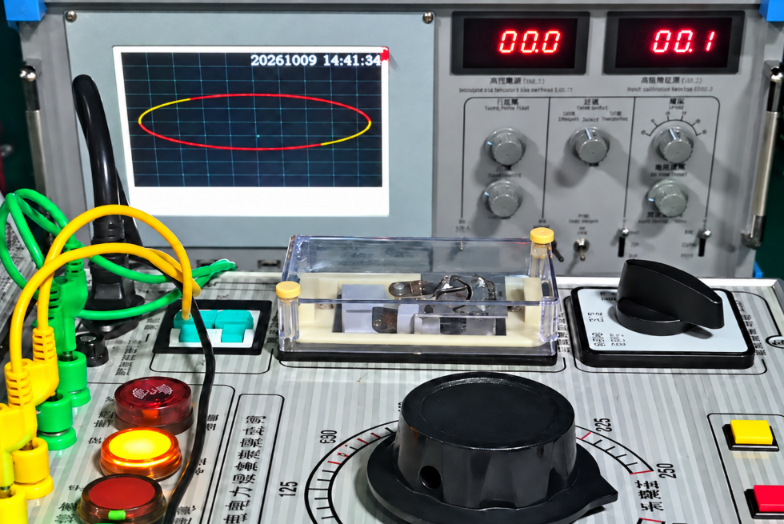
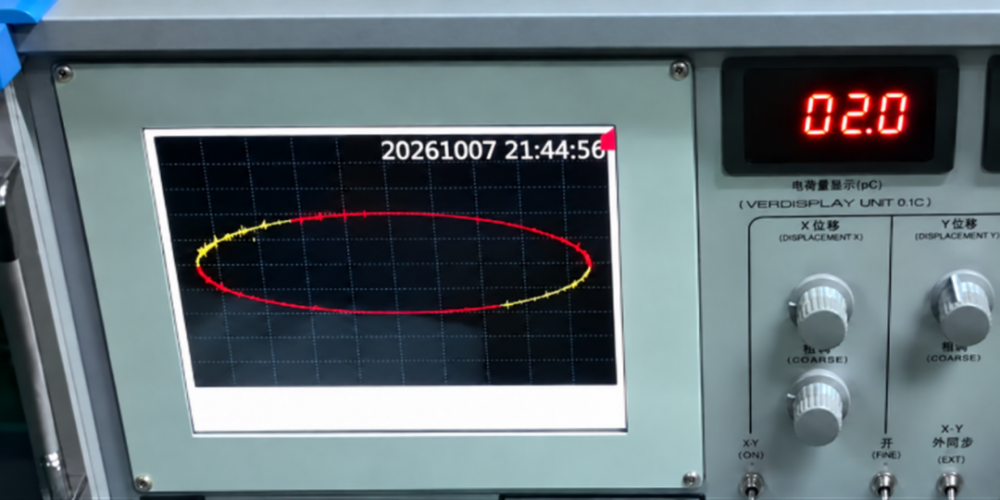
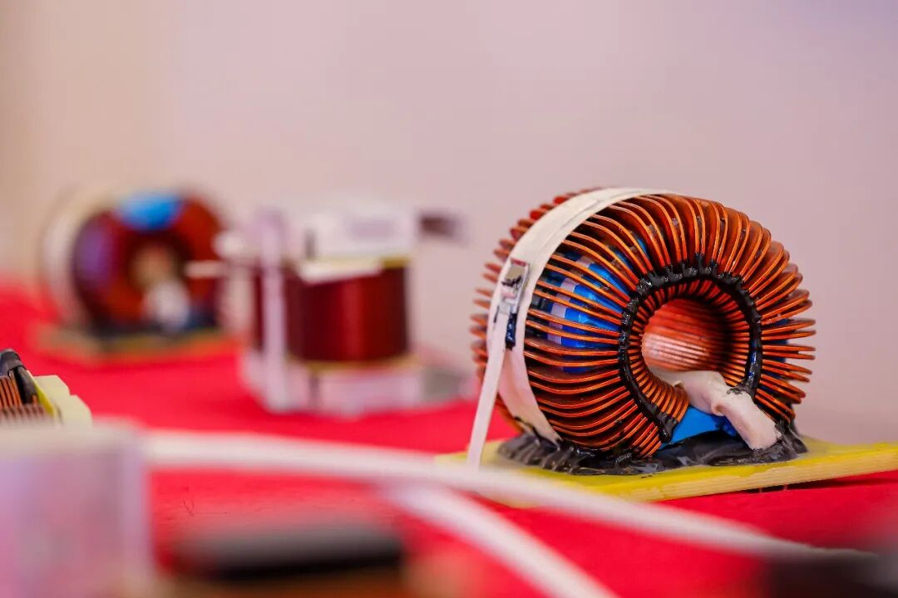
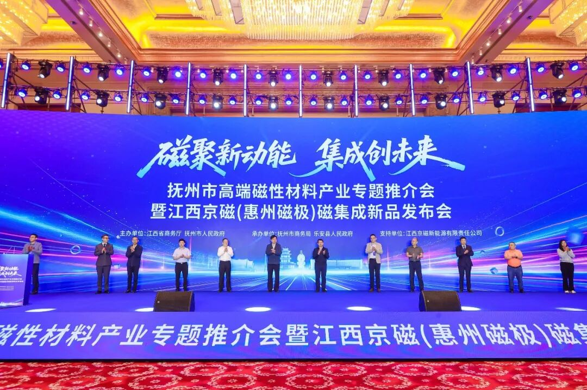
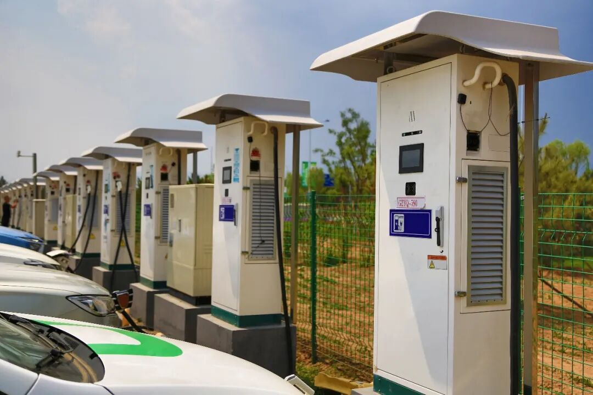

作者 | 文昌先生

封面 | 京磁新能源

SST赛道，再迎新玩家！

今年6月，惠州新增了一家名为“固态特变新能源科技有限公司”的企业。在其公开信息中，“专注SST电力电子元器件”几个字格外醒目。

再往下看，这家新公司的背景并不陌生——正是曾公开举办行业首场磁集成新品发布会的惠州磁极(江西京磁)。

从磁集成到SST，磁极这次显然不只是增加一条产品线这么简单。磁极为何选择在这个时候落子？SST磁件还面临哪些应用难点？带着这些问题，《磁性元件与电源》记者专程采访了磁极研发总经理海来布曲。看看SST热度背后，产业链上游又能给出什么答案。

一

## SST的“拦路虎”

## 局方只是第一关

SST与传统工频变压器相比，不只是承担电压变换，还能通过电力电子模块实现交—交、交—直、直—直之间的灵活转换；模块化、组串式的结构，也让系统更容易按功率需求扩展。

SST / 台达集团

但“能做出样机”和“能够规模化应用”，中间隔着一条很长的工程化鸿沟。磁极研发总经理海来布曲没有先谈市场空间，而是先提到一个高频出现于研发现场的词：**局部放电。**

“以10kV的SST系统为例，电压升高以后，材料承受的电应力更大，绝缘老化和局部放电的风险也会上升；频率提高之后，涡流损耗、温升等问题又会更明显。”海来布曲说道。高压与高频叠加，意味着磁件要同时应对绝缘、散热、损耗、体积和寿命等多重约束。

0pC背景局放 / 惠州固态特变

局放也不是换一种绝缘材料就能解决。材料体系、绕组结构、磁路设计、制造工艺以及整机运行工况，需要被放在同一个系统里考虑。任何一环处理不当，都可能让实验室里的指标在长期运行中失效。

海来布曲透露，目前“惠州固态特变”依托自建自研局放屏蔽实验室，能够构建无本底干扰的高精度检测体系，配套局放测试系统实现0pC 背景局放，彻底剥离外部电磁噪声干扰（pC为皮库仑，是衡量局部放电量的单位；相同测试条件下，数值越小，局放越弱）。

 10KV 局放2pC / 惠州固态特变

在此超高灵敏度测试条件下，现阶段公司面向10kV SST系统的磁件实测局部放电低至2pC，在高频高压工况下绝缘控制能力实现局放指标跨越式突破，并进入样机和小批量交付阶段。

二

## 年投入近3000万

**如何把“磁”做到极致？**

回到磁极本身，它为什么敢在市场尚未成熟时提前落子？答案首先藏在这家企业过去十多年的路径里。

## 1.18年积淀 打下制造基础

磁极从2008年的线圈制造起步，随后把业务延伸到变压器、磁环电感等磁性元器件，并在惠州做器件、在江西做磁粉和磁芯，逐步打通“材料—磁芯—器件”链条。如今，其产品已经进入车载、光伏、充电桩和工商业储能等场景。

图 / 磁极

海来布曲介绍，公司今年上半年实现约3亿元销售额，全年目标为6亿—7亿元，工商业储能正是突出的增长来源。

## 2.95%，把磁集成做成标配

而真正让磁极形成行业辨识度的，是磁集成。

2024年，磁极公开举办磁性元器件行业首场新品发布会，把磁集成产品推到台前；今年5月，它又在南昌举办第二场发布会，推出第七代磁集成产品。磁极想让行业看到的，也从“我们在做磁集成”，走到了“这些产品正在怎样被客户使用”。

图 / 磁极新品发布会

这个过程并不轻松。早期客户会担心可靠性，也会怀疑实际效果能否达到方案指标。随着部分车载项目连续运行七八年，以及工商业储能客户开始更细致地核算体积、效率与成本，磁集成才逐渐从需要反复解释的方案，变成可以进入量产评估的选择。

“目前，我们大约95%客户都在用磁集成产品。”海来布曲说道，也正是在这段磨合中，磁极积累了理解整机的能力。

多路磁通进入同一个磁回路，可能叠加，也可能抵消；环流、纹波、发热和啸叫，都与客户的拓扑、控制算法和实际工况相互牵连。海来布曲举例说，有客户开发100kW产品，功率还没跑到10kW，啸叫和发热就已经非常明显。

“磁集成不是简单地把几个电感放到一起。”

## 3.千万研发筑牢技术护城河

目前，磁极已开发出24合一的多路交错并联磁集成产品，并进入小批量试产。据海来布曲介绍，公司每年研发投入约2000万—3000万元，累计授权专利近80项，其中国家发明专利近10项。

而SST同样需要把磁路、电路、控制和热管理协同设计。海来布曲表示：“磁极早在2017年至2018年就开始关注SST，2023年决定系统布局，随后组建专门事业部，配置局放实验及高压测试设备，直到今年才将产品推向市场。”

三

## SST产业链仍在磨合

即便如此，磁极对SST的判断并不激进。

“现阶段的SST，有点像新能源汽车发展的早期，更多是在试产和验证。”海来布曲说，一开始，行业先回答“能不能用”；真正进入市场后，才会继续追问效率、可靠性和成本。

“整机厂一次可能交付10套、20套系统，换算到磁件端，一批大约是两三百只。”海来布曲表示，市场没有立刻放量，不等于应用方向模糊。

AI数据中心、充电站、工商业储能电站、轨道交通配电房以及电网配电，都是磁极正在接触的场景，公司也已向不同方向送出样品。

在磁极看来，AI数据中心和高功率充电设施，是当前更有希望率先形成SST增量的两个方向。

图 / 包图网

英伟达正在加速推进800VDC供电架构，兼容现有交流基础设施的800VDC Power Rack计划于2026年下半年落地，面向更高密度AI机架的Row Power Center等方案则计划在2027年进一步导入。

随着AIDC的机架功率不断提升，传统供电链路在效率、占地和扩展性上的压力会进一步放大，也为SST直接连接中压电网、减少中间转换环节提供了应用空间。

充电桩也是如此。比亚迪已将乘用车闪充进一步推向兆瓦级，2026年发布的最新闪充系统单枪最高功率达到1.5MW。充电设施正从“多建桩”向“提高单枪功率”演进。功率越高，场站对电网接入、模块化扩容和直流供电的要求也越高，这与SST的技术特点较为契合。

技术之外，还有另一道门槛。SST标准化仍处于推进阶段。不同应用、电压和技术路线之间，尚未形成成熟统一的全球标准体系。

整机方案对频率、电压、绝缘和热设计的要求并不相同，磁件很难脱离整机单独定型。SST迟迟没有大规模放量，并非需求不够热，而是技术、标准与供应链协同仍在磨合。

由此看，SST的第一轮竞争未必是单纯拼产能，而是谁能先把样机指标变成可复制的工程能力，并与整机厂一起完成长期验证。

## 最后

磁极成立新公司，是磁性元器件企业向SST靠拢的一个缩影。在高压、高频环境下，磁件直接影响系统的绝缘可靠性、功率密度、效率与使用寿命，它不是SST内部一个可以最后再定的普通零件，而是决定整机边界的重要部分。

但磁件企业单点突破，仍不足以推动SST规模化。当前行业缺少统一、清晰的技术接口和验证标准，更需要SST整机厂牵头，让功率半导体、磁性材料、磁件、绝缘与检测等上下游尽早进入同一套设计和验证体系。

当SST从“做得出来”走向“批量可用”，磁件能否从被动配套转向共同定义系统标准，或许正是这条新赛道真正值得追问的命题。

#磁极 #SST #磁性元器件
