电机产品技术前哨 · 第008期

机器人对关节模组的轴向尺寸要求很高，市场需求也在推动不同技术路线演化。本文从电机出发，比较径向外转子与轴向磁通这两种集成思路。

## 两种关节电机拓扑，两种思路

以肩关节为例，整个模组除了电机，还有减速器、输出轴承、电控和端盖。要让肩部收紧，一是减薄电机本体，二是让部件共用轴向空间。

以MIT为代表的外转子方案，把直径做大、铁芯做短，再把中心留给齿轮，降低总体高度。

拓普的双转子单定子轴向方案，把绕组端部转到内外圆，减少端部的轴向占位，再把中心留给电控。

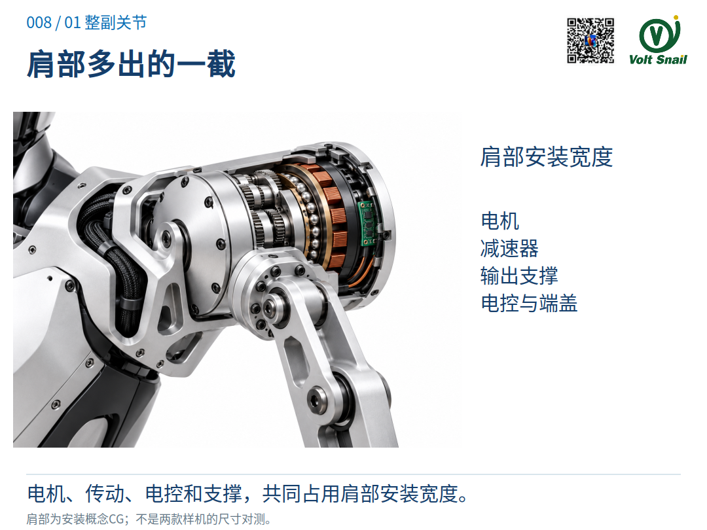*图1｜肩部安装概念CG，展示传动、电机、电控和输出支撑的轴向占位。*

MIT的转子在外圈，包住定子，气隙沿圆柱面展开。拓普的定子夹在两片转子盘之间，两道气隙都在盘面上，形成“转子—定子—转子”的R-S-R结构。

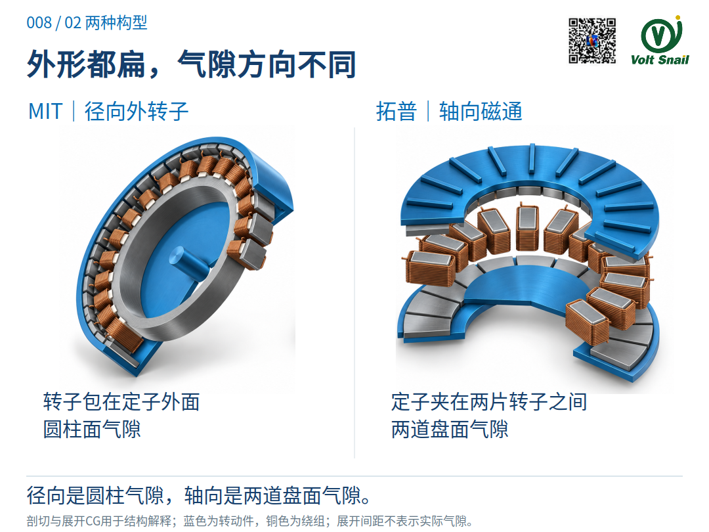*图2｜左为径向外转子剖切，右为轴向R-S-R组件沿轴向展开；展开间距用于看清结构。蓝色为转子，铜色为绕组。*

## 电机本体长度构成

MIT原型的气隙直径为81 mm，铁芯叠长为8.2 mm。工作半径增大，同样的切向力能产生更大的转矩，铁芯便有缩短的空间。

装上绕组，端部还会增加轴向长度。再装入行星齿轮、输出支撑、背面电控和端盖，模组总长达到40 mm。8.2 mm的铁芯叠长，只是其中一段。

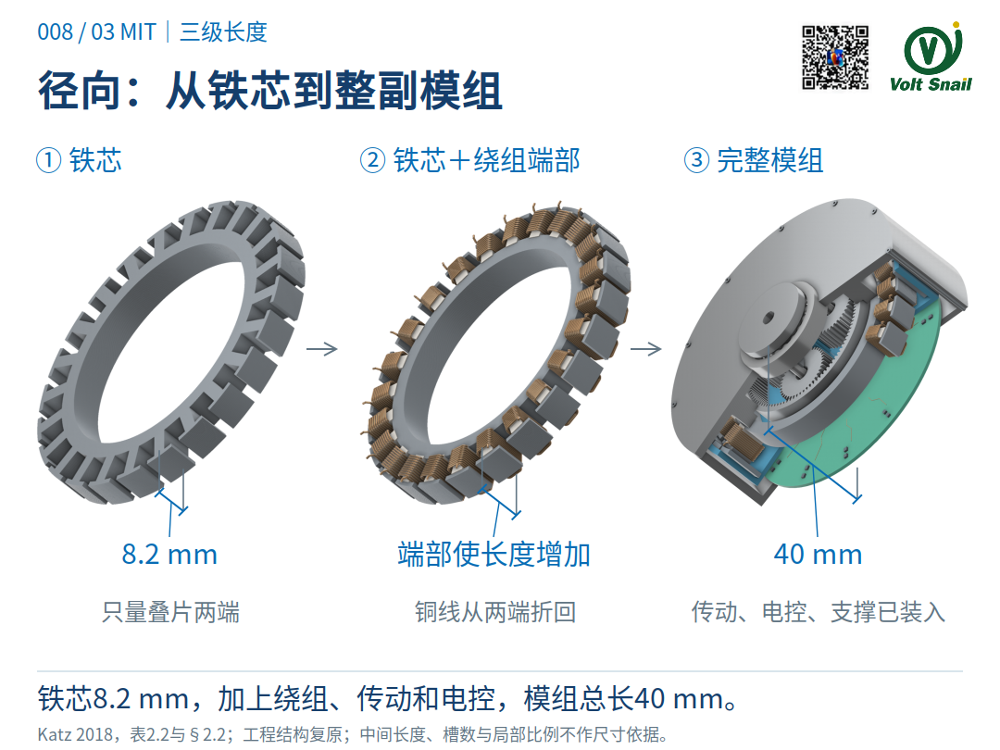*图3｜左为裸铁芯，中间加上绕组端部，右为完整模组。8.2 mm铁芯叠长、40 mm总成长度引自Katz论文；绕组中间长度未公开，重复槽数及局部比例只用于解释结构。*

轴向电机的铜线在定子内外圆折回，双转子单定子因此能减少绕组端部的轴向占位。但两片转子盘、磁体和两道气隙仍要留空间，不能把定子厚度直接当成电机本体厚度。

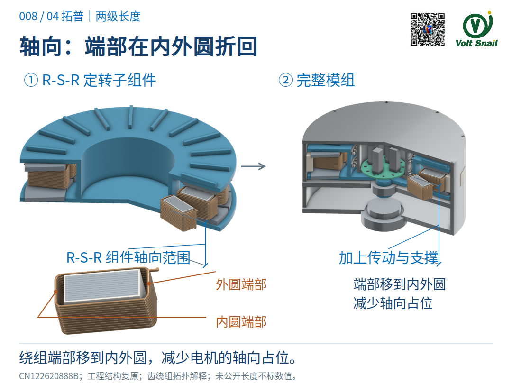*图4｜左上为装配状态R-S-R组件，右上为完整模组；下方放大同一齿绕组，标出内外圆端部。根据CN122620888B复原装配关系，未知尺寸不标数值。*

## 齿轮或电控，和电机共用轴向空间

MIT把中心让给了齿轮，控制、位置检测和通信便集中到背面的PCB上，相线与信号连接留在模组内部。

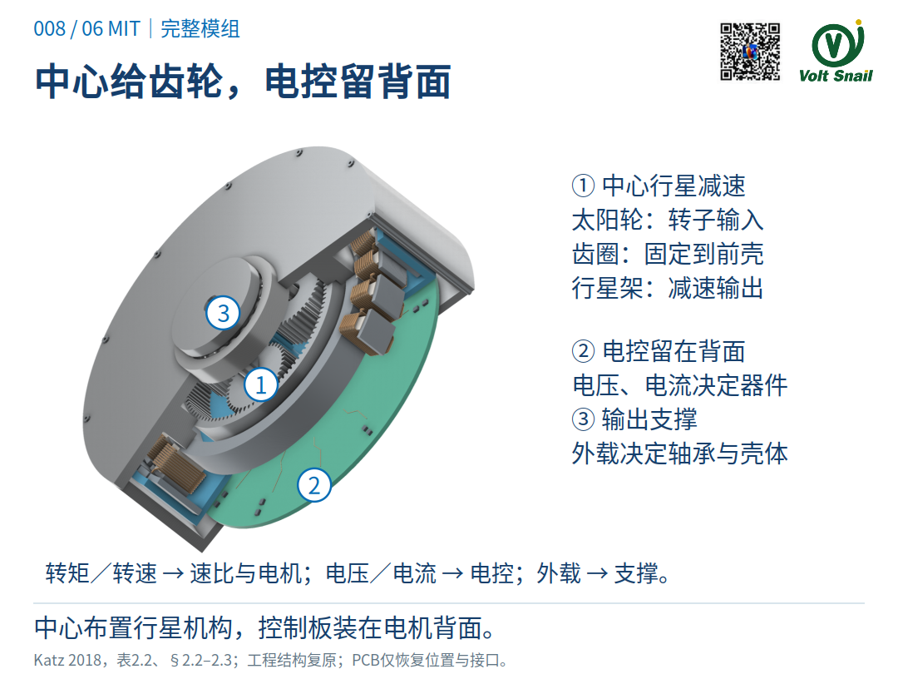*图6｜剖切图中，①为中心行星机构；②为背面固定PCB；③为输出端支撑。零件重复数及电子元件布局不作为官方制造数据。*

拓普的电控装在固定凹壳内。凹壳从转子筒的开口端伸入，固定在壳体上；两片转子盘连在筒上，通过轴承绕凹壳旋转。中心电控保持静止，转矩从筒的闭端传出。

电控进了中心，背面独立电控层所需的长度随之减少；另一侧仍要容纳传动与输出支撑。图7把传动腔画成两级行星减速：第一级行星架带动第二级太阳轮，第二级行星架连接输出端，两级齿圈固定在机壳上。这里补足的是集成构型，专利未公开具体齿轮机构、级数及速比。

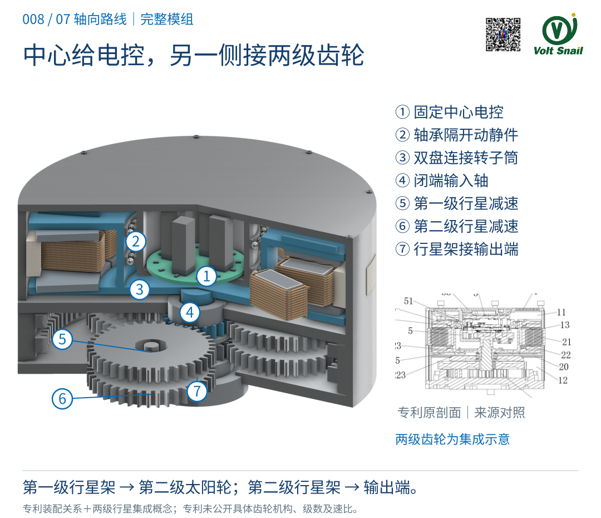*图7｜中心为固定电控，另一侧传动腔布置两级行星减速。⑤为第一级，⑥为第二级，⑦为输出端；第一级行星架连接第二级太阳轮。两级机构为集成示意，非专利已公开的级数、齿数或速比。*

## 共壳以后，误差进入哪里

电机、齿轮和轴承共用壳体，重复端盖和中间连接件可以减少，定位误差也会相互传递。

MIT的径向结构第一批壳体出现过齿轮卡滞，原因是输出轴承孔与齿圈孔的同轴误差改变了啮合。改版把这些同轴特征尽量移到同一侧，在一次装夹中加工。

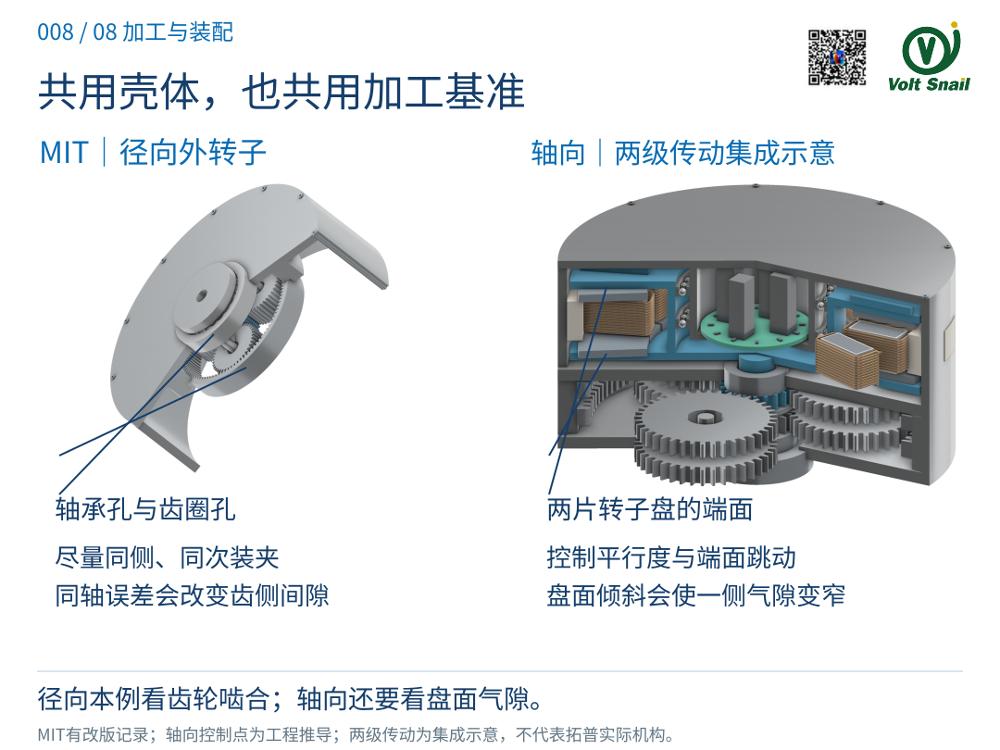*图8｜左侧标出轴承孔与齿圈孔的同轴定位区域，右侧标出两片转子盘端面。轴向侧沿用图7的两级传动模组；本图解释加工关系，不给出实测公差。*

轴向电机结构还多了一组盘面关系。矛盾转移到了端面跳动、盘面倾斜和轴承轴向定位误差，这会让圆周上的气隙一边大、一边小。两片转子盘与定子的定位面，需要一起安排加工和装配基准。

关节输出端受到弯矩时，两处支承形成一对反力。支承间距越短，相同弯矩所需的反力越大，轴承座和壳体也更容易变形。两种路线都会遇到这个约束。

轴向电机还要承受盘面的磁吸力。两片转子的总轴向力可以平衡，每片盘却仍被吸向定子。盘面一旦局部挠曲，气隙变小，吸力继续增大。

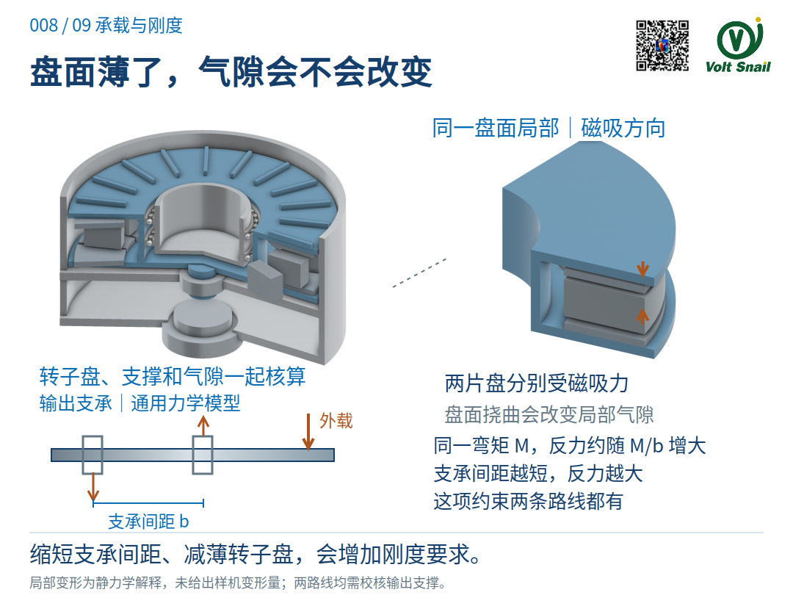*图9｜左图为轴向模组的盘面与支撑，右图为盘面局部。橙色箭头表示两片盘分别受到朝向定子的磁吸力。左下为通用双支承模型，非该专利的具体轴承布置；悬伸外载下两支承反力方向相反。*

## 绕组与电控，各自把热传出去

MIT原型的绕组通过固定结构和空气向外散热。附加送风后，温升明显下降，持续出力也随冷却条件改变。

拓普把分块铁芯和绕组灌封，外环穿过壳壁开槽，露在壳外。热量经灌封材料传到外露面，再散向环境。灌封层越厚、有效截面越小，热越难传；气泡和接触不良还会增加界面热阻。转子盘背向定子的一侧还布置了环形散热叶片，随转子旋转推动空气。

MIT的功率器件通过导热垫接触背面铝壳。拓普把控制板移入中心凹壳，器件通过导热凸部连接散热盖。两处都是从器件顶部，把热传到固定金属件。

板高、器件高度和导热垫压缩量决定装配后的接触。过松会增加热阻，压得过重会损伤器件或电路板。电控层的厚度，也受这处接触所需的尺寸和压紧量约束。

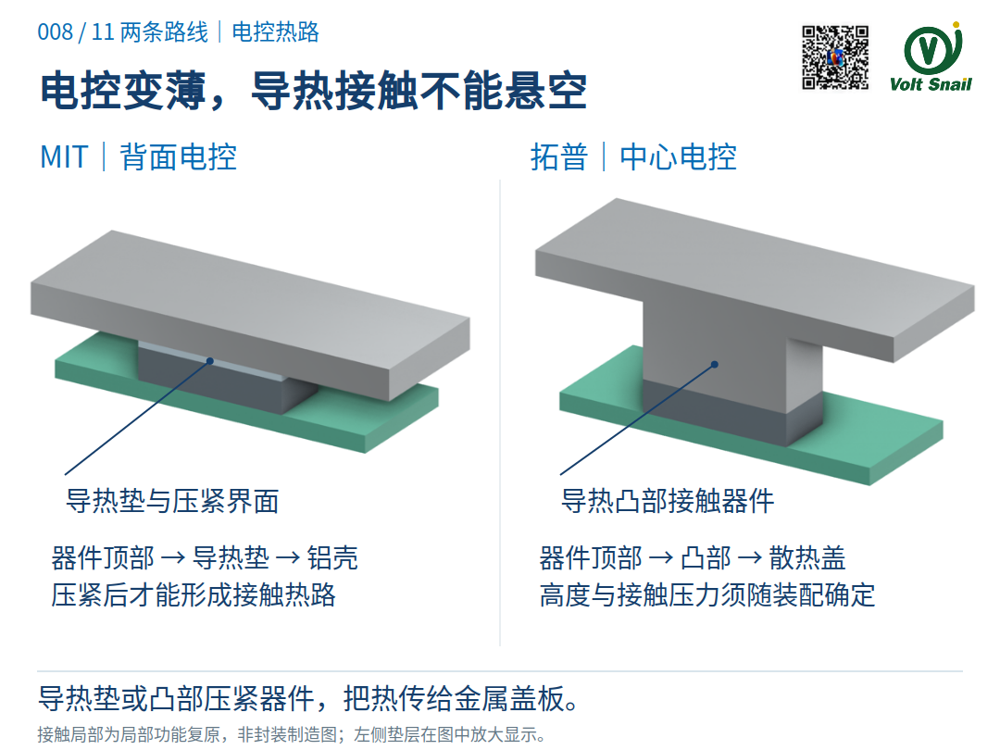*图11｜左侧器件经导热垫接触铝盖，右侧器件经导热凸部连接散热盖。局部比例放大，非具体封装或公差图。*

## 同样减薄，外转子为什么更容易排热

外转子定子通常靠内径圆周面固定。铁芯直接向内支撑传热；绕组端部灌胶后，灌胶部分的内圆也与支撑贴合，于是又有了“绕组端部→灌胶→内支撑”这条通道。

双转子单定子的两侧端面留给气隙和转子，常规构型主要向内外圆排热。定子减薄，径向导热截面也随之减小；外转子则还保留着端部通向内支撑的额外路径。

因此，在本文讨论的薄型、常规壳体导热条件下，我的判断是：外转子的总热阻远小于双转子单定子轴向电机。轴向方案省下轴向空间以后，接下来要解决的，就是怎样把热更直接地取出去。

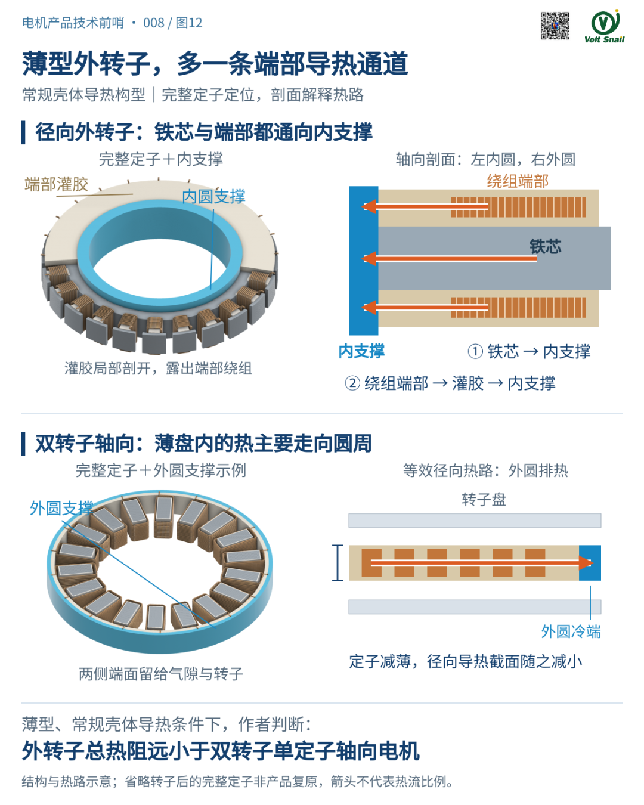*图12｜外转子通过铁芯与端部灌胶两条通道接入内支撑；轴向侧以外圆排热为例。完整定子与局部剖面用于解释结构，非MIT或拓普原机复原。总热阻比较为本文薄型构型下的工程判断，未给出产品对测比值。*

## 优化：把取热位置移进绕组

轴向方案若要扩大持续工况的优势，就要给薄盘里的热找一个更近的出口。一个办法，是把取热位置移进绕组。

Camilleri与McCulloch把导热片嵌入集中绕组，用直接液冷带走热量。导热片从绕组内部伸向冷却液，内层铜线产生的热不必再穿过全部外层绕组及绝缘。

内层铜线的热有了更近的出口，对内外圆排热的依赖随之减少。关节零速保持转矩时，转子叶片停止送风，固定冷却件仍可依靠供液系统排热。

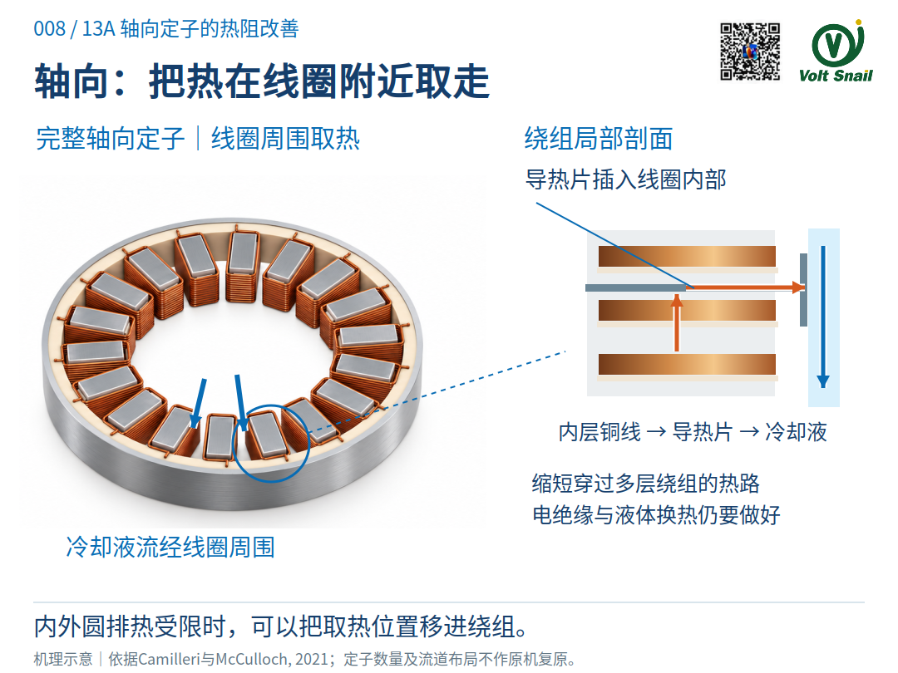*图13A｜左为完整轴向分块定子的取热位置概况，圈出一个线圈并展开右侧局部：热量由内层铜线，经导热片传向冷却液。依据Camilleri与McCulloch（2021）的机理绘制；定子数量、通道和层厚仅为示意，不代表拓普液冷结构或论文原机的完整复原。*

外转子已有端部灌胶这条通道，还可以进一步把取热位置靠近铜线：槽内换热器照顾有效段，两侧端部冷却照顾折回的铜线。

Hossain等在原有槽内换热器上增加两侧端部冷却。相对原来的槽内换热器方案，热阻降低超过50%。这项改动同时覆盖槽内与端部，绕组的温度分布也更均匀。

两种结构都能靠近线圈取热，代价也都要算进总成：电绝缘、取热件、流道、密封与供回液接口要共同布置，泵和外部散热器也要占空间。

回到常规壳体导热，外转子的端部通道仍是薄型化时的重要优势。直接冷却可以改变热阻比较，但新增的冷却构件和系统，也会改变整副关节的尺寸比较。

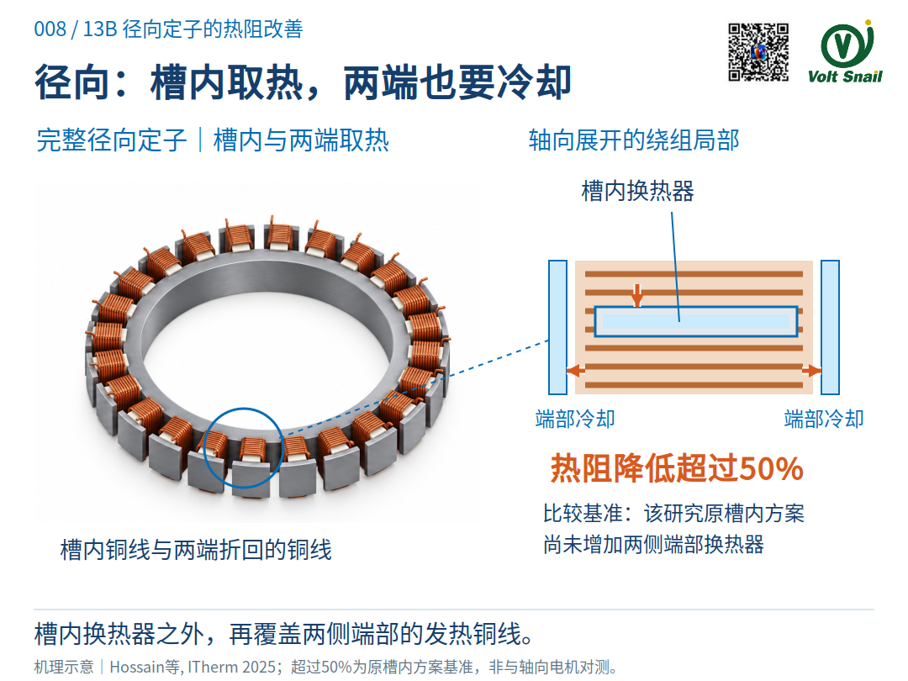*图13B｜左为完整径向定子的绕组位置，右侧示意槽内换热器与两侧端部取热。超过50%的降幅相对Hossain等（2025）原有槽内换热器方案，不是轴向与径向的热阻对测。布局、数量与尺寸仅用于解释机理。*

## 哪种关节，更有机会做薄

MIT径向方案靠中心齿轮与电机重叠，减少串接长度；拓普轴向方案靠内外圆端部和中心电控，减少轴向占位。把传动、支撑和冷却件一起装进去，电机省下的长度才会变成模组总长的差别。

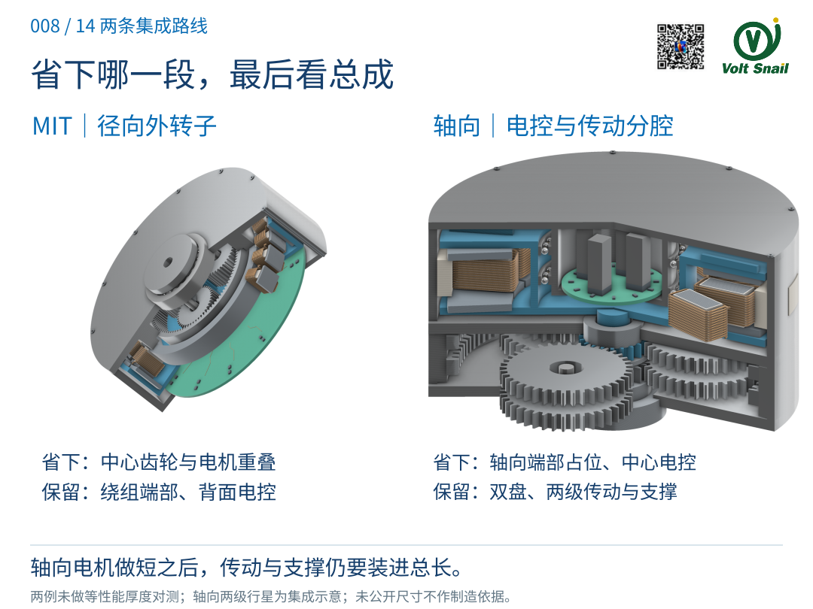*图14｜左为中心内嵌齿轮、背面电控，右为中心电控和另一侧两级行星传动。轴向侧与图7、8共用同一集成示意模组；两例未做等性能厚度对测。*

短时大转矩、轴向空间紧张，我更倾向双转子单定子的轴向方案。长期承载、反复高负荷，主要靠固定壳体排热时，外转子更低的热阻更有利于持续出力，也让它更有机会把整副模组做薄。

轴向方案要进一步拓展持续工况，关键是改善绕组到冷却部位的热传递；径向方案则还要在薄型尺寸内提升转矩输出能力。提高极对数可以作为设计方向之一，仍需结合绕组、损耗和控制频率一起权衡。两种构型都还会继续演化，我们持续观察。

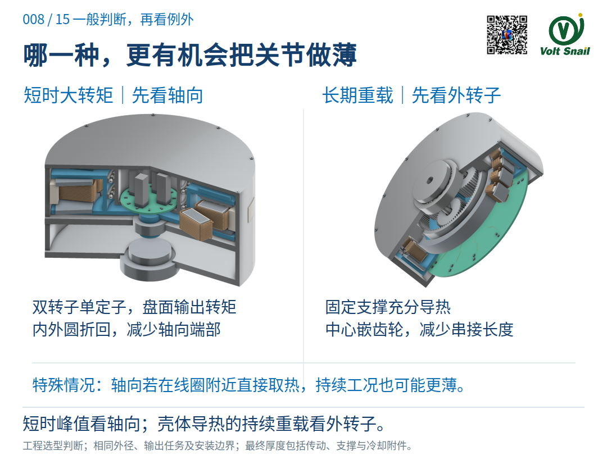*图15｜一般选择基于相同外径及输出任务，区分短时峰值与壳体导热的持续重载；直接冷却可改变选择。最终厚度包括传动、支撑和冷却附件。*

### 

死磕自己，服务大家，我是核动力蜗牛，希望和大家一起交流。

洪涛｜杭州伏特动力科技有限公司创始人

“电机产品技术前哨”主理人

VMD电机多物理场设计与优化软件

提供电机定制设计服务

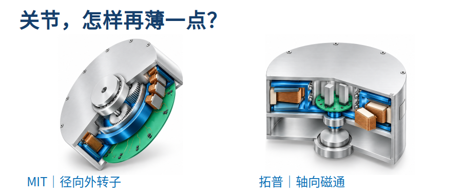

