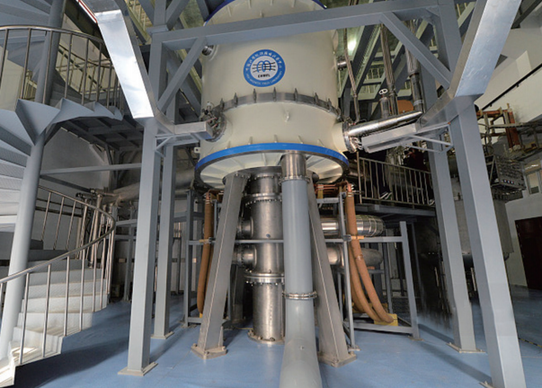
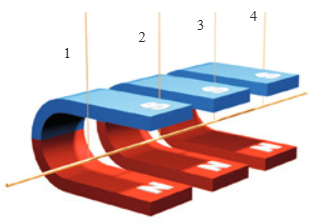
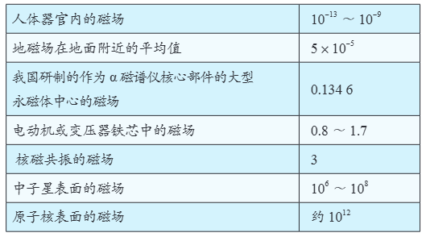
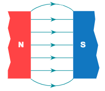
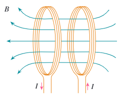
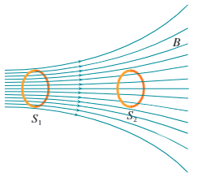
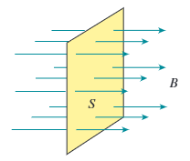
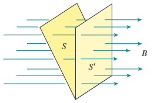

图1 中国科学院强磁场科学中心的稳态强磁场实验装置

早期人们对磁现象没有进行系统的科学探究和测量，仅仅停留在对磁极间相互作用和地球磁性等表面现象的观察上。直到 19 世纪 20 年代，丹麦著名物理学家奥斯特发现了电流的磁效应后才开启了电磁学研究的新纪元。

与天然磁体的磁场相比，电流产生的磁场的强弱和方向容易控制和调节，在科学研究和实际中有更多的应用；电磁起重机、电话、电动机、发电机、电磁继电器、磁浮列车、电子门锁、智能通道闸和电磁流量计等都离不开电流产生的磁场。中国科学院强磁场科学中心建成的强磁场实验装置（图1）为我国电子材料、铁基超导体、新型拓扑超导体、非常规超导体、低维体系量子效应及输运研究、生物大分子在疾病中的分子机制、肿瘤发病机理和小分子药物作用机制等研究提供了有力的支持。

## 1 磁感应强度

用小磁针可以判断空间某点磁场的方向，但很难对它进行进一步的定量分析。若以通电导线作为磁场的检验物体，则既可以知道导线中电流的大小，又能测量导线的长度，从而可以进行定量的研究。

为研究空间某点的磁场，可以考虑在该处放一段很短的通电导线，分析它受到的力。在物理学中，把很短一段通电导线中的电流 I 与导线长度 l 的乘积 Il 叫作电流元。但要使导线中有电流，就要把它接到电源上，所以孤立的电流元是不存在的。如果要研究的那部分磁场的强弱、方向都是一样的，我们也可以用比较长的通电导线进行实验从结果中推知电流元的受力情况。

分析了很多实验事实后人们认识到，通电导线与磁场方向垂直时，它受力的大小既与导线的长度 l 成正比，又与导线中的电流 I 成正比，即与 I 和l 的乘积 Il 成正比，用公式表示就是

式中 B 与导线的长度和电流的大小都没有关系。但是，在不同情况下，B 的值是不同的：即使是同样的 I、l，在不同的磁场中，或在非均匀磁场的不同位置，一般说来，导线受的力也是不一样的。看来，B 正是我们要寻找的能表征磁场强弱的物理量 —磁感应强度（magnetic induction）。由此，在导线与磁场垂直的最简单的情况下（图2），有关系式

磁感应强度 B 的单位由 F、I 和 l 的单位决定。在国际单位制中，磁感应强度的单位是特斯拉（tesla），简称特，符号是 T，即

图2 匀强磁场通电导线受力因素

表1 一些磁场的磁感应强度（T）

磁感应强度是矢量，它的方向就是该处小磁针静止时 N 极所指的方向。

## 2 匀强磁场

如果磁场中各点的磁感应强度的大小相等、方向相同，这个磁场叫做匀强磁场。距离很近的两个平行异名磁极之间的磁场（图3），除边缘部分外，可以认为是匀强磁场。

匀强磁场的磁感线用一些间隔相等的平行直线表示。两个平行放置较近的线圈通电时，其中间区域的磁场近似为匀强磁场（图4）。这种装置在电子仪器中常常用到。

图3 两个平行放置的异名永磁体磁极间的匀强磁场

图4 两个平行放置的通电线圈之间的匀强磁场

## 3 磁通量

磁感线的疏密程度表示了磁场的强弱。在图5 中，S1 和 S2 两处磁感线的疏密不同，这种不同是如何体现的呢？如果在 S1 和 S2 处，在垂直于纸面方向取同样的面积，穿过相同面积磁感线条数多的就密，磁感线强度就大。

图5 磁通量与磁感线的关系

设在磁感应强度为 B 的匀强磁场中，有一个与磁场方向垂直的平面，面积为 S（图6），我们把 B 与 S 的乘积叫做穿过这个面积的磁通量（magnetic flux），简称磁通。用字母 Φ 表示磁通量，则

图6 磁通量

如果磁感应强度 B 不与我们研究的平面垂直，例如图7 中的 S，那么我们用这个面在垂直于磁感应强度 B 的方向的投影面积 S‘ 与 B 的乘积表示磁通量。

图7 平面与B不垂直时的磁通量

在国际单位制中，磁通量的单位是韦伯（weber），简称韦，符合是 Wb。

从 Φ = BS 可以得出 B = Φ/S，这表示磁感应强度的大小等于穿过垂直磁场方向的单位面积的磁通量。
