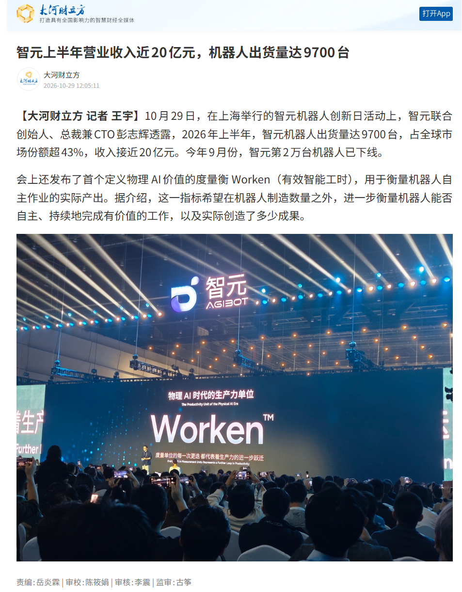

中国老板盼了几十年的员工，可能真的快来了。

不要工资，不交社保，不要求双休，不在工作群里阴阳怪气。夜里两点喊它…起来补货，它也不会问一句：“这个算加班吗？”

唯一的问题是，它可能把咖啡倒在顾客裤子上，然后站在原地，等一个年薪几十万的工程师过来救场。

10月29日，智元机器人搞出了一个新词，叫 Worken，中文翻译是“有效智能工时”。彭志辉，也就是大家熟悉的稚晖君，给机器人定了一套算工时的方法：活跃机器人数量，乘以自主工作时长，再乘以产出效能比。

同一天，智元公布了另一组数据：今年上半年机器人出货9700台，整体收入接近20亿元，9月份第20000台机器人下线。

这些数字当然漂亮。但我觉得最有意思的不是9700台，而是那个 Worken。

**机器人行业终于发现，卖出去一台机器，跟这台机器真正替老板干了多少活，根本不是一回事。**

以前机器人公司开发布会，大家比自由度、比算力、比能不能跳舞、能不能后空翻。有些机器人的后空翻比我年轻时候利索多了，可惜工厂老板不买票看杂技。他花钱买的是产能，不是掌声。

现在终于开始算工时了。这意味着机器人正在从一件昂贵的科技展品，向一名需要接受绩效考核的员工转变。

有意思的是，过去几十年，人类员工最讨厌的就是绩效考核。到了机器人这里，绩效倒成了产业进步的标志。

智元还准备在11月2日至3日，把6台G2机器人送进真正的便利店，连续24小时直播上班。从上午10点干到第二天上午10点，补货、理货、做咖啡、制作热食、收垃圾，还得招呼客人。

这可比后空翻有看头多了。

我甚至建议把直播画面分成两半：左边放机器人干活，右边实时统计有多少人类工程师在后台替它擦屁股。

如果机器人工作24小时，背后还有三个工程师轮班伺候，那这位新员工的工资可不低。

不过，作为一个长期跟芯片、传感器、电机和编码器打交道的人，我对这件事还有另一层兴趣。

大家看机器人，总喜欢盯着它那个像人的脑袋。其实真正容易让工程师失眠的，往往是它身上那些不起眼的关节。

一个关节要知道自己转到了哪里，需要位置反馈。电机要控制力矩，需要电流反馈。机器人要拿起一杯咖啡，除了知道手伸到了哪里，还得知道有没有抓稳、有没有碰到旁边的东西。

这些东西都不性感。没有人愿意在发布会上花半小时讲编码器的温漂、零位校准和通信异常。

但机器人在便利店里干活的时候，一个关节位置丢了，可能就是一次停机。一次停机，就要有人过来处理。处理的人如果还是工程师，老板刚刚省下的人工费，转眼又以技术服务费的形式花出去了。

芯片可能只值几块钱，工程师坐高铁来一趟可不止这个价。更别说停产、返工和客户赔偿。

当然，这不是说智元的机器人就有这些问题，而是所有准备从实验室走向商业运行的机器人，都得面对同一本账。

咱们不妨给老板算个假账。假设未来某台机器人售价10万元，按5年、每年300天、每天16小时使用，不算资金成本，光设备折旧就已经超过每小时4元。再加上维护、软件、远程算力、现场管理和故障停机，哪怕电费只有几毛钱，也不能说它的劳动成本就是几毛钱。

所以，标题里那句“把人工费砍到电费”，现在还只是老板的美梦。

但这个梦有个危险之处：**一旦机器人真的能够稳定工作，它不需要比人聪明，只需要比人便宜。**

拧螺丝不需要哲学博士，仓库搬箱子不需要理解人生意义，凌晨三点给货架补饮料，也不需要具备完整的人类情感。

只要机器能够把这些任务完成得足够好，成本又足够低，老板自然会算账。

过去大家争论机器人什么时候能够拥有人的智能。我觉得这个问题可能问错了。

资本从来没要求流水线工人拥有诺贝尔奖水平的智力，它要求的是准时上班、稳定产出、少出差错。

今天智元推出Worken，某种意义上就是把这套要求搬到了机器人身上。

而人类打工人真正值得留意的，也许不是机器人哪天通过图灵测试，而是哪天老板拿着计算器，发现一台不怎么聪明的机器，已经足够替他省下一笔工资。

至于机器人会不会取代所有人，我不知道。

但我知道，**等机器人也开始按有效工时考核，老板们大概会第一次认真考虑：人类员工那些不能用工时衡量的东西，到底值多少钱。**

希望到那时候，人类不要输在自己发明的绩效制度上。
