<strong>QDD 电机由电机和低减速比减速器组合而成。</strong>QDD 是 Quasi Direct Drive 的缩写，中文通常称为“准直驱”。

随着宇树等四足机器人的普及，QDD 也逐渐进入更多人形机器人的关节。机器人跑跳、落地时如何出力，和这种驱动结构密切相关。

拆解对象是 RobStride 04，该系列中扭矩最大的一款，**峰值扭矩为 120 N·m，减速比为 9:1。**

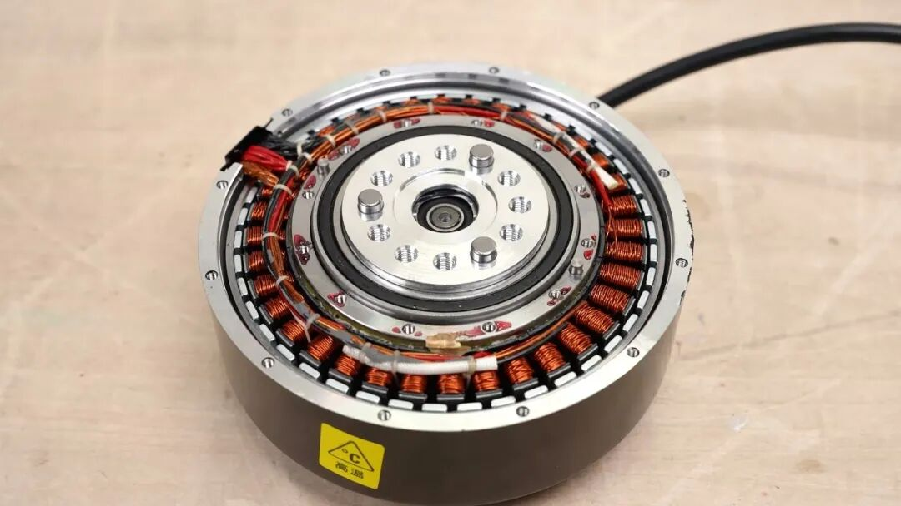

RobStride 04 型 QDD 电机实物。

这台电机购自速卖通，花了 3.9 万日元（约合人民币 1950 元）。

本文素材源于 Disassembling a QDD Motor: A Key Component for Physical AI! How Does It Differ from a Regular Motor?

更多资料：每日产业信息、2000+份国内外行业报告及500+份非公开资料，均可在文末扫描知识星球二维码获取；商务合作请后台留言。

## 一、高减速比、直驱与 QDD：机器人关节如何取舍？

人形机器人落地、被推搡时，关节既要承受冲击，也要撑住身体。电机需要足够大的扭矩，却又得塞进有限的关节空间。

要增加扭矩，可以把电机做大，也可以加减速器，用转速换扭矩。工业机器人长期采用高速电机配合高减速比减速器；直驱方案则省去减速器，减少摩擦和齿轮间隙带来的影响。

但四足机器人和人形机器人要跑、跳，还会受到外力。单靠高减速比或直驱，都有难以兼顾的地方。

高减速比方案把高速电机与 100:1 等大减速比减速器组合起来，能够在较小体积内输出较大扭矩。但从外部推动关节时，输出轴往往很难转动，也就是**反向驱动能力较差**。

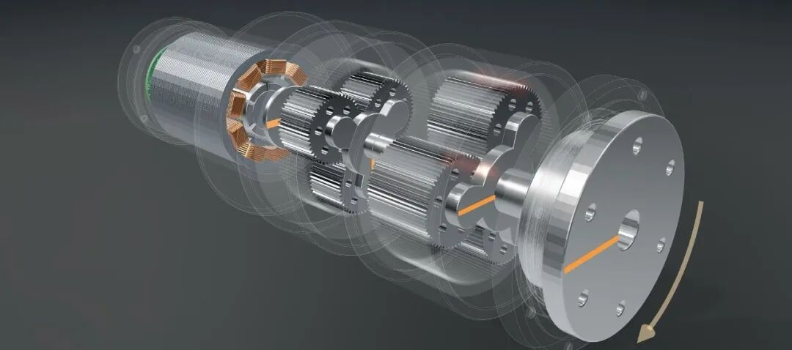

高减速比方案通过多级齿轮放大扭矩，也使输出轴更难被外力反向带动。

机器人落地时，如果关节无法随外力运动，突然的冲击就难以释放，严重时可能损伤齿轮。减速器内部较大的摩擦，也会干扰根据电机电流估算关节输出扭矩的过程，有时需要额外安装扭矩传感器。

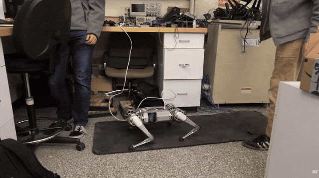

MIT Mini Cheetah 被举起后放落，落地时腿部弯曲缓冲。来源：MIT。

工业机械臂主要追求定位精度，高减速比方案通常适用。换成经常受到外力扰动的四足机器人和人形机器人，就还要考虑冲击如何释放、关节出力如何控制。

直驱方案不经过减速器，直接把电机转动传给关节。没有减速器带来的阻力和间隙，关节更容易被外力带动，具有较好的反向驱动能力。

演示中用的是一台从机械臂上拆下、未装减速器的电机，并非专门设计的直驱关节电机。用手指就能轻松转动它的轴，反向驱动的感觉很直观。

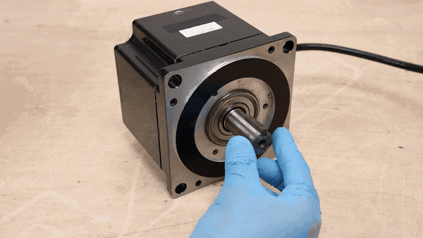

手指推动没有减速器的电机轴，演示反向驱动。

没有减速器摩擦的干扰，**根据流过电机的电流，可以较准确地推算输出扭矩**。代价是，全部扭矩都要由电机自身产生。要撑住人形机器人的重量，电机往往得做得更大、更重。

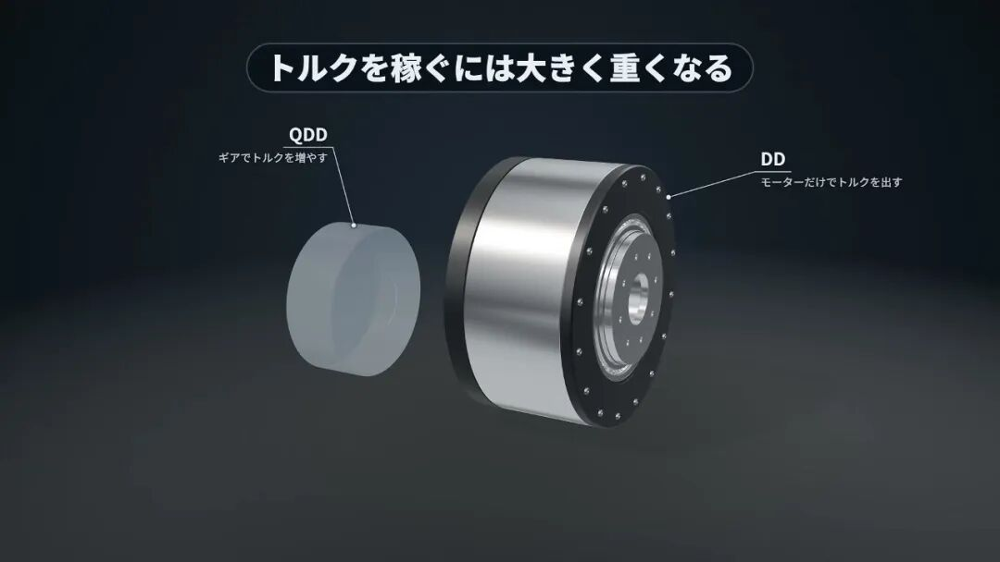

直驱依靠电机自身产生扭矩，QDD 则通过减速器放大扭矩。

给刚才的电机装上高减速比减速器，就能构成高减速比驱动器。扭矩放大了，输出轴也会更难被外力带动。

机器人关节需要同时做到三件事：<strong>较高的扭矩重量比、承受冲击的能力，以及对输出扭矩的估算能力。</strong>也就是尽量轻、出力足，落地时能缓冲冲击，还能根据扭矩估算与地面的作用力，及时调整出力。

高减速比方案在反向驱动和冲击缓冲方面存在局限，直驱方案则难以在质量受限时提供足够扭矩。**QDD 通过低减速比在这些要求之间取得折中**，通常采用扁平电机提高扭矩，并将减速比控制在约 10:1。

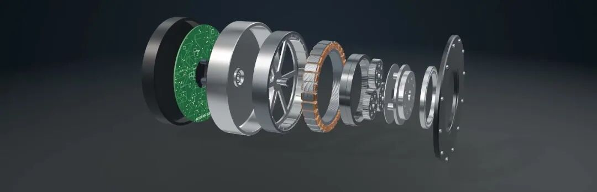

QDD 方案将扁平电机与一级行星减速器集成在同一模块内。

这类 QDD 模块的输出轴通常仍能用手转动，受到冲击时可以随外力运动，缓冲一部分冲击；根据电流估算扭矩的能力也基本保留下来。MIT 的“猎豹”机器人研究让这种方案受到关注，此后它在四足机器人和人形机器人中逐渐普及。

QDD 的扭矩密度通常不及高减速比方案，长时间保持高负载姿态时，电机也容易发热。某些关节仍需要更高的减速比，或者改用其他驱动方式。

## 二、扭矩与温升：120 N·m 能持续多久？

RobStride 04 的<strong>峰值扭矩为 120 N·m，额定扭矩为 40 N·m。</strong>产品手册给出的持续时间很明确：<strong>120 N·m 只能持续约 10 秒，不能作为连续工作扭矩。</strong>长时间维持这个出力，驱动电路可能过热损坏。

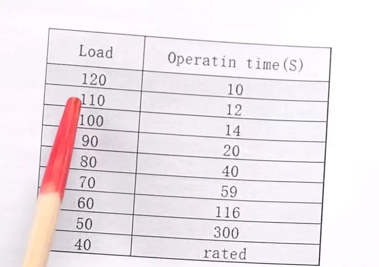

产品手册中的扭矩与持续时间表：120 N·m 对应约 10 秒，40 N·m 为额定值。

这台模块<strong>采用 48 V 供电，通过 CAN 总线控制，电机控制器集成在内部。</strong>测试时用 ESP32 单片机配合 CAN 收发器发送指令，接好线后就能控制旋转、翻转和停止。

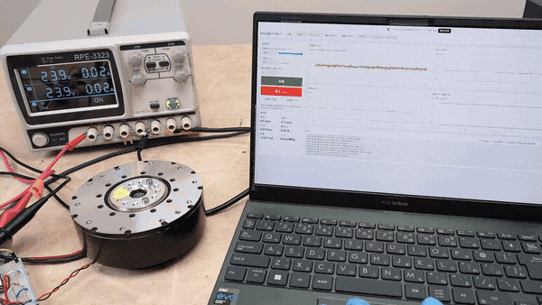

接入电源和 CAN 控制后，QDD 模块按指令转动。

带电保持位置时，用工具向输出轴施力，轴仍保持不动。

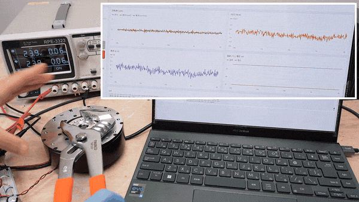

带电保持位置时，用工具向输出轴施力，屏幕曲线随扰动变化。

<strong>空载运行约 10 分钟后，机身温度已经达到约 40°C。</strong>还没承受负载，电机就已经明显发热。拆下盖板，内侧贴着一圈导热硅胶垫，把绕组产生的热量传向盖板和外壳。

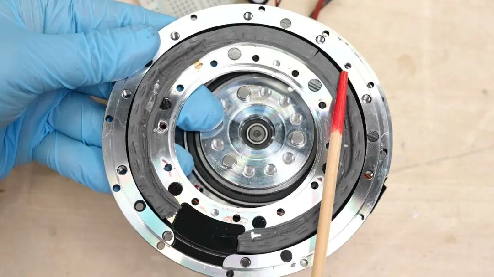

盖板内侧的环形导热硅胶垫，把绕组热量导向外壳。

## 三、电机本体：外转子与多极定子

转动输出轴时，可以看到内部转子随之旋转。由于中间经过减速器，转子的转速高于输出轴。带绕组的定子固定不动，永磁体装在外侧转子上，构成外转子永磁电机；这种结构也常见于无人机电机。

打开电机后转动输出轴，可观察内部转子随之旋转。

外转子的转动惯量较大，也更容易获得较大扭矩，对这类 QDD 模块可能更有利。继续拆下转子和定子组件，轴承与行星齿轮机构也露了出来。

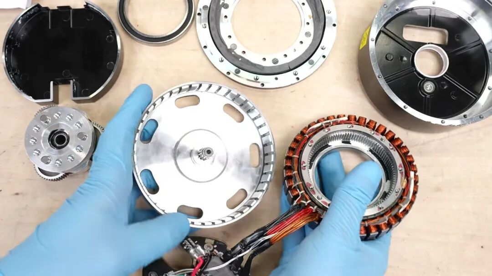

拆出的壳体、转子、定子与减速组件。

电机采用三相、多极设计，定子铁芯由冲片叠压而成。增加极数有利于缩短不产生有效扭矩的绕组端部，而不必显著增大铁芯。但电机每转一圈所经历的电角度周期也会增加，带来更高的铁芯损耗，并要求更短的控制周期。

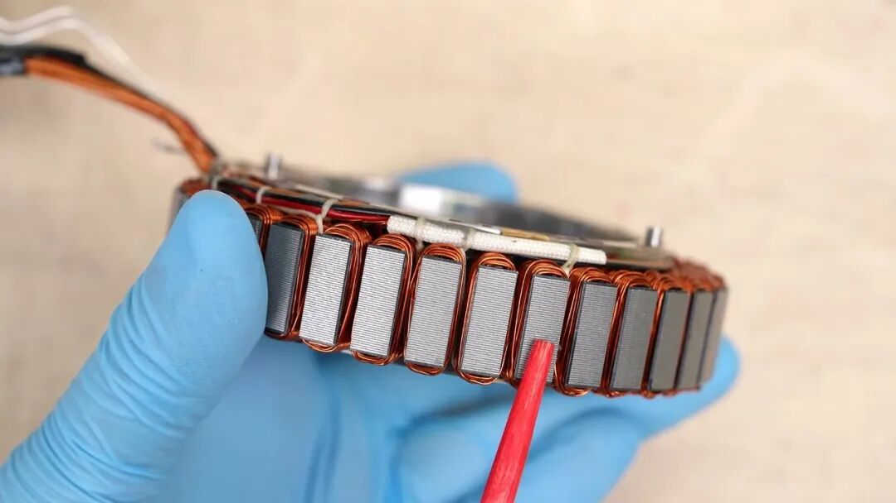

多极定子：叠片铁芯上密布铜线绕组。

外转子内侧排列着钕磁铁，通过胶黏剂固定，并用塑料隔块定位。转子旋转时，离心力将磁铁压向外圈，有助于降低磁铁向内脱落的风险。

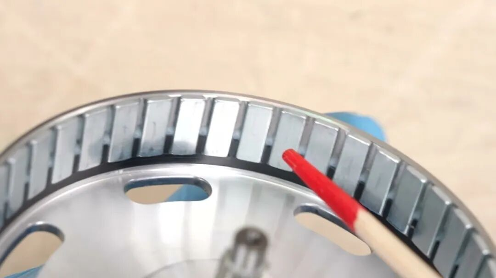

外转子内侧排列着永磁体。

这次拆解未观察到明显的动平衡修正痕迹，具体处理方式无法确定。

## 四、驱动电路：控制、采样与散热

驱动电路板上集成了单片机、传感器、通信芯片和功率半导体。板子原本有防潮涂层，表面也沾着齿轮润滑脂。用乙醇擦掉油脂后，防潮涂层似乎也被一并擦掉了。

主控是**兆易创新 GD32F303**，一款采用 Arm（英国处理器架构公司）Cortex-M4 内核的 32 位单片机。它支持 DSP 指令，带浮点运算单元，适合电机控制。

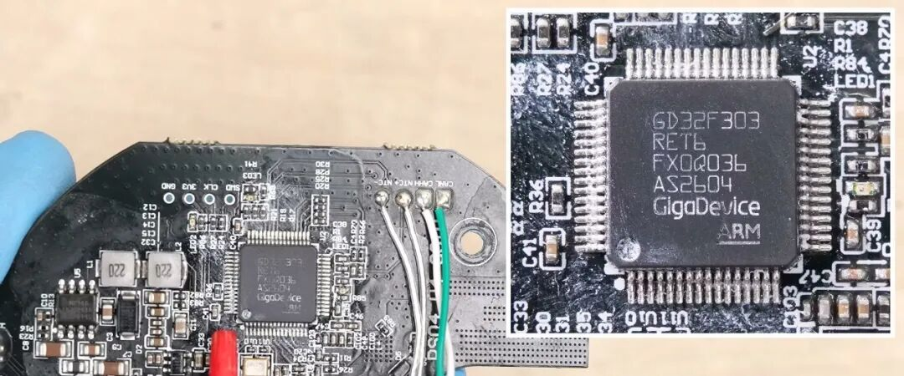

控制板使用兆易创新 GD32F303 单片机。

导热硅胶垫下面是三相逆变电路，使用东方半导体的硅 MOSFET，每组两颗并联。器件耐压 100 V，导通电阻 4.3 mΩ，脉冲漏极电流 560 A，连续漏极电流额定值 140 A。这些是 MOSFET 的器件参数，并非电机模块的工作电流。

选用较低导通电阻的器件，可能是为了减少功率电路的发热。

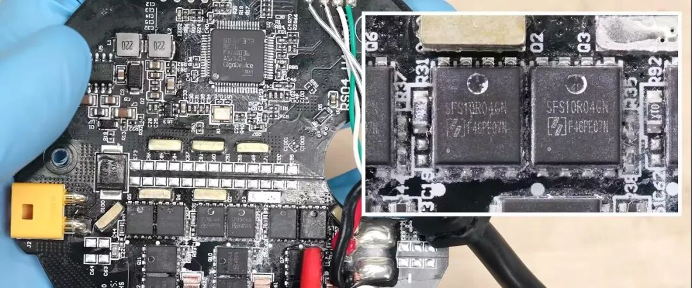

三相逆变电路使用东方半导体 SFS10R04GNF MOSFET。

<strong>功率器件产生的热量先传到电路板，再经过导热硅胶垫导向铝合金外壳。</strong>硅胶垫紧贴外壳。绕组和逆变器都在发热，长时间高负载运行，能否把热量及时散出去就很关键。

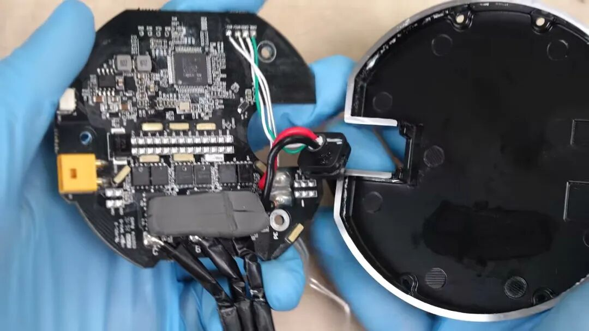

功率器件附近的导热硅胶垫贴向金属外壳，形成散热路径。

<strong>逆变器的三相电流分别通过三组采样电阻测量。</strong>电流测得准，才能精确控制电机，并据此估算输出扭矩。

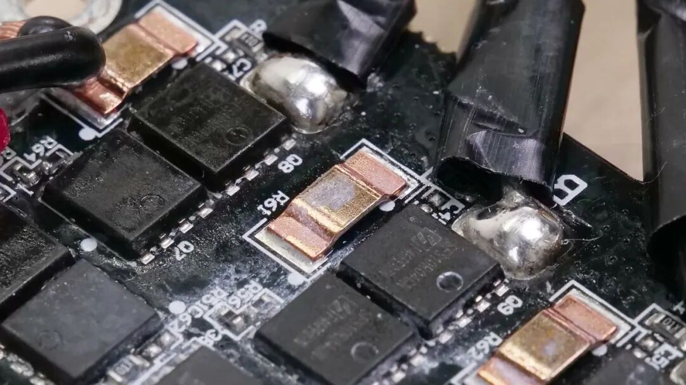

逆变器附近的低阻值采样电阻，用于测量各相电流。

功率电路附近的金属铜条可以降低铜箔路径的等效电阻，也可能用来暂时储热。关节负载突然增加时，逆变器会迅速升温，热量传到外壳却需要时间。铜条增加了局部热容量，或许能缓冲这段温升；储热用途仍是讲解中的推测。

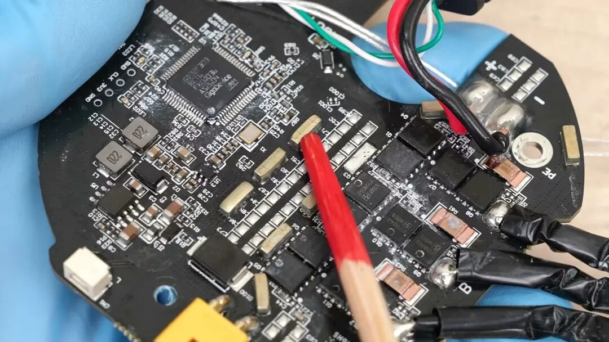

驱动板上的金属铜条；旁边成排的 MLCC 焊盘未安装器件。

板上预留了不少 MLCC（多层陶瓷电容）焊盘，但没有装器件，另一面使用了电解电容。电解电容的等效串联电阻 ESR 和等效串联电感 ESL 通常较高，负载突变时能否稳住供电，还需要测试。

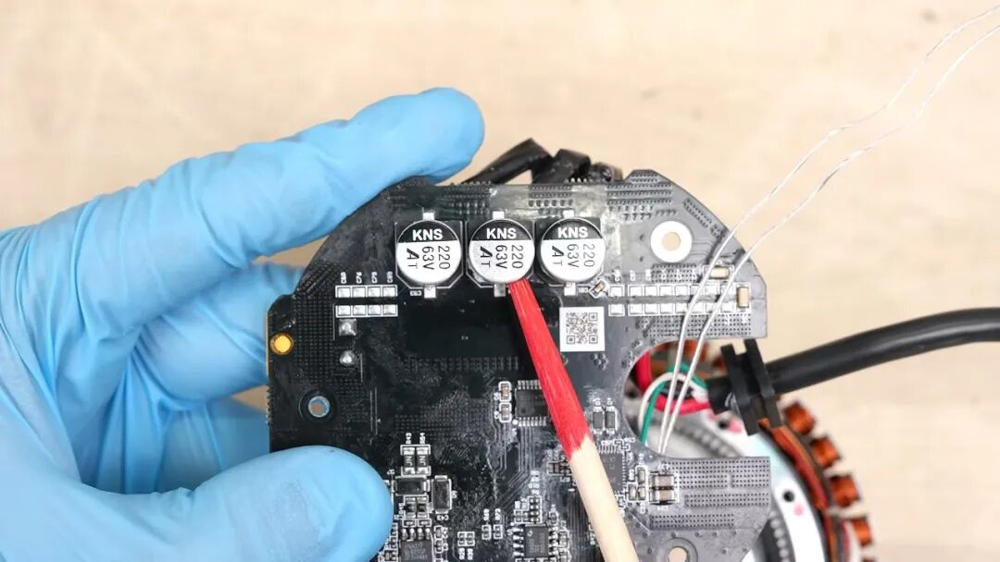

驱动板另一面的三颗电解电容。

模块额定供电为 48 V，控制系统最低可在 24 V 工作。按讲解中的判断，48 V 供电留出的电压余量，应该能降低负载突变导致控制系统掉电重启的风险。

电路板另一面主要是通信和传感器芯片。德州仪器（美国模拟与嵌入式芯片厂商）的 DRV8353 驱动 MOSFET 的栅极。

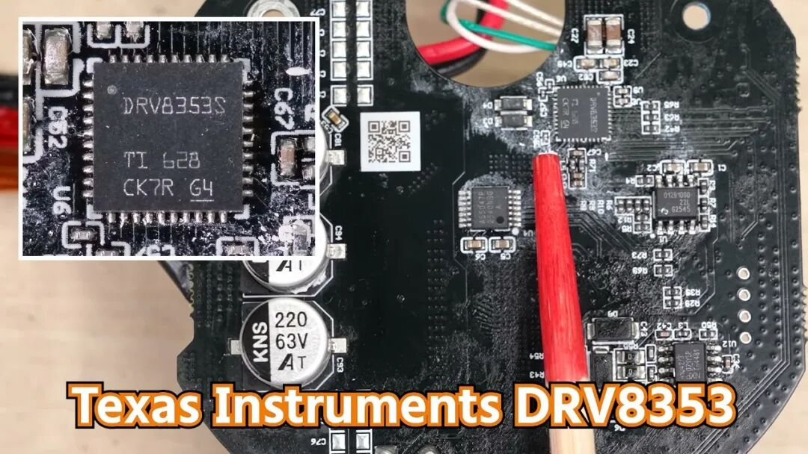

德州仪器 DRV8353S 栅极驱动器的型号特写与板上位置。

恩智浦（荷兰半导体公司）的 TJA1042 是 CAN 收发器，与 GD32 单片机内置的 CAN 控制器配合使用。

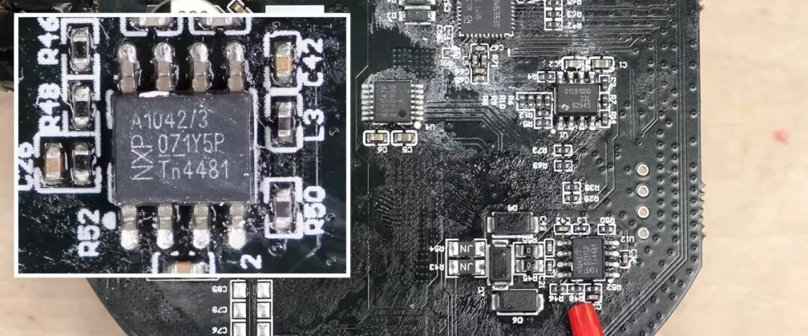

电路板背面的恩智浦 TJA1042 CAN 收发器。

## 五、位置检测：两颗磁传感器如何测角度？

两颗磁传感器分别来自英飞凌（德国半导体公司）和 ams（起源于奥地利的传感器及模拟芯片厂商）。

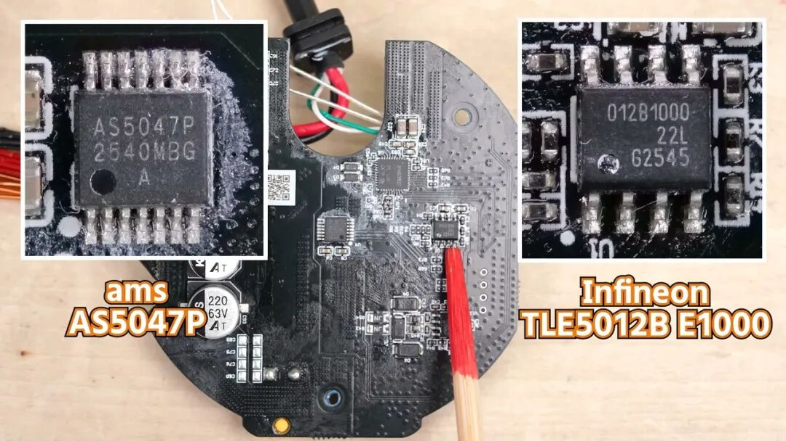

两颗磁传感器及其芯片型号。

中央的 ams 芯片是磁式旋转位置传感器。装配后，它与转子轴线对齐，正对轴端磁铁，通过读取磁场方向判断转子的朝向。

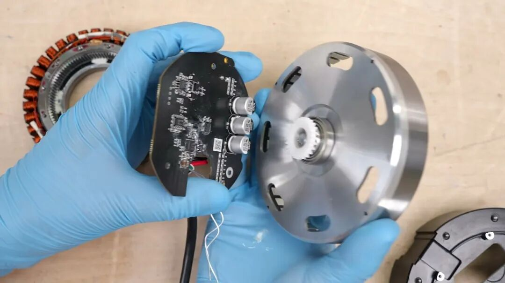

装配时，控制板上的磁传感器与转子轴端磁铁相对。

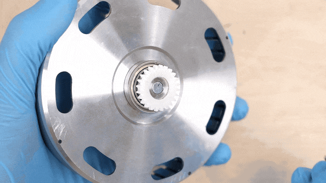

将条形磁铁靠近转子轴端磁铁，观察它偏转、对齐。

另一颗磁传感器偏离转子轴线，对着第二只齿轮。第二只齿轮与转子上的塑料齿轮啮合，轴端同样装有磁铁，传感器读取磁场方向来判断转角。

<strong>两只齿轮的齿数不同，旋转时两路磁信号的相对关系会逐渐变化。</strong>根据这种错位，可以推算转子的位置，这就是**游标原理**。

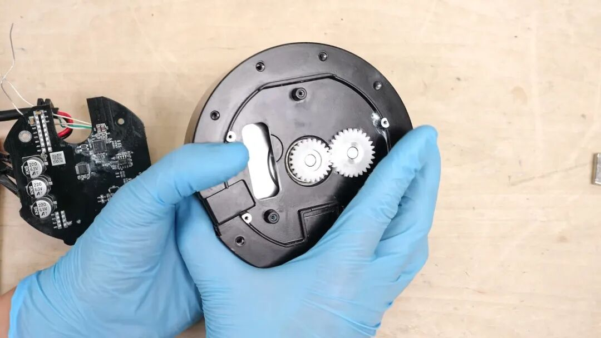

两只齿数不同的齿轮配合磁传感器，用于判断转动位置。

知道输出轴的初始角度，再辨别转子转过多少圈，程序就能在启动时判断关节角度。磁式检测的选择可能与成本和使用环境有关：光学式绝对值角度传感器更贵，电机内部又容易溅上润滑脂，安装空间也有限。

按视频中的估算，这套磁式角度检测只需几百日元（约合人民币几十元）。板上的半导体主要来自中国厂商，部分通信和传感芯片来自欧美厂商。

## 六、机械结构：行星齿轮与输出轴承

机械部分采用行星齿轮减速器：**太阳轮与电机转子连为一体，行星架连接输出轴**，中间有三只行星轮，内齿圈固定在定子壳体上。电机转动经过这组齿轮减速后，传到输出轴。

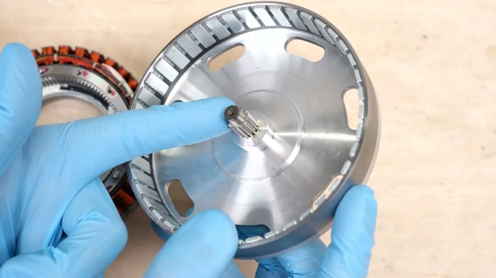

外转子中央的太阳轮，与转子连为一体。

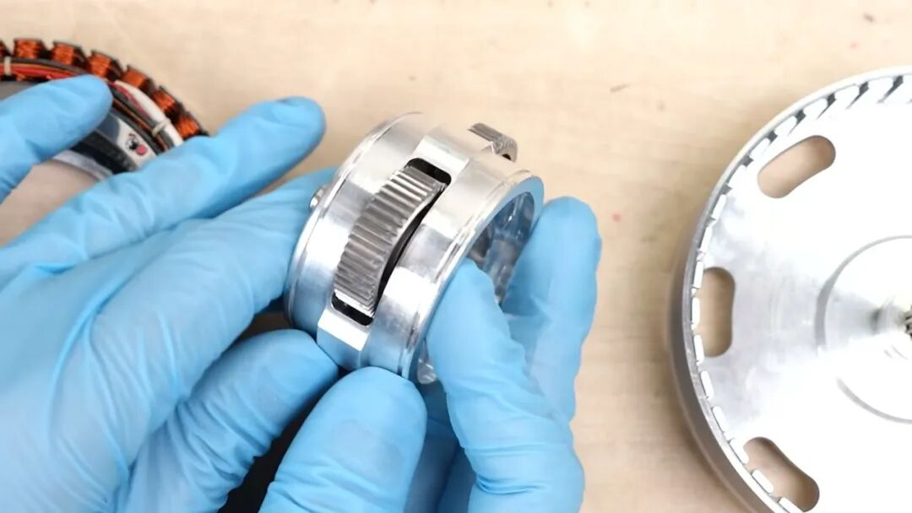

拆出的行星减速组件，可见行星齿轮的啮合结构。

多处机械组件装有轴承，品牌包括 C&U 和 S&F，以 C&U 为主。输出轴用了两只大直径轴承。这些机械部件基本都能在中国国内采购。

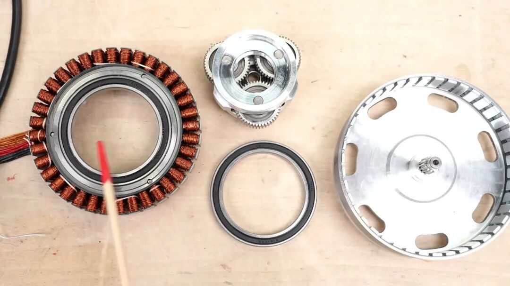

拆开的电机组件中，可见大直径轴承及其安装位置。

外转子电机、低减速比行星齿轮、驱动板和磁式角度检测集成在同一壳体中，提供较大扭矩，也保留一定的反向驱动能力。120 N·m 是约 10 秒的峰值，连续工作要看 40 N·m 的额定值，同时满足散热要求。
