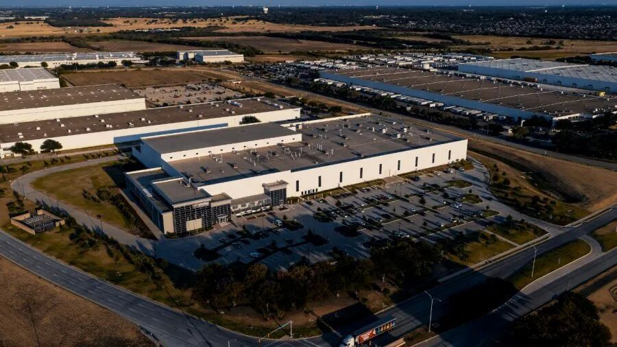
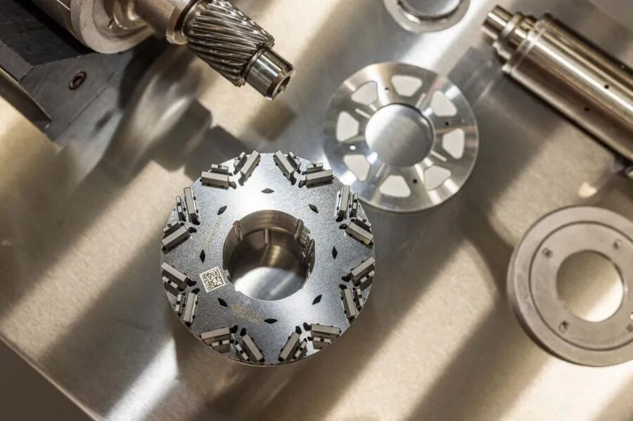
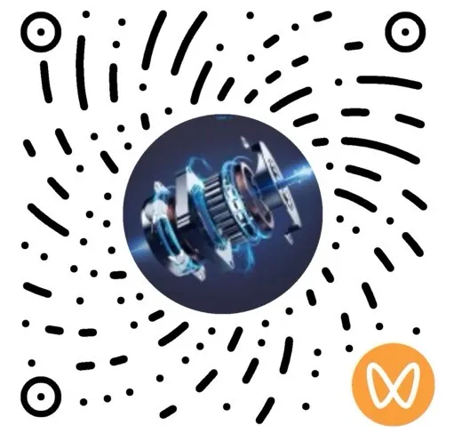

近日，美国通用汽车披露，与美国稀土企业MP Materials合作建设的本土稀土永磁供应链取得新进展。MP Materials位于得克萨斯州沃斯堡的Independence工厂已开始生产汽车级永磁体，相关产品目前正在通用汽车位于密歇根州庞蒂亚克的工程实验室接受电机测试与验证。  
双方自2021年启动的长期合作，正从稀土资源开发、磁体工厂建设逐步进入实际电机应用验证阶段。合作已初步形成一条连接加利福尼亚州稀土开采与精炼、得克萨斯州永磁体制造，以及密歇根州电机开发与验证的美国本土供应链。  
PART 01历时近五年，美国本土稀土磁体进入GM电机验证  
2021年12月，GM与MP Materials签署长期供应协议，计划为GM旗下基于Ultium平台的十余款电动车提供美国本土生产的稀土合金及钕铁硼永磁体。MP Materials宣布在得克萨斯州沃斯堡建设稀土金属、合金及永磁体制造设施，即Independence工厂。MP Materials公司位于德克萨斯州沃思堡的独立制造工厂按照当时披露的规划，该工厂设计年产能约为1000吨成品钕铁硼永磁体，可满足约50万台电动车电机的磁体需求。此后，MP Materials持续推进稀土永磁材料制造能力建设。2025年1月，公司宣布Independence工厂已启动钕镨金属商业化生产，同时开展汽车级烧结钕铁硼磁体试生产。同年，公司进一步在商业化设备上生产出首批成品磁体。进入2026年，双方合作开始进入更加具体的产品验证阶段。MP Materials预计于2026年第四季度启动商业化磁体交付，并在后续逐步提升产量。对于汽车级钕铁硼而言，从生产出合格磁体到进入整车厂供应体系，并不只是简单的材料性能测试。双方从2021年签署合作协议，到2026年进入实际电机验证，经历了近五年的开发与产业化过程。  
PART 02聚焦内置式永磁电机，通用披露双V形磁钢与分段设计  
通用汽车目前旗下多数电动车驱动电机采用内置式永磁结构。这类电机将永磁体布置于转子内部，通过定子产生的旋转磁场与转子磁场相互作用，实现电磁转矩输出。GM展示了一张电机组件照片，可以清楚看到来自MP Materials的永磁体采用双V形排列结构。GM EV 电机组件细节图，展示了 MP Materials 提供的双 V 形永磁体排列。GM介绍，该结构此前已应用于第二代雪佛兰Volt的电机设计，开发目标包括提高转矩、降低噪声和振动。双V形磁钢排列能够为永磁磁链和磁阻转矩的优化提供设计空间。GM还披露，在现有电机产品系列中，已由整体式磁钢向分段式磁钢发展，以降低发热和能量损耗，提高电机效率。在高速运行及高频磁场谐波作用下，永磁体内部可能产生涡流损耗，导致磁钢温度上升。通过合理分段并进行绝缘处理，可以改变涡流路径，降低部分工况下的磁体损耗。  
PART 03MP Materials加速建立本土制造能力  
MP Materials正在推动美国稀土产业链从上游原料向下游永磁体制造延伸。MP公司依托加利福尼亚州Mountain Pass稀土矿及加工设施，开展稀土开采、分离与精炼，生产钕、镨等稀土产品。得克萨斯州Independence工厂承担稀土金属、合金及烧结钕铁硼永磁体的生产任务。最终，成品磁体被交付至汽车制造商，进入电机及整车应用验证流程。在现有工厂之外，MP Materials还在推进更大规模的磁体制造项目。2026年2月26日，公司宣布将在得克萨斯州Northlake建设新的10X稀土永磁制造园区，计划投资超过12.5亿美元，预计2028年启动设备调试。按照公司规划，新项目投运后，MP Materials在美国的整体钕铁硼永磁体制造能力预计达到每年约1万吨，还计划在10X项目中引入自主开发的晶界扩散工艺。对于高性能烧结钕铁硼而言，提高矫顽力和高温稳定性，通常是满足新能源汽车驱动电机运行要求的重要环节。晶界扩散技术能够通过优化重稀土元素在磁体中的分布，在特定材料体系与工艺条件下减少重稀土用量，同时维持所需的矫顽力水平。根据MP Materials的规划，新工厂拟采用相关技术，降低部分高性能磁体对重稀土的依赖。随着全球新能源汽车、人形机器人和高效电机等应用领域持续发展，稀土永磁材料的产业竞争也不再局限于上游资源获取，而是进一步延伸至高性能磁体制造、终端应用验证和供应链整合能力。

END

  
  
  
  
  
电机新材料平台专注于电机材料的前沿研究、市场趋势分析和技术应用推广，致力于为产业链上下游提供高质量的信息交流与合作机会。欢迎关注我们，获取更多行业深度分析与最新动态！  

找到我们

FIND US

材料咨询｜电机打样｜合作推广

电机材料交流群

扫码关注视频号
