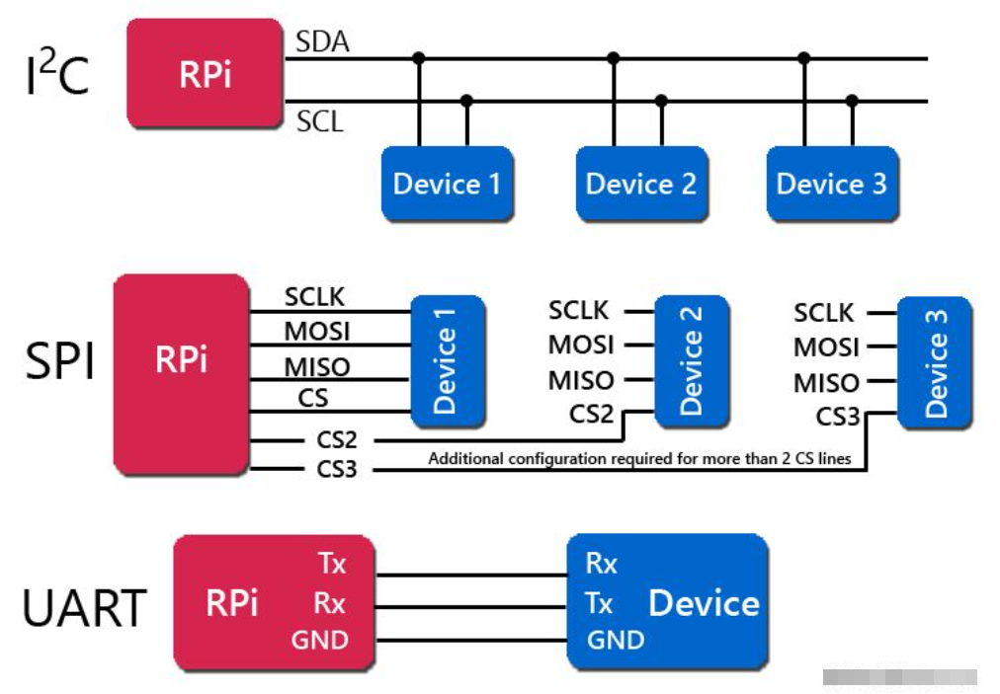
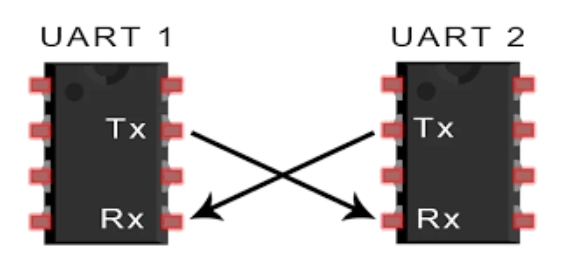
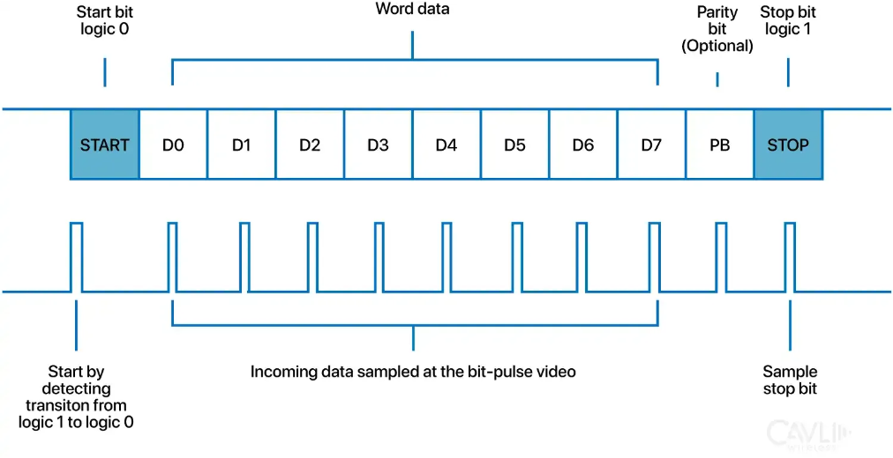
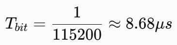
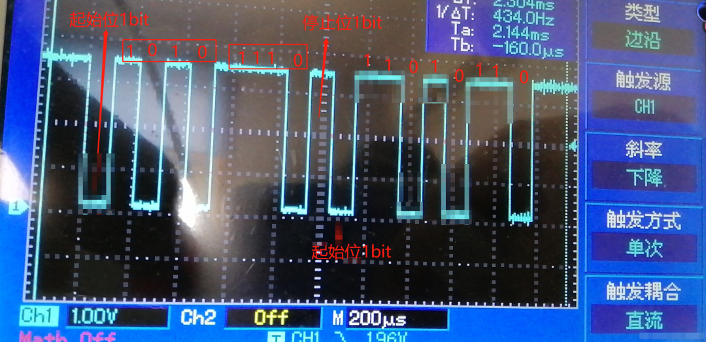
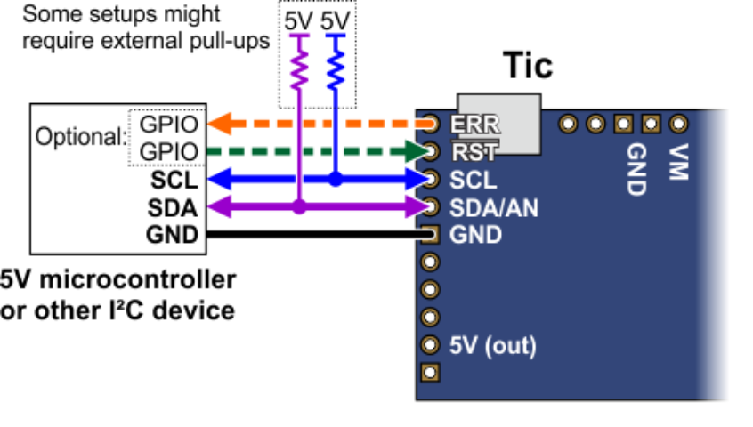
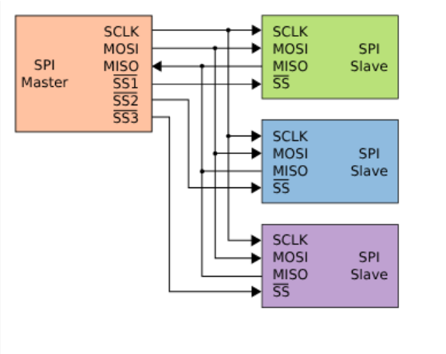
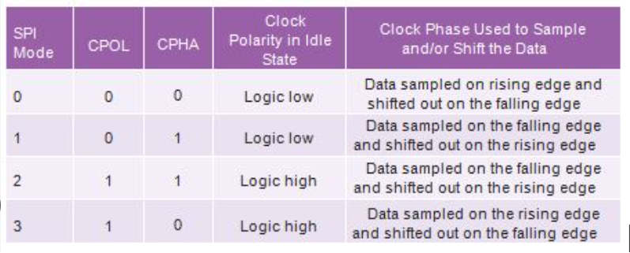
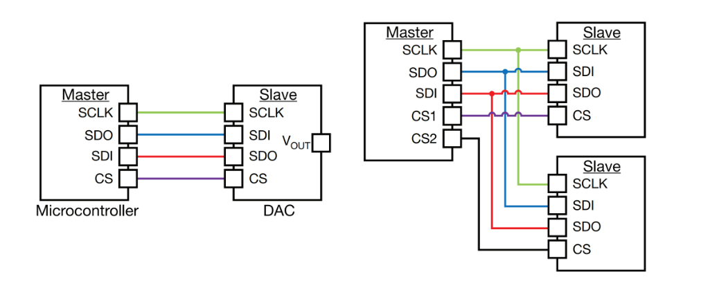

做硬件久了会发现，很多问题并不是电源没设计好，也不是芯片选错了，而是MCU和外设之间根本没有做好该做好的设计，传感器读不出来、Flash偶尔掉线、屏幕花屏、调试口没反应，最后查来查去，可能只是SPI的CPOL、CPHA配错了，UART的波特率不匹配，片选信号没有拉对，当然这是软件的锅，硬件工程师也会犯错，比如I²C上拉电阻选得太大，总线上挂了太多电容，地线回流路径太差。

咱们硬件不背锅，当然也不盲目甩锅，所以呢真正的硬件工程师，不只是知道它们的英文全称，而是要知道什么时候该用哪一种，线路怎么画，参数怎么算，出了问题又该从哪里查。

UART最简单，但最容易被低估

UART是异步串行通信，常见信号是TX：发送，RX：接收，GND：地

它没有单独的时钟线，双方靠约定好的波特率和起始位、停止位来完成数据同步。最常见的配置是115200，8N1，这是啥意思呢？意思是波特率115200，8位数据位，No parity就是无校验，1位停止位。

UART为什么不需要时钟？

因为发送端和接收端提前约定了通信速度，一帧数据通常由起始位、数据位、可选校验位和停止位组成。接收端检测到起始位后，按照自己的时钟在对应时间点采样数据。

但这也带来一个问题：双方时钟不能差太多。假设发送端波特率误差为+2%，接收端误差为-2%，两边相对误差就接近4%，如果一帧数据较长，采样点会逐渐偏移，严重时就会出现乱码。所以UART虽然简单，但并不是随便接两根线就能稳定通信。

UART的硬件设计，重点看这几个地方：

## 1. TX和RX要交叉连接

MCU的TX接对方RX，MCU的RX接对方TX，这件事听起来很基础，但调试现场确实经常有人接反。

## 2. 电平必须匹配

UART不等于RS-232，MCU常见的是3.3V逻辑，5V逻辑，而传统RS-232可能是正负电压摆幅，不能直接接到MCU GPIO，如果是RS-232接口，需要通过专用收发器进行电平转换。

## 3. 线路过长时要考虑边沿和干扰

UART速度不算特别高，但如果波特率提高、线缆变长，或者周围有电机、继电器、DCDC等噪声源，依然可能出现误码，比如115200 baud，单个bit时间约为：

如果线路上的干扰脉冲、地电位差或边沿振铃已经接近这个时间尺度，通信就可能不稳定。

所以UART适合MCU调试口，GPS、蓝牙模块，低速控制器，点对点通信，但它不适合直接承担复杂的多节点总线任务。

I²C串联的电阻阻值必须计算

I²C只有两根信号线SDA：数据线，SCL：时钟线，这两根线通常都是开漏或开集电极结构，需要外接上拉电阻。这意味着I²C的高电平不是芯片主动推上去的，而是靠上拉电阻把线路拉高。

这就是I²C设计中最关键的硬件知识，上拉电阻不是随便放一个4.7kΩ就结束了，那I²C上拉电阻怎么计算呢？下一篇文章我们专门讲一下。

上拉电阻需要同时满足两个条件。

条件一：低电平时，器件不能承受过大电流

条件二：上升时间不能太慢

I²C总线上的电容包括MCU引脚电容，传感器引脚电容，PCB走线电容，连接器电容，线缆电容，示波器探头电容，上拉电阻和总线电容形成RC充电网络，对于标准模式100kHz，通常还有机会满足要求，但如果跑400kHz甚至更高速度，上升时间太慢就有问题了，所以I²C的上拉电阻存在一个矛盾电阻太大，上升慢，电阻太小，低电平电流大，最终要结合总线电容、速率和器件下拉能力一起选。

I²C为什么容易出现偶发死机？

I²C是多节点总线，设备多、线路长、上拉不合理时，问题会比较集中，常见故障包括：

## 1. SDA被某个器件一直拉低，比如某个从设备在传输中途掉电、复位或者受到干扰，可能把总线卡在低电平。

## 2. 地址冲突：两个器件地址相同，软件怎么读都不对，有些器件支持修改地址，有些只能通过I²C多路复用器解决。

## 3. 上拉电阻不合适：特别是挂了多个模块之后，总线电容增加，原本能工作的4.7kΩ可能就不够了。

## 4. 地线不可靠：I²C虽然速度不高，但仍然是数字信号。地电位不稳定时，逻辑高低电平判断也会出问题。

I²C的优点是省引脚、支持多节点，缺点是速度和总线电容受限。

SPI的速度快，但硬件连接更复杂

SPI通常包含SCLK：时钟，MOSI：主机到从机，MISO：从机到主机，CS或SS：片选。相比I²C，SPI没有统一的设备地址，主机通过不同的CS信号选择从设备。这意味着挂一个SPI器件不难，挂多个SPI器件就要认真规划片选和信号完整性。

那你想过SPI为什么比I²C快吗？

SPI通常采用推挽输出，时钟和数据线可以主动拉高、拉低，不需要像I²C那样依赖上拉电阻充电，因此边沿更快，速度也更高，但SPI的代价是引脚更多，如果有4个从设备，常见连接方式可能是SCLK共用，MOSI共用，MISO共用，CS分别独立。

也就是3+4=7根信号线，如果MCU引脚紧张，SPI就没有I²C那么省资源。

SPI有哪些容易踩坑的地方呢？

首先就是CPOL和CPHA，SPI没有只有一种时序，而是由CPOL和CPHA组合成四种模式：

CPOL决定时钟空闲电平，CPHA决定数据在第一个边沿还是第二个边沿采样，如果主机配置成Mode 0，而从设备要求Mode 3，通常就会出现读出来全是0，读出来全是0xFF，数据偶尔正确，高速时错误更加明显，这类问题特别像软件问题，但本质上是双方对时钟边沿的理解不一致，调试SPI时，不要只看代码里的初始化参数，最好直接用示波器或逻辑分析仪观察：

CS什么时候拉低？时钟空闲状态是什么？数据在哪个边沿变化？数据在哪个边沿采样？CS拉高之前是否完成最后一位传输？

另外就是SPI的接线很多人也会搞错，我也搞错过，那就是SDI接SDO，SDO接SDI，可别搞成SDI接SDI，SDO接SDO了。

SPI高速设计，只看频率行吗？

很多人认为SPI只有10MHz、20MHz，不算高速，PCB随便走就行，其实不准确，判断信号完整性，不能只看时钟频率，还要看边沿速度。假设SPI信号从0V跳到3.3V，上升时间只有1ns，那么等效频率已经很高。如果走线存在L=10nH寄生电感，电流变化速度didt=0.5A/ns，那寄生电感产生的电压：

V=L*di/dt=10nH×0.5A/ns=5V

当然这只是一个示意计算，但足以说明高速数字信号的过冲和振铃，很多时候不是芯片坏了，而是走线、回流和封装寄生参数的问题，所以SPI布线建议SCLK尽量短，时钟线远离敏感模拟信号，MOSI、MISO和SCLK保持合理参考平面，多从设备时避免支路过长；必要时在源端串联22Ω～100Ω电阻，CS信号要有明确的默认状态，不使用的MISO不能让多个从设备同时驱动总线。

那这三种接口到底怎么选？

需要调试、日志、连接GPS或蓝牙模块，优先考虑UART，需要挂很多低速传感器，而且MCU引脚比较紧张，优先考虑I²C。需要高速读写Flash、屏幕或采样数据优先考虑SPI。当然从硬件的角度来说，硬件工程师至少要掌握三件事，看得懂时序图，算得出关键参数，拿示波器能定位问题。
