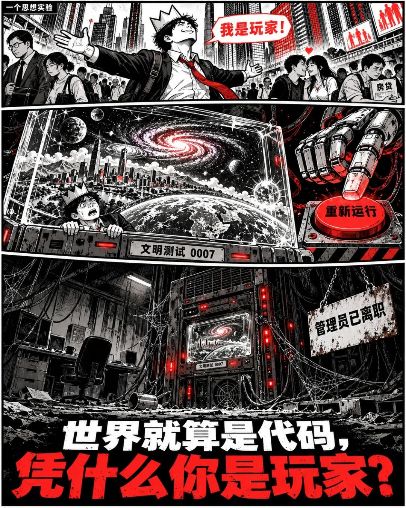

# 做编码器芯片久了，我开始怀疑：人类是不是宇宙的一个外设？

我做编码器芯片，日常工作之一，就是把轴转到哪里，变成一串数字。干久了，总觉得这件事有点古怪：控制器从来没见过那根轴。它收到几个数字，就相信轴在那里，然后通电、加速、刹车。整个系统忙得热火朝天，控制器对世界的认识，全靠接口回话。

人又好到哪里去了？眼睛报颜色，耳朵报振动，皮肤报温度，大脑把这些信号拼起来，宣布：这就是现实。你觉得自己直接看见了世界，其实中间已经过了好几道手续。**一个连自身接口都绕不过去的物种，天天讨论宇宙底层架构，胆子确实不小。**

当然，这不能证明世界是程序。但既然开脑洞，不妨想狠一点：假如宇宙真是某种计算系统，人类究竟是什么设备？大家最爱给自己安排“玩家”的位置，来人间体验一趟，死后退出登录。安排得真周到，连造物主都得给你做内容服务。可凭什么？做编码器的人看这件事，会冒出另一种不太体面的猜想：**人类也许只是一群带情绪的传感器。**

传感器负责把物理变化变成数据。人呢？看见日出，产生赞叹；遇到危险，产生恐惧；资源不足，发生争夺；建立关系，再产生爱、嫉妒和背叛。假如外面真有一套系统，它需要研究的，恰好就是这些反应呢？那么你觉得跌宕起伏的一生，在外面看，也许是一条持续七八十年的采样记录。你以为自己正在寻找人生意义，系统正在等你上传最后几个数据点。

更损的是，传感器不需要知道自己测的是什么。编码器不会理解电机为什么转，也不会替机械臂操心订单。它把位置报对，任务就算完成。那么，人类有没有一种可能：把自己的感受报得无比认真，却始终不知道这些感受被拿去干什么？你深夜失眠、反复回想的一句话，在某份实验报告里，只占一格：“受到拒绝后，行为变化明显。”

想到这里，有人肯定不服：我会拿显微镜检查，会造粒子探测器，会一直追查到底。可检查用的结果，你还是得通过仪器读取。于是脑洞又来了：假如系统足够会应付，你每深入一层，它就交付一层前后自洽的细节呢？**你以为自己拿着显微镜，在查世界的底细；也许你只是把画质从流畅，调到了极致。** 这里说的是科幻设定，不能拿它冒充量子力学。只是这个设定有个特别难受的地方：你连“我已经戳穿它了”的那份得意，都能被它一起交付。

做芯片还会养成一个习惯：看见功能，顺手想想成本。如果宇宙真靠计算运行，为什么非要把每个角落都精细算满？

一个无人经过的荒原，需要每粒沙子都实时更新吗？你昨天没打开的抽屉，今天也没打开，它有没有必要占那么多资源？假如只要在你打开时，给出一份与过去相容的结果就够了，那宇宙最厉害的本事，恐怕是让所有参与者始终对得上账。你藏的钥匙，别人找得到；你借的钱，银行记得住。尤其后者，稳定得让人绝望。

再拉远一点：**你正在担心下个月的房贷，外面的人正在担心这轮实验占了太多显存**。你觉得人生快撑不住了，他觉得机器快撑不住了。你希望熬过这一关，他准备点“结束实验”。更大的反转是，外面早就没人了，任务却还在自动运行。创造它的文明已经消失，服务器还亮着，里面一代代生命认真地问：造物主为什么不回应？**也许项目负责人已经离职，交接文档还没写。**

不过，想到这里，我反而觉得底层是什么没那么容易决定一切。控制器读到错误的位置，机器真的会撞；人收到一句伤人的话，也真的会痛。即使某种生命由计算产生，也不能只凭“它是程序”，就断言它的体验不算数。对编码器来说，一串数字背后有一根正在转动的轴；对一个人来说，几句话背后，也有一段你没见过的人生。看不见后面的东西，不代表前面的信号可以随便糊弄。

所以，世界是不是代码，万物是不是AI，我不知道。拿计算打比方，也远远不够证明宇宙真在运行某个程序。但我至少知道，做传感器的人最该警惕一件事：**别把自己测到的那一点，当成被测对象的全部**。人类也一样。拿着几个感官，接着几台仪器，就宣布看透了宇宙——万一你看透的，只是这一版驱动呢？

