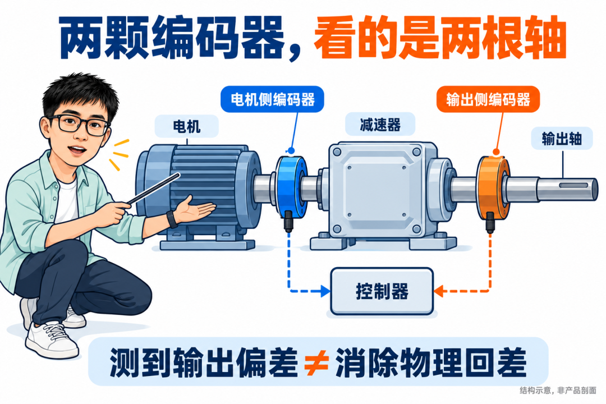
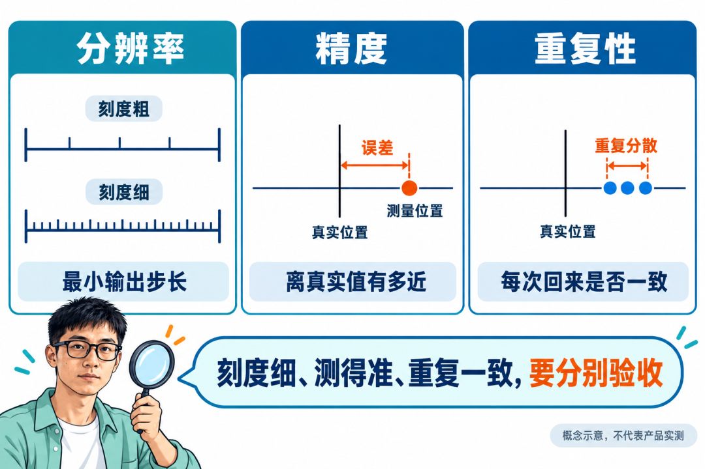

# 机器人关节编码器怎么选？从光磁电感到双编码器，一篇讲清

机器人关节里，同样叫“编码器”，有的盯着电机转子，有的盯着减速器输出轴。它们都在报角度，控制器拿这些角度做的事却可能完全不同。

选型最容易从这里走偏：看到“20位”就以为比“17位”更准，看到“双编码器”就以为回差和安全问题一起解决，看到“电感”就觉得天然比磁编更适合人形机器人。

做编码器芯片，我看一份关节方案时，首先会把这几句话拆开。位数说的是刻度有多细，精度说的是位置有多准，安装位置决定测到了哪根轴。三件事混在一起，参数表越漂亮，选型越容易失焦。

这篇从关节本身出发，把技术路线、参数和双编码器放进同一张选型地图。先回答一个问题：**你准备让这颗编码器，替控制器看清什么？**

## 先看它装在哪里，再看它有多少位

一台带减速器的关节，可以先想成一条传动链：电机转子带动减速器，减速器再带动输出轴。

装在电机侧的编码器，直接看到转子。控制器用它确定电角度、完成换相，也可以获取电机速度与位置。它需要跟上电机的速度，角度数据还得赶上控制器使用它的时刻。

装在输出侧的编码器，直接看到减速后的轴。电机已经转了多少，和输出端实际到了哪里，中间隔着传动误差、弹性变形和可能存在的回差。输出侧反馈让控制器有机会观察这些差异。

用一个理想算例说明：减速比为100∶1，电机转一圈，输出轴名义上转3.6°。如果只拿电机角度除以100，得到的是按理想传动关系估算的位置。负载下输出轴偏离了这个位置，电机侧编码器并不能直接把那段偏差测出来。

**所以，电机侧精度再高，也不能代替对输出轴位置的直接测量。** 这不意味着每台关节都要装两颗，而是先分清：项目到底需要控制转子，还是还需要知道输出端的实际位置。

*图1｜两路反馈观察传动链两侧；结构示意，不能据此推断产品内部结构。*

## 光学、磁性、电感：三条路线，各自替你解决什么

### 光学：关注精密刻度，也要给它合适的安装条件

光学编码器通过光源、刻度和光电检测获得位置。高精度刻度、低噪声读出和成熟的细分技术，使它成为精密运动反馈的重要选择。

但“光编”两个字不能直接换算成某个统一精度。读头、码盘、安装偏心、轴系误差和工作环境都会影响最终表现。看数据手册时，要确认精度指的是编码器系统，还是装入关节后的轴角度。

污染同样不能只用“怕灰”概括。开放式读头确实要评估污染，有些产品通过光学设计与编码冗余提高了容污能力，封闭式产品又有不同的防护条件。Renishaw的公开资料就介绍了具备容污设计的绝对式光学编码器。[1]

适合优先评估光学方案的情况，是项目对定位、低速平稳性或测量噪声要求较高，并且能为码盘、读头和防护留出合适的结构条件。

### 磁性：集成灵活，磁路就是设计的一部分

磁性编码器利用霍尔或磁阻器件感知磁场。磁铁或磁环跟着轴转，芯片根据磁场变化计算角度。它可以做得紧凑，也适合与关节结构一起设计。

选磁编，不能只选芯片。磁体、气隙、偏心、倾斜、附近铁磁材料，以及电机工作时的杂散磁场，都会进入误差预算。不同感应结构对这些因素的敏感程度也不一样。

“抗油污”更不代表“装在哪里都一样准”。油污不遮挡磁场，与装配误差不影响角度，是两件事。真正该问的是：在允许的磁环公差、安装偏差、温度和工作电流下，装成关节之后还能保证多少精度？

磁性方案值得优先评估的情况，是空间与集成要求突出，项目能把磁路设计、装配控制和必要的校准一并纳入开发。它并不只属于低端或低精度应用。

### 电感：少一块永磁体，多一套线圈与靶标约束

这里讨论的是通过激励、接收线圈和导电靶标获取位置的电感式方案。它可以利用PCB线圈形成测量结构，为超薄、中空或大直径布局提供设计空间。

这条路线不依赖永磁体来编码角度，某些产品也明确以抗杂散磁场作为设计特性。但“抗磁场”仍要看具体产品与测试条件，不能进一步推成“所有电磁干扰都不怕”。靶标间隙、倾斜、周边金属、线圈设计和布板条件，同样需要验证。

Melexis的机器人关节资料同时列出了磁性MLX90384与电感MLX90514方案：前者最高18位，后者最高16位，且分别给出位置、尺寸与安装约束。[2] 这两个分辨率不能拿来给两条路线排精度名次。对工程选型而言，更有意义的是：**同一个关节里，尺寸、轴端结构和反馈任务不同，候选路线就可能不同。**

把路线选择压缩成一张表，可以这样讨论：

| 项目里最紧的约束 | 值得优先评估的方向 | 样机阶段重点核什么 |
| --- | --- | --- |
| 精密定位、低速噪声要求高，结构允许配置刻度与读头 | 光学方案 | 系统精度、安装误差、污染与防护条件 |
| 空间紧，需要小型芯片、磁铁或磁环灵活集成 | 磁性方案 | 磁路公差、工作电流下的杂散场、温度与校准残差 |
| 需要PCB式布局、中空或特定靶标结构 | 电感方案 | 线圈与靶标匹配、间隙倾斜、周边金属和抗扰条件 |

这张表用于决定先测谁。最终入选的仍然是具体产品和具体结构。

## 参数表里，最值得分开的四件事

*图2｜重复读数集中在一起，仍可能整体偏离真实位置。概念示意，不代表产品实测。*

### 位数：刻度有多细

一圈按17位输出，名义量化步长约为0.00275°；20位约为0.000343°。这两个数字由360°除以对应的码值数量得到，只代表名义刻度。

如果一个20位系统装好后的实际角度误差是±0.1°，输出小数再长，也不能据此宣称位置已经准到0.000343°。反过来，更高分辨率在低速控制和细小变化观测上可能有价值，价值要结合噪声和带宽判断。[3]

### 精度与重复性：准不准，和每次是否一致

精度描述读数接近真实角度的程度；重复性描述重复到达同一位置时，读数有多一致。[3] 一个系统可能每次都稳定地偏一点，也可能平均位置接近正确、瞬时读数却在跳。

因此，询价时的一句“精度多少”，最好展开成：常温还是全温？校准前还是校准后？典型值还是保证上限？单颗器件还是完整组件？允许多大的安装偏差？

这些条件没有对齐，两份规格书上的数字就还不能直接比较。

### 动态表现：静止时准，转起来还准不准

静态误差、角度噪声、周期误差、滤波和延迟，需要分别看。静止时输出很稳，可能包含较强滤波；整圈误差不大，也可能存在会影响速度估算的局部周期误差。

再算一笔时间账：6000rpm等于每秒100圈，10μs内转子转过0.36°。这是机械角度的运动量，不代表某款编码器必然有0.36°误差。它说明控制器必须知道数据对应什么时刻，以及是否已经做过预测或补偿。

问供应商“多久能读完一帧”还不够，还要问这帧角度代表哪个采样时刻。通讯变快，不会自动把此前的测量和滤波延迟全部抹掉。

### 断电后的能力：记住圈内位置，还是还记住圈数

单圈绝对式通常能在上电后给出一圈内的位置，多圈能力还涉及圈数如何保持、断电期间的运动如何处理。增量接口则要结合计数、参考标记与回零策略使用。

选型表不能只勾“绝对值”。如果关节断电时可能被外力转动，就应把恢复供电后的允许动作、位置恢复要求和失效处理写清楚。

## 双编码器贵在哪里，又不能替你承诺什么

双编码器最直接的价值，是让控制器同时观察传动链两侧。

电机侧反馈可以服务于转子控制，输出侧反馈可以参与输出位置闭环。把两侧角度按减速比、零点和时间对齐后，还能分析传动链的偏差。至于两路数据如何参与速度环与位置环，取决于具体控制架构，不能固定成一句“一个管速度，一个管位置”。

输出侧误差被测到之后，控制器才有机会修正相应位置偏差。但减速器的物理间隙和弹性不会因此消失，闭环带宽与机械共振也会限制补偿效果。

同样，两路角度差可以在一定条件下用于研究负载或扭转状态；要把它变成可信的力矩估计，还需要刚度、摩擦、迟滞和温度等模型与验证。两颗编码器不直接等于一只合格的力矩传感器。

安全问题也要单独讨论。两颗器件如果共享某些供电、安装或处理环节，可能同时受到同一种故障影响。“数量为二”和“具备经过设计验证的安全冗余”之间，还有独立性、诊断覆盖和故障响应需要交代。BiSS Safety公开方案就不仅包含两路位置，还包括数据完整性检查、计数与接收端处理机制。[4]

**双编码器增加了可观测的信息，能否转化成更好的控制、力估计或安全能力，要看整套系统。**

## 真正能拿去开选型会的一页问题

在讨论供应商和料号之前，先让机械、电控、算法和测试把下面这页填上：

| 先确认的问题 | 应该得到的答案 |
| --- | --- |
| 测的是哪根轴？ | 电机侧、输出侧，还是两侧都要 |
| 需要知道什么？ | 电角度、速度、输出位置，或另有诊断任务 |
| 允许多大误差？ | 指定位置、温度、负载与安装条件下的误差要求 |
| 数据何时使用？ | 有效采样时刻、更新率、延迟与抖动要求 |
| 断电后怎么办？ | 单圈、多圈、回零和外力移动处理策略 |
| 结构能给什么条件？ | 轴端或中空空间、间隙、偏心、倾斜与防护 |
| 怎么证明选对了？ | 装入实际结构后的全温、转速、负载与干扰验收 |

这页填不出来，先争论光编、磁编还是电感，大概率只是在比较各自最漂亮的那一列。

我更愿意把编码器选型看成一次反馈任务分配：哪根轴需要被看见，什么时刻需要它的角度，结构和环境允许用什么办法看见，再让样机证明测得够不够好。

把这几件事说清楚，采购拿到的是验收条件，机械知道该控制哪些公差，算法知道角度数据能信到哪里。一颗编码器的价值，也才从“参数很好看”，变成“这台关节用得上”。

参考资料（文中数值算例可独立复算，不代表特定产品实测）：

1. Renishaw：光学编码器的工作原理与容污设计
2. Melexis：机器人关节用编码器与旋变方案
3. RLS：分辨率、精度与重复性的区别
4. BiSS：BiSS Safety系统概念
