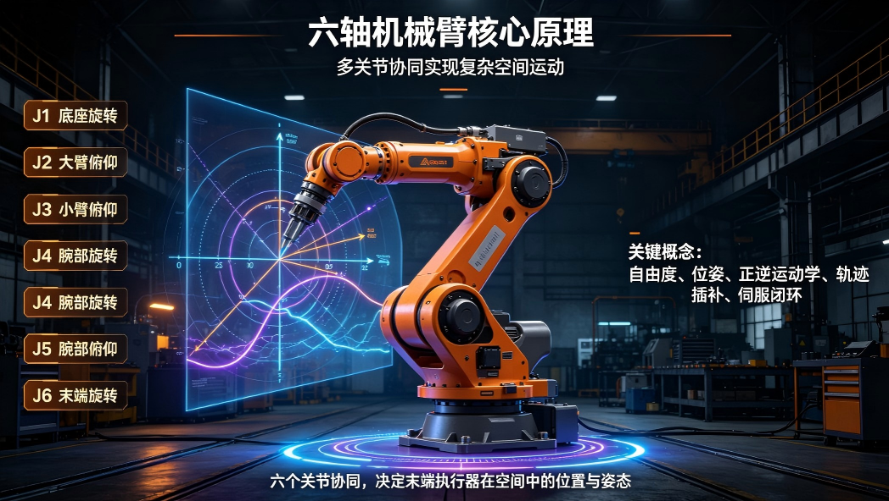
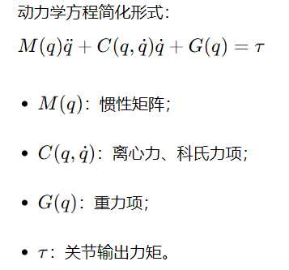
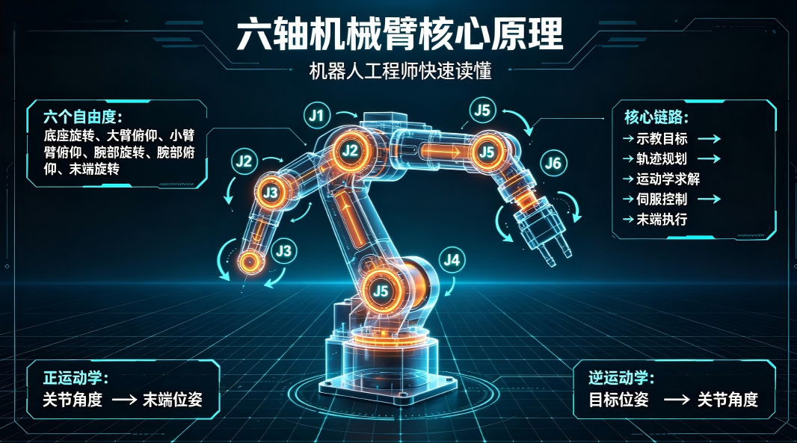

###

六轴串联机械臂是工业机器人领域应用最广泛的本体形态，广泛应用于焊接、喷涂、搬运、上下料、装配、打磨等场景。区别于四轴SCARA机器人、Delta并联机器人，六轴机械臂拥有6个旋转自由度，可以在工作空间内实现末端任意位姿，兼顾工作范围、灵活性与负载能力。很多工程师只会做示教编程，对底层运动学、动力学、伺服驱动、标定、误差来源理解浅薄，在调试、故障排查、方案选型时容易遇到瓶颈。

## 一、六轴机械臂整体架构与自由度逻辑

六轴机械臂属于串联机器人，6个关节依次串联，全部为旋转关节，从基座到末端依次定义为J1‑J6。

- J1：基座回转关节，实现整机水平旋转；
- J2：大臂俯仰关节；
- J3：小臂俯仰关节；
- J4：小臂旋转关节；
- J5：腕部俯仰关节；
- J6：末端法兰旋转关节。

通俗理解：J1‑J3负责把末端送到三维空间中某一个位置，确定末端在哪里；J4‑J6组成球形手腕，负责调整末端工具的姿态，决定工具朝哪个方向。6个自由度配合，实现末端在可达空间内任意位置+任意姿态，这就是六轴机械臂相比于四轴机器人最大优势。

完整系统分为五大子系统：机械本体结构、伺服驱动系统、运动控制系统、感知反馈系统、上层编程示教系统。数据流链路：示教/程序给定目标位姿→运动学求解得到各关节目标角度→运动控制器生成轨迹→伺服驱动器闭环驱动电机运转→编码器、力矩传感器反馈实际关节状态，形成闭环。

关键认知：六轴机器人不是6个电机简单拼接，串联结构存在严重的耦合效应，后级关节运动会对前级动力学产生影响，这也是运动控制复杂度远高于单轴设备的根本原因。

| 子系统 | 包含核心部件 | 核心功能 | 工程师关注点 |
| --- | --- | --- | --- |
| 机械本体 | 基座、大臂、小臂、腕部壳体、减速器、轴承、法兰输出盘 | 承载、传递力矩，提供机械运动基础 | 臂展、负载、重复定位精度、惯量、刚度 |
| 伺服驱动系统 | 伺服电机、减速器、伺服驱动器、抱闸 | 提供动力，实现降速增扭，执行关节运动 | 功率密度、扭矩、减速比、响应带宽 |
| 运动控制系统 | 机器人控制器、运动控制算法库 | 运动学求解、轨迹规划、插补、逻辑调度 | 控制周期、插补精度、动力学前馈、总线 |
| 感知反馈系统 | 绝对值编码器、增量编码器、六维力传感器 | 采集关节角度、速度、末端受力 | 反馈分辨率、噪声、同步精度 |
| 示教编程系统 | 示教器、离线编程软件 | 点位编程、轨迹示教、工艺配置 | 程序兼容性、离线仿真精度、工艺包 |

## 二、机械本体结构与核心零部件

六轴机械臂本体性能上限由硬件零部件决定，整机成本中减速器、伺服电机占比最高。串联结构每个关节都采用“电机+减速器”的典型配置。

### 2.1 六大核心零部件

1. 伺服电机
 六轴机械臂全部采用交流伺服电机。基座、大臂J1/J2/J3承受大负载，电机功率大；腕部J4/J5/J6负载较小，电机体积更小。核心指标：额定扭矩、峰值扭矩、额定转速、转动惯量。电机输出转速很高，但输出扭矩小，必须依靠减速器放大扭矩。
2. 减速器
 六轴机械臂主流使用谐波减速器、RV减速器两类。

- RV减速器：抗冲击能力强、刚性高，多用于J1、J2、J3底座大负载关节；
- 谐波减速器：体积小、重量轻，适合J4、J5、J6腕部小负载关节。
 减速器是机械臂精度的核心来源，回程间隙、扭转刚度、寿命直接决定整机性能。

1. 编码器
 分为绝对值编码器与增量编码器。工业六轴机械臂几乎全部使用绝对值编码器，断电不丢失关节位置，开机无需回零。编码器分辨率直接影响关节角度采样精度。
2. 抱闸制动器
 每个关节电机配置电磁抱闸，断电抱死电机轴，防止重力作用下大臂下坠，是安全保护部件。故障场景经常出现抱闸未完全打开，造成电机过载报警。
3. 臂体铸件
 多为铸铝材质，追求轻量化与结构刚度。臂体刚度不足，高速重载下会发生形变，带来重复定位误差。
4. 末端法兰盘
 机械臂输出接口，用来安装夹爪、焊枪、打磨头等工具，具备标准机械接口，支持快换装置。

### 2.2 减速器技术路线对比

| 减速器类型 | 应用关节 | 优势 | 劣势 | 六轴机械臂应用场景 |
| --- | --- | --- | --- | --- |
| RV减速器 | J1/J2/J3基座大关节 | 高刚性、抗冲击、耐过载 | 体积重量偏大 | 搬运、点焊、重载六轴机器人 |
| 谐波减速器 | J4/J5/J6腕部关节 | 体积小巧、重量轻 | 抗冲击弱，过载易损坏 | 轻载装配、喷涂、小负载通用六轴 |

### 2.3 六轴机械臂关键本体参数解读

工程师选型时重点看五类参数：

1. 负载：末端法兰允许最大载荷，包含工具+工件总重量；选型需要预留安全余量，不能卡满标称负载。
2. 工作半径（臂展）：机械臂末端最大可达距离，决定作业空间；同时要关注最小可达距离，避免奇异点干涉。
3. 重复定位精度：反复运动到同一目标点的位置偏差，一般±0.02mm~±0.1mm；注意区分重复定位精度和绝对定位精度。很多机器人重复定位很好，但绝对定位偏差大，对离线编程不友好。
4. 最大关节速度：各关节最大转速，决定整机节拍。
5. 允许惯量：末端允许最大转动惯量，如果工具惯量超标，会出现振动、抖动，严重会损坏减速器。

工程误区：只看负载重量，忽略末端惯量。一个重量轻但重心远、转动惯量大的工具，依然会造成机器人振动报警。

## 三、运动学：六轴机械臂最核心底层数学原理

运动学分为正运动学与逆运动学，是控制器底层算法基石。

### 3.1 正运动学

已知J1‑J6六个关节角度，求解末端法兰在基坐标系下的位姿（位置X/Y/Z，姿态RPY）。工业机器人普遍采用D‑H参数法建立连杆坐标系，每一根连杆定义连杆长度、连杆偏距、关节转角、扭转角四组参数，依次矩阵相乘，得到末端齐次变换矩阵。正运动学解唯一，输入一组关节角度，只能得到唯一一组末端位姿。

### 3.2 逆运动学

已知目标末端位姿X/Y/Z/RPY，求解对应的6个关节角度。六轴串联机械臂逆运动学存在多解问题。同一个末端位置姿态，机器人存在多组关节角度可以实现，分为右肩解、左肩解、肘上解、肘下解，总共最多8组逆解。控制器需要根据当前关节位置、关节限位，自动选择一组合理解。逆运动学是工程师最容易踩坑的地方：目标点超出工作空间、或者到达奇异点，逆运动学无解，机器人直接报错无法运动。

### 3.3 奇异点（奇点）

六轴机械臂典型奇异点两类：

1. 腕部奇异点：J4与J6轴线重合，J5角度接近0°；此时J4、J6无限旋转也无法改变末端姿态，关节速度会出现理论无穷大。
2. 肩部奇异点：腕部中心点落在J1旋转轴上。

奇异点不会损坏硬件，但会出现关节速度突变、抖动，程序运行报错。工程解决方案：轨迹规划避开奇异区域；调整工件摆放位置；优化姿态。

### 3.4 坐标系体系

调试六轴机械臂，必须理解四类坐标系：

1. 世界/基坐标系：固定在机器人底座，机器人全局参考；
2. 关节坐标系：每个关节自身角度；
3. 工具坐标系TCP：定义工具中心点与工具姿态；
4. 用户坐标系（工件坐标系）：绑定工件，程序基于工件编写，工件移位后只修改用户坐标系即可，不用修改全部点位。

TCP标定不准，是现场调试最常见故障。TCP误差会导致抓取、焊接、装配全部偏移。

| 运动学概念 | 核心含义 | 工程现象 | 工程师处理要点 |
| --- | --- | --- | --- |
| 正运动学 | 关节角度→末端位姿 | 输入关节角度算出末端位置 | 用于仿真、状态监测，解唯一 |
| 逆运动学 | 末端位姿→关节角度 | 给目标点位，机器人计算各轴角度 | 最多8组逆解，控制器择优选择 |
| 奇异点 | 逆运动学退化，无解或者速度无穷大 | 运动卡顿、抖动、报警停机 | 轨迹规划规避奇异区域，调整姿态 |
| TCP工具坐标系 | 工具中心点与姿态 | TCP不准，作业整体偏移 | 正确执行四点法/六点法标定 |
| 用户坐标系 | 工件局部坐标系 | 工件移位，程序不用重写点位 | 现场根据工装重新标定 |

## 四、动力学与运动控制原理

运动学只研究位置姿态，不考虑力、质量、惯性；动力学研究关节需要输出多大力矩才能完成运动。六轴串联机器人动力学非常复杂，前一个关节运动，会改变后面全部连杆的惯性、重力、离心力、科氏力。

### 4.1 动力学模型

含义：机器人关节输出力矩，需要克服连杆惯性、离心科氏效应、自身重力。高速运动时离心力、科氏力不可忽略；静止状态主要克服重力。

### 4.2 运动控制三环架构

每个关节伺服执行电流环‑速度环‑位置环三环串级控制。

1. 电流环（内环）：控制电机输出力矩，采样频率最高；
2. 速度环：抑制转速波动；
3. 位置环：跟踪目标关节角度。

六轴机器人控制器会输出关节目标角度给伺服驱动器。单纯PID控制在高速、重载工况误差大，现代机器人普遍加入动力学前馈补偿：把重力、惯性力矩提前计算出来，作为前馈给到电流环，大幅降低跟踪误差。没有动力学前馈，高速运动轨迹会出现明显滞后偏差。

### 4.3 轨迹规划

机械臂有两种典型运动指令：

1. JOG关节运动MOVEJ：各个关节独立插补，关节角度平滑过渡，不保证末端走直线。适合快速点位移动，远离工件。
2. 笛卡尔直线运动MOVEL：末端TCP严格走空间直线，需要逆运动学实时计算每个时刻关节目标角度，计算量大，适合焊接、涂胶等工艺作业。

轨迹规划会做S曲线加减速，限制加速度、加加速度，抑制启动停止冲击，避免振动。

### 4.4 力控（阻抗/导纳控制）

普通位置控制：强制机器人走到目标位置；当遇到外部阻碍会产生巨大内力。增加六维力传感器后，可以开启阻抗控制，实现柔顺。典型场景：装配插孔、打磨、力跟随。位置控制追求位置精度；力控追求接触力可控。很多通用六轴机器人本体不带力传感器，需要外接末端六维力传感器。

| 控制模式 | 特点 | 适用场景 | 局限 |
| --- | --- | --- | --- |
| 关节运动MOVEJ | 关节空间插补，速度快，不保证末端直线 | 点位搬运、快速移动 | 末端路径不可控，不能用于工艺轨迹 |
| 直线运动MOVEL | TCP笛卡尔空间直线轨迹 | 焊接、涂胶、装配工艺轨迹 | 计算量大，靠近奇异点容易报错 |
| 纯位置闭环控制 | 严格跟踪位置目标 | 无接触搬运，定位作业 | 遇到外力容易过载、撞机 |
| 阻抗柔顺控制 | 允许末端在外力下偏移，控制接触力 | 打磨、精密装配 | 需要力传感器，调试参数复杂 |

## 五、标定、误差来源与精度分析

很多工程师混淆重复定位精度和绝对定位精度。

- 重复定位精度：反复多次运动到同一个点位，位置离散程度，体现机器人重复能力；
- 绝对定位精度：程序设定目标坐标，机器人实际到达和理论坐标的偏差。

六轴机械臂重复定位精度普遍很好，但绝对定位精度往往差很多。离线编程仿真环境点位，直接下发实体机器人，点位偏移，大多就是绝对定位精度不足导致。

### 5.1 主要误差来源

1. 机械制造装配误差：D‑H参数实际值和理论设计值存在偏差；
2. 减速器回程间隙：换向运动时出现间隙；
3. 结构形变：重载下臂体、减速器发生弹性形变；
4. 温度漂移：长时间运行发热，结构热变形；
5. TCP标定误差：工具坐标系标定错误；
6. 控制插补误差。

### 5.2 机器人标定

机器人标定分为几何参数标定（D‑H标定），通过激光跟踪仪采集多组末端点位，修正D‑H连杆参数，提升绝对定位精度。没有标定的机器人，离线编程很难直接使用。

| 误差来源 | 现象 | 改善手段 |
| --- | --- | --- |
| D‑H几何参数误差 | 绝对定位差，重复定位正常 | 激光跟踪仪几何标定 |
| 减速器回程间隙 | 换向运动出现位置跳变 | 减速器选型、间隙补偿参数 |
| 弹性形变 | 重载时点位偏移，负载越大偏差越大 | 刚度优化，动力学补偿 |
| TCP标定错误 | 所有作业点位统一偏移 | 重新标定工具坐标系 |
| 热变形 | 长时间运行点位逐渐漂移 | 温控、热误差补偿算法 |

## 六、六轴、SCARA、Delta机器人横向对比

工程师选型时经常混淆几类工业机器人，表格清晰对比各自边界。

| 机器人类型 | 自由度 | 核心优势 | 短板 | 典型应用 |
| --- | --- | --- | --- | --- |
| 六轴串联机械臂 | 6旋转轴 | 空间任意位姿，工作范围大，通用性强 | 高速节拍弱于Delta，价格偏高 | 焊接、搬运、装配、打磨、喷涂 |
| SCARA四轴机器人 | 4自由度（3旋转+1Z轴平移） | 平面运动速度快，成本低 | Z方向旋转姿态受限，无法复杂空间姿态 | PCB插件、平面搬运、螺丝锁付 |
| Delta并联机器人 | 3‑4自由度 | 极高速度，节拍快 | 工作空间小，负载低 | 食品分拣、高速包装 |

选型核心逻辑：如果作业需要复杂空间姿态，必须六轴；仅平面作业优先SCARA；高速轻载分拣优先Delta。

## 七、控制系统架构：控制器、总线、示教器

现代六轴机械臂控制器硬件架构分为两种主流路线：

1. 专用硬件控制器：主流大厂方案，专用运动控制板卡，硬实时系统，EtherCAT总线驱动各个伺服驱动器，稳定性强。
2. PC‑based控制器：基于工业PC+实时操作系统，软件实现运动学动力学算法，开放性强，方便二次开发，很多国产机器人、科研平台采用。

工业机器人主流实时总线为EtherCAT，实现控制器与多轴伺服毫秒级周期同步。总线同步一旦丢失，会出现关节不同步，轨迹畸变，报警停机。

软件层面：控制器内部包含运动学库、轨迹规划、PLC逻辑、工艺包（焊接包、打磨包）；示教器只是人机交互终端，不承担核心运算。

| 控制器路线 | 优势 | 劣势 | 适用对象 |
| --- | --- | --- | --- |
| 专用硬件控制器 | 实时性强，稳定性高，成熟工艺包丰富 | 开放性差，二次开发难度高 | 传统工业机器人大厂产品 |
| PC‑Based工业PC控制器 | 开放性好，方便二次开发，算法迭代灵活 | 对实时系统调试能力要求高 | 国产机器人、科研定制项目 |

## 八、现场常见故障与底层原理分析

工程师现场调试高频问题，从原理角度解析现象与根因。

1. 运动抖动、振动
 根因：伺服参数不匹配；末端惯量超过允许范围；减速器磨损；动力学前馈未开启；轨迹加速度设置过大。
 处理：降低加减速；核对末端惯量；优化伺服增益；检查减速器状态。
2. 到达奇异点报警
 根因：逆运动学退化，目标姿态落入奇异区域。
 处理：修改程序姿态，调整工装，移动工件位置。
3. 点位重复很好，但离线编程点位偏移
 根因：绝对定位精度不足，D‑H参数存在几何误差，未做标定。
 处理：几何标定；精准标定TCP与用户坐标系。
4. 大臂断电下坠
 根因：抱闸失效，抱闸控制回路故障。
 处理：检查抱闸供电，更换抱闸制动器。
5. 直线MOVEL轨迹卡顿
 根因：靠近奇异点；逆运动学计算压力大；总线同步抖动。
 处理：调整姿态，避开奇异区域。

| 故障现象 | 主要底层原因 | 处理思路 |
| --- | --- | --- |
| 运动抖动振动 | 惯量超标、伺服参数、减速器磨损 | 校验末端惯量，调整伺服增益，降低加速度 |
| 奇异点报警停机 | J4/J6同轴、腕部落入J1轴线 | 修改姿态，调整工件摆放位置 |
| 重复精度正常，离线编程点位偏移 | 几何参数误差，绝对定位精度差 | 执行机器人几何标定，校准TCP |
| MOVEL直线轨迹卡顿 | 奇异点、逆运动学计算压力 | 规避奇异区域，必要改用关节运动 |
| 断电大臂下坠 | 关节抱闸故障 | 检修抱闸供电与制动器 |

## 九、六轴机械臂技术发展趋势

1. 轻量化一体化关节：传统分体电机减速器向一体化关节模组演进，降低本体设计难度，国产六轴本体快速迭代。
2. 力控普及：末端六维力传感器成本下降，柔顺装配、打磨场景大规模落地，力控不再是高端选配。
3. 视觉+六轴机器人融合：2D/3D视觉引导，解决无序抓取，机器人不再依赖固定工装。视觉输出目标位姿给到机器人控制器，完成动态抓取。
4. 更高绝对定位精度：几何标定工具普及，提升离线编程实用性，减少现场示教工作量。
5. 开放化控制器：PC‑based架构越来越多，支持二次开发，适配AI、机器视觉等上层应用。
6. 协作六轴机器人发展：力感知、碰撞检测，无需安全围栏，实现人机共作业。协作机器人本质也是六轴串联机械臂，增加碰撞检测与柔顺控制。

## 十、工程师实操总结

六轴机械臂整套底层逻辑可以梳理为：机械本体+减速器伺服电机提供物理运动基础；D‑H参数正逆运动学完成关节角度与末端位姿互相转换；动力学模型计算各个关节需要输出力矩；轨迹规划生成平滑运动路径；三环伺服闭环完成每个关节精准跟随；标定补偿各类机械误差；上层示教器下发任务指令。

工程师调试不能只停留在拖动示教写点位，遇到抖动、偏移、奇异点报错，需要回归运动学动力学底层定位问题。选型时不能只看标称负载，要综合臂展、惯量、重复定位精度、绝对定位精度综合评估。六轴机械臂强大来源于6自由度带来任意末端姿态，但复杂度也来自串联结构带来的逆解多解、奇异点、动力学耦合等一系列工程难题。

行业提示：样机参数好看不等于现场好用，减速器品质、动力学前馈算法、标定能力，直接决定机器人在高速重载工艺场景的实际表现。

## 28.9资料合集内部分 电子书籍 截图

## 28.9资料合集内 部分课件PPT截图

