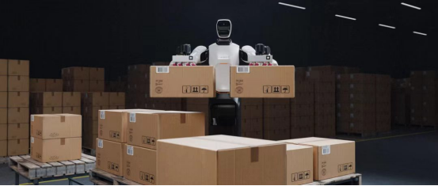
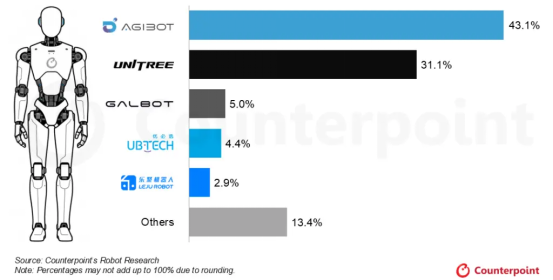
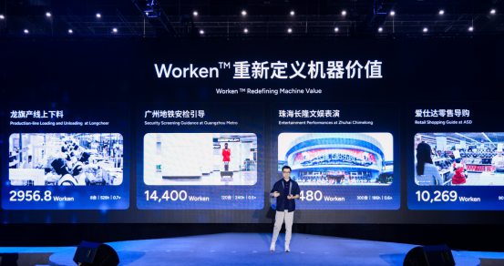
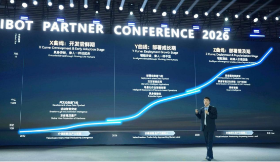

没实力的时候不要说话，有实力的时候不需要说话。

出品 | 跨境参考 作者 | 千帆

## 冠军亮出成绩

最近，人形机器人市场真的挺热闹。宇树刚交完三季度答卷，智元就紧随其后把自己的成绩单摆上了桌。这一次，风头轮到了智元。

10月29日，在2026智元创新日上，智元总裁兼CTO彭志辉透露，今年上半年，智元整体收入接近20亿元。

这个数字，超过了宇树同期的11.52亿元，也高于优必选的12.69亿元。两家颇受关注的机器人企业，在这场营收较量中，被智元远远甩在了后面。

把时间拉长，智元的成长速度更显眼：2023 年营收约 30 万元，2024 年 6000 万元，2025 年冲到 10.5 亿元，今年上半年又接近 20 亿元。仅仅半年，就干过了宇树科技今年九个月的营收。

智元机器人搬运货物 图源：智元官网

营收背后，已有实实在在的交付支撑。研究机构Counterpoint统计，2026年上半年，智元人形机器人出货约9700台，占全球份额超过43%，排名第一。

智元占据人形机器人全球出货榜首 图源：Counterpoint Research

<strong>成立于2023年的智元，已经布局远征、灵犀、精灵等产品系列，将机器人送进商演、科研教育和工业生产等市场。</strong>不同客户的采购用途，给这门生意打开了多个入口。

这些成绩，也让机器人行业的商业竞争变得具体起来。技术要转化为收入，终究得找到愿意采购、能够使用产品的客户。

## 生意多线并进

<strong>商演租赁和科研教育，是智元已经打开的两类市场。</strong>灵犀X2系列已广泛应用于国内商演租赁，也覆盖科研教育等用途。

商演客户看重动作表现和互动效果，科研客户需要开展实验、开发程序的平台。采购目的清楚，产品开发便有了方向，机器人也就找到了现实中的买家。

灵犀X2在宽窄巷子提供游客交互、导览与文化讲解服务 图源：智元官网

进入工厂，客户的要求更加具体。精灵G2系列已进入龙旗的平板生产线，承担物料搬运等任务。跟上生产节拍、能长时间稳定运行，才能为工厂创造理想的价值。

<strong>此次创新日上，</strong>智元<strong>发布的Worken，正是尝试衡量这份价值，将活跃机器人数量、自主工作时长和产出效率纳入考量。</strong>对采购者而言，持续完成多少有效工作，是判断投入是否划算的重要依据。

智元CTO彭志辉发布Worken 图源：智元官网

商演要效果，工厂要效率。不同产品承接不同任务，让智元能够触达更多客户；量产能力则为批量交付提供支撑。这些业务共同构成了理解其营收规模的线索。

产品与用途的匹配，在国内可以靠智元自己下场验证。到了海外，隔着语言和市场规则，这一步就需要当地伙伴的判断和参与。

今年6月30日，智元在伦敦举行合作伙伴大会，宣布在英国、爱尔兰拓展10家当地合作伙伴，业务涉及分销、应用展示、售后及研发。

智元CEO邓泰华在英国发表演讲 图源：智元官网

**这类合作**旨在利用国外本地网络，将<strong>销售和使用接起来。</strong>展示让客户了解产品，再针对使用中的具体任务开展开发，售后支持则处理使用中的问题。机器人进入真实工作环境后，当地有人协助适配、跟进维护，客户才更容易把设备用起来。

## 20 亿营收是答案，也是新问题的开始。 客户 的需求会更新，科研预算会收紧，产 品 对稳定性的要求只会更高。

智元已经在试着把衡量标准从卖了多少台换成产生了多少价值，**而**能定义价值标准的人，才有资格定义这个行业**。这把尺子最终能不能被客户和市场接受，现在还远未到揭晓的时候。谁能最先帮客户把账算明白，谁就掌握了下一程的主动权。

## 铁粉推荐
