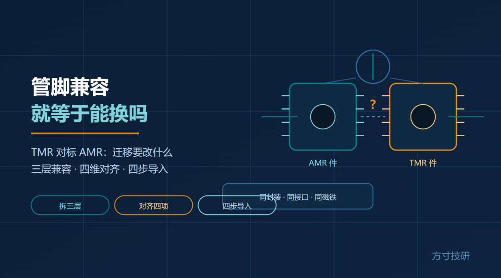
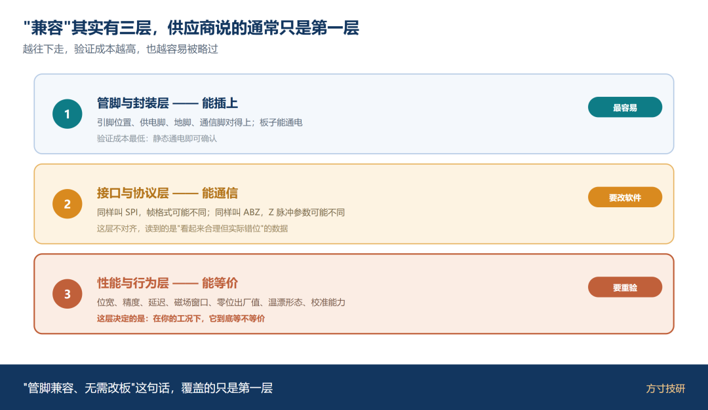
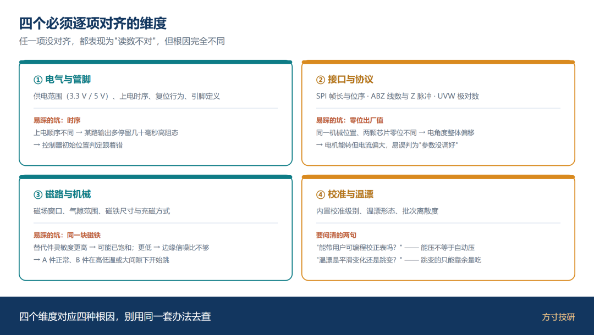
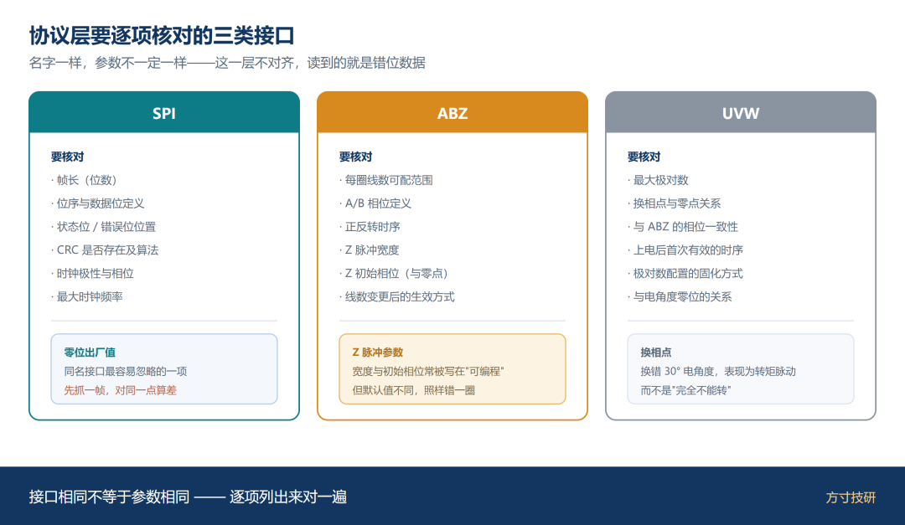
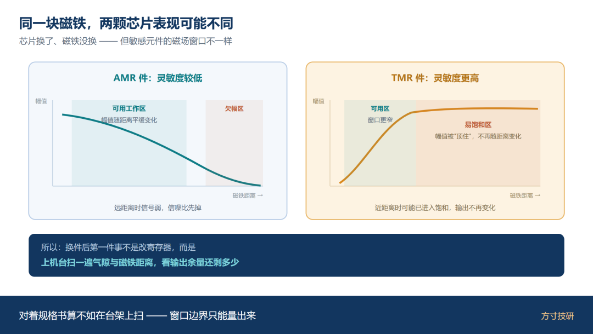
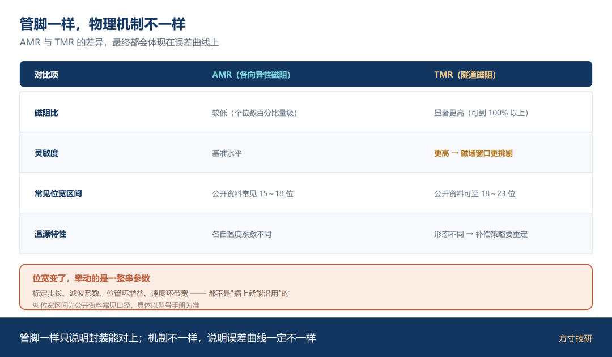
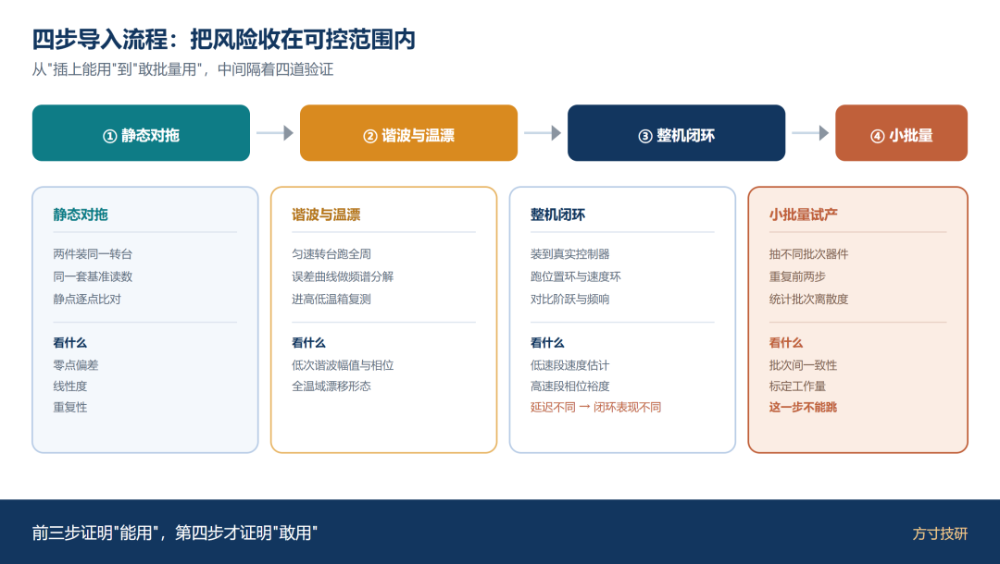
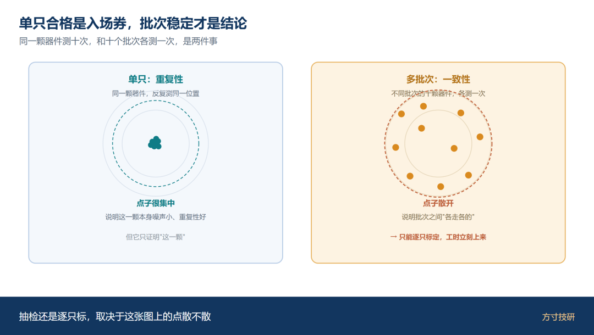
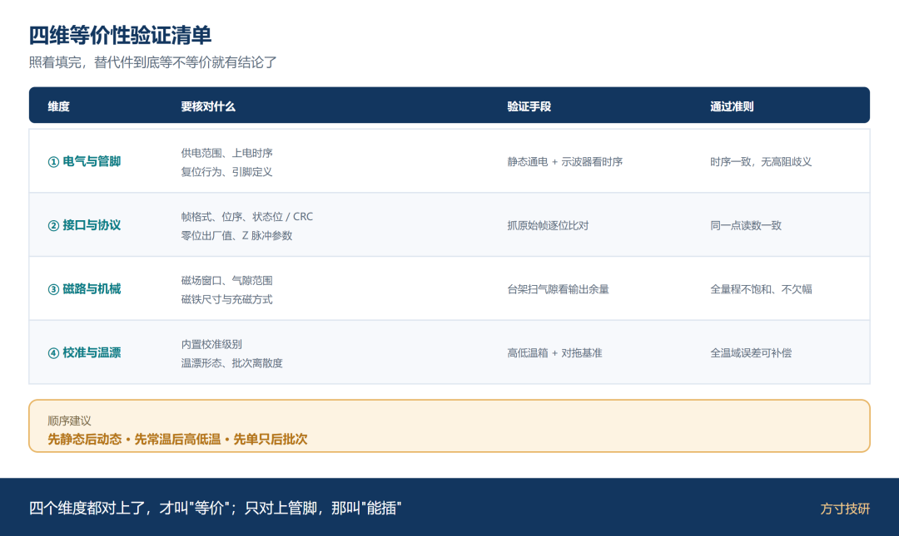

供应紧张的时候，最快的动作是找第二来源。

公开资料里有一组现成的例子：某国产 TMR 磁性编码器芯片，与某主流的 AMR 磁编码器芯片**封装与引脚定义一致**，可以直接在原有板卡上做替换评估，不用重新设计 PCB。

资料写得很清楚："迁移集中在参数配置，而非硬件改动。"

这话不算错，但容易让人松掉一根弦。因为**"能插上"和"能等价"之间，还隔着两层。**

## 一、先把"兼容"拆成三层

**第一层，管脚与封装。** 引脚位置、供电脚、地脚、通信脚对得上，板子能插上、能通电。这一层最容易验证，也最容易被当成全部。

**第二层，接口与协议。** 同样叫 SPI，帧格式可能不同；同样叫 ABZ，Z 脉冲宽度与初始相位可能不同；同样叫 UVW，极对数配置上限可能不同。这一层不对齐，MCU 读到的是"看起来合理但实际错位"的数据。

**第三层，性能与行为。** 位宽、精度、延迟、磁场窗口、零位出厂值、温漂形态、校准能力——这层决定的是：在你的工况下，它到底等不等价。

一句话：**管脚兼容只解决了第一层。第二层要改软件，第三层要重做验证。**

图 1｜管脚封装（能插上）→ 接口协议（能通信）→ 性能行为（能等价）

## 二、四个必须逐项对齐的维度

### ① 电气与管脚

供电范围（3.3 V 还是 5 V）、上电时序、复位行为、引脚定义，逐项对。

这一层常见的坑不在引脚本身，而在**时序**：上电顺序不同，可能导致某一路输出在高阻态多停留几十毫秒，控制器的初始位置判定就跟着错。

### ② 接口与协议

以 SPI 为例，要核对：帧长、位序、数据位定义、状态位与 CRC 的处理方式。

以 ABZ 为例，要核对：每圈线数（可配置范围）、A/B 相位定义、Z 脉冲宽度与初始相位。

以 UVW 为例，要核对：最大极对数、换相点与零点偏移的关系。

**零位出厂值是最容易翻车的一项。** 同一个机械位置，两颗芯片出厂零位不同，上电后电角度整体偏移——现象是电机能转但电流偏大、效率下降，很容易被误判成"参数没调好"。

### ③ 磁路与机械

芯片换了，磁铁没换。但**两颗芯片要求的磁场窗口可能不一样**。

如果替代件灵敏度更高，同一块磁铁在它上面可能已经进入饱和区；如果灵敏度更低，边缘位置的信噪比又不够。结果就是：同一个结构，A 件读数正常，B 件在高低温或大间隙下开始跳。

上机前用台架扫一遍气隙与磁铁距离，看输出余量，比对着规格书算更可靠。

### ④ 校准与温漂

**内置校准的能力级别要问清**：出厂只做零点与正交校准，还是能带用户可编程的校正表？有公开资料显示，部分器件支持用户写入校正查找表，把系统级误差进一步压下来——但那是"能压"，不是"自动压"，你得有基准、有流程。

**温漂形态也要问清**：是随温度平滑变化，还是存在跳变点？平滑的可以建表补偿，跳变的只能靠设计余量吃掉。

图 2｜电气与管脚 / 接口与协议 / 磁路与机械 / 校准与温漂

图 3｜SPI / ABZ / UVW 三栏，各列出必须核对的参数项（帧长、位序、零位、Z 脉冲…

## 三、技术路线不同、管脚却相同，坑埋在哪

这是最容易忽略的一节。两颗芯片可以引脚一致，但底层物理机制完全不同：一类基于各向异性磁阻（AMR），一类基于隧道磁阻（TMR）。

差异会体现在三个地方：

**分辨率与位宽区间**。公开资料显示，AMR 方案常见 15～18 位区间，TMR 方案可做到 18～23 位。位宽不同，意味着你原来的标定步长、滤波参数、甚至控制器的位置环增益都可能需要重新整定。

**灵敏度与磁阻比**。TMR 的磁阻比远高于 AMR，同磁场下的信号幅度更大。好处是信噪比好，代价是**对磁场窗口更挑剔**——原来"随便一块磁铁都能用"的方案，换件后可能得重新挑磁铁。

**温漂特性**。不同技术路线的温度系数不同，全温域的漂移形态也不同。实验室常温合格，不代表 -40～125℃ 全区间合格。

一句话：**管脚一样，只说明封装能对上；物理机制不一样，说明误差曲线一定不一样。**

图 4｜左 AMR 件输出曲线、右 TMR 件输出曲线，同一磁铁下一条欠幅、一条趋饱和

图 5｜磁阻比、位宽区间、灵敏度、温漂特性

## 四、四步导入流程

替代件不是"插上就能用"，但也不必推倒重来。按这四步走，能把风险收在可控范围内。

**第一步：静态对拖。** 原器件与替代件装在同一台转台上，用同一套基准读数，静点逐点比对。看零点偏差、看线性度、看重复性。

**第二步：谐波与温漂。** 让转台匀速转起来，把两件的误差曲线做频谱分解，对比低次谐波的幅值与相位；再进高低温箱，对比全温域的漂移形态。

**第三步：整机闭环。** 装到真实控制器上跑位置环与速度环。重点看低速段的速度估计、高速段的相位裕度——**接口看起来一样，延迟不一样，闭环表现就会不一样**。

**第四步：小批量试产。** 抽一批不同批次的器件重复前两步，看批次间的离散度。单只合格是入场券，批次稳定才是结论。

图 6｜静态对拖 → 谐波与温漂 → 整机闭环 → 小批量试产

图 7｜单只误差 vs 批次分布，标"单只合格是入场券"

## 五、四维等价性验证清单

|  |
| --- |
|  |

|  |  |  |  |
| --- | --- | --- | --- |
| 维度 | 要核对什么 | 验证手段 | 通过准则 |
| 电气与管脚 | 供电范围、上电时序、复位行为、引脚定义 | 静态通电 + 示波器看时序 | 时序一致，无高阻态歧义 |
| 接口与协议 | 帧格式、位序、状态位/CRC、零位出厂值、Z 脉冲参数 | 抓原始帧逐位比对 | 同一机械位置读数一致 |
| 磁路与机械 | 磁场窗口、气隙范围、磁铁尺寸与充磁方式 | 台架扫气隙看输出余量 | 全量程不饱和、不欠幅 |
| 校准与温漂 | 内置校准级别、温漂形态、批次离散度 | 高低温箱 + 对拖基准 | 全温域误差可补偿 |

顺序建议：**先静态后动态、先常温后高低温、先单只后批次**。

图 8｜四维表格卡片 + 底部顺序条（先静态后动态、先常温后高低温、先单只后批次）

## 总结

· **"兼容"有三层**：管脚封装、接口协议、性能行为。供应商说的兼容通常只覆盖第一层，第二层要改软件，第三层要重做验证。

· **零位与磁场窗口是最容易翻车的两项**：前者让电机能转但效率变差，后者让同一块磁铁在两颗芯片上表现不同。

· **四步导入不能跳**：静态对拖、谐波温漂、整机闭环、小批量试产；单只合格是入场券，批次稳定才是结论。

💬 你们做双供应商导入时，踩过最深的坑是哪一项——零位、温漂，还是磁场窗口？评论区聊聊。

喜欢这类把选型动作拆到可执行步骤的内容，点个关注。

**—— 方寸技研 · 下期预告：同一家芯片公司为什么同时押两条技术路线。**
