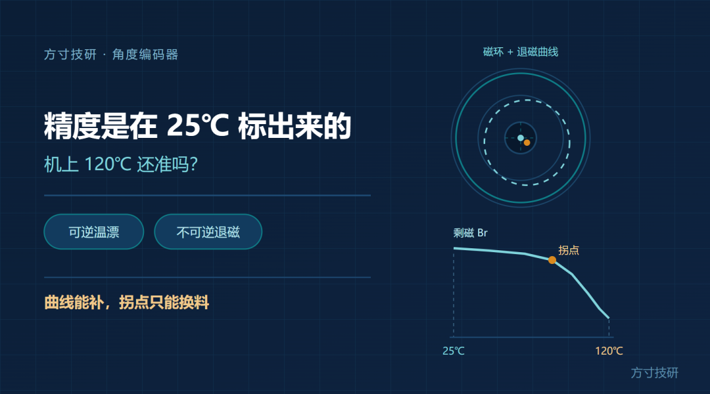
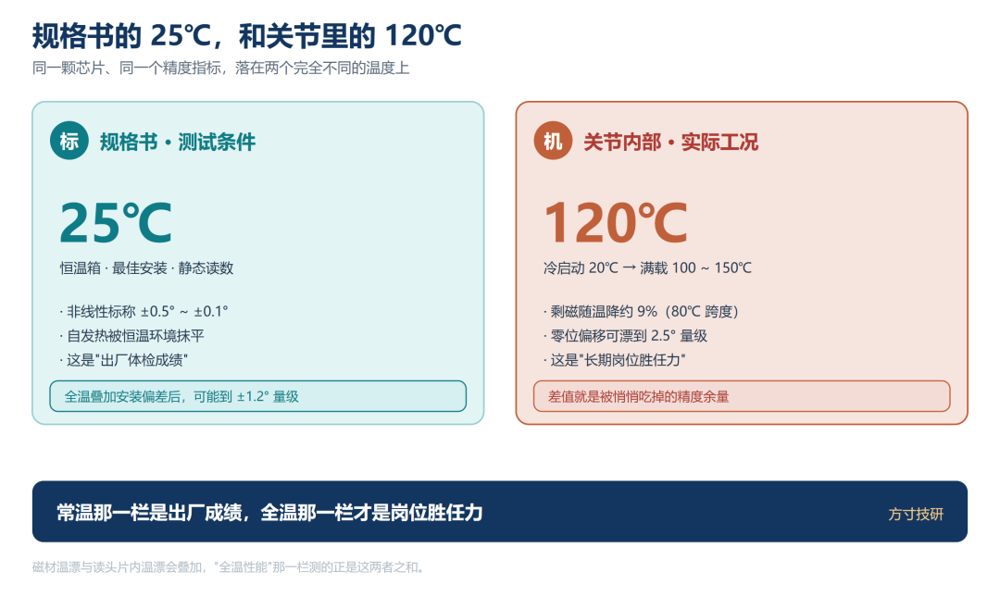
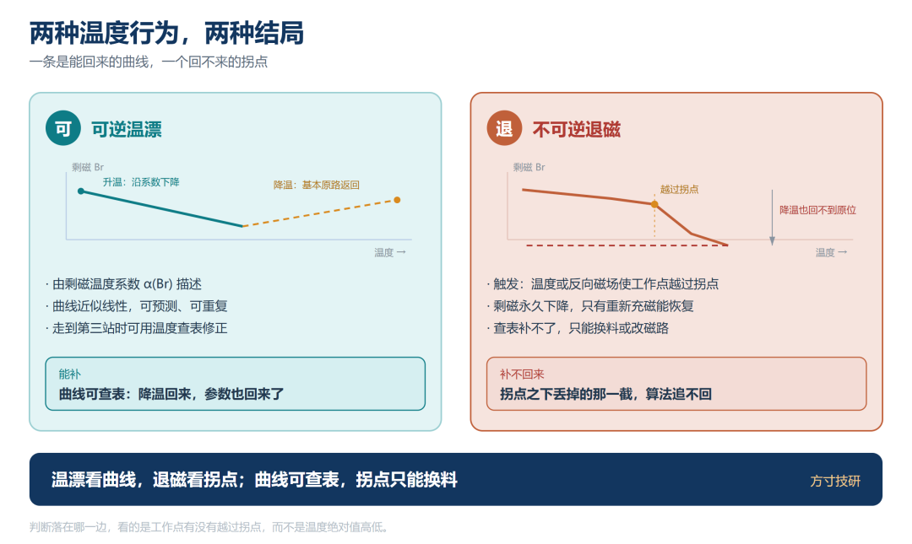
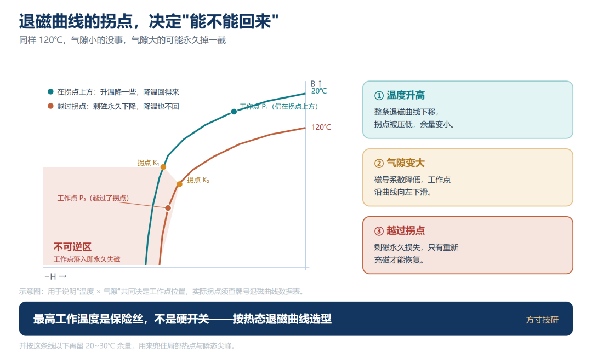
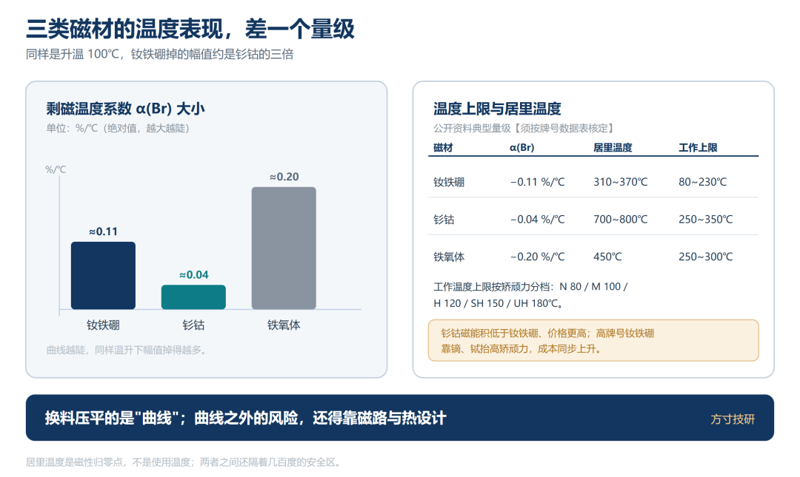
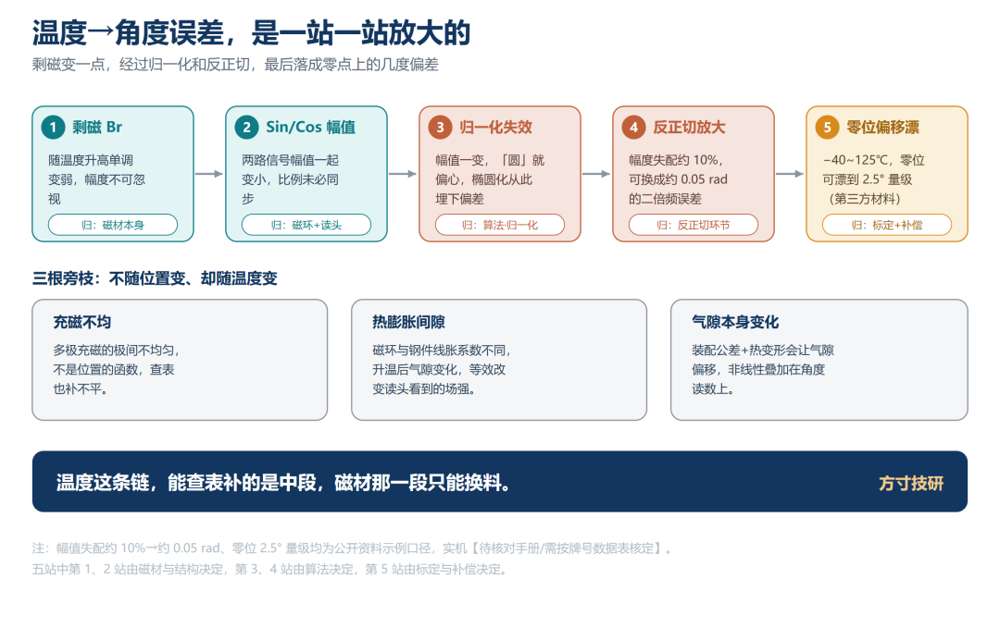
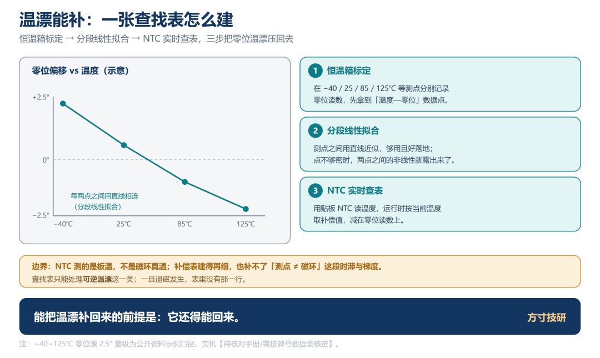
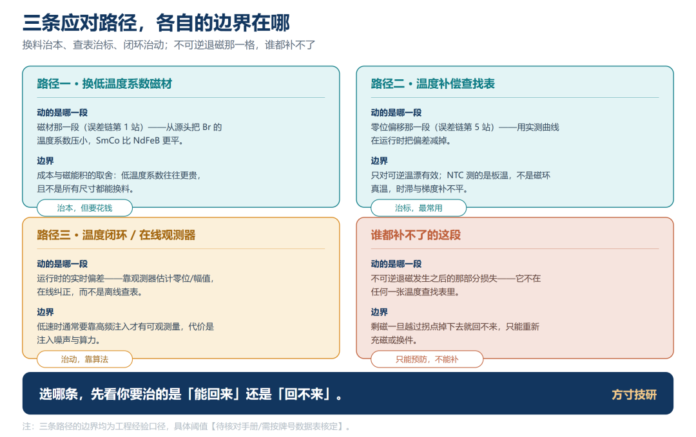
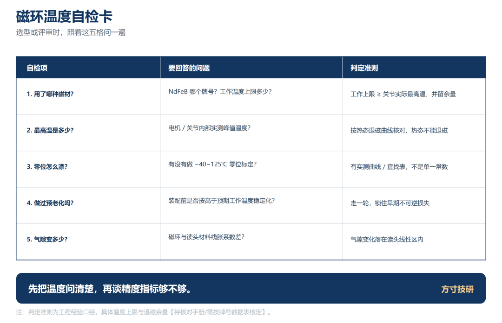

选型时你盯的是那一栏"±0.5°、±0.1°"，落笔时也默认它是全温指标。

可关节装完、电机一跑，内部温度轻松上到 120℃，某些高负载结构里能摸到 150℃ 量级。规格书的精度是在 25℃ 标出来的，机上却不是 25℃——这两者之间差的，就是被悄悄吃掉的精度余量。

更棘手的是，磁材受热不只是"变弱"，某些条件下它会"变没"，而且再也变不回来。

## 一、规格书的 25℃，和关节里的 120℃

翻开磁编码器的公开数据，几乎每一款都会标一个很漂亮的常温非线性。

但再往下看一栏"全温性能"，画风就变了：有资料给出，某款 14 位磁角度芯片最佳安装条件下非线性约 ±0.8°，把全温与安装偏差叠加后可能到 ±1.2°；另一款 GMR 芯片启用自动校准后，全寿命、全温范围最大误差 1.0°。

也就是说，**常温那一栏是"出厂体检成绩"，全温那一栏才是"长期岗位胜任力"。** 两者常常差一个量级。

差距从哪来？很大一块在磁环本身。钕铁硼的剩磁温度系数典型量级是 −0.11% ~ −0.12%/℃，温度每升 1℃，剩磁就掉千分之一出头。

单看不多，但关节从冷态 20℃ 热到 100℃，跨度 80℃，剩磁就要掉掉约 9%。**【具体牌号取值须按磁材数据表核定】**

芯片那头的动态范围是有限的——它有最低磁场门限，也有 AGC 或归一化的量程。幅值一掉，留给解算的余量跟着变，误差自然冒头。

图 1｜规格书 25℃ 标定条件

## 二、先分清两种温度行为：温漂能回来，退磁回不来

这是全文最该分清的一节。磁材受热有两种行为，物理机理完全不同。

**第一种：可逆温漂。** 温度升高，原子热振动加剧，磁畴取向被扰乱，宏观剩磁 Br 下降；温度降回去，磁畴重新站队，剩磁基本能恢复。这条曲线**近似线性**，斜率就是常说的**剩磁温度系数 α(Br)**。

**第二种：不可逆退磁。** 温度或外磁场超过某个限度，磁体的**工作点越过了退磁曲线的拐点（knee）**，一部分磁畴彻底翻不回来。即使温度降回室温，剩磁也停在低处——**只有重新充磁才能恢复。**

判断落在哪一边，看的是"工作点有没有越过拐点"，而不是"温度高不高"。同样 120℃，气隙小、磁导系数高、磁路"夹得紧"的磁体可能安然无恙；气隙被热膨胀拉开、工作点又低的磁体，可能就在这个温度上永久掉了一截。

图 2｜一条升温下降、降温原路返回

这里还要区分两个温度，很多人会混：**居里温度**是磁畴彻底瓦解、磁性归零的点；**最高工作温度**只是"在该工况下不至于不可逆失磁"的额定值。**额定不是硬开关，是保险丝——它按热态退磁曲线给，不按 20℃ 的 Br 给。** 工程上通常还要在这条线以下再留 20~30℃ 余量，兜住局部热点与瞬态尖峰。

一句话：**可逆温漂是一条能回来的"曲线"，不可逆退磁是回不来的"拐点"；曲线能补，拐点补不回来。**

一条可背走的口诀记住这节：**温漂看曲线，退磁看拐点；曲线可查表，拐点只能换料。**

图 3｜退磁曲线（第二象限 B-H），标注拐点 knee、磁导系数工作线

## 三、从磁材漂到角度：误差链上的五站

温漂不是直接变成角度误差的，它要走完一条链。下面每一站，我都顺手标了它归谁管。

**第一站，磁材剩磁随温度变。** NdFeB 约 −0.11%/℃ 量级，SmCo 约 −0.03% ~ −0.045%/℃，铁氧体更高，约 −0.20%/℃ 量级。**【待核对手册：均须按牌号数据表核定】** ——这一站，归**选材**。

图 4｜剩磁 → Sin/Cos 幅值 → 归一化失效 → 角度误差 → 零位偏移

**第二站，Sin/Cos 两路幅值跟着变。** 剩磁变化直接体现在读头看到的磁场强度上，两路正交信号的幅度一起缩小。这一站，一部分归磁材、一部分归芯片 AGC。

**第三站，归一化失效。** 芯片或算法里那套幅值归一、椭圆拟合参数，通常是在标定时（多半是常温）算出来的。温度一变，幅度比、偏置、正交度都偏离了当初的拟合结果，归一化就不再"归得干净"。这一站，归**补偿表**。

**第四站，反正切把残余的非理想放大成角度误差。** 幅度失配会以二倍机械频率的形式直接调制角度输出——有公开资料估算过，10% 的幅值失配能带来约 0.05 rad（约 2.9°）量级的解算误差。**【第三方工程资料口径】**

**第五站，零位偏移随温度漂。** 这一站对闭环最致命。有第三方 FOC 校准资料提到，在 −40℃ ~ 125℃ 这一档里，磁编码器零位偏移的最大变化量可达 2.5° 量级。**【第三方口径，须按型号核定】**

图 5｜NdFeB / SmCo / 铁氧体的 α(Br) 与居里温度区间对照

零位一漂，FOC 的 dq 轴解耦就跟着歪：本该全部用来出力矩的 Iq 里混进了 Id，转矩对不上指令，效率掉、发热涨，严重时抖振甚至失步。

链上还挂着三根"旁枝"，会同时叠加。

**充磁不均**——磁环个体差异，它不是位置的函数，任何按角度铺开标定表都放不下它。

**磁环与读头的间隙随温度变**——两者热膨胀系数不同：NdFeB 平行充磁方向约 3~4×10⁻⁶/K、垂直方向约 1~3×10⁻⁶/K，SmCo 垂直方向可到 10~13×10⁻⁶/K，钢轴约 12×10⁻⁶/K 量级。

**气隙变化本身**——气隙一变，磁导系数就变，工作点在退磁曲线上上下移动。**幅度这一站会失准，退磁那一站的拐点余量也在被同时消耗。** 这两件事，往往是同一根因。

还有一处芯片侧的同侪效应别漏掉：**读头自身的失调与灵敏度也随温度漂。** 磁材掉幅值和读头漂灵敏度是叠加的，不是二选一。

## 四、三条应对路径，各自动的是哪一段

面对温漂，工程上无非三条路。分清它们各自"动的是哪一段"，比记住怎么实现更重要。

**路径一：从源头选材。** 换成低温度系数的磁材——钐钴，或高牌号钕铁硼。钕铁硼按矫顽力分档，工作温度上限从标准牌号约 80℃，一路到 M 约 100℃、H 约 120℃、SH 约 150℃、UH 约 180℃。**【待核对手册：牌号分档须按供应商数据表核定】**

它动的是**物理源头**——把曲线压平。代价是成本与磁性能的取舍：钐钴常温磁能积低于钕铁硼、价格更高；高牌号钕铁硼靠加镝、铽把矫顽力抬上去，成本同步上升。

边界也清楚：**换料能压平"可逆的那条曲线"，但改不了外部反向磁场，也改不了装配环节的退磁风险**，更管不了读头芯片片内的失调温漂。

**路径二：温度补偿查找表。** 在恒温箱里标定 −40℃、25℃、85℃、125℃ 几个关键温度点的零位偏移，拟合成分段线性曲线，运行时用 NTC 或片内温度计实时查表修正。**【第三方工程资料口径】**

它动的是**可预测的那部分漂移**。前提是：漂移与温度的关系在标定时就已确定、且可重复。

边界在"测点不等于真值"：温度传感器测的是自己那一点，不代表磁环本体的实际温度；标定温度点之外的曲线靠外推，也会走形。

图 6｜恒温箱标定点（−40 / 25 / 85 / 125℃）→ 分段线性拟合 → NTC 实…

**路径三：温度闭环 / 在线观测器。** 中高速下用电机模型估算的角度做参考，用低带宽调节器把编码器读数慢慢拉回来；零速低速下改用高频注入做校验。

它动的是**缓变、且能被模型覆盖的那部分**。代价是复杂度，边界是模型准确性——电机参数一把不准，观测器拉回来的就是错的方向。

三条路之外，还有一段谁都补不了：**已经发生的不可逆退磁、磁材的个体差异、以及超出标定范围的非线性。** 这一段只能回到换料、重新充磁与热设计。

图 7｜换料 / 查表 / 观测器，各标"能补哪一段""边界在哪"，右侧一列"补不回来"

|  |
| --- |
|  |

|  |  |  |
| --- | --- | --- |
| 路径 | 动的是哪一段 | 边界 |
| ① 换低温度系数磁材 | 可逆温漂的**曲线斜率** | 改不了反向磁场与装配退磁；成本与磁能积取舍 |
| ② 温度补偿查找表 | 与温度**可重复对应**的漂移 | 测点≠磁环真温；标定点之外靠外推 |
| ③ 温度闭环 / 观测器 | **缓变、模型可覆盖**的漂移 | 依赖电机模型；零速低速失效 |
| —— 补不回来 | 已发生的不可逆退磁 / 磁材个体差异 / 超范围非线性 | 只能换料、重新充磁、改热设计 |

一句话：**补偿只能吃掉"可预测的那部分温度漂移"；模型之外的，得靠换料与热设计。**

## 五、磁环温度自检卡

动手前，把下面这张卡过一遍。五格都有答案，方案才算站得住。

|  |
| --- |
|  |

|  |  |  |
| --- | --- | --- |
| 自检项 | 要回答的问题 | 判定准则 |
| ① 磁材牌号与温度曲线 | 用的什么牌号？α(Br) 与 Hcj 温度曲线有没有数据表？ | 拿不到曲线就算不出余量，先要数据表 |
| ② 最高工作温度与居里温度余量 | 额定工作温度多少？机内热点多少？离居里点多远？ | 留 20~30℃ 以上余量，按**热态**退磁曲线选，不按 20℃ 的 Br |
| ③ 装机后热循环验证 | 冷启动到满载，角度重复性还在不在？ | 至少做一轮冷态↔满载热循环，记录零位回差 |
| ④ 是否要上温度传感器与补偿表 | 温漂量级是否已进入误差预算？ | 进入了，就上 NTC + 分段线性补偿表，并想清测点代表性 |
| ⑤ 判定准则 | 谁来判定"可以放行"？ | 以**全温段**角度误差为准，不以常温非线性为准 |

补一句生产端的实招：磁环在装进整机前，先按**高于预期工作温度的某个点做一轮预老化（稳定化处理）**。它会主动把"低承诺取向"的那部分磁畴提前剔掉，之后的输出反而更稳定、批与批之间的离散也更小。这一步花的是工序时间，省的是售后拆机。

图 8｜五格自检卡，对应正文第五节的表

## 总结

· **规格书的精度是常温标出来的。** 常温非线性 ≠ 全温精度，两者常常差一个量级；温升带来的余量损耗，必须在误差预算里先扣掉。

· **温漂分两种：可逆的曲线、不可逆的拐点。** 前者降温能回来、可以补偿；后者只有重新充磁才能恢复。判断依据是工作点有没有越过退磁曲线拐点，而不是温度绝对值高低。

· **三条应对路径各补一段：** 换料压平曲线、查表补可预测漂移、观测器管缓变分量；而已经发生的退磁、磁材个体差异、超范围非线性，算法一律补不回来。

💬 你的项目做过全温标定吗？热机之后那零点，是漂了一点，还是已经掉了一截、怎么补都补不回来？评论区聊聊。

喜欢这类把原理、误差与工程取舍摊开讲的内容，点个关注。

**—— 方寸技研 · 下期预告：单台机器人 70 多个位置传感器——国产编码器产业链正在发生什么**
