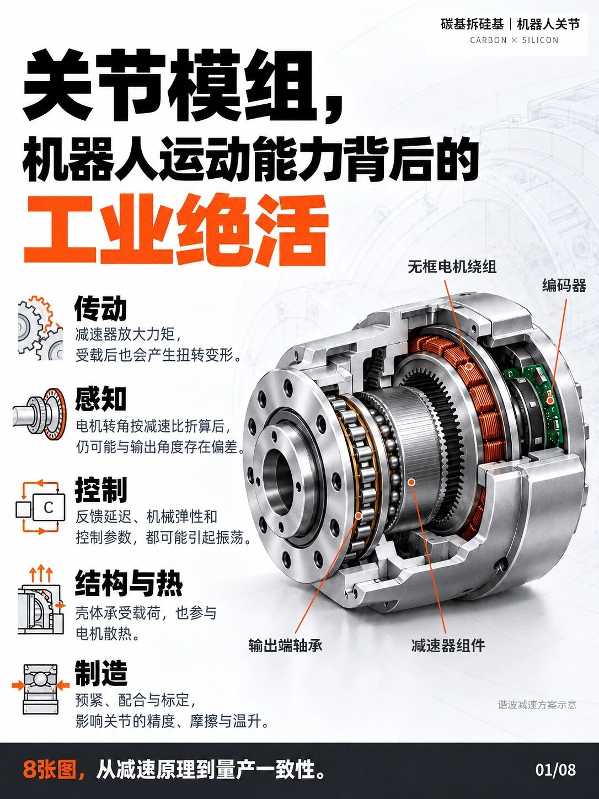
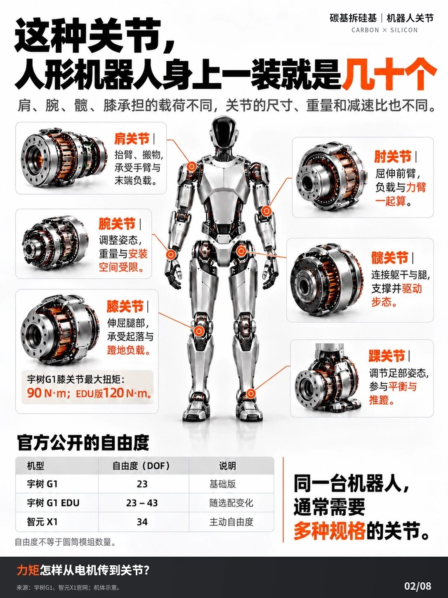
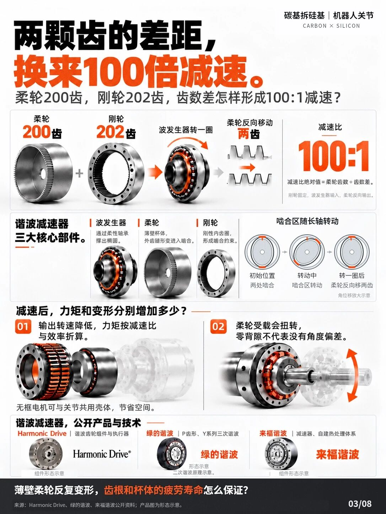
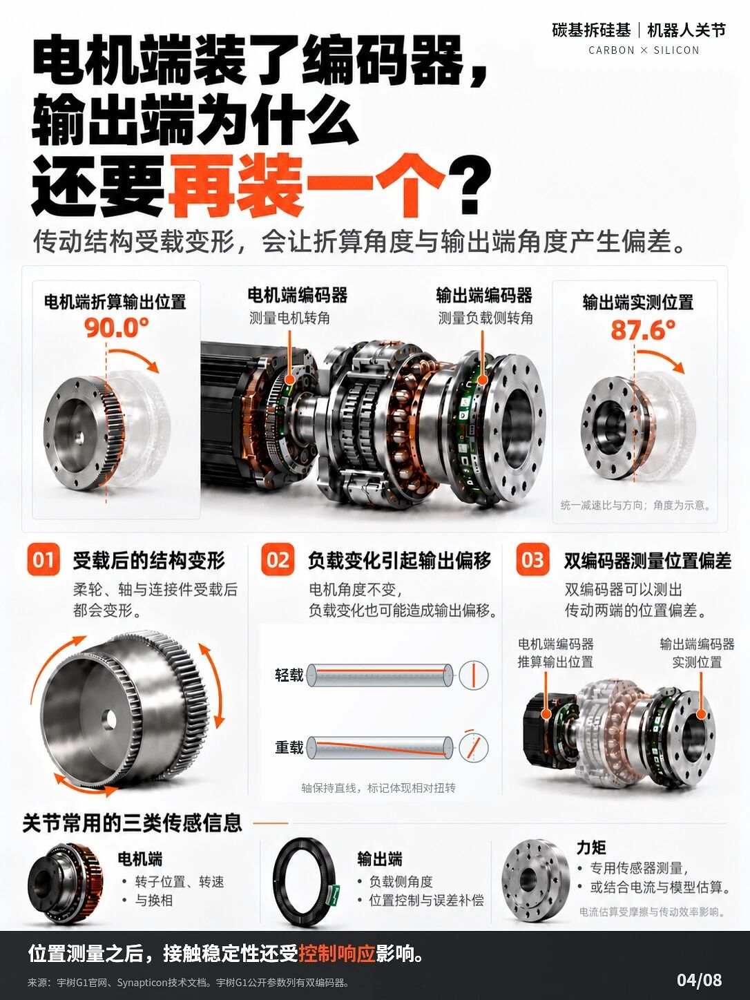
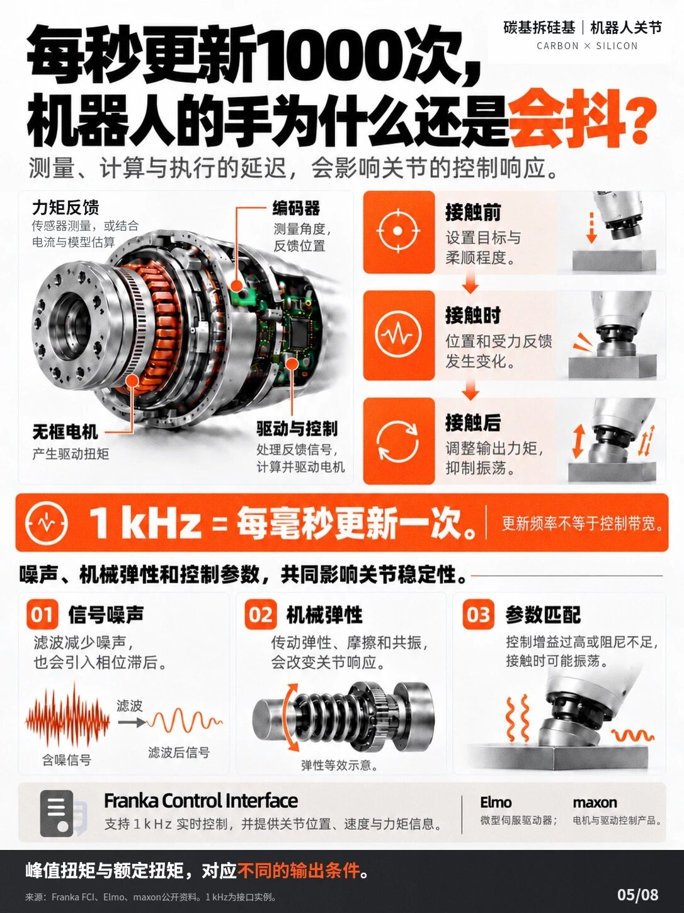
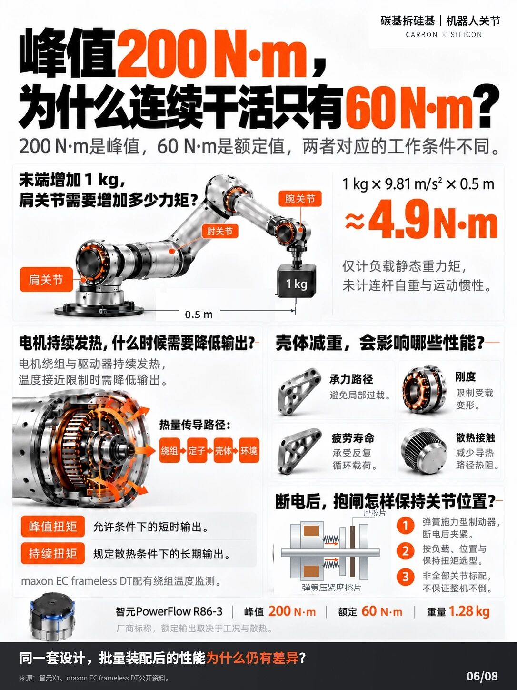
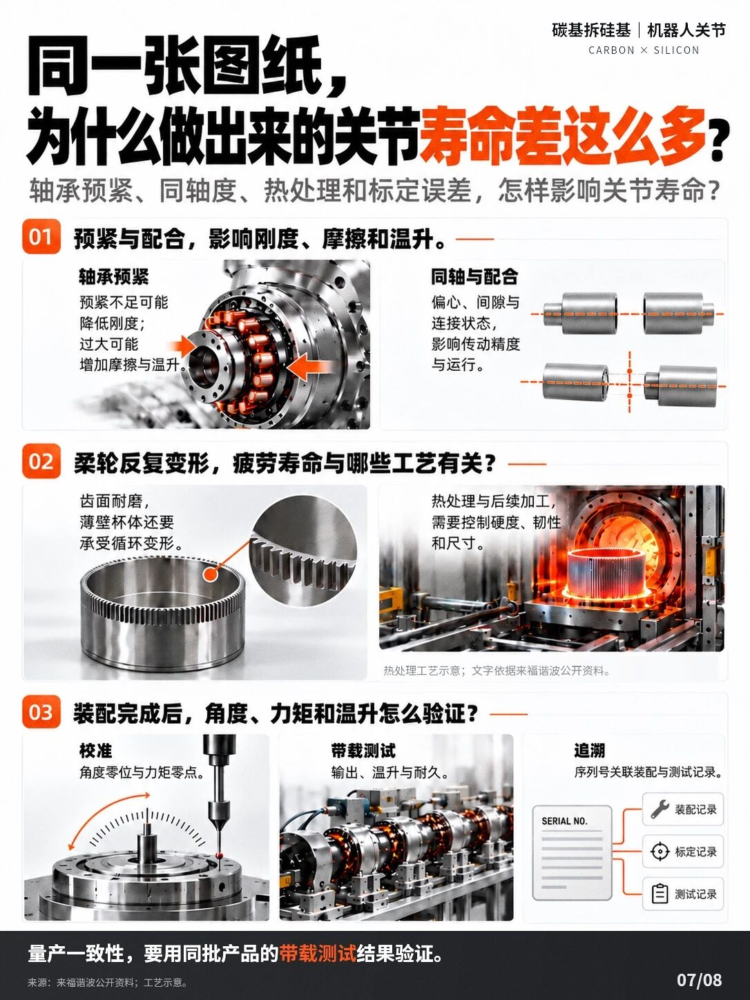
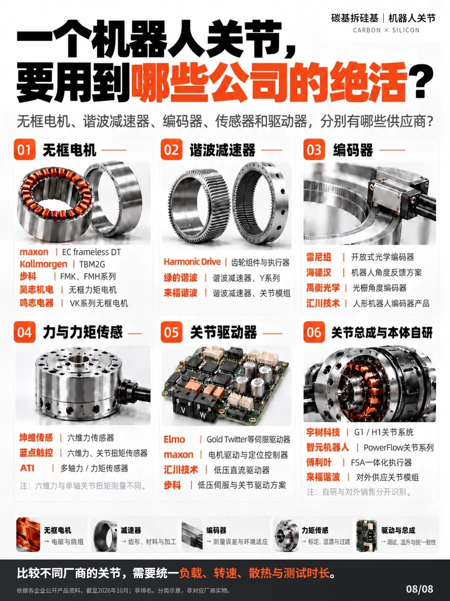

一组共 8 张图，从减速原理到量产一致性，拆解机器人关节模组里的传动、感知、控制、结构与制造。

01/08 关节模组：机器人运动能力背后的工业绝活

02/08 这种关节，人形机器人身上一装就是几十个

03/08 两颗齿的差距，换来 100 倍减速

04/08 电机端装了编码器，输出端为什么还要再装一个？

05/08 每秒更新 1000 次，机器人的手为什么还是会抖？

06/08 峰值 200 N·m，为什么连续干活只有 60 N·m？

07/08 同一张图纸，为什么做出来的关节寿命差这么多？

08/08 一个机器人关节，用到了哪些公司的「绝活」？
