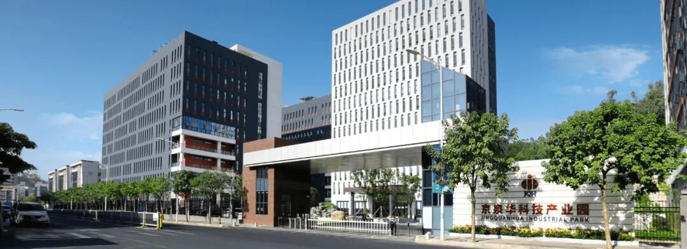
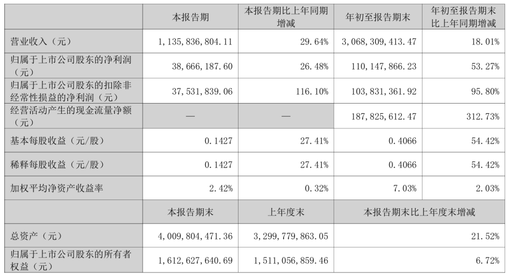
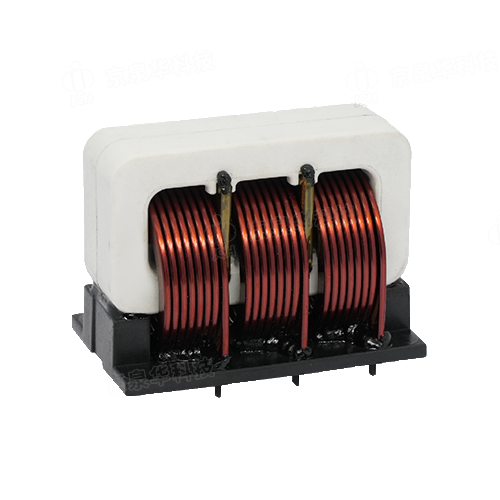
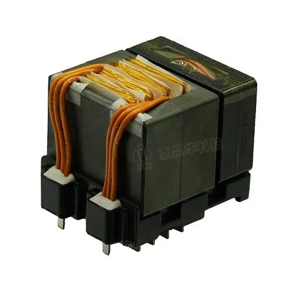

作者 | 池缘涧

封面 | 京泉华

在磁性元件行业普遍“以价换量、以规模换增长”的当下，**京泉华**（002885）交出了一份不一样的答卷。

10月26日，京泉华发布2026年第三季度报告——前三季度，营业收入30.68亿，同比增长18.01%；归母净利润1.10亿，同比增长53.27%；扣非净利润1.04亿，同比增长95.80%。

显然，利润端几乎翻倍，这是这份财报最亮眼的一面。

但利润增速远超营收增速的反差本身，还提示我们——这份财报需要翻到背面去读。

## PART 01 增长53.27%净利润

由什么构成？

先把这53.27%一层层拆开。

收入端，前三季度营收30.68亿元，同比增18.01%，单季更猛——第三季度营收11.36亿元，同比增29.64%，也就是说：收入在加速。

成本端，营业成本25.99亿元，同比增15.15%，增速低于营收，说明毛利率这一项是改善的，这是利润增长的第一层来源。

再看费用，销售费用3371.68万元，基本持平；管理费用1.22亿元，同比增25.68%；研发费用1.28亿元，同比增10.58%。管理费用涨得比收入还快，吃掉了毛利率改善带来的一部分空间。

图 / 京泉华2026三季报

真正的差异，还体现在几项非主营的损益上。

其他收益同比降50.08%；投资收益同比降80.20%；营业外收入同比降99.59%。这几项加起来，把净利润往下拽了不少。

反过来说，扣非净利润同比增95.80%，比归母的53.27%高出整整42个百分点，恰恰说明：剔除这些在收缩的非经常项目后，主营经营的改善比账面看到的更强。

这一轮增长，是真的由经营本身驱动的，而不是靠补助和理财收益撑着。

## PART 02 利润正在向哪里再分配？

但问题是，这些利润并没有老老实实留在账上，而是被重新分配到了几个地方。

第一个去处是应收账款。期初10.70亿元涨到13.79亿元。公司对信用减值损失的归因是“销售增加”，也就是说：一部分营收是靠放宽账期换来的。

这其实是磁性元件行业的老问题。

变压器、电感、磁芯这类器件，夹在铜材、磁材等上游材料和新能源车、储能等强势下游之间，单价低、议价能力弱，上游涨价难转嫁、下游账期难缩短。京泉华销售规模一上来，回款周期就被同步拉长，是整个行业共同的处境。

图 / 京泉华

第二个去处是存货。从5.28亿元到8.07亿元，增幅超过一半。而同期资产减值损失反而下降26.35%，部分利润是靠“少计提”托住的，下游一转弱，风险迟早要还回去。

第三个去处是财务费用。前三季度3448.76万元，上年同期才595.15万元，翻了近6倍。

利息费用没涨多少，主要是汇兑损失——磁性元件厂商这几年靠出口走量，收入以美元计价、成本以人民币计价，汇率一波动，账面利润就跟着上下。

## PART 03 盈利之后

压力才真正开始

利润改善是真实的，但改善本身也在为下一阶段埋下压力。前三季度营收30.68亿元、同比增长18.01%，靠的是放宽账期、降价走量换来的规模。

这种增长模式的可持续性，正是盈利之后要面对的第一个问题——一旦下游需求增速放缓，靠价格和账期堆出来的量，会反过来变成最重的一笔负担。

第一重压力，来自资产负债表。

应收账款已经堆到13.79亿元，存货8.07亿元，两者合计超过21亿元，而同期资产减值损失反而下降了26.35%。

换句话说，眼下账面利润有相当一部分，是靠“少计提”托住的。下游新能源、储能、算力客户的景气一旦回落，坏账计提和存货跌价会集中释放，直接吃掉利润——这是悬在利润之上、随时可能落下的那一笔。

第二重压力，来自汇率。

前三季度财务费用3448.76万元，是上年同期的近6倍，主因不是利息，而是汇兑损失。

磁性元件厂商靠出口走量，收入以美元计价、成本以人民币计价，汇率双向波动时，这一项在盈利好的时候是“隐形成本”，一旦订单收缩、回款变慢，它就会被放大成直接的利润侵蚀。

图 / 京泉华

第三重压力，来自行业结构本身。

磁性元件是典型的“大市场、小企业、低集中度”，产品同质化、客户切换成本低，议价权天然不在中游器件厂商手里。

这一轮放量，本质是价格和账期堆出来的规模，而不是技术溢价换来的利润。需求旺盛时还能维持，需求一放缓，最先被压缩的就是毛利率。

更现实的，是扩产与订单的匹配问题。

新下游订单大，但也高度集中——单一大客户、单一应用的波动，都会直接传导成收入波动；而产线一旦铺开，折旧和固定成本不会随订单收缩。

所以对京泉华来说，盈利之后的真正考验，不是这一季利润能到多少，而是它能否在放量中同时守住回款、周转和技术溢价。这恰恰是行业里最稀缺、也最难做到的能力。

END

结语

对磁性元件行业来说，这轮新能源和算力带来的放量，是难得的增长窗口，但窗口里也藏着代价——利润在涨，钱却更紧了。

全球能源转型和 AI 算力扩张还在继续，磁性元件作为电源转换和能量传输的核心器件，需求空间还有很大。

这意味着，未来几年，谁能在放量的同时守住回款、周转和资金成本，谁才能将繁荣转化成实打实的利润。

#京泉华 #磁性元器件 #磁元件

本文为Big-Bit电子变压器与电感原创文章，未经允许和授权不得转载，否则将严格追究法律责任。如需转载，请留言申请。

文章部分素材及图片来自网络，其版权归原作者所有。若有侵权行为,请留言告知小编进行删除处理。
