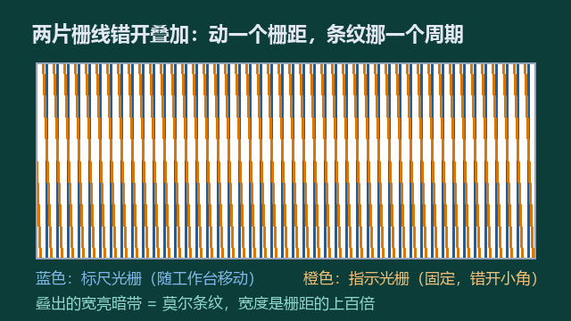
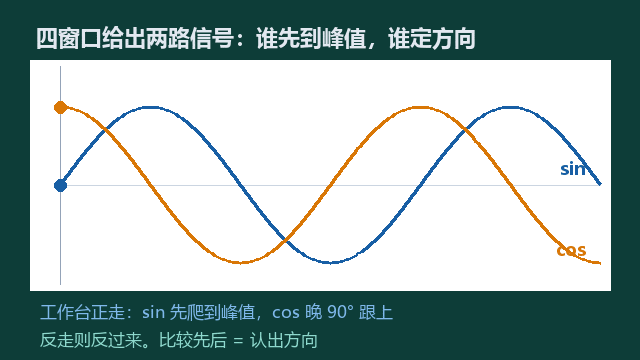
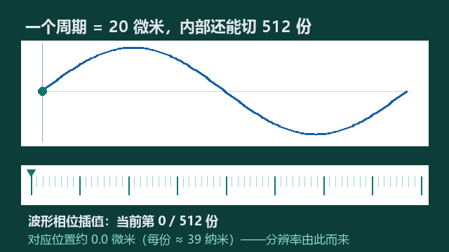

机床上的精密部件 · 原理篇

光栅尺身上没有一行数字，就是一条刻满细线的尺子加一个读数头。它量位置靠三步：先把微小位移放大，再把光变成电信号，最后在信号里做细分。每一步都不玄，拆开看都是物理和数学。

01　第一步：两片细线叠加，位移放大一百倍

尺子本体叫标尺光栅，固定在床身上。玻璃或钢带上用光刻工艺刻满等间距的平行细线，常见栅距 20 微米，比头发丝细三四倍，肉眼根本分辨不出间隔。

读数头里还有一片差不多的刻线片，叫指示光栅。安装时让两片刻线错开一个很小的角度，比如 0.01 弧度。光穿过去时两片刻线互相挡光：挡得严的地方是暗带，透得开的地方是亮带，于是出现了远比刻线宽的明暗条纹。它叫莫尔条纹。

条纹宽度 = 栅距 ÷ 错开角度。栅距 0.01 毫米、角度 0.01 弧度，条纹就是 1 毫米宽，刚好放大一百倍。

—— 科普中国《光栅尺》词条

10 微米级刻线的动静，被放大成毫米级条纹的移动。光电元件看不清刻线，但看得清条纹。工作台每挪一个栅距，条纹正好挪一个条纹宽度，位移信息一点没丢。

02　第二步：光变成电，还得认出往哪边走

条纹亮暗变化被光电管接收，输出的是连续的正弦波：工作台匀速走，波形就匀速爬坡落谷。光栅尺的本质，是把位置问题变成了波形问题。

办法是沿条纹方向开四个观察窗口，间隔取条纹宽度的四分之一。这样得到四路信号，两两相位差 90°，取两路就是 sin 和 cos。正走时 sin 先到峰值，反走时 cos 先到峰。一比先后，方向就出来了。

读数头里还有一条零位刻线。工作台每次经过它，计数归零一次，走了多少格才能换算成坐标。

03　第三步：一个周期里再切五百多份

数波形只能精确到一个周期，也就是 20 微米，对精密加工太粗。好在正弦波是连续曲线，周期内部可以做文章：电路实时测出波形当前处于周期的哪个相位，把 20 微米再均匀切分。

01 只数周期：一个波形数一次，分辨率就是 20 微米。

02 周期内 512 倍细分：除下来约 39 纳米。

03 sin 加 cos 定相位，任意时刻的插值才算得准。

细分做出来的是分辨率，精度是另一回事。分辨率指尺子能显示多小的变化，精度指显示值离真实位置差多少。精度由三件事决定：栅线刻得匀不匀、装得正不正，加上温度稳不稳。宣传页上两个数挨着印，看的时候要分开。

04　它凭什么准：上千条刻线一起投票

莫尔条纹还送了一份礼物：平均效应。1 毫米宽的条纹由上千条刻线共同参与形成，个别刻线间距有误差，会被众多刻线平均掉。单根刻线做不到的均匀，大量刻线一起做到了。

这也是光栅尺难做的地方：刻划机自身的精度就是尺子的上限，批量一致性才是真功夫。国内中低端已经自主，长春禹衡的绝对式光栅尺分辨率做到 2.5 纳米；光刻机级的高精度场合，还在样品验证阶段。

Q　为什么机床要装两套位置反馈？

A　电机编码器测的是电机转了多少度，隔着丝杠和导轨，不知道工作台最终停在哪。光栅尺直接量移动部件，把传动链的误差全部排除在测量之外。

Q　绝对式和增量式差在哪？

A　增量式断电就忘了位置，开机要回零。绝对式带位置编码，断电重启不用回零，展会上的新品已支持 26bit 以上分辨率。

整条链路

放大成条纹，辨向靠相位，细分出纳米。  
一支光栅尺，就这三步。

事实来源：科普中国《光栅尺》词条、百度百科《光学尺》词条（莫尔条纹公式、四窗口相位差 90°、平均效应）；百度百科《光栅式线位移测量装置》（512 倍细分约 39nm）；CCMT2026 展品评述（绝对式 26bit）；今日头条产业分析（禹衡 JFT 2.5nm、光刻机级样品验证）

讲透了就点个关注。

下期拆机床上的下一个精密件。
