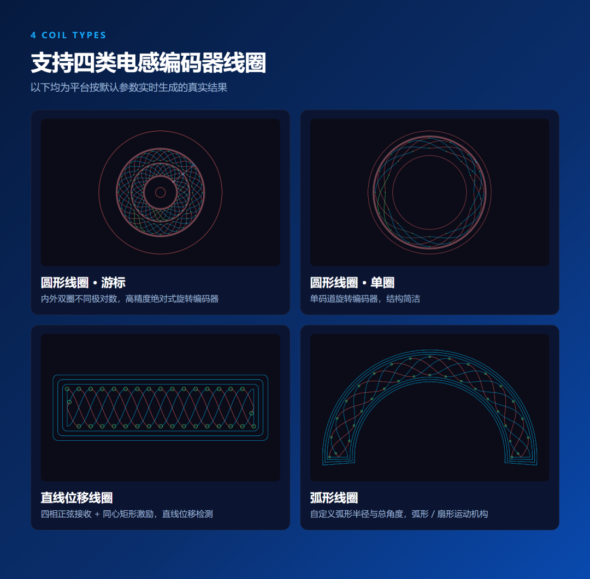
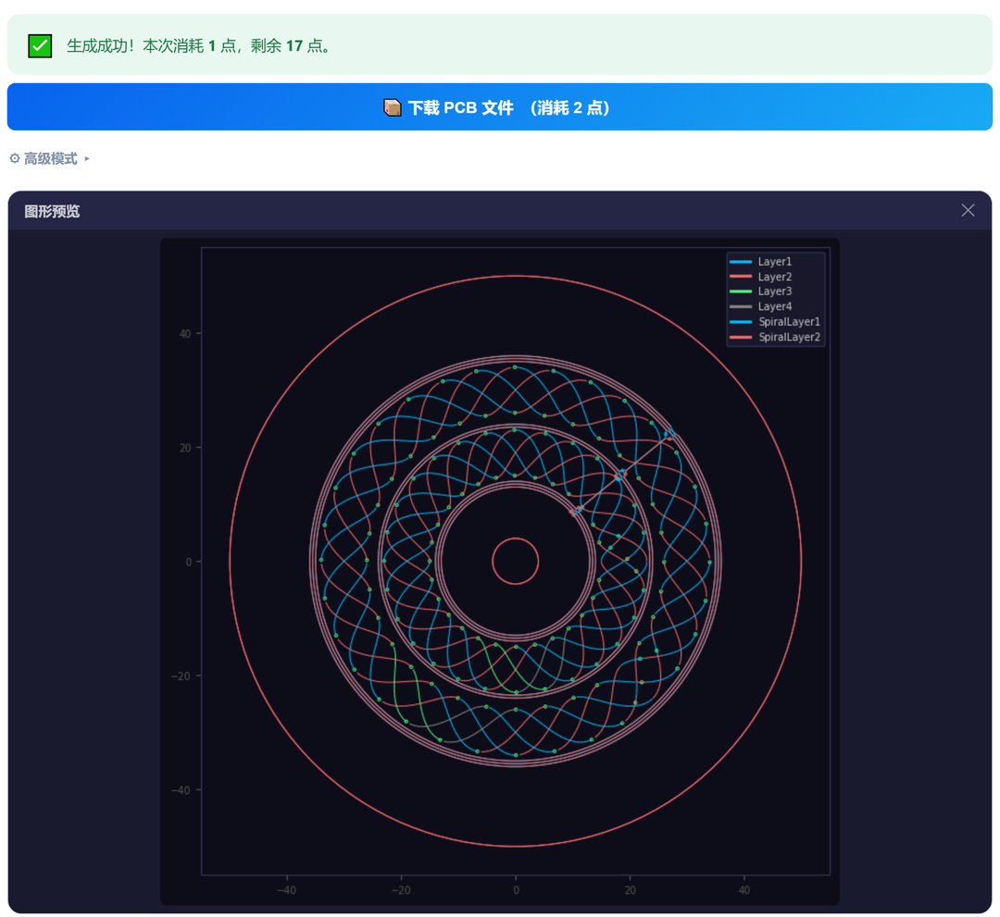

做过电感式编码器的工程师都知道：最磨人的，往往不是算法，而是线圈。

正弦、余弦接收线圈要严格对称，激励线圈要一圈圈嵌套，游标结构还要让内外两圈的极对数错开……在 CAD 里一条曲线一条曲线地画，一版设计常常要花上好几天；结构尺寸一改，又得从头再来。

为此，**感御科技**把团队内部长期使用的线圈设计工具做成了在线平台，现在正式向工程师开放——

线圈在线生成平台

官网 senovotech.com → 点击「在线工具」

## 01 能生成哪些线圈？

平台目前支持四类电感编码器线圈，覆盖旋转与直线两大应用场景：

● **圆形线圈（游标）**：内外双圈采用不同极对数，适用于高精度绝对式旋转编码器

● **圆形线圈（单圈）**：单码道结构，适用于常规旋转编码器

● **直线位移线圈**：四相正弦接收线圈 + 同心矩形激励线圈，适用于直线位移检测

● **弧形线圈**：可自定义弧形半径与总角度，适用于弧形、扇形运动机构

▲ 以上图形均为平台按默认参数实时生成

## 02 参数一填，图形即出

不需要手动画任何一条曲线。选择线圈类型后，只需填写**中心半径、振幅、极对数、内外边界、出线位置、激励偏移**等参数。

担心参数含义看不懂？**点到哪个参数，右侧就会弹出对应的示意图**，第一次使用也能快速上手。

▲ 每个参数都配有示意图

点击「生成预览」，几秒钟后即可看到完整的线圈图形，确认无误再进行下一步。

## 03 一键生成 PCB 文件

线圈画好了，PCB 还要再画一遍？不用。

点击「下载 PCB 文件」，平台会在后台自动将线圈转换为 **Altium Designer 的 PCB 文件（.PcbDoc）**，通常两三分钟即可完成。完成后会发送邮件通知，登录即可下载，直接在 Altium 中打开继续布局布线。

如需将线圈导入嘉立创EDA、KiCad 等其他平台，可联系我们获取工具链支持。

## 04 三步上手

**第一步**　访问 senovotech.com，点击「在线工具」注册登录

## 第二步 选择线圈类型，填写参数，生成预览

**第三步**　下载线圈图纸，或一键生成 PCB 文件

## 05 适合谁用？

● **机器人关节、伺服电机团队**：评估或自研电感编码器方案

● **直线模组、精密运动平台**：快速得到直线位移检测线圈

● **高校与研究机构**：开展电感式位置传感的教学与研究

● **硬件工程师**：快速验证「我的结构里能不能放下一个电感编码器」
