## 前言

Preface

在运动控制的江湖里，光电式编码器像是个高冷的刺客，精度极高但极度娇贵，见不得一点灰尘；磁式编码器像个皮实的步兵，抗造但容易被旁边的强磁场“带偏”。而电感式编码器，过去一直像个在航天和军工领域里扫地的“扫地僧”——实力深不可测，但不怎么在通用工业中露面。

然而，随着具身智能和高端制造的爆发，这位“扫地僧”正在重塑规则。今天，我们就来扒一扒电感式编码器是如何从二战的炮火中走来，最终登上了特斯拉Optimus机器人的关节王座。

## 1 1940s-1950s： 战火淬炼的“硬汉”

时代背景：第二次世界大战末期到冷战初期，那是属于机械和模拟信号的狂野时代。

当时的防空火炮和早期雷达需要极其精确的实时角度反馈。为什么不是光电？那时候连发光二极管都还没普及。那磁呢？在炮火连天的震动和各种电磁干扰下根本扛不住。于是，基于电磁感应原理的旋转变压器（Resolver，电感式编码器的直系老祖宗）应运而生。工程师们通过极其复杂的绕线工艺，让转子和定子之间的电磁耦合随着角度变化而改变。它没有电子元器件，纯靠物理结构硬刚恶劣环境。

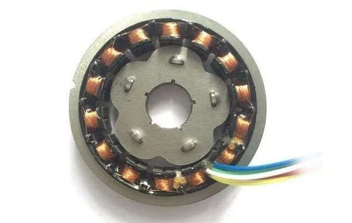

主要应用：军用雷达天线俯仰角控制、防空火炮底座、早期的航空航天仪表。

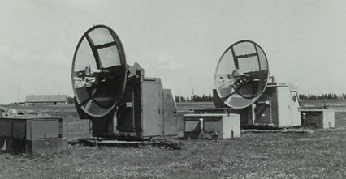

英国曼海姆的一对雷达

## 2 1960s-1980s： 数控机床的“幕后推手”

时代背景：工业自动化起步，高精度数控机床（CNC）开始成为国家重器的核心。

早期德国西门子生产车间照片

传统的绕线式旋变太厚重了，装不进紧凑的工业设备里。美国Farrand Controls公司在这个时期大放异彩，他们推出了感应同步器（Inductosyn）。工程师巧妙地将原本立体的线圈“拍扁”，做成了平面印制绕组。这不仅大大降低了厚度，还让多极对数的实现变得容易，精度直线飙升。虽然这时的信号处理还需要庞大且昂贵的外部解码箱，但它彻底解决了重型机床在油污、铁屑飞溅环境下的高精度定位问题。

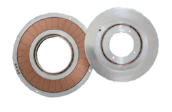

主要应用：高端CNC数控机床、重型精密转台、早期军用/工业机器人。

## 3 1990s-2010s： 摩尔定律的馈赠

时代背景：芯片技术爆发，微电子学彻底改变了传感器的形态。

电感式技术面临着一次生死存亡的转型——它太贵、信号处理太复杂了。这时，以英国剑桥大学衍生企业（如Zettlex等）为代表的工程师们引入了革命性的改变：PCB电感式编码器诞生。利用高精度的多层PCB制造工艺，彻底淘汰了传统的铜线绕组。更关键的是，专用的ASIC（专用集成电路）芯片被研发出来，将原本需要一个鞋盒大小的解码电路，浓缩成指甲盖大小的芯片，直接集成在传感器板上。电感式编码器完成了从“昂贵的模拟组件”到“紧凑型数字传感器”的华丽转身。

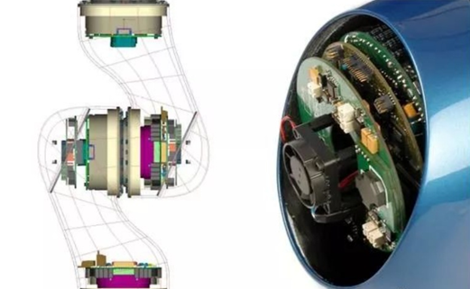

传统机器人内部关节

主要应用：医疗手术机器人关节、精密机床、无刷直流电机（BLDC）的换相控制、重工机场转台。

## 4 2020s-至今： 具身智能的“天选之子”

时代背景：人形机器人、外骨骼、协作机器人爆发，对传感器的SWaP（尺寸、重量、功耗）提出了变态级的要求。

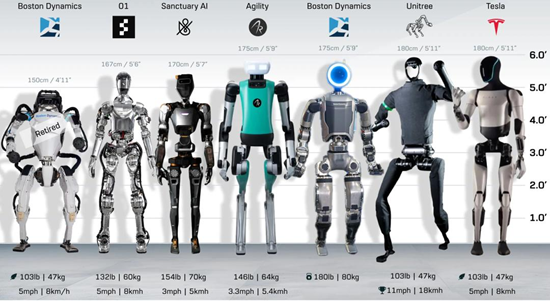

几款大火的人形机器人及尺寸对比

传统工业机器人的关节空间还算宽裕，但到了人形机器人时代，每个关节都恨不得塞进减速器、力矩电机、驱动器和双编码器（电机端+减速器端）。光电怕震怕油，磁式在力矩电机的强磁场下直接“罢工”，而电感式编码器以其无轴承、超薄、大中孔的特性，迎来了属于它的高光时刻。

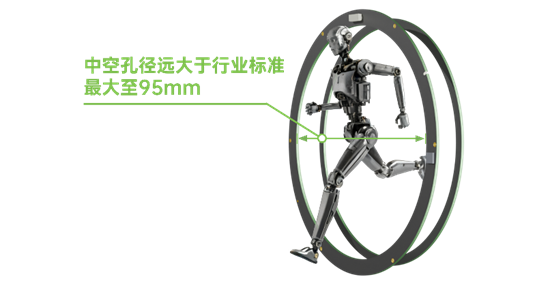

超大中空的电感式编码器（弓望）

## 5 为何成为特斯拉机器人的“王牌”？

如果你仔细观察过特斯拉Optimus（擎天柱）或其他顶尖人形机器人的旋转执行器（Rotary Actuator）拆解图，你会发现电感式编码器几乎成了标配。

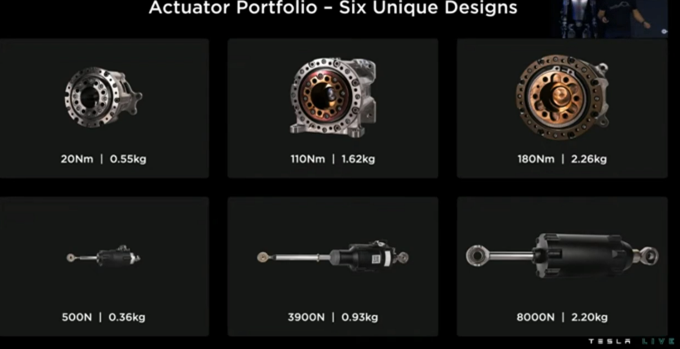

特斯拉关节矩阵

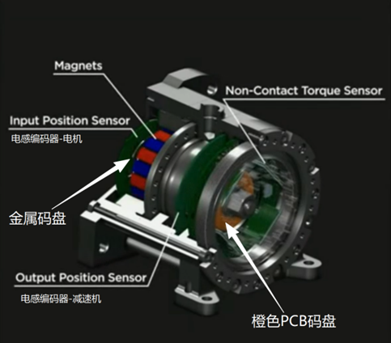

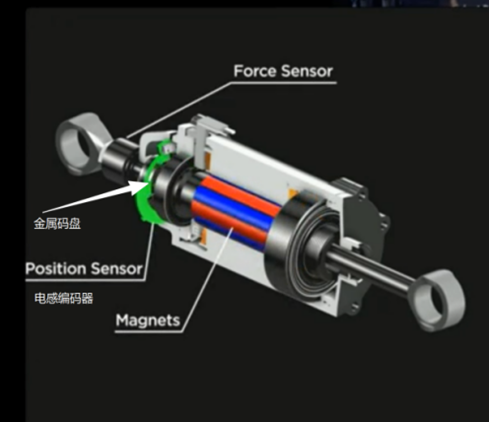

特斯拉关节节构（旋转和直线）

Optimus的肩部、髋部等大扭矩关节，使用了无框力矩电机与谐波/行星减速器的直驱集成方案。为了实现极致的控制，特斯拉采用了双编码器架构。电感式编码器通常被直接集成在电机转子末端或减速器输出端，负责提供极高分辨率的绝对位置反馈，用于电机的FOC矢量控制和减速器柔性形变的补偿。

## 6 为什么推荐使用电感式编码器

无惧“磁场刺客”： 机器人的无框电机在全负荷运转时会产生巨大的漏磁场。磁编码器在这里极易产生信号畸变甚至失效，而电感式编码器基于高频交变电磁场工作，对低频和恒定强磁场天生免疫，可以紧贴电机安装。

极致的“偷空间”能力： PCB级别的厚度（通常只有几毫米），且不需要传统的轴承结构，转子重量以克计算，极大地降低了系统转动惯量，提升了机器人的动态响应速度。

天生的大中空设计： 机器人关节和重型转台内部需要穿过大量的动力线、通信线甚至气管。电感式编码器极易做成大孔径的中空环形结构，完美契合这种走线需求。

军工级的耐受力： 没有光学透镜，不怕灰尘、油污、冷凝水；没有脆弱的玻璃码盘，抗震动和冲击能力拉满。这对于需要在工厂、野外甚至恶劣天气下工作的人形机器人和外骨骼来说，是保证系统MTBF（平均故障间隔时间）的关键。

---

虽然特斯拉验证了双编码器架构的优越性，但对于广大机器人开发者来说，市面上能同时满足高精度、抗强磁且具备高安装容忍度的电感式编码器仍然稀缺且昂贵。正是为了打破这一壁垒 ，弓望传感带着新一代电感技术强势破局 。不同于传统传感器的单点测量误差，弓望的电感式传感器采用了多组感测和差分信号数字抵消技术，极大地降低了安装偏心带来的影响，安装容忍度极高。不仅拥有抗强磁、抗震动、耐油污、耐磁性粉尘的强硬属性 ，更将绝对精度推向了惊人的0.5~300角秒区间 ，真正实现了在多种技术路线中兼顾优异性能与超强耐用。

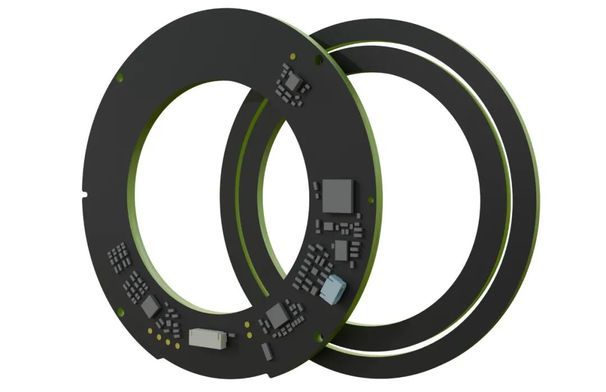

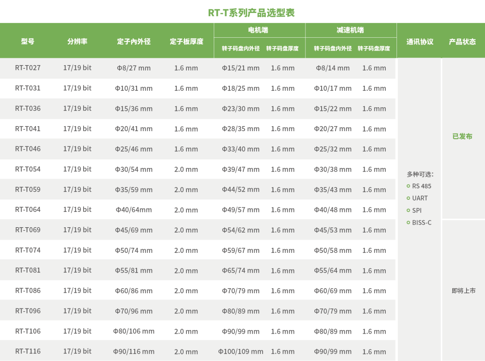

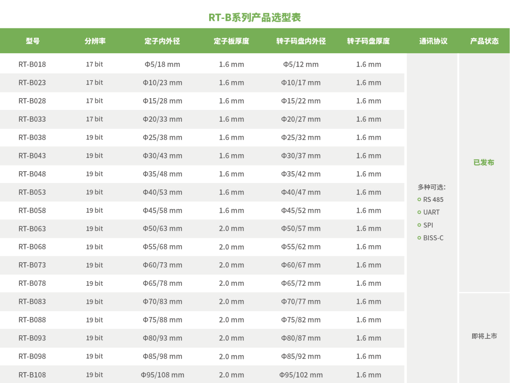

---
