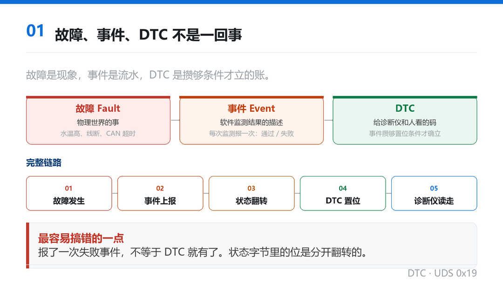
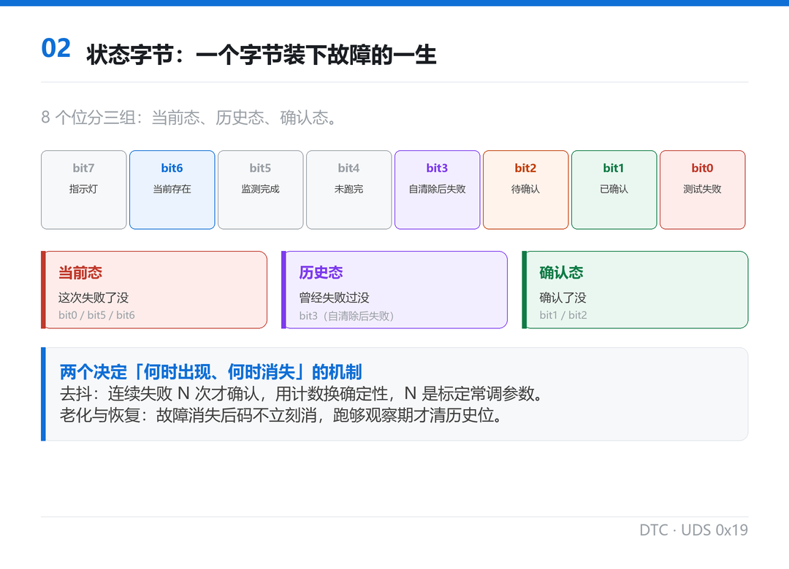
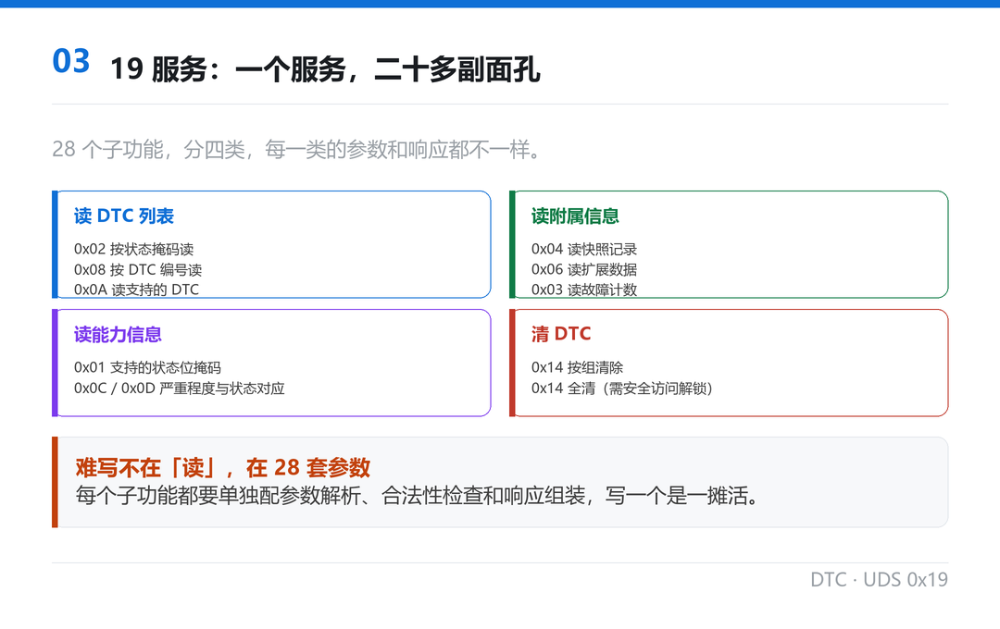
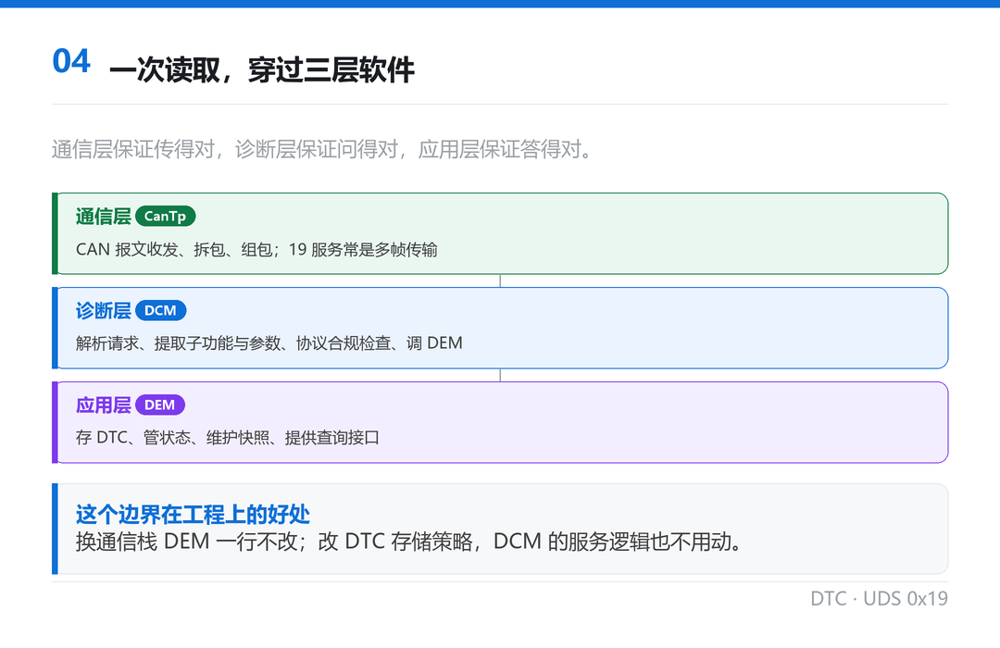
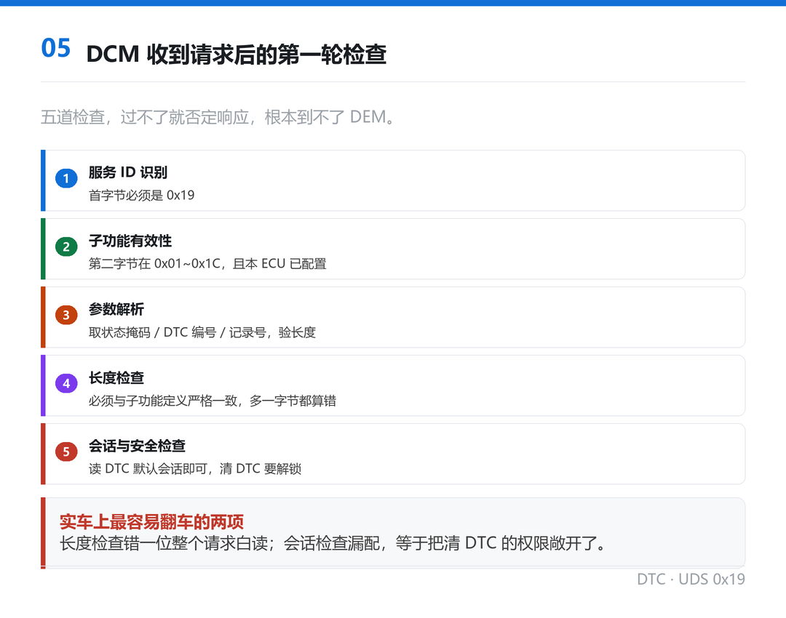
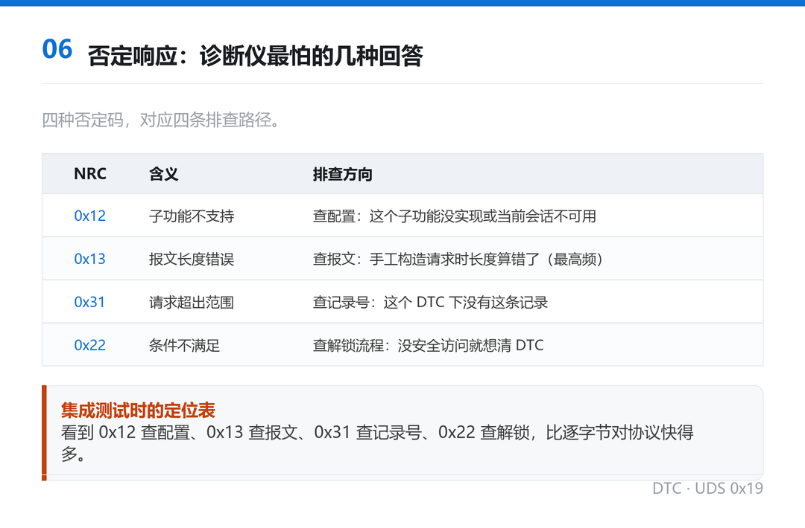
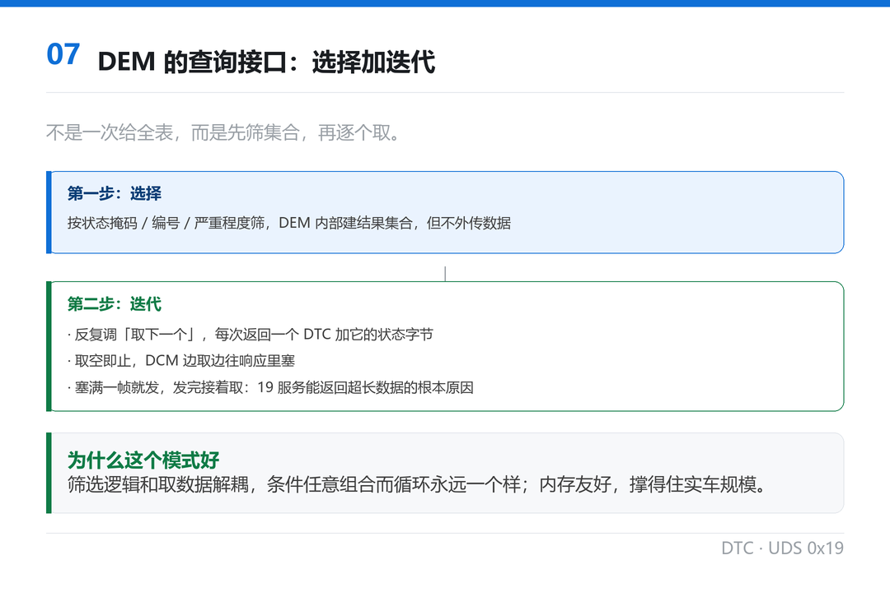
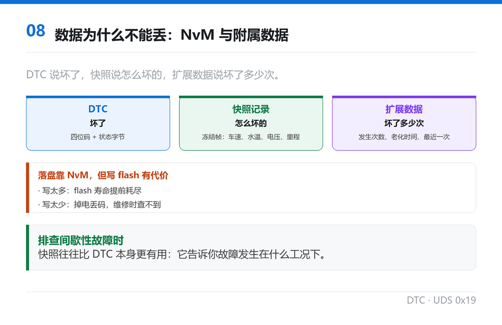
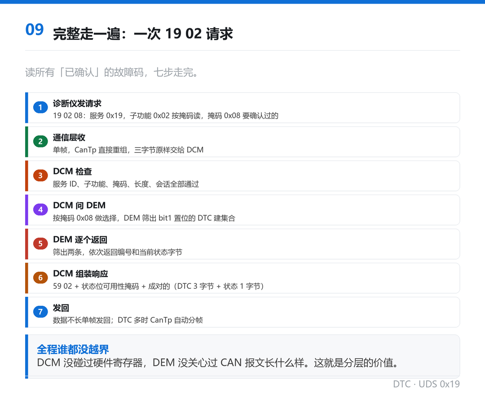

导语：前面几期一直念叨 DTC，从 CanNm 念到看门狗，这回兑现。修车厂师傅拿个读码器，几秒钟就能把车里的故障码全读出来，看着很神奇。但你知道这几秒钟背后，一个码要先经历多少次监测、多少次状态翻转、再穿越三层软件，才最终变成诊断仪上那三位数吗？这期把它从产生到被读走，整条链路走一遍。

## 01 先把三个词分开：故障、事件、DTC

聊 DTC 最容易混的三个词，必须先掰开。

故障（Fault）是物理世界的事。水温高了、传感器线断了、CAN 超时了，这是现象。

事件（Event）是软件世界里对一次监测结果的描述。DEM 管的是事件，不是故障。应用层代码每监测一次，就调用一次上报接口，告诉 DEM：这次监测的结果是「通过」还是「失败」。

DTC 才是我们熟悉的那个四位码。它是给诊断仪和人看的，是事件多次累积、满足了置位条件之后，才被正式确立下来的东西。

所以顺序是这样的：物理上出故障，软件监测到，报事件，事件攒够条件，DTC 置位。

这里有个特别容易搞错的地方：报了一次失败事件，不等于 DTC 就有了。 DEM 内部对每个 DTC 都维护一个状态字节，这个字节里的 bit 是分开翻转的。比如「测试失败」这一位可能这次监测就置起来了，但「已确认」这一位要等满足去抖条件、通常是连续多次失败，才会置。

换句话说，事件是流水，DTC 是账本，状态字节是账本上的印章。 三者职责完全不同。

*图1：故障是现象，事件是流水，DTC 是攒够条件才立的账*

## 02 一个字节装下故障的一生

既然状态字节这么关键，单独把它拆开看。

ISO 14229 定义了 8 个状态位，每个位记录故障的一个维度。工程上常用的是这几个：

bit0 testFailed：最近一次监测结果是失败。这是最先动的位，一次失败就能置。

bit1 confirmedDTC：DTC 已确认。这个位不急着动，它表示「不是偶发，是真的坏了」。

bit2 pendingDTC：待确认。监测失败了，但去抖次数还没攒够，DEM 先给你挂个「待定」。

bit3 testFailedSinceLastClear：自上次清除以来失败过。这一位是历史记录，哪怕现在故障已经消失它也保持置位。它是「历史存在」的来源。

bit4 testNotCompletedSinceLastClear：自上次清除以来这项监测还没跑完过。用于区分「监测过且通过」和「根本没测」。

bit5 testFailedSinceLastClear 和 bit6 类似，管的是当前是否存在。

剩下的位管故障是否导致点灯、故障是否影响通信这类衍生信息。

我把这 8 个位的用法总结成三组：当前态（这次失败了没）、历史态（曾经失败过没）、确认态（确认了没）。 这三组分别回答三个问题，也正是诊断仪读码时最想知道的。

而诊断仪读码，本质就是拿一个字节的掩码去匹配这些位。掩码里哪一位是 1，就是要查哪一类的故障。

这里面还有两个机制值得单独说，因为它们直接决定 DTC 什么时候出现、什么时候消失。

去抖（debounce）。 监测失败不可能一失败就确认，那样误报会满天飞。DEM 对每个事件都配了去抖策略，常见的是计数式：连续失败 N 次才把 confirmed 位置起来。N 配多少，直接决定这个故障是「敏感」还是「迟钝」。配小了，路面一颠就报故障；配大了，真坏了半天不认。这个参数是标定里最常被调的几个之一。

老化与恢复（aging and healing）。 故障消失之后，DTC 不会立刻消失。DEM 通常配一个老化计数，一般是按「成功监测次数」或者「运行时间」算，满足条件才把历史位清掉。这是为了维修后留一段观察期：如果故障真的修好了，码自己会消失；如果没修好，过不了多久又置起来。

这两个机制放在一起看，会发现 DEM 其实在做一件很朴素的事：用时间换确定性。 它宁可晚一点报、晚一点消，也不肯因为一次抖动就下结论。这也解释了为什么有时候故障明明已经修好，读码器上还挂着码，等几天或者跑几个循环才消。

*图2：当前态、历史态、确认态，三组位回答三个问题*

## 03 19 服务：一个服务，二十多副面孔

DTC 信息在车上是存着的，但怎么被读走？靠 UDS 的 0x19 服务，ReadDTCInformation。

这个服务有个让人头疼的特点：它有 28 个子功能。

拿它和熟悉的几个服务比一下。22 服务读数据，就是「给我某个 DID 的值」；31 服务控制例程，就是「启动 / 停止 / 查结果」。这两个服务虽然也有子功能，但数量少、逻辑直白。

19 服务不一样。因为 DTC 相关的信息维度太多了，每一种组合都要一个子功能：按状态掩码读、按 DTC 编号读、读快照记录、读扩展数据、读支持的 DTC 列表、读故障发生次数、清除 DTC……一路排下来 28 个。

这 28 个子功能可以分成四类：

·读 DTC 列表：按掩码读、按编号读、读全部。

·读 DTC 附属信息：快照记录（freeze frame）、扩展数据。

·读能力信息：支持哪些 DTC、状态位可用性掩码。

·清 DTC：按组清、全部清（这一类通常要安全访问解锁）。

所以写 19 服务，工作量不在「读」这个动作，而在为 28 个子功能分别维护参数解析、合法性检查、响应组装。这也是它比 22 和 31 难写的原因。

*图3：难写不在读，在 28 个子功能各自的参数和响应格式*

## 04 一次读取，穿过三层软件

现在把镜头拉到架构上。一次 DTC 读取，要穿过三层软件。

通信层：负责 CAN 报文的收发、拆包、组包。这里 CanTp 登场，因为 19 服务的请求响应可能很长，尤其返回多个 DTC 时，必然是多帧传输。这一层的职责只有一句话：保证字节不丢不乱。

诊断层（DCM）：解析 19 服务请求，提取子功能和参数，做协议合规性检查，然后调 DEM 拿数据。它是协议的大脑。

应用层（DEM）：DTC 的专业管家。存 DTC、管状态、维护快照、提供查询接口。它不关心是谁来问，只关心「你要查什么，我给什么」。

三层的分工有个很干净的边界：通信层保证传得对，诊断层保证问得对，应用层保证答得对。

这个边界的好处在工程上特别实在：换一套通信栈（比如从 CAN 换以太网），DEM 一行代码不用改；反过来，改 DTC 的存储策略，DCM 的服务处理逻辑也不用动。

*图4：通信层传对，诊断层问对，应用层答对*

## 05 DCM 收到请求后的第一轮检查

诊断层拿到完整的 19 服务请求后，不是直接就去问 DEM，它要先过一遍检查。这一步决定了请求是会被受理还是被否定。

检查项按顺序有这么几项：

服务 ID 识别。请求第一个字节必须是 0x19，不是就走别的分支。

子功能有效性。第二个字节是子功能，范围 0x01 到 0x1C。不在这个范围，或者这个 ECU 没配这个子功能，直接否定响应。

参数解析。按子功能取后续数据。以最常用的 0x02 为例，第三个字节是状态掩码，一个字节，每一位对应一种 DTC 状态。有些子功能还要带 DTC 编号、记录号，一并提取并验长度。

长度检查。请求长度必须和该子功能的定义严格一致，多一个字节少一个字节都算错。

会话与安全检查。大部分读 DTC 的子功能在默认会话就能做，但清除 DTC 这类写操作通常要安全访问解锁。没解锁就返回「条件不满足」。

这几项里，长度检查和会话检查是最容易在实车上翻车的。长度检查错一位，整个请求白读；会话检查漏配，等于把清 DTC 的权限敞开了。

*图5：先看服务 ID，再看子功能，再查长度，最后看会话安全*

## 06 否定响应：诊断仪最怕的几种回答

检查不过，DCM 就回否定响应。19 服务常见的否定响应码有这么几个：

0x12：子功能不支持。要么这个子功能本来就没实现，要么当前会话下不可用。

0x13：报文长度错误。最常见，通常是手工构造请求时长度算错了。

0x31：请求超出范围。比如你要读某个记录号，但这个 DTC 下根本没有这条记录。

0x22：条件不满足。典型场景是没解锁就想清 DTC。

这几个码各有各的排查方向。看到 0x12 查配置，看到 0x13 查报文，看到 0x31 查记录号，看到 0x22 查解锁流程。 我在集成测试时基本就按这个表定位，比逐字节对协议快得多。

顺便说一句，0x13 是绝对的高频。诊断仪厂的测试用例里，专门有一类是「故意发错长度」，就是为了验证你有没有做这项检查。这项没做，人家一测就露。

*图6：四种否定码，对应四条排查路径*

## 07 DEM 的查询接口：一个迭代器

请求合法了，DCM 开始问 DEM。这里有个设计值得单独说，因为它是 DEM 接口里最容易被忽略、也最讲究的部分。

DEM 的查询不是「一次把符合条件的 DTC 全给你」，而是选择 + 迭代两步。

第一步是选择。DCM 调一个选择接口，把筛选条件传进去，比如按状态掩码筛。这一步 DEM 内部会建一个结果集合，但不往外传数据。

第二步是迭代。DCM 反复调「取下一个」接口，每调一次返回一个 DTC 和它的状态字节，直到取空为止。

这个模式的好处，是把「筛选逻辑」和「取数据」解耦了。筛选条件可以任意组合（掩码、编号、严重程度、故障发生次数），而取数据的循环永远长一个样。

对应的另一个好处是内存友好。假设车里存了两百个 DTC，全拷出来要一大块缓冲区；迭代器一次只出一个，DCM 边取边往响应里塞，塞满一帧就发，发完再接着取。这就是 19 服务能返回超长数据的根本原因。

我自己的习惯是，看到这种「选择 + 迭代」的接口组合，就知道设计者是认真考虑过大数据量的。如果某个 DEM 的接口是一次性返回全表，那基本可以断定它没在实车规模上验证过。

*图7：选择建集合，迭代逐个取，内存友好且支持分帧*

## 08 数据为什么不能丢：NvM 与快照

DTC 存下来不是给人看一眼就完的，它得扛得住掉电。

DEM 通常依赖 NvM（非易失存储管理器）把 DTC 状态落到 flash 里。掉电之后再上电，这些码还在，维修人员照样能读出来。这就是「故障记忆」的物理基础。

这里有个工程上的权衡值得说：往 flash 写是有次数上限的，而且写的时候有耗时。 所以 DEM 不会每次事件都立刻落盘，通常是状态变化了才写，而且可能合并批量写。写得太勤，flash 寿命提前耗尽；写得太懒，掉电丢码，维修时查不到。

跟 DTC 绑在一起的还有两类附属数据，也是 DEM 要管的：

快照记录（Snapshot），也就是常说的冻结帧。故障发生那一刻，把相关的实时数据存一份：车速、水温、电压、里程。等维修时读出来，就知道故障是在什么工况下发生的。

扩展数据（Extended Data），记录一些统计信息，比如这个故障自清除以来发生过几次、老化了多久、最近一次是什么时候。

这两类数据的价值在于：DTC 只告诉你「坏了」，快照告诉你「怎么坏的」，扩展数据告诉你「坏了多少次」。 排查间歇性故障时，快照往往比 DTC 本身更有用。

*图8：DTC 说坏了，快照说怎么坏的，扩展数据说坏了多少次*

## 09 完整走一遍：一次 19 02 请求

把前面所有零件拼起来，完整走一遍。我用自己的例子，不复用常见的教科书报文。

假设诊断仪要读当前所有「已确认」的故障码。

第一步，诊断仪发请求。 三个字节：服务 0x19，子功能 0x02（按状态掩码读），掩码 0x08。掩码 0x08 对应 confirmedDTC 那一位置 1，意思是「我只要确认过的」。

第二步，通信层收。 这是个单帧，CanTp 直接重组，三个字节原样交给 DCM。

第三步，DCM 检查。 服务 ID 对；子功能 0x02 已配置支持；参数就一个掩码，长度正好 3 字节；默认会话允许读 DTC，不需要解锁。全部通过。

第四步，DCM 问 DEM。 先按掩码 0x08 做选择，DEM 内部把状态字节 bit3 置位的 DTC 筛出来建集合。然后开始迭代。

第五步，DEM 逐个返回。 假设筛出来两条：一条是通信丢失类，一条是传感器超程类。DEM 依次返回它们的 DTC 编号和当前状态字节。

第六步，DCM 组装响应。 响应首字节 0x59（0x19 加 0x40），第二个字节回显子功能 0x02，第三个字节是状态位可用性掩码，告诉诊断仪「我支持哪些状态位」，之后是成对的数据，每个 DTC 三个字节加一个状态字节。

第七步，发回。 数据不长，单帧发回去。如果筛出来的 DTC 很多，响应会超长，这时 CanTp 自动分帧，诊断仪那边再重组。

整个过程里，DCM 自始至终没碰过硬件寄存器，DEM 也没关心过 CAN 报文长什么样。这就是分层的价值。

*图9：七步走完，诊断层问、应用层答、通信层跑腿*

## 10 为什么 19 服务是诊断里最难写的一块

最后聊聊为什么 19 服务让人头大。我总结有三个原因。

第一，子功能多，而且每个都不一样。 28 个子功能，参数格式各异、响应格式各异、合法性规则各异。写一个子功能是一摊活，写 28 个就是 28 摊，还得保证互相不冲突。

第二，数据量大，天然要分帧。 读 DTC 列表还算短，读快照记录能长到几百字节。一个服务里既要处理协议逻辑，又要处理分帧，还得注意分帧过程中的异常（诊断仪中途断开怎么办、超时怎么办）。

第三，它是唯一同时碰三层的服务。 22 服务基本在应用层就答完了；19 服务要 DEM 的存储、DCM 的协议、CanTp 的分帧三方配合。任何一层有小问题，症状都表现在这一层，特别难定位。

反过来说，把 19 服务写扎实了，其他服务都不算事。 这也是我建议新手从 DTC 读取入手学诊断的原因。

## 11 收尾：把链路闭起来

回头看整条链路，其实就五步：故障发生、事件上报、状态翻转、DTC 置位、诊断仪读走。

再往上接一层，前面的几期就都串起来了：看门狗发现监控超时，DEM 把这次监控异常记成事件，事件攒够条件变成 DTC，诊断仪一读，售后就知道这台车出过什么问题。一个"系统异常"变成"可追溯的诊断信息"，走的就是这条链路。

所以 DTC 从来不是一个孤立的四位码，它是整车上软件异常的终点，也是维修人员的起点。理解了这条链路，你再看读码器上那几个码，感觉会完全不一样。
