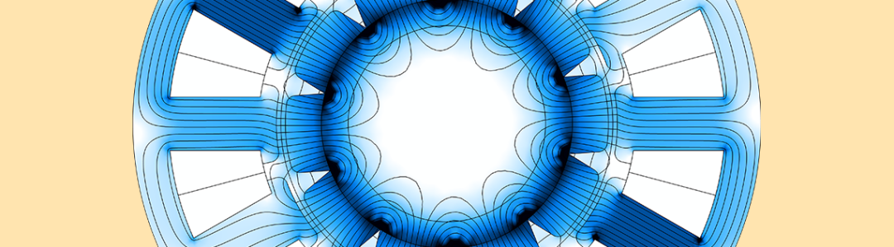
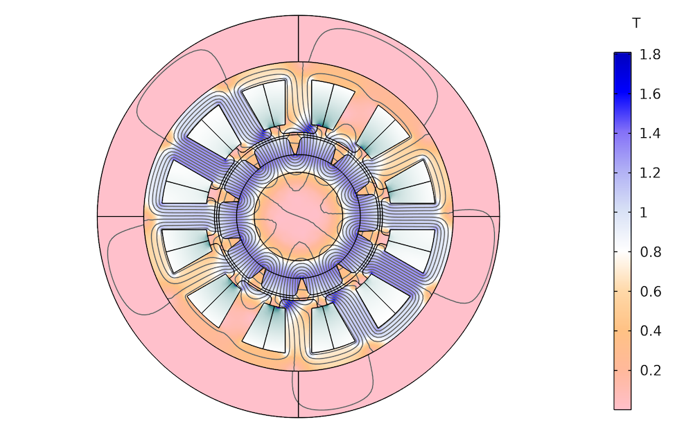
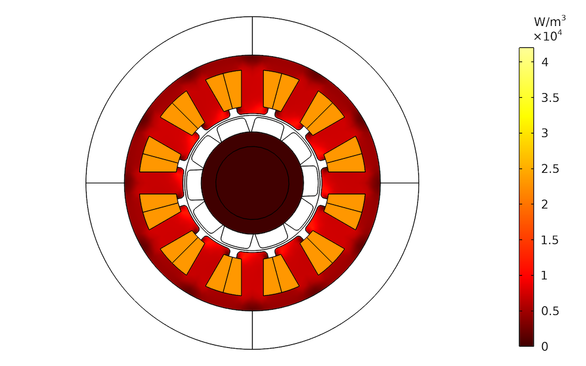

## 电机设计到底在设计什么？从磁场到转矩的工程逻辑

新能源汽车驱动电机、风力发电机、工业伺服系统，看起来属于完全不同的产品，但其核心都离不开电机。

很多刚接触电机设计的人容易把关注点放在槽极配比、绕组形式、磁钢选型等具体参数上。实际上，这些只是设计结果的体现。

对于电机工程师而言，更核心的问题通常集中在几个方面：

- 气隙磁场是否合理；
- 转矩输出是否满足要求；
- 铁芯材料是否得到充分利用；
- 损耗和温升是否可控；
- 成本、重量和性能之间是否达到平衡。

从本质上讲，电机设计是在有限体积、有限成本和有限散热能力下，对电磁能量转换过程进行优化。

---

## 电机为什么能够产生转矩？

从物理本质来看，转矩来源于定子磁场与转子磁场之间的相互作用。

以永磁同步电机（PMSM）为例：

- 转子永磁体提供励磁磁场；
- 定子绕组通入三相交流电后产生旋转磁场；

当两者保持同步运动时，就会产生连续稳定的电磁转矩。

因此，电机产生转矩的本质并不是机械接触，而是磁场之间的相互作用。

同样一台永磁同步电机：

- 电能驱动机械旋转时，它是电动机；
- 机械驱动转子旋转时，它是发电机。

从结构角度看，两者往往没有本质区别，区别在于能量流动方向。

---

## 气隙：电机中最关键的区域

在电机内部，最受工程师关注的区域通常不是绕组，也不是磁钢，而是气隙（Air Gap）。

气隙位于定子与转子之间。

虽然厚度通常只有零点几毫米到几毫米，但几乎所有电磁能量交换都发生在这里。

换句话说，气隙连接了：

- 定子产生的电枢磁场；
- 转子产生的励磁磁场。

气隙中的磁场质量，很大程度上决定了电机的运行品质。

---

## 为什么电机工程师总在追求正弦磁场？

对于绝大多数永磁同步电机而言，理想状态下的气隙磁场应该接近正弦分布。

原因很简单。

正弦磁场配合正弦电流时，可以获得：

- 更平滑的电磁转矩；
- 更低的转矩脉动；
- 更小的振动和噪声；
- 更理想的反电动势波形。

如果气隙磁场中含有大量谐波成分，就会带来一系列问题：

- 转矩波动增加；
- NVH性能下降；
- 损耗增加；
- 电机效率降低。

这也是为什么电机设计中经常看到：

- 斜极设计；
- 分数槽绕组；
- 特殊磁极形状；

这些设计措施本质上都是在改善气隙磁场波形。

---

## 铁芯并不是越厚越好

刚接触电机设计时，很多人会产生一种直觉：

> 铁芯越厚，性能越好。

实际情况并非如此。

## 铁芯太薄的问题

当铁芯截面积不足时，磁通密度会快速升高。

一旦超过材料的最佳工作范围，就会出现磁饱和。

此时：

- 磁导率下降；
- 励磁需求增加；
- 漏磁增加；
- 发热增加。

虽然继续增加电流，但转矩提升已经不明显。

## 铁芯太厚的问题

如果铁芯设计得过于保守，虽然不会发生饱和，但会带来新的问题：

- 材料利用率下降；
- 重量增加；
- 成本增加；
- 功率密度降低。

因此优秀的磁路设计并不是避免饱和，而是在保证性能和可靠性的前提下，让铁芯尽可能工作在合理的磁密区间。

工程上常说的一句话是：

> 材料既不能过载，也不能闲置。

---

## 转矩优化不仅仅是提高电流

评价电机性能时，很多人首先关注最大转矩。

但在实际应用中，更重要的指标往往是平均转矩以及转矩脉动。

对于永磁同步电机而言，同样大小的电流，在不同转子位置下产生的转矩并不相同。

因此工程师需要寻找最佳的电流相位角。

在新能源汽车驱动电机中，常见的控制目标之一就是：

**MTPA（Maximum Torque Per Ampere）**

即：

> 每安培电流产生尽可能大的转矩。

通过合理调整电流矢量方向，可以在不增加电流的情况下获得更高输出能力，同时降低铜耗。

---

## 限制电机性能的往往不是磁场，而是温度

随着电机功率密度不断提高，一个现实问题越来越突出：

**温升。**

很多时候决定电机极限性能的，并不是磁场强度，而是散热能力。

电机运行过程中主要存在两类损耗。

## 铜损

绕组电流通过导体时产生的焦耳热：

铜损通常是电机热源的重要组成部分。

## 铁损

铁芯在交变磁场作用下会产生：

- 磁滞损耗；
- 涡流损耗。

随着频率提高，铁损往往迅速增加。

当温度持续升高时，会带来一系列问题：

- 永磁体性能下降；
- 绕组绝缘老化；
- 电阻上升；
- 效率下降。

  

因此现代电机设计越来越强调：

**电磁-热联合分析。**

在很多新能源汽车项目中，仿真分析已经不再局限于磁场，而是同时考虑：

- 电磁场；
- 温度场；
- 冷却流场；
- 机械应力场。

---

## 电机设计本质上是一场多目标优化

现实工程中不存在完美方案。

每一项性能提升都需要付出相应代价。

例如：

- 增加磁钢体积可以提高转矩，但成本会上升；
- 增大电流可以提高输出能力，但温升也会增加；
- 增加铁芯尺寸能够降低饱和风险，但重量会增加。

因此电机设计实际上是一种典型的多目标优化问题。

工程师需要同时平衡：

- 功率密度
- 效率
- NVH
- 温升
- 重量
- 成本
- 可靠性

最终找到满足工程需求的方案。

---

## 结语

从表面上看，电机设计是在确定槽极配比、磁钢尺寸和绕组参数。

但从更深层次来看，电机设计实际上是在控制磁场、管理能量并平衡各种设计约束。

- 气隙磁场决定转矩品质；
- 磁路设计决定材料利用率；
- 损耗分析决定温升水平；
- 热管理能力决定电机的性能上限。

随着有限元仿真技术的发展，工程师已经能够在样机制造前预测磁场分布、转矩特性、损耗水平以及温度场变化。

现代电机研发正在逐步由经验驱动转向模型驱动。

从某种意义上说，电机工程师最核心的工作并不是设计零件，而是在设计磁场的分布方式，以及能量在系统中的流动路径。
