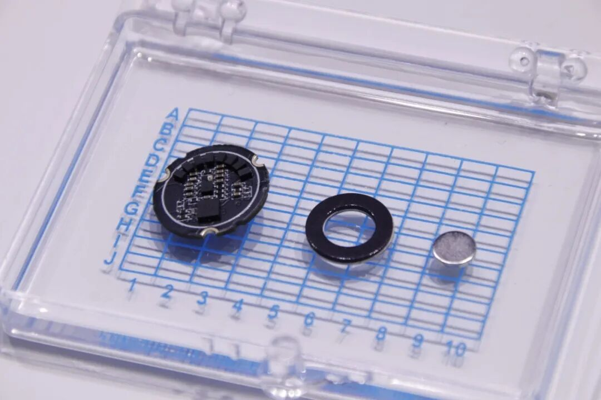
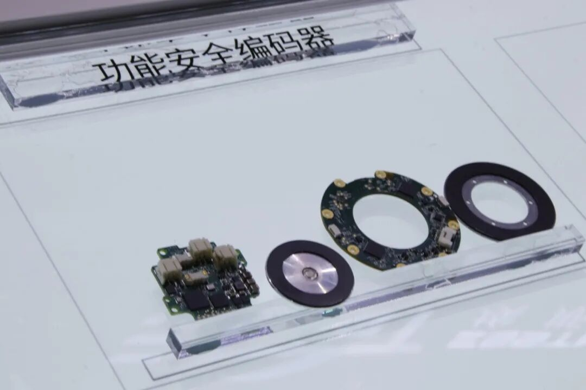
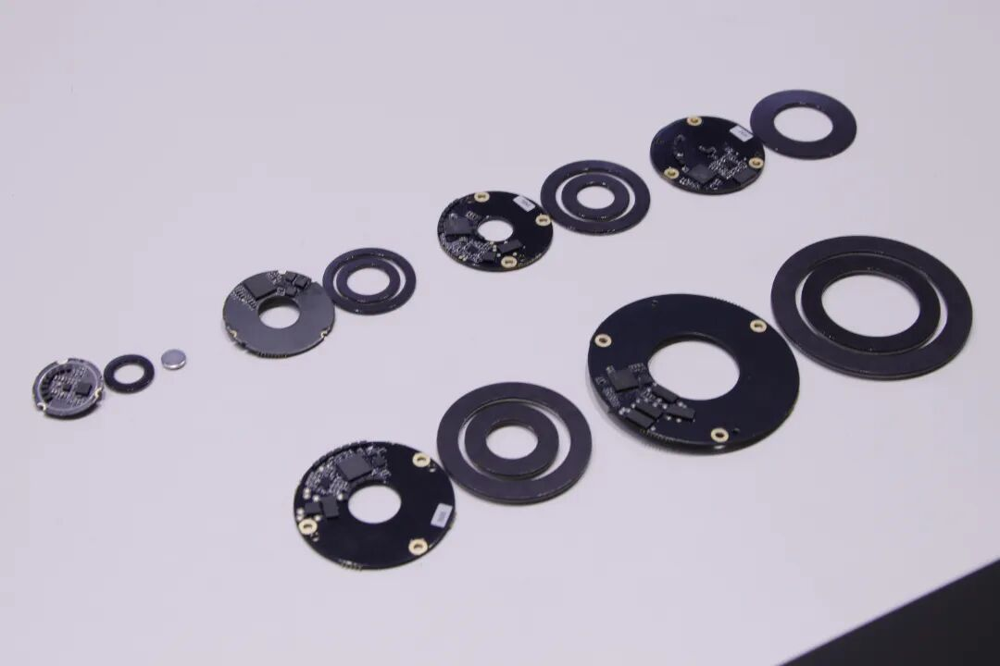
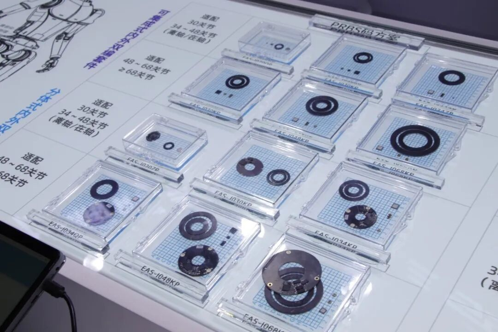
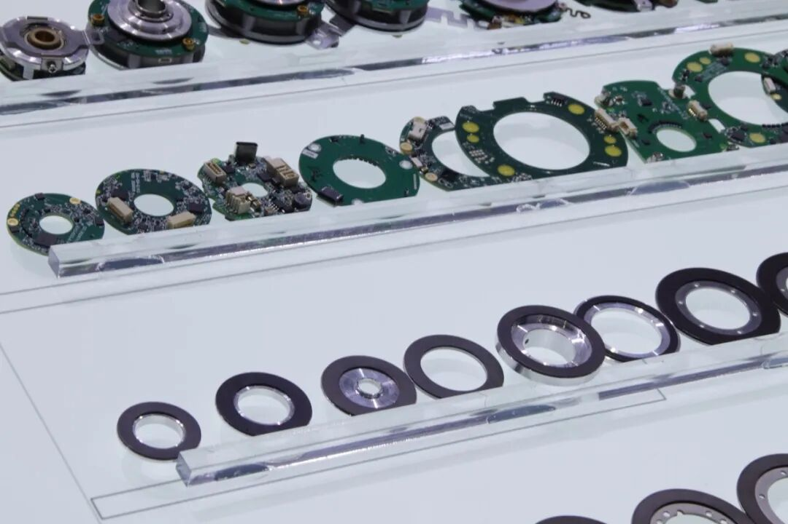
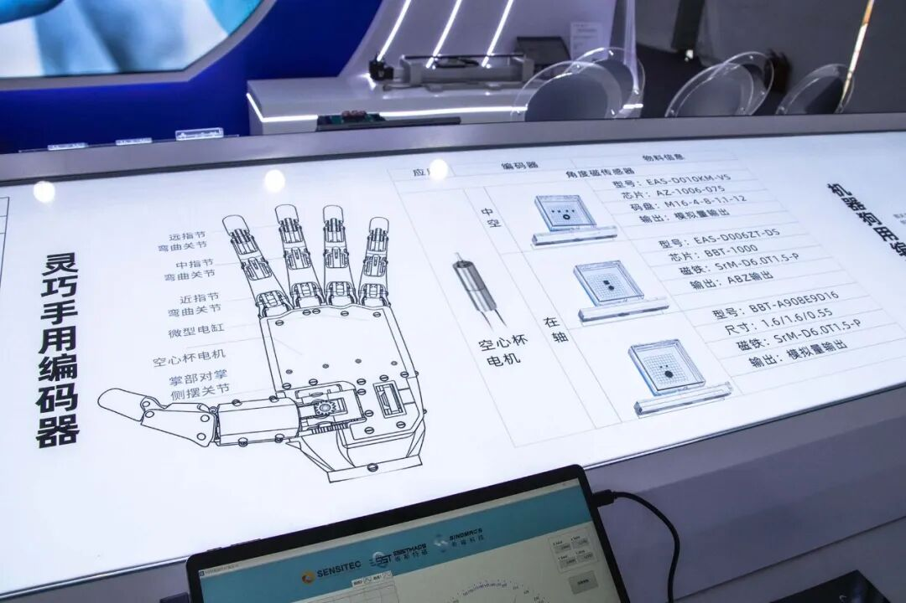
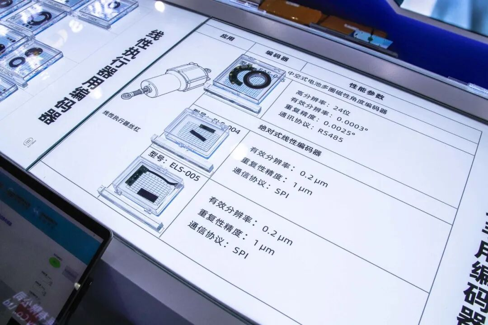
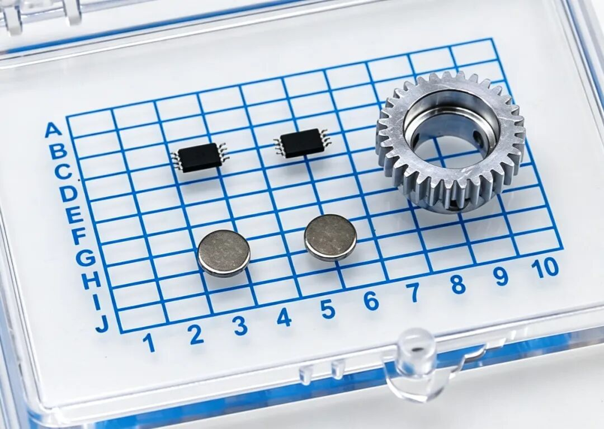
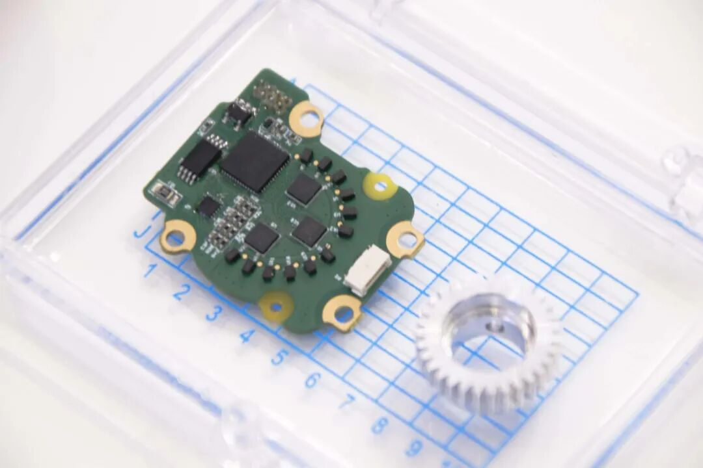
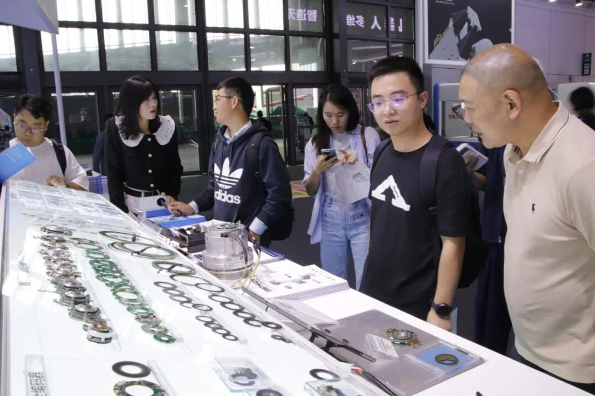

近日，2026 中国国际工业博览会（CIIF 2026）在上海国家会展中心举办。希磁科技（sinomags）与旗下埃斯特磁科技（esstmags）共同参展，展出面向人形机器人、协作/工业机器人、机器狗、灵巧手及线性执行器等场景的高精度 TMR 磁性编码器产品。

展台围绕「从传感晶圆、芯片到成套磁编码器模组」的技术链路，展示了分体式与可集成式内外双编磁性角度编码器、分体式 / 一体式角度编码器、灵巧手编码器、关节用机械多圈角度编码器，以及绝对式线性编码器等品类；并通过产品演示现场实测直观展示了产品性能。

## 展出重点新品

**EAS-J020 分体式内外双编磁性角度编码器**：面向 20 mm 级人形机器人小型关节，采用内外双通道设计，支持 15 kRPM 转速，快轴重复精度 0.005°、慢轴重复精度 0.02°，用于实现角度冗余检测；高速带校验通讯，并提供成套物料便于客户集成调试。

**具有功能安全的磁性角度编码器**：涵盖电池多圈绝对值与单圈绝对值两个品类。

多圈版本分辨率单圈 20 位、多圈 16 位，重复精度 0.0014° / 0.003°；单圈版本分辨率 24 位，重复精度 0.003°，有效分辨率均为 0.001°，采用 RS485 通讯。

**全系列内外双编磁性角度编码器**：可集成式与分体式内外双编产品，覆盖 20、30、34、48、68 关节及以上规格，24bit 分辨率；重复精度 0.001°；延迟低于 2 μs；刷新率 30 kHz；转速高于 15 kRPM；集成式内外双编厚度小于 2.4 mm；全系列支持功能安全升级。

## 场景化应用展品

### 人形机器人关节

EAS-J 系列内外双编套件（可集成式&分体式），含 PRBS 码与游标码两种编码方案，并提供在轴和中空结构产品，灵活适配客户端多样化场景应用需求。

### 工业/协作机器人关节

一体式&分体式磁性角度编码器，分辨率 23–26 bit；重复精度 0.001°；延迟低于 2 μs；刷新率 30 kHz；含单编和双编两种方案。

### 灵巧手

空心杯电机用磁性角度编码器（含中空、在轴方案），以及微型电缸用绝对式线性编码器 ELS-004（有效分辨率 0.2 μm，重复精度 1 μm，SPI 通讯）。

### 线性执行器

**中空式电池多圈编码器** EAS-045（24 位，有效分辨率 0.0003°，重复精度 0.0025°，RS485 通讯）；

**绝对式线性编码器** ELS-004 / ELS-005（有效分辨率 0.2 μm，重复精度 1 μm，SPI 输出）；线性端检测行程覆盖 1–5300 mm，大行程支持定制。

### 机器狗

机械多圈角度编码器 EAS-081 / EAS-079，重复精度小于 0.03°，输出 2 Vpp / 3.3 V 差分信号。

## 现场交流

展会期间，展台与来自人形机器人、协作机器人、灵巧手、线性执行器等领域的行业同仁及合作伙伴，就小型化关节编码器、功能安全、双编冗余检测、宽温耐振等技术方向进行了交流，并就样品测试、定制化开发与长期供货等话题进行了对接。

如需进一步了解产品规格或洽谈合作，可通过官方渠道与希磁科技（[www.magsens.cn](https://www.magsens.cn)）、埃斯特磁（[www.esstmags.com](https://www.esstmags.com)）联系。
