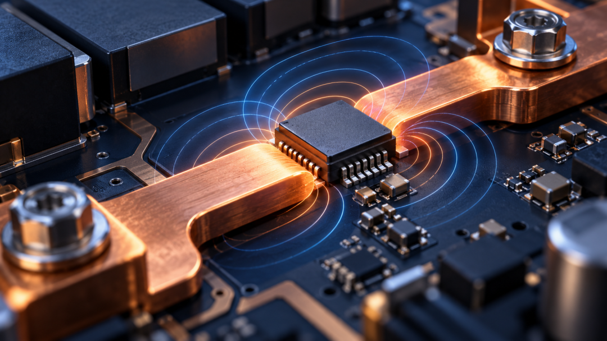

电动汽车的车载充电机和直流变换器，需要知道电流正在怎样变化。测量结果既关系到控制，也关系到过流保护；但传感器如果自身发热过多，又会给系统增加负担。

纳芯微近日发布车规级集成式电流传感器NSM2019。公司公开选型资料显示，该型号属于NSM201x系列，采用集成电流路径，并提供隔离测量及过流保护输出。

一颗看似负责“读数”的芯片，实际上横跨大电流路径、低压控制电路和安全隔离边界。把三件事同时做好，才是它进入汽车系统的关键。

一、为什么要在电源系统里测电流

车载充电机、DC/DC与其他功率模块会根据输入、输出状态调整控制策略。电流测量帮助系统判断负载变化，也可为故障保护提供信号。

测量的位置不同，关注的电流范围和动态速度也不同。持续运行的精度、瞬时过流的响应，不应被混为同一个指标。

电源系统中的电流可能伴随高电压或快速开关噪声，低压控制器需要得到可用信息，同时避免与高压侧形成不安全的电连接。

测量精度之外，控制系统还关心传感信号的带宽和延迟。快速保护若拿到的是经过过度滤波、滞后明显的数值，可能错过异常处理窗口。

二、把电流路径放进芯片，会带来什么权衡

集成式传感器让待测电流经过器件内的导体，内部感测结构再输出与电流相关的信号。相较外置方案，它有机会缩小布局、简化部分连接。

但电流一旦通过导体，电阻就会产生损耗和热量。纳芯微资料列出该系列低至0.27mΩ的输入导通阻抗；这是系列中的最低值，不能直接写成NSM2019每个配置都相同。

实际温升还取决于工作电流、环境温度、PCB铜箔和散热路径。小阻抗提供设计空间，却不能替代整机热测试。

导体产生的热量会反过来影响传感器零点与增益。设计时需要把标称精度、温漂、PCB布局和校准方式放在一起，而非只挑最低的导通电阻。

三、隔离与过流保护，分别守什么边界

隔离帮助高压电流路径与低压测量输出保持电气安全边界。公司选型资料对NSM2019列出SOW10封装、1618VDC工作绝缘电压和5000Vrms一分钟耐受隔离电压。

这些数字对应不同测试定义，不能互相替换，更不能简单写成汽车系统可长期运行在5000Vrms。整机仍需按目标规范核算爬电距离、绝缘和环境条件。

NSM2019还提供过流保护输出，面向异常状态的快速响应。保护阈值如何设定、系统多久切断功率级，应由完整控制链路验证。

高压侧的开关变化可能向低压测量端引入干扰。隔离强度是安全的一面，信号在强共模瞬变下是否准确，则是控制稳定性的另一面。

四、新品发布以后，客户会验证什么

“车规级”首先要落实到具体型号、质量文件和适用场景。客户还会检验精度随温度变化、外部磁场干扰、浪涌承受以及长期可靠性。

官方近日的产品发布说明扩展了选型方向，公开资料并未给出该型号的车企定点或大规模装机数据。器件上市与整车导入之间有较长的评估路径。

从产业视角看，国产模拟与传感器厂商的竞争，正逐渐从单点参数转向测量、隔离、保护和应用支持的系统组合。

车载充电机和DC/DC的功率等级、散热环境与保护策略各异。同一系列提供多个量程和封装，系统厂商仍需按具体电流波形选择型号。

量产验证也要覆盖高低温、长期循环和故障状态。新传感器能否替换既有方案，取决于客户对读数、保护时间、面积及供应稳定性的整体评价。

**需要注意**

0.27mΩ为NSM201x系列公开的最低阻抗；隔离测试电压不能等同于持续工作电压。具体型号参数与车规文件以最新版数据手册为准。

车上测电流，既要得到可信读数，也要限制传感器自身损耗，并守住高低压隔离边界。纳芯微NSM2019的后续价值要在客户系统验证中体现。
