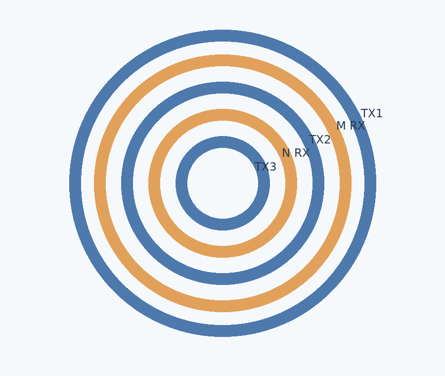
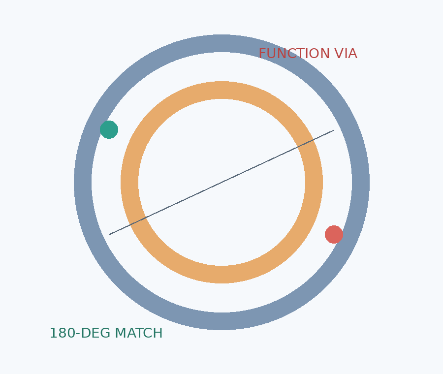
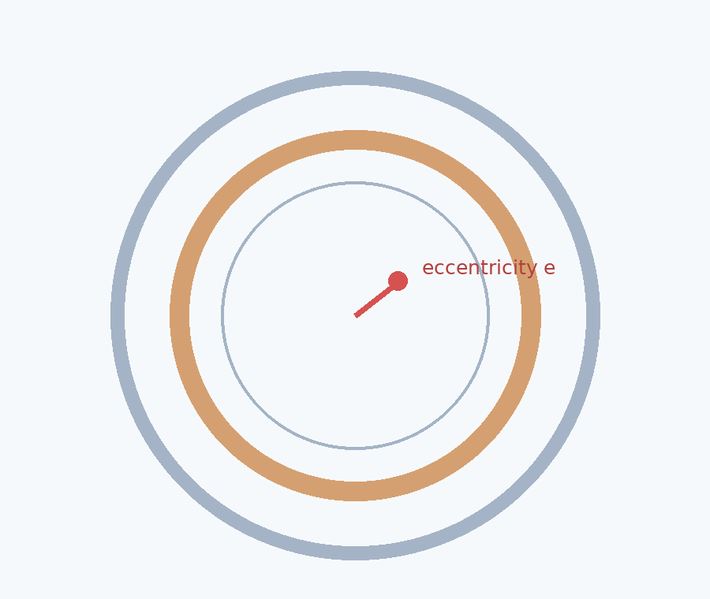

如是有为 · 编码器结构深读

# 电感编码器的精度，为什么可能败在一颗过孔上？

从双码道金属耦合、PCB 圆周对称性到转子偏心：那些隐藏在 SIN/COS 背后的结构误差。

一颗普通 PCB 过孔，可能改变一颗电感编码器的测角精度。它不直接测角，也不输出 SIN/COS，却可能改变接收线圈周围的电磁分布。

真正值得追问的，不是这颗过孔有多大，而是：**编码器依赖空间对称性获得准确的相位信息，局部多出来的一点铜，为什么能够改变相位？**

## 01｜角度来自空间耦合，不是简单的磁场强弱

交流激励线圈产生磁场；转子金属靶形成涡流；涡流的二次磁场影响定子接收线圈。空间正交的接收线圈产生两路随转角变化的响应。理想化表示为：

S(θ) = A sin(pθ)　　C(θ) = A cos(pθ)

其中 p 为机械一圈内的空间周期数。角度经 atan2(S,C) 求得，但真实 PCB 上的正交曲线并不可能无限完美：线圈要换层，信号要引出，铜线附近还会存在过孔、焊盘与其他码道。

## 02｜双码道结构：隔壁铜箔也可能参与测量

为了在高细分测量之外恢复整圈绝对位置，一类编码器采用两个空间周期数不同的码道。它们可以沿径向布局，中央由激励线圈分隔。

图 1｜双码道的径向结构关系示意。颜色仅用于区分功能区，不代表真实铜箔尺寸。

两个空间周期数互质，可以帮助绝对位置消歧，却**不能保证电磁隔离**。N 码道金属靶形成的涡流场，只要对 M 的接收线圈存在非零耦合，就有可能在 M 信号中留下寄生空间分量。

这解释了一个看似矛盾的设计取舍：转子铜箔适度外扩能容纳径向安装偏差，但铜箔如果向相邻接收区域过度延伸，也可能提高跨码道耦合。

## 03｜为什么某些金属边界需要刻意退让？

CN224051343U《一种电感式编码器感应组件》提供了一个很具体的结构案例：单块定子线圈板与单块转子码盘同心、平行、面对面；M 与 N 是码盘上的径向内外铜箔，并非上下叠放的两块转子金属靶。

其两个实施例对 N 铜箔的径向边界做了不同处理，尤其关注其与靠近 M 接收区的中间激励线圈 TX2 的关系。

| 结构关系 | 实施例一 | 实施例二 |
| --- | --- | --- |
| N 接收线圈至 TX2 | 0.8 mm | 1.2 mm |
| N 接收线圈至 TX3 | 0.8 mm | 0.5 mm |
| N 铜箔至 TX2 投影间隙 | 0.1 mm | 0.4 mm |
| N 铜箔与 TX3 | 留 0.1 mm 间隙 | 允许投影重叠 |

表中感应线圈的距离与转子铜箔投影边缘的距离不是同一个物理量。两个实施例没有一味要求 N 铜箔远离所有 TX，而是都谨慎处理靠近 M 区域的 TX2 边界。这支持一种工程解读：**需要优化的是寄生空间耦合，而不是单纯增加所有金属间距。**具体尺寸并不构成其他设计的通用最优值。

## 04｜串扰如何进入 atan2 的角度结果？

假设 M 码道理想的归一化正交信号为 S=sin(pθ)、C=cos(pθ)，受外部结构影响后变成 S+ΔS、C+ΔC。小扰动的一阶电角度误差可写成：

δθe ≈ (CΔS − SΔC) / (S² + C²)

这个表达式说明：**角度误差与寄生扰动在理想信号轨迹切向上的投影有关。**并非所有影响幅度的扰动都同等程度地影响角度。

如果只在 S 通道存在 εsin(qθ+φ) 的扰动，一阶误差包括 p+q 和 |p−q| 对应的空间频率分量：

δθe ≈ ε/2 · [sin((p+q)θ+φ) + sin((q−p)θ+φ)]

这是用来说明测量机理的简化模型，不是特定厂商实测出的频谱。真实两路 SIN/COS 可能同时受到不同幅相的干扰，谐波是否抵消或者增强，要根据实际复数耦合关系分析。

## 05｜功能过孔为什么是圆周对称性的破口？

接收线圈的重复布局可以利用空间对称性控制某些寄生耦合。但是信号必须从局部角位置引出，功能过孔、焊盘和连接导线便在圆周上留下非周期性结构。

图 2｜功能过孔与对面补偿结构：几何二重对称示意，并不表示电连接条件一定相同。

局部结构可能改变金属面积、线路寄生电容、接收灵敏度或者对激励场的耦合。不能简单断言误差全部来自过孔铜柱里的涡流；它取决于过孔电气连接、层叠、走线与附近线圈的整体结构。

一种设计办法是在相关过孔或焊盘的 180° 对面增加尺寸相近的结构，尝试恢复圆周的二重旋转对称性。

## 06｜180° 补偿能抵消什么，不能抵消什么？

把一个局部寄生分布记为 d(φ)，在正对面复制理想等效分布，就有：

dpair(φ) = d(φ) + d(φ−π)

对这个理想局部分布做圆周傅里叶分解，第 n 阶系数满足：

Dn,pair = Dn [1 + (−1)n]

所以，**这对理想等效的局部扰动在奇数阶空间分量上相互抵消，在偶数阶空间分量上则可能叠加。**但这是对局部寄生分布本身的傅里叶结论，不能直接说最终角度误差里的所有奇次谐波就被消除了。

接收线圈的空间权重、转子周期性调制、偏心状态和 atan2 解调都会重新映射这些扰动。尤其功能过孔连着信号回路，镜像补偿焊盘未必具有相同电位和电流边界条件；几何相似不等于电磁等效。

## 07｜偏心为什么会放大那些原本不显眼的结构细节？

转子与定子理想同心时，空间周期性比较完整。出现小的径向偏心 e 后，铜箔相对接收线圈的径向覆盖位置随方位角变化，一阶几何扰动通常带有 cos(φ−φe) 这样的圆周一阶分量。这里主要讨论径向错位；若两板保持平行，偏心并不必然使局部轴向气隙随方位变化。

图 3｜转子偏心改变沿圆周的径向对准关系，图形为示意而非电磁仿真结果。

第一阶偏心调制与原有 n 阶空间分量相乘，会产生 n−1 与 n+1 阶的边带。哪些边带最终投射为角度误差，还取决于接收线圈空间敏感度及正交解算。

因此，同心样件上的角度误差峰峰值，不一定能够预测真实装配中的表现。一个很重要的工程指标是：

Ke(θ) = ∂δθ(θ,e) / ∂e

它表示在给定位置附近，角度误差对径向偏心的敏感度。比较有无补偿结构的 Ke，往往比只比较单一同心工况的 INL 更能揭示结构补偿的实际价值。

## 08｜怎样验证补偿真的有效？

**第一步，比较同心状态。**保持主体线圈几何、叠层、激励与转子一致，制作带补偿和不带补偿的 PCB，记录两路正交信号的幅相、空间频谱和解算角度误差。

**第二步，施加可控偏心。**在多个偏心幅值与方向下测误差随角度变化的曲线，比较补偿前后的误差增长斜率，而非只报一个绝对精度指标。

**第三步，拆分电气与几何影响。**分别测试孤立焊盘、连接到指定节点的焊盘、贯通孔结构，并保持对比条件尽量一致，判断主要改善来自铜几何、寄生电容还是电流路径。

**第四步，扫描相邻铜箔边界。**单独调整 N 铜箔朝 TX2 的径向边界，观察 M 码道角度误差谱，并同步记录 N 通道自身的幅值、信噪比和误差。不要把对 M 的改善，建立在 N 已经无法正常工作的代价上。

## 09｜真正值得关注的是空间误差链条

电感编码器里的每一片铜都可能参与电磁耦合。但**参与耦合，不等于一定造成有害角度误差**。真正关键的是它处于什么位置、具有怎样的空间对称性、是否改变正交相位，以及扰动最终能否穿过解调算法进入角度输出。

金属靶制造的是我们需要的涡流。过孔、焊盘和引线可能制造的，则是测角系统原本不想看见的空间信息。

这也是为什么高精度电感编码器的开发不能止步于漂亮的 SIN/COS、足够多的 ADC 位数，或者一张理想的线圈图纸。PCB 堆叠、铜箔边界、走线换层、局部焊盘和装配偏心，必须在同一条误差链上理解。

一颗过孔未必是精度的主要限制项。但如果它破坏了原本依赖的空间对称性，那么它就不再只是“布线细节”。

**资料与说明**  
结构案例：CN224051343U《一种电感式编码器感应组件》（重点涉及双码道径向布局、N 铜箔边界及 180° 对称补偿结构）。文中电磁模型、傅里叶推导与测试方法为独立工程分析，不等于该专利的试验数据，也不代表对任何量产型号的测量结论。三幅示意图为原创机制图，非实际 PCB 复刻。
