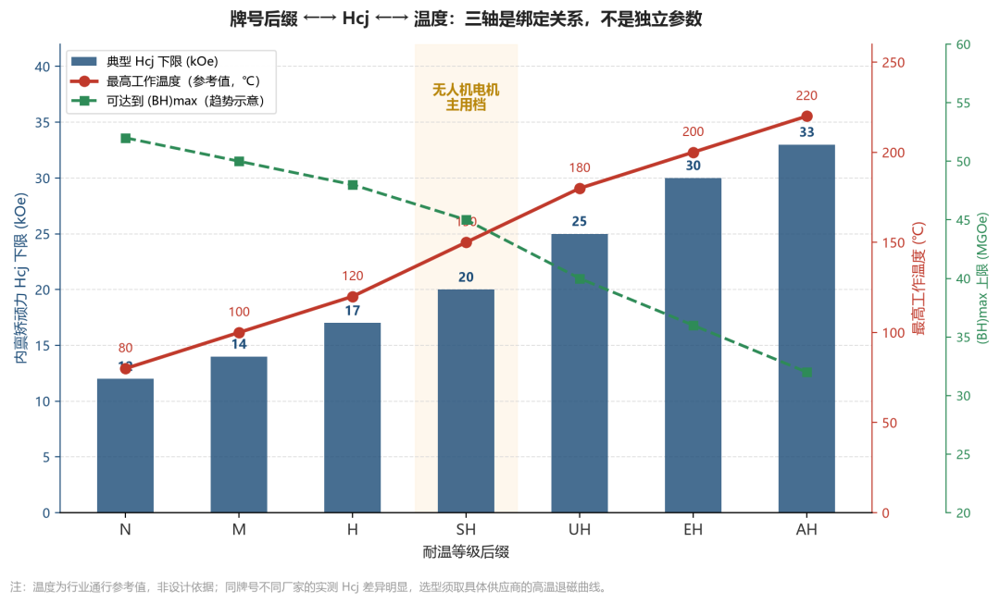
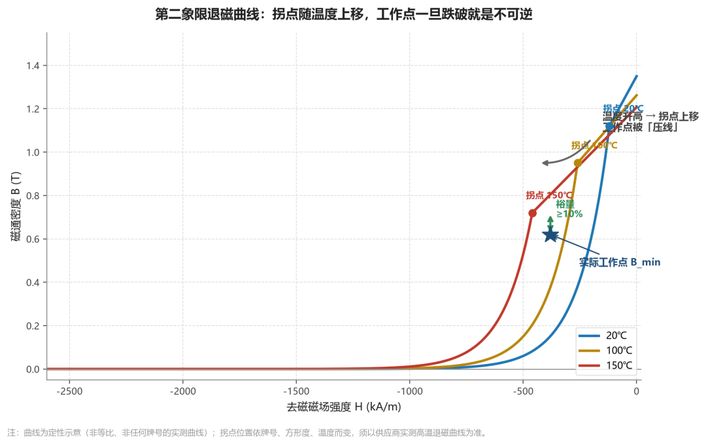
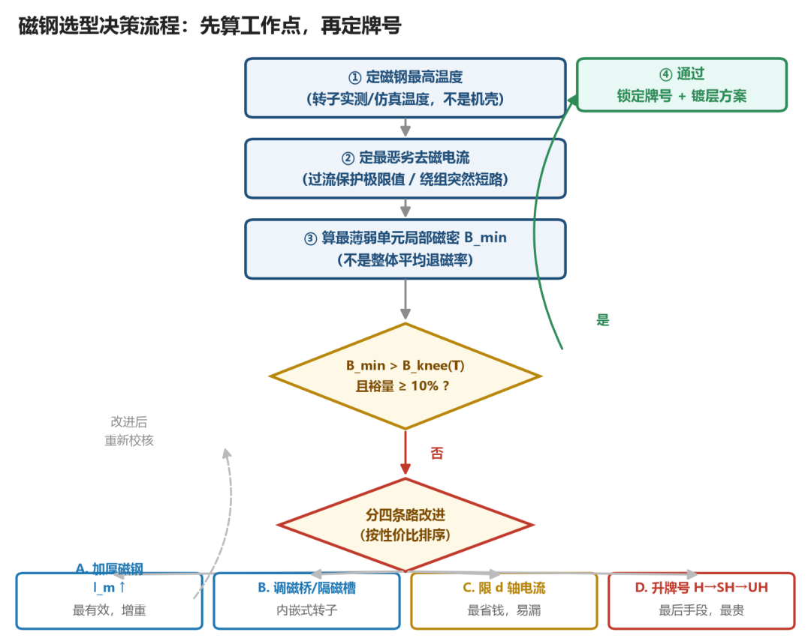

摘要：选磁钢最贵的坑，不是牌号买低了，是拿"最高工作温度"当判据。工作点才算数。

---

开篇：一份 150℃ 的样件，在 130℃ 的工况里退磁了

先讲一个听起来很荒唐的结果。

一台工业无人机电机，磁钢选的是某厂家的N42SH，规格书上白纸黑字写着"最高工作温度 150℃"。整机热仿真算下来，磁钢最热点 130℃。留了 20℃ 余量，够了吧？

台架跑耐久，第三轮循环开始扭矩往下掉，拆开一看：局部退磁。不是烧的，也没过热，就是磁钢自己掉了。

问题出在哪？

出在"最高工作温度"这个参数本身——它不是材料的一个物理常数，而是一个在标准测试条件下的推荐上限。而你的电机里，磁钢承受的去磁磁场比标准测试条件下大得多。去磁磁场一叠加，同样温度下，退磁曲线的拐点就往上爬，工作点一掉到拐点以下，就是不可逆退磁。

所以那句"150℃ 的磁钢我怕它 130℃ 出事吗"，问法本身就错了。该问的是：我的磁钢在最高温度下、遇到最恶劣去磁电流时，工作点还剩多少裕量。

这篇文章就干一件事：把"N/M/H/SH"这套牌号后缀拆开，告诉你贵的钱具体花在哪个物理量上，以及怎么用工作点而不是用温度来选牌号。

---

## 一、牌号后缀到底在标什么

先纠一个高频误读。N42SH 这三个部分各有分工：

|  |  |  |
| --- | --- | --- |
| 组成 | 含义 | 决定什么 |
| N | 钕铁硼系列（Neodymium） | 材料体系 |
| 42 | 最大磁能积 (BH)max ≈ 42 MGOe | 磁力大小（同样体积能出多大力） |
| SH | 耐温等级后缀 | 抗退磁能力（内禀矫顽力 Hcj 的档位） |

关键：数字管磁力，后缀管抗退磁，两者是两件独立的事。

而且这两个方向是互相打架的。提高耐温等级靠的是添加镝（Dy）、铽（Tb）这类重稀土，重稀土一加，内禀矫顽力上去了，但剩磁 Br 和磁能积会被压下来。

这就导致一个工程上很反直觉的现象：N52 的磁力不如 N35SH 在高温下表现好——N52 在 80℃ 以上就开始不可逆损失，而 N35SH 到 150℃ 还稳得住。

所以"我要最强的磁铁，给我 N52"这句话，在无人机电机上几乎一定要出事。

后缀与内禀矫顽力的对应关系

|  |  |  |  |
| --- | --- | --- | --- |
| 后缀 | 最高工作温度（参考值） | 典型 Hcj 下限 | 通常应用印象 |
| 无后缀（N） | ≤ 80℃ | ≥ 12 kOe（约 955 kA/m） | 常温消费电子、小电机 |
| M | ≤ 100℃ | ≥ 14 kOe（约 1114 kA/m） | 散热较好的小型电机 |
| H | ≤ 120℃ | ≥ 17 kOe（约 1353 kA/m） | 电动工具、风扇电机 |
| SH | ≤ 150℃ | ≥ 20 kOe（约 1592 kA/m） | 电动车、水泵、工业无人机主用档 |
| UH | ≤ 180℃ | ≥ 25 kOe（约 1989 kA/m） | 新能源车驱动电机 |
| EH | ≤ 200℃ | ≥ 30 kOe（约 2388 kA/m） | 高性能车用、高温特种 |
| AH | ≤ 220℃ 以上 | ≥ 33 kOe（约 2625 kA/m） | 极端高温工况 |

> ⚠️ 这张表的"最高工作温度"是行业通行的参考值，不是可以照抄的设计依据。 不同厂家的同牌号产品实测 Hcj 可以有明显差异，价格也差得不少。选型前必须拿具体供应商的实测高温退磁曲线，不要用这张表下料。
>
> 表中 N/M/H/SH/UH/EH/AH 后缀与 Hcj 档位的对应关系，可在 GB/T 13560-2017《烧结钕铁硼永磁材料》 中查到牌号与磁参数的规定（该标准 2017-10-14 发布、2018-05-01 实施，现行有效；2025-03-27 复审结论为"继续有效"）。引用前请核实标准原文具体表号与数值，本文不代为引用条款号。

一个容易被忽略的点：后缀还影响镀层。常规电镀镍（Ni-Cu-Ni）在 150℃ 以上长期服役时可靠性会下降，SH 及以上档位通常要考虑化学镍或环氧涂层。这是选型时要一并定的，不是采购阶段才想起来的细节。

---

## 二、贵的钱花在哪：算一笔 Hcj 的成本账

大家最关心的问题其实就是：SH 比 H 贵、UH 比 SH 更贵，这钱换来的是什么？

答案是：换来了"最高温度下退磁曲线拐点还能撑住"这件事。

退磁曲线的拐点，才是真正的红线

钕铁硼在第二象限的退磁曲线，不是一条直线，它有一个膝点（拐点）。工作点高于拐点，撤去去磁磁场后磁性能自动恢复（可逆）；工作点一旦低于拐点，磁畴被翻转，冷却后也回不来（不可逆退磁）。

而拐点位置随温度升高而向上移动。

有一段公开的、值得记住的实测数据可以说明这个趋势：某内埋式永磁同步电机的电磁—热耦合研究显示，温度高于 140℃ 后退磁曲线出现明显拐点；160℃ 时拐点对应磁通密度约 0.15 T，180℃ 时约 0.34 T。（来源：公开期刊论文《基于典型工况下电磁–热耦合的内埋式永磁同步电机(IPMSM)温升与退磁性能研究》，2026-06，非一手来源，引用前需核实原文）

翻译成工程语言：温度一高，红线就往上抬，你的工作点原本在安全区，抬着抬着就压线了。这就是开篇那台电机退磁的机理。

所以 Hcj 之外还要看一个参数：方形度。同样 Hcj 的两款料，方形度差的那个，拐点更早出现，实际抗退磁能力更弱。这一条也是 GB/T 13560-2017 相对 2009 版新增的磁参数之一（同上，需核实标准原文）。

退磁校核：三个必须做对的动作

动作 1：找对最恶劣工况，不是满载。

很多人拿额定负载去校核，这是错的。最恶劣的工况是故障工况：

变频器/电调过流保护动作前的极限电流；

逆变器故障瞬间的绕组突然短路。

短路时，短路电流里的d 轴分量会形成强烈的去磁磁场，这是不可逆退磁最重要的触发条件。对调速永磁同步电机，不计定子电阻时，最大去磁电流近似为 I ≈ E / Xd（E 为反电势，Xd 为直轴同步电抗）。

动作 2：把温度设在最高温度，不是常温。

退磁校核绝对不能只用常温参数。必须把永磁体温度设在该工况下的最高允许温度（甚至更高一点的包络）再算。低温也有坑——铁氧体的最低温度、钕铁硼在极低温下的矫顽力下降，同样要单独看。

动作 3：看最薄弱点的局部磁密，不是平均值。

退磁是从最薄弱的局部单元开始的。要关注永磁体最薄位置的局部磁通密度最小值。有限元结果里"整体退磁率 3%"这种数字没有意义，要盯的是单个单元是否跌破了对应温度下的拐点。

判据（可直接用）：

> 永磁体最薄弱单元的磁通密度 B_min(工作点) > B_knee(最高温度下的拐点磁密)，且留 ≥10% 裕量。

保守估算式（手算，用来快速判断量级）：

外加去磁磁场强度 H 与磁钢尺寸、匝数、电流的关系，粗略可写成：

H ≈（N *I）/l_m

其中 N 为每相绕组串联匝数，I 为最大去磁电流（A），l_m 为磁化方向上的永磁体厚度（m）。

判据是：H 必须小于该温度下的内禀矫顽力 Hcj（注意不是 Hcb）。

I_max <「 H_cj(T) *l_m」/N

> 这个估法非常保守（工程师圈里常说的"保守到 100% 不失磁"），因为它没有计入磁路漏磁、极靴屏蔽、磁桥分流等有利因素。它的价值在于：算出来不通过，基本可以确定方案有风险，不用急着跑有限元；算出来通过，再去有限元里看局部细节。
>
> 注意公式里是 l_m（磁化方向厚度）而不是磁钢面积——这也是为什么"减薄磁钢"这个降本动作，往往是直接拿抗退磁能力换钱。

校核不过，四条改进路，按性价比排序

|  |  |  |  |
| --- | --- | --- | --- |
| 改法 | 效果 | 代价 | 什么时候用 |
| 加厚磁钢（l_m↑） | 直接降低 H，最有效 | 转子重量、转动惯量、离心应力全涨 | 结构空间还有 |
| 升牌号（H→SH→UH） | 直接抬高 Hcj | 重稀土用量↑，Br 和磁能积↓，成本显著涨 | 空间已经用满 |
| 调磁桥/隔磁槽尺寸 | 改善工作点，分流去磁磁通 | 需与结构强度反复迭代，周期长 | 内嵌式转子 |
| 削去磁电流（改控制策略，限制最大 d 轴电流） | 从根上减小 H | 会牺牲部分堵转/过载能力 | 最省钱，但最容易被忽略 |

最后一条常被跳过。电调的控制策略（最大 d 轴去磁电流限制）其实是一个自由度，把电调供应商拉进来一起定这个限值，比升一个牌号便宜得多。

---

## 三、无人机场景的额外一笔账：温度不是唯一变量

无人机电机比工业电机多两个约束，选型时必须一起看。

## 1. 重量是硬成本，且是"乘法成本"

工业电机加厚磁钢，改的是电机自己的重量。无人机电机加厚磁钢，改的是整机重量——多出来的每一克，都要靠减少电池或减少载荷来还。

所以无人机磁钢选型的经济账，本质上不是"磁钢贵多少"，而是"减重省下多少电量、又能换回多少载荷"。

## 2. 高转速带来的第二重加热

无人机电机普遍在几千到上万转。转子表面的高频交变磁场会在磁钢里产生涡流损耗，这部分热是直接从磁钢内部产生的，散热路径还比定子绕组更差。

结果就是：磁钢温度常常是整机最热点之一，而不是跟着机壳温度走。

所以判断磁钢工作温度，别用机壳温度，别用环境温度，也别用绕组温度——要用转子的实测或仿真温度。常规经验是电机内部温度比环境高 20~40℃，但高转速工况下这个差值可以远远超出。

---

## 四、选型决策表

按场景查表，不按"越贵越保险"选。

|  |  |  |  |
| --- | --- | --- | --- |
| 你的场景 | 推荐档位 | 关键理由 | 必须一并确认的 |
| 常温小电机 / 低成本批量 | N 或 M | 成本最低，80℃ 内无风险 | 确认实际磁钢温度不超 80℃ |
| 一般工业电机 / 中等散热 | H（120℃） | 性价比档，够用则不必上 SH | 环境 50℃ 以上要重新核 |
| 工业无人机电机 / 连续作业 | SH（150℃） | 当前主流档，抗退磁与成本平衡 | 必须做短路工况退磁校核 |
| 高转速 / 大电流 / 堵转频繁 | SH 起，视校核结果考虑 UH | 高频涡流热 + 大去磁电流双重叠加 | 转子实测温度 + 电调 d 轴限流值 |
| 环境温度高（沙漠、高原、密闭舱） | UH | 环境起点就高，余量被吃掉 | 分季节/分地域的极端工况包络 |
| 已有 SH 方案但校核不过 | 先改磁桥 / 先限 d 轴电流，最后才升牌号 | 改设计和改控制比换材料便宜 | 与结构、电调三方一起定 |

两条最重要的判断标准：

1。判据是工作点，不是牌号后缀，也不是"最高工作温度"。

后缀只告诉你材料的 Hcj 档位，工作点告诉你实际会不会退磁。

## 2.校核不过时，先动设计（磁桥、l_m）和控制（d 轴限流），最后才动材料牌号。升牌号是四条路里通常最贵的一条。

---

## 五、给工程师的检查清单

出图前、定料前，按这个顺序过一遍：

实测或仿真出磁钢最高温度

——用转子温度，不用机壳温度

确定最恶劣去磁电流

——取"过流保护动作前的极限值"或"绕组突然短路值"，不是额定值

退磁校核的温度用最高温度，不用常温

盯最薄弱单元的局部磁密

，不要看平均退磁率

裕量至少 10%

——低于 10% 一律视为不通过

看方形度，不只看 Hcj

——同 Hcj 的两款料抗退磁能力可能不同

确认镀层与温度匹配

——150℃ 以上评估化学镍/环氧

把电调 d 轴限流值纳入设计输入

——这是个被浪费的自由度

磁钢减薄的降本动作，先过一遍退磁校核再说

拿供应商的实测高温退磁曲线，不用通用牌号表下料

第 2 条和第 8 条是最容易漏的：一个决定你校核得对不对，一个决定你能不能少花钱。

---

## 六、行业视角：为什么这块料越来越贵

最后说点产业层面的判断。

第一，成本结构决定磁钢的议价能力。动力系统厂商的公开财务数据能说明问题：某 A 股上市动力系统厂商的招股材料显示，报告期内直接材料占主营业务成本比例分别为 76.28%、75.43%、74.76% 和 72.67%，是成本结构的绝对主导项。其列示的主要原材料就包括磁性材料、轴承、漆包线、铁芯、矽钢等。（来源：该公司公开招股说明书，公开披露数据）

磁钢是这条成本链上单价最高的材料之一——同牌号、同尺寸的钕铁硼，往往是一台电机里材料成本的大头。所以"降本"的压力，最终有很大一部分会落到磁钢上。

第二，供给端阶段性偏紧。行业数据显示，2025 年国内无人机动力系统核心零部件产能利用率约 85.2%，其中高端钕铁硼磁材、7075-T6 铝合金型材的头部供应商产能利用率均超过 90%，接近满负荷。（来源：公开行业研究数据，非一手来源，需核实原文）

供给紧的直接影响是：便宜的档位越来越难拿，交期开始分化。

第三，重稀土是长期变量。提高耐温档位靠加镝、铽，这两种是稀缺资源，价格波动比钕本身大得多。这意味着"H 换 SH"这个动作的成本，不是线性上涨。

所以我的判断是：未来两三年，无人机电机磁钢的选型会从"能过就行"转向"精确到工作点的按需选材"。因为档位之间一旦有 30%~50% 的价差，"我用不着这么高的牌号"这件事就值钱了——而要说清"我用不着"，前提是你能算工作点。

能算工作点的团队，选型时是主动的；只能看牌号表的团队，只能往高了买，然后整个项目买单。

---

## 写在最后

磁钢选型这件事，说到底是一个"在最高温度、最恶劣电流下，工作点还剩多少裕量"的问题。

牌号是给采购看的，工作点是给设计看的。

所以下次有人跟你说"我这是 SH 的，150℃ 没问题"，先别急着放心——问一句：最恶劣工况下的去磁电流是多少，校核过了吗？

---

本文为设计经验整理，数据来源为公开标准、公开行业资料与常规工程实践。涉及具体牌号与供应商的参数，请以其公开规格书和实测数据为准。文中引用的标准与行业数据均标注来源，正式引用前请核实原文。欢迎在后台留言交流你所在场景的磁钢选型判断。
