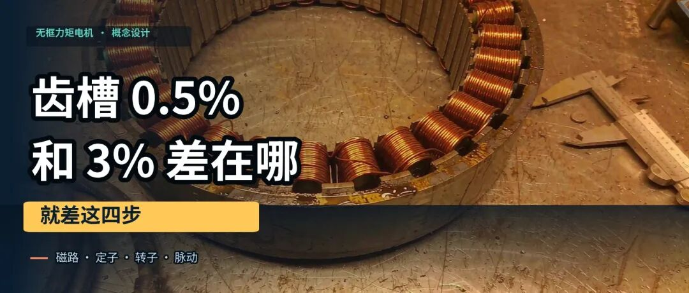
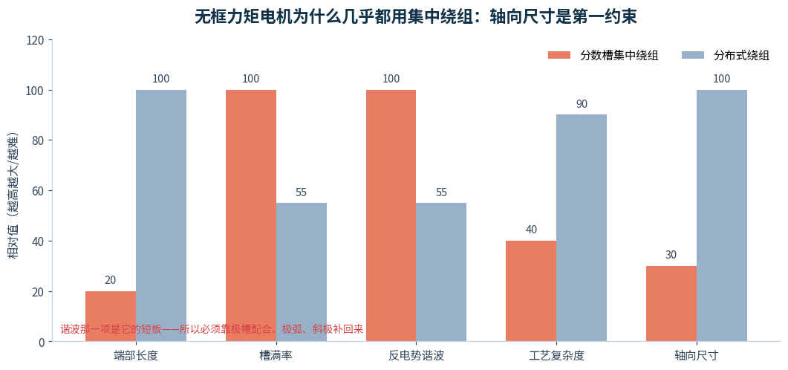
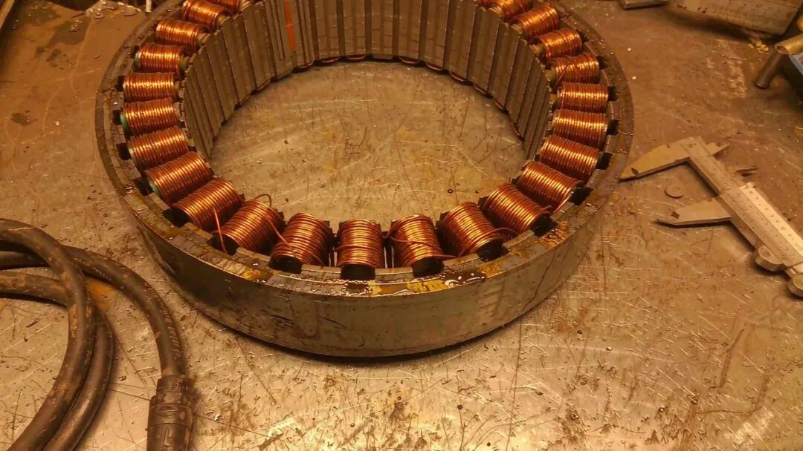
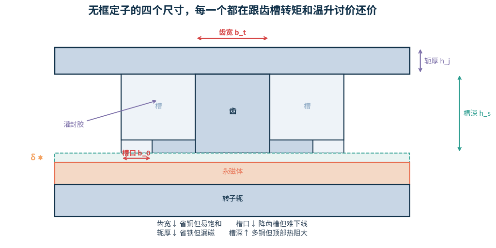
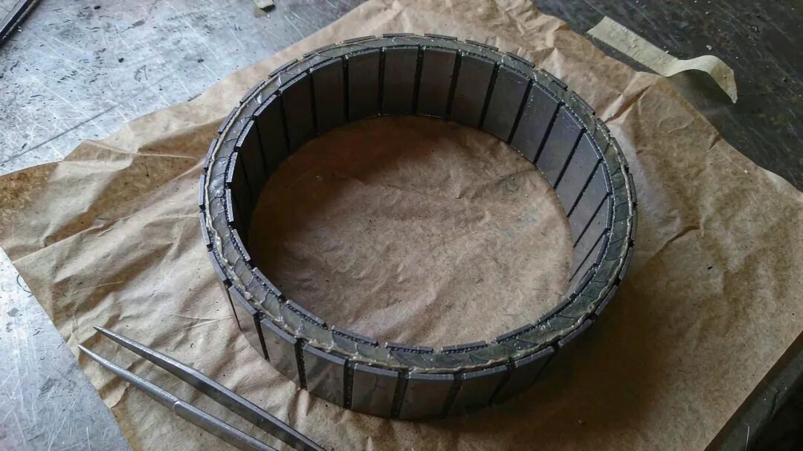
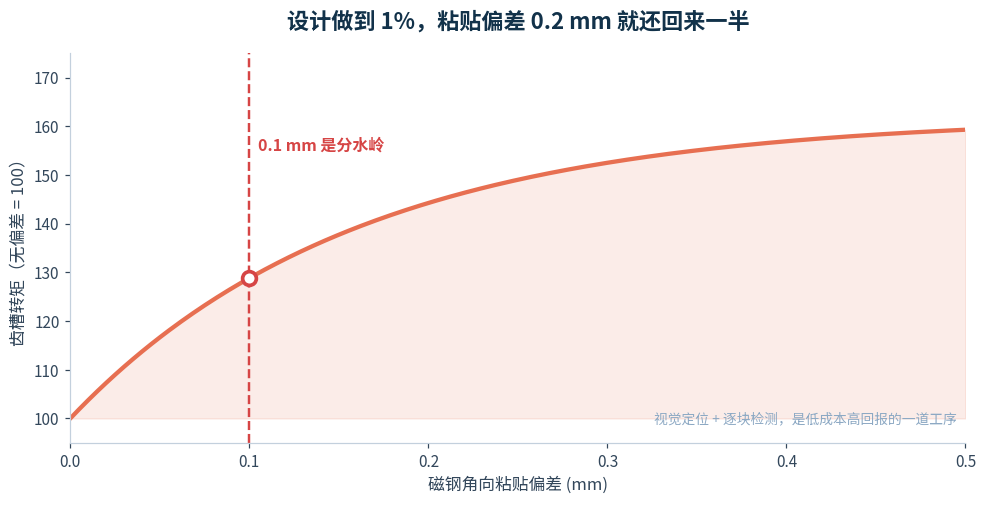
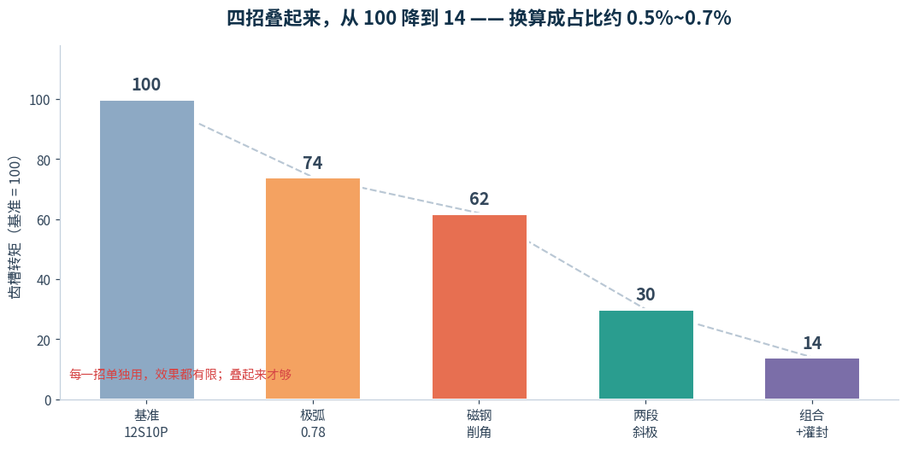
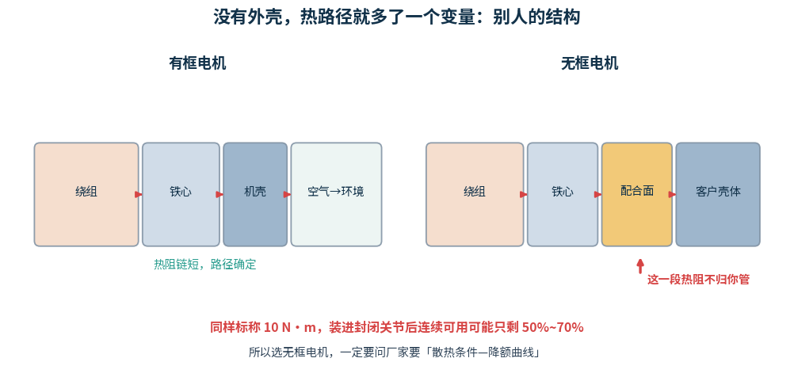
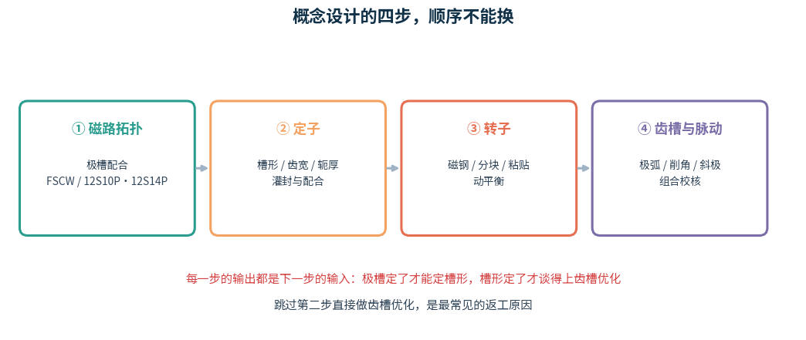

同样是无框力矩电机，同样 12 槽 10 极，同样标称 10 N·m。

一家报齿槽转矩 0.5%，一家报 3%。

差的不是磁钢牌号，也不是谁家的仿真软件好——是四步走没走完。

这篇文章按概念设计的顺序，把无框力矩电机的四件事讲清楚：磁路怎么选、定子怎么定、转子怎么做、脉动怎么压。

六条结论

## 1 无框电机几乎都是分数槽集中绕组。 不是因为谐波好，是因为轴向尺寸——端部短，才塞得进关节。

## 2 定子四个尺寸，每个都在跟两件事讨价还价： 齿槽转矩和温升。

## 3 转子决定下限，工艺决定上限。 磁钢角向偏差超过 0.1 mm，设计做到 1% 也白费。

## 4 0.5% 不是某一招的功劳。 极弧 + 削角 + 斜极叠起来，才能从 100 降到 14。

## 5 无框把三个问题交给了你： 散热、对中、电磁兼容。电机厂只保证本体。

## 6 顺序不能换： 磁路 → 定子 → 转子 → 脉动。跳过第二步直接做齿槽优化，是最常见的返工。

01

磁路拓扑：为什么几乎都是集中绕组

先说一个容易被讲反的事实。

集中绕组的谐波比分布式差，这是共识。那为什么无框力矩电机几乎清一色用它？

图 1　集中绕组在谐波这一项是输的，但端部、槽满率、轴向尺寸全线赢

答案就一个字：短。

机器人关节的轴向空间是寸土寸金的。集中绕组的线圈只绕在一个齿上，不跨槽，端部可以做得极短——轴向长度能比分布式省三分之一。

再加上槽满率高、铜耗低、便于自动绕线，谐波那点亏，后面用极槽配合和极弧补回来就是了。

图 2　无框定子的样子：没有外壳、没有端盖，一圈齿上一个线圈，中间一个大孔走线

仔细看这张图，能看出三件事：

·<strong>端部真的很短。</strong>线圈几乎贴着铁心端面，没有那种鼓出来一大坨的端部。

·<strong>内孔很大。</strong>这是无框电机的立身之本——编码器线、力矩传感器线、甚至减速器输出轴都要从这里过。

·<strong>铁心是裸露的。</strong>外圆那一圈是配合面，直接坐在客户壳体里，没有中间那层机壳。

极槽配合上，最常见的是 **12 槽 10 极**和 **12 槽 14 极**。前者综合平衡，后者齿槽更低、反电势更正弦，但绕组因数略低。

再往上走，高端产品会用到更多极——极数越多，低速转矩越平稳，0.1°/s 这种超低速也能匀速走。代价是频率高、铁耗大，对控制器要求也高。

02

定子：四个尺寸的连环交易

定子设计看起来是四个独立参数，其实是四笔互相牵制的交易。

图 3　四个尺寸：齿宽、轭厚、槽口、槽深。每一个都同时影响转矩和温升

齿宽 bt

窄一点省铜、槽面积大；但太窄齿部饱和，铁耗上来、转矩上不去。经验上齿部磁密控制在 1.6~1.8 T。

轭厚 hj

薄一点省铁、外径小；但太薄漏磁严重，转矩掉。这是无框电机最容易"省过头"的一项——为了压缩外径把轭做薄，结果实测转矩比仿真低 5%。

槽口 b0

这个尺寸最值钱。**槽口每收窄一点，齿槽转矩就降一点**，因为磁导的峰谷差变小了。但槽口太窄，绕线针伸不进去，自动绕线就废了。

槽深 hs

深一点多放铜、转矩大；但槽底到外圆的热阻变长，同样损耗下绕组温度更高。无框电机没有风扇，这一项直接决定连续转矩能报多少。

还有一件不写在图纸上的事

无框定子要**灌封**——用高导热胶把槽内空隙填满。

这一步不只是防潮：空气的导热系数大约 0.026 W/(m·K)，灌封胶能到 1~2，差了几十倍。同样的损耗，灌封前后绕组温升能差 10℃ 以上。

另外，定子外圆那一圈是**配合面**。它要坐进客户的壳体里，靠过盈或过渡配合把热传出去——所以这个面的公差、圆度、粗糙度，直接决定散热效果，也决定装上去会不会偏心。

03

转子：磁钢贴上去之后才见真章

图 4　无框转子：一个薄壁环，外圆贴一圈分块磁钢，没有轴也没有外壳

无框转子看起来比定子简单，其实坑更多。

因为没有轴、没有轴承，**转子的同心度完全由客户那边保证**。装到负载轴上一旦偏心，气隙不均、不平衡磁拉力全出来了。

磁钢：牌号、分块、形状

车规/机器人级基本都用高牌号钕铁硼，N52H 这一档，剩磁能到 1.45 T 以上。磁钢越强，同样体积转矩越大——但齿槽转矩按 B2 涨，优化压力也更大。

磁钢通常做成**分块**：一是降低涡流损耗（每块之间断开，涡流回路变小），二是大尺寸整体磁环难做、贵、易碎。

粘贴：0.1 mm 是分水岭

图 5　磁钢角向偏差对齿槽转矩的影响。超过 0.1 mm，设计的优化成果开始快速流失

这是无框电机最容易被低估的一道工序。

磁钢是逐块贴上去的，每块的角度偏差都会破坏极间的均匀性。偏差小的时候，影响还在齿槽波形的"抖动"层面；一旦超过 0.1 mm 量级，就变成明显的低次谐波——表现为低速爬行、定位抖。

所以高端产品的粘贴工序会用**视觉定位 + 逐块检测**，而不是靠工装硬定位。这一道工序的投入，比换更好的磁钢划算得多。

还有三件小事

·<strong>动平衡。</strong>无框转子是个薄环，贴一圈磁钢后质量分布不均，必须做动平衡，否则高速时整机振动。

·<strong>护套。</strong>高速或大惯量场合，表贴磁钢需要碳纤维护套或不锈钢护套箍住，否则离心力会把磁钢甩开。

·<strong>惯量。</strong>关节要求低惯量提高响应，所以转子轭要尽量薄——但薄了又漏磁。这又是一笔交易。

04

齿槽与脉动：0.5% 是叠出来的

图 6　四招叠加的效果。单用任何一招都不够，合起来才够

行业里报"齿槽转矩 ≤0.5%"的产品，基本都是这么叠出来的：

·<strong>极槽配合先选好。</strong>12S10P 或 12S14P，LCM 大，天生就低。

·<strong>极弧系数调到 0.78 附近。</strong>让主阶次谐波抵消，这一步几乎不花钱。

·<strong>磁钢两端削角 0.3~0.5 mm。</strong>平滑气隙磁密的突变，高次谐波直接掉。

·<strong>两段分段斜极。</strong>把基波彻底压掉。注意角要填对：12S10P 的段间错位是 3°，不是 6°。

还有一个无框电机特有的招：**定子斜槽**。因为定子是整体叠压的，斜槽在工艺上反而比大电机容易实现，对齿谐波效果直接。

但齿槽只是脉动的一部分

齿槽转矩压到 0.5%，不代表转矩脉动也是 0.5%。

还有反电势谐波、电流谐波、逆变器死区。所以厂商报的"转矩波动 <0.5%"，通常是**整机在某个工况下实测的峰峰值**，和齿槽转矩不是同一个量。

05

去掉外壳，三个问题就露出来了

传统电机把这些事封装在壳子里，你只需要选型、接线。无框把壳子拿掉，**问题就转移到了你的结构上。**

① 散热：热路径多了一段不归你管

图 7　有框电机的热阻链是封闭的；无框的最后一段，取决于客户的壳体

这是选无框电机最需要警惕的一条。

标称连续转矩是在厂家标准散热条件下测的。装进封闭关节、自然对流又差的时候，**连续可用转矩可能只剩标称值的 50%~70%**。

所以选型时一定要问厂家要<strong>"散热条件—连续转矩降额曲线"</strong>，而不是只看铭牌上的那个数。

② 对中：偏心直接变成振动

无框转子没有轴承定位，同心度全靠你的装配。装偏心以后，气隙一边大一边小，产生的不是随机振动，是**和转频严格同步的周期性不平衡磁拉力**。

工程上一般要求转子与负载轴的同心度控制在 0.02 mm 以内。超了，齿槽做得再好也白搭。

③ 电磁兼容：周边金属件得让路

没有机壳屏蔽，漏磁直接散到周围。周边金属件离定子太近会被加热（涡流），编码器也可能受干扰。

经验上，周边结构件与定子的距离建议留 10~20 mm；编码器线走屏蔽、单点接地。

06

四步走，顺序不能换

图 8　概念设计的四步，每一步的输出都是下一步的输入

为什么顺序不能换？因为每一步都在收窄下一步的可选空间。

**磁路定了**，才知道槽形能做成什么样；

**槽形定了**，才知道齿宽、轭厚的取值范围；

**转子的极弧、磁钢厚**，又依赖气隙磁密的目标值；

**最后**才是拿极弧、削角、斜极去压齿槽。

跳过定子直接调齿槽参数，是返工率最高的做法——你不知道槽口的余量还有多少，也不知道轭厚还能不能动，优化只能在一个很窄的区间里瞎摸。

07

六个常被问到的问题

Q1　12 槽 10 极和 12 槽 14 极怎么选？

要综合平衡，选 12S10P；要更低齿槽、更正弦的反电势，选 12S14P。

代价是 12S14P 的绕组因数略低（约 0.933 vs 0.966），同样转矩需要多一点铜。齿槽要求特别严的场景（手术机器人、精密转台），这 3% 的铜换得值。

Q2　齿槽 0.5% 是设计出来的还是工艺保证的？

一半一半。

<strong>设计决定 1% 左右，工艺决定剩下的。</strong>磁钢粘贴偏差、充磁不均、气隙不均，任何一项失控都能让 0.5% 变成 2%。所以看供应商，别只看仿真报告，要看工序能力。

Q3　无框电机能不能不用灌封？

小批量、低速、间歇工况可以，量产基本不行。

不灌封的话，槽内是空气，热阻大、温升高，还会因为线圈微动产生噪声和绝缘磨损。除非你的工况很轻，否则省这一步的代价会以温升的形式还回来。

Q4　为什么我买的电机，实测齿槽比样本大？

先确认三件事：

① 样本值是不是**峰峰值**，你测的是不是峰值（差 2 倍）

② 测试时三相是否**真的开路**（短接会制动）

## ③ 有没有 扣掉摩擦偏置

这三条都对了还差很多，那就是装配偏心或磁钢一致性问题，找供应商。

Q5　极数越多越好吗？

在一定范围内是。极数多，低速转矩平稳、转矩密度高、可以做超低速匀速。

但极数多了，电频率高、铁耗大、对控制器带宽要求高，而且极距变短后槽面积被挤小、绕组放不下。**无框电机常见的是 10~20 极，再往上要看具体应用。**

Q6　直驱和"电机+减速器"怎么选？

看你要的是"力"还是"精度"。

直驱没有背隙、没有磨损、力反馈真实，但同样转矩下体积大、成本高。**手腕、手指、精密转台这类地方，直驱几乎不可替代；髋、膝这种大转矩关节，减速器方案还是主流。**

速查卡

四步答题卡

无框电机 · 概念设计速查

磁路

分数槽集中绕组（FSCW）为主
12S10P 平衡 / 12S14P 更低的齿槽
理由：端部短，轴向省 1/3

定子

齿宽看磁密 1.6~1.8T
轭厚别省过头（漏磁）
槽口是齿槽与工艺的平衡点
必须灌封，温升差 10℃+

转子

N52H 级，剩磁 1.45T+
磁钢分块降涡流
粘贴偏差 >0.1mm 就出事
动平衡 + 护套

压脉动

极弧 0.78 → 削角 0.3~0.5mm
→ 两段斜极（错位 3°）→ 定子斜槽
四招叠加才能到 0.5%

三条红线

同心度 ≤0.02mm　周边件让 10~20mm
散热要降额曲线，不是看铭牌

无框力矩电机的难，不在电磁。

它的电磁方案，说起来跟普通永磁电机没本质区别——都是分数槽、都是表贴、都要压齿槽。

难的是它**把原本封装在壳子里的一堆工程问题，摊开在桌面上**：热怎么出去、转子怎么对中、漏磁怎么挡。

所以选无框电机，选的其实不是电机，是**这家供应商愿不愿意跟你一起把这些事解决掉**。

做电驱 NVH 十余年，整理了一份电驱动行业资料：齿槽转矩、反电动势、扭振、电磁噪声的仿真模板与实测数据。完整 PDF 放在公众号，后台回复【NVH】直接领取。

只做工程干货，持续更新电驱振动噪声、扭振、壳体刚度相关内容。

<strong>下一篇：</strong>灌封胶那一层——同样的绕组，为什么温升能差 15℃。

文中齿槽转矩水平、粘贴精度、散热降额、对中间距等数据引自公开行业资料与厂商发布信息，为典型量级，具体项目请以自身方案与实测为准。
