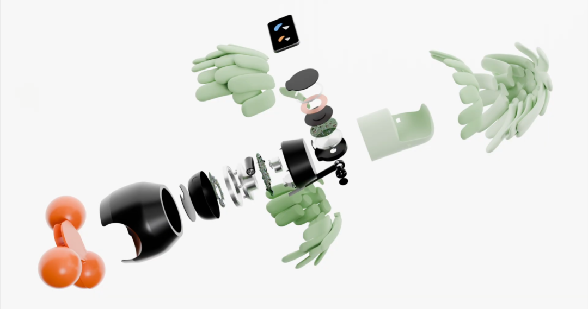
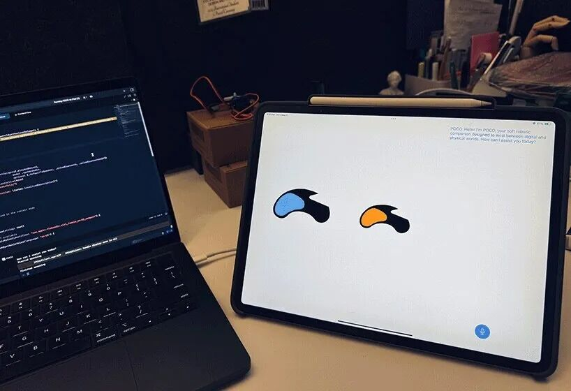
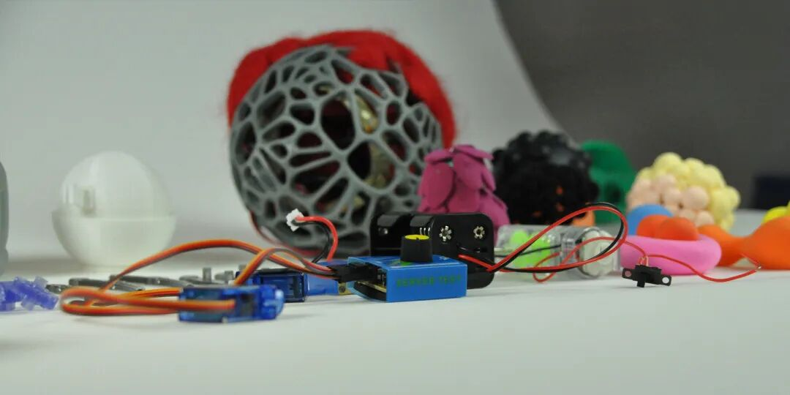

## 前言

Preface

平时我们在做机器人或者伺服传动系统的方案评估时，往往把精力死磕在如何提高机身刚性、如何降低减速机背隙、或者选配多少分辨率的绝对值角度编码器上。在很多工程师的观念里，“高精度”和“大扭矩”似乎就是机器人技术演进的唯一主轴。

然而，如果我们将目光从工业产线转向前沿的人机交互（HMI）领域，会发现技术趋势正在发生微妙的偏移。近期，海外科技与设计媒体Designboom深入报道了设计师Mehrnaz Amouei主导的最新软体机器人（Soft Robotics）项目——POCO。不同于我们熟知的那些由硬核液压或高功率电机驱动的“钢铁巨兽”，POCO完全摒弃了传统的刚性传动构型。

这不仅是一个设计学上的概念，更给出了一个极具探讨价值的工程命题：在没有传统电机、高精度位置反馈系统（甚至没有编码器）的情况下，系统如何单纯通过柔性传感与轻量化边缘计算，实现与人类的深度物理与情感交互？

今天，我们就从技术的视角，来硬核拆解一下POCO背后的底层逻辑。

## 1 从位置控制到多模态触觉感知

POCO的交互核心建立在“触觉”之上。根据项目公开的技术资料，该机器人利用了电容式传感器（Capacitive Sensors）来实时识别用户的动作手势，比如“握持”或“抚摸”。

从工程角度来看，在柔性织物和软体基底上部署传感器，与我们常见的刚性表面触控完全不同。传统的协作机械臂如果要感知人类接触，通常会在末端执行器或关节处安装六维力矩传感器，依赖动力学模型进行碰撞检测；但软体机器人的表面形变极大，传统的力控模型往往会失效。

为了实现连续的触觉捕捉，POCO这类系统通常会采用导电弹性体（如掺杂碳纳米管的硅胶聚合物）或柔性导电织物作为电容极板。当用户抚摸或抱紧POCO柔软的身体时，材料内部的电介质层厚度或极板间的有效面积会发生改变，从而导致电容值产生微小且连续的波动。

后端微控制器（MCU）通过高分辨率的电容数字转换器捕捉这些微弱的信号变动，再结合时序数据模型，将无规则的压力变化转化为具有实际语义的交互指令。这种设计跳过了复杂的运动学逆解计算，让机器感知直接回归到最原始、最直观的物理接触。

POCO内部结构示意

## 2 机器如何模拟“呼吸”？

在动态表现上，POCO没有采用突兀或高速的机械运动，而是呈现出一种缓慢、有节奏且类似“生物呼吸”的运动模式。

对于习惯了“伺服电机+行星减速机”方案的硬件工程师来说，要实现如此平滑且不规则的“呼吸”动作，往往意味着需要设计复杂的凸轮机构或进行多轴插补控制。但对于软体机器人而言，最经典的解法是采用流体弹性体驱动器（Fluidic Elastomer Actuators）或气动网络（Pneumatic Networks）。

通过内置的微型气泵和比例微型阀，系统可以对POCO内部的多个柔性气腔进行充放气控制。由于外部包裹的纺织材料和硅胶本身具有极高的非线性弹性和被动柔顺性（Passive Compliance），当气腔膨胀和收缩时，机器人就会产生极其自然的形变表现。这种气动驱动方式虽然放弃了毫米级的绝对定位精度，但换来的是极高的本征安全性（Intrinsic Safety）——即便系统控制出现故障，它也不会对人类造成任何物理伤害。这也完美契合了POCO的设计初衷：成为一个没有侵略性、温和的陪伴者。

## 3 边缘计算与“建设性相互依赖”

在算力分配上，POCO并没有挂载庞大的工控机，而是极其务实地将智能手机作为其计算中枢（Computational Component）。

这不仅仅是处于系统集成度或成本控制的考量，更是一种典型的边缘计算（Edge Computing）架构。在当今动辄依赖云端大模型的交互方案中，数据传输的延迟和隐私数据泄露一直是难以绕开的痛点。将手机作为本地的“大脑”，通过底层接口实时处理从柔性传感器阵列回传的串行数据，既保证了系统的极低延迟响应，也把用户的交互数据死死锁在了本地设备中。

在控制逻辑层面，设计师Mehrnaz Amouei提出了一个非常深刻的技术哲学：“建设性相互依赖（Constructive Interdependence）”。

现在的AI产品往往试图过度拟人化，甚至越俎代庖地去“指导”人类行为。而POCO的状态机则显得极其克制：它不会独立发起交互，而是作为一个响应式系统，完全由用户的输入来触发。系统通过自身的物理反馈，明确划定了它“能做什么”和“不能做什么”的边界，让AI回归到一个平等参与者的位置，而不是一个发号施令的控制中心。

## 4 或许是下一代机器人的终极形态

看完了POCO的设计思路，再回过头审视我们平时深耕的高精密传动与控制领域。目前阻碍工业机器人全面走向日常生活的痛点恰恰在于：机器的刚性太强，导致人机安全隔离与交互的成本居高不下。

虽然POCO目前更像是一个探索新型人机关系的原型机，但它背后的技术栈——柔性大面积触觉传感、被动柔顺的流体驱动机制、以及基于边缘端运行的轻量化交互边界模型，正在为机器人行业的下半场提供新的解题思路。

或许在不久的将来，主流技术流派将会走向融合。在最核心的关节模组中，我们依然需要高精度绝对值编码器和力矩电机来保证执行的准确性；而在机器人的外部，则会包裹上类似POCO这样的柔性传感“皮肤”与缓冲层。只有当冰冷的算法与刚性的机械，穿上一层具有感知和温度的“软甲”，机器人才能真正走出防护围栏，成为既能精密作业，又能与人类安全共存的智能伙伴。

---
