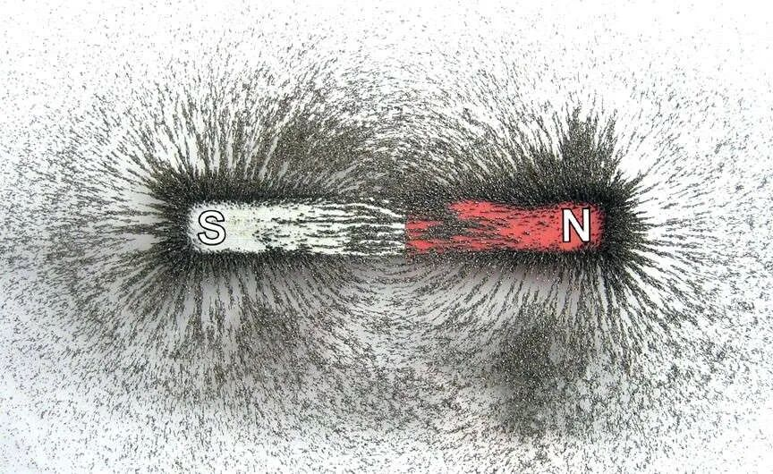
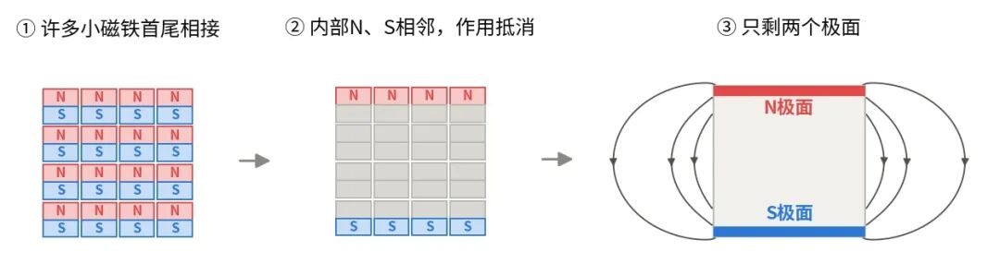
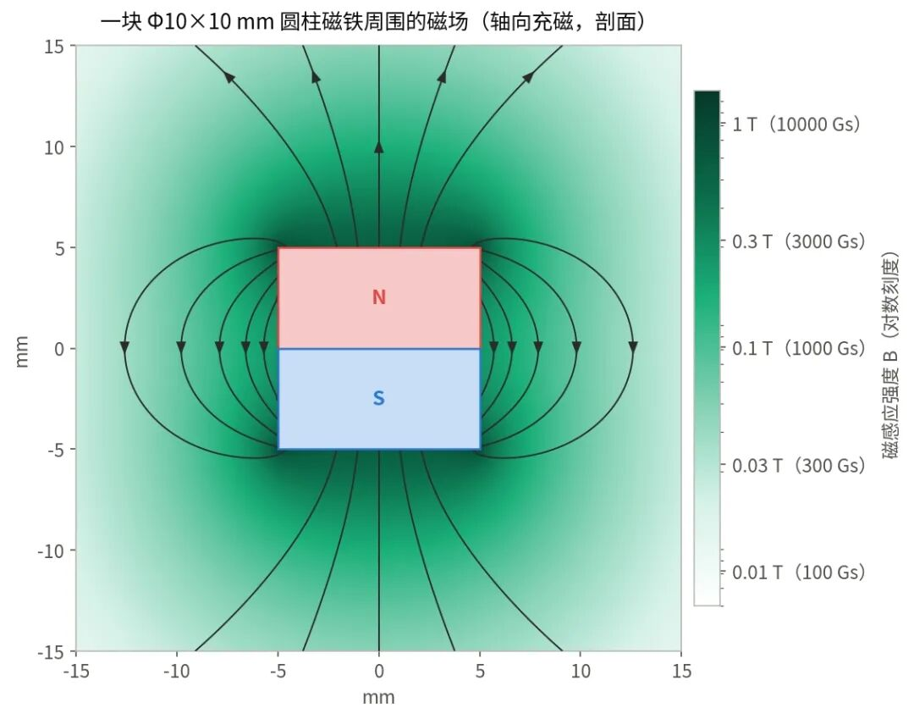
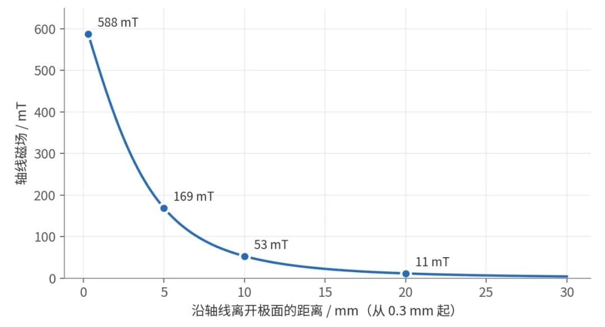
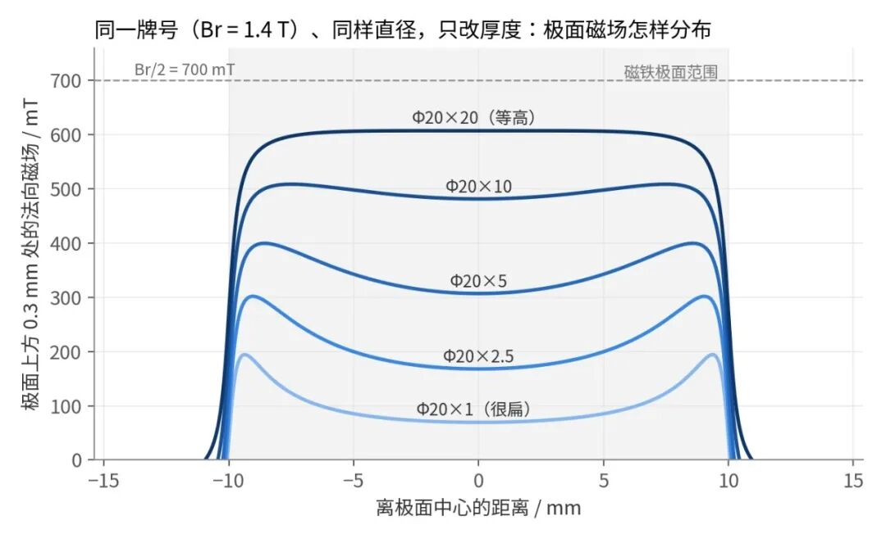
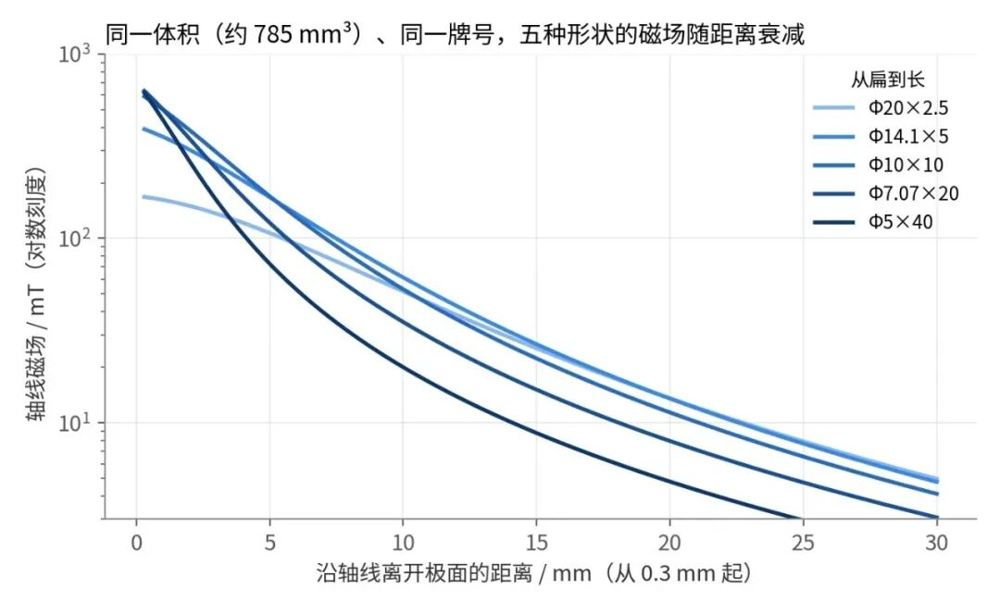
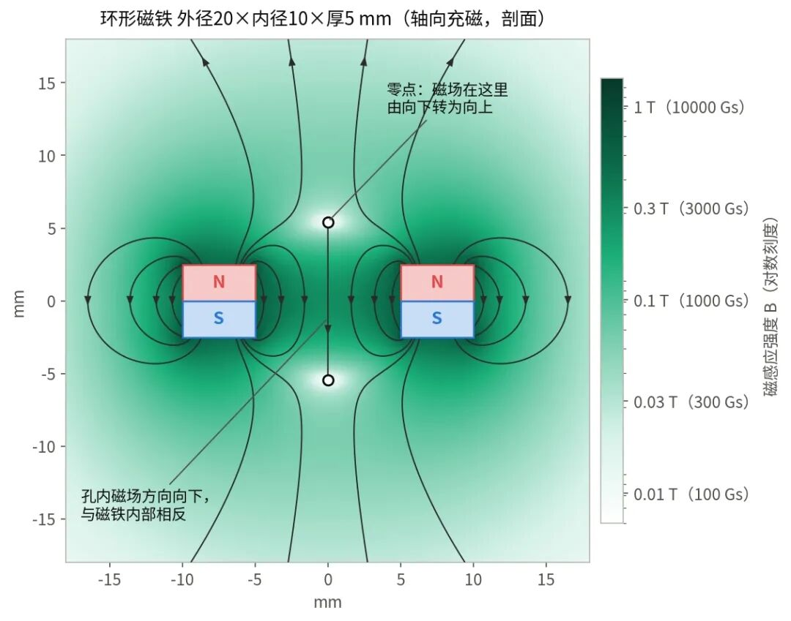
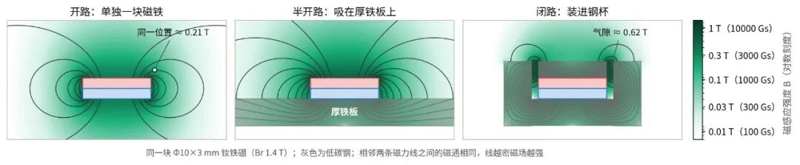

**点击蓝字关注我们吧！**

把一块磁铁放在白纸下面，撒上铁粉，轻敲纸面，铁粉就会排成一条条弧线，从一极绕向另一极。这张图很多人在中学课本里都见过，它给了我们对磁铁周围磁场最直观的印象。

**【图1】用铁粉演示磁铁周围的磁场分布**  
 

仔细看会发现，铁粉的分布并不均匀：磁铁两端堆得最密，侧面正中间却很稀疏。同一块磁铁，同一种材料，为什么两端强、中间弱？

铁粉图只画出了磁场的大致轮廓，哪里强、哪里弱、强弱相差多少，它回答不了。要看清一块磁铁周围的磁场究竟是什么样子，得先弄清磁场从哪里来。

**一、磁场从两个极面”长”出来**

可以把一块磁铁想象成由许多小磁铁排列而成：每个小磁铁都有自己的N极和S极，一个挨一个，首尾相接。在内部，前一个小磁铁的N极紧挨着后一个的S极，作用相互抵消，只有两端没有相邻磁极与它们配对，于是对外表现为两个极面。这就是电磁学中常用的“等效磁极模型”。

【图2】等效磁极模型示意  
 

只看磁铁外部，可以把磁场理解成从N极面“出来”，绕过外部空间，再回到S极面。磁铁外部任意一点的磁场，都是两个极面共同作用的结果。一般来说，离某个极面越近，它的影响越明显；但两个极面的作用还要看方向——有些位置会互相削弱，有些位置则会同向叠加。

回头看图1的铁粉。磁铁的每一端是一个极面，另一个极面远在另一头，几乎削弱不到这里，所以两端的铁粉都堆得最密；侧面正中间离两个极面都远，铁粉就稀稀落落。

差距有多大？按计算，一根Φ5×40mm的钕铁硼圆柱，极面上方的磁场约为0.6 T，侧面正中间只有约0.01 T，相差五十多倍。

图3是用这个模型算出的Φ10×10mm钕铁硼圆柱磁铁周围的磁场。磁力线在磁铁外部从N极绕回S极，在内部再回到N极，首尾闭合。

【图3】一块Φ10×10mm钕铁硼圆柱磁铁周围的磁场

**二、为什么同一块磁铁周围，有些地方强，有些地方弱？**

**离得越远越弱，而且弱得很快。**以图3的钕铁硼圆柱磁铁为例，沿中心轴，极面上方0.3mm处的磁场约为588 mT；离开5mm，约为169 mT；离开10mm，也就是一个直径的距离，只剩大约53 mT，不到极面附近的十分之一；离开20mm，磁场只剩约11 mT。

【图4】Φ10×10mm钕铁硼圆柱磁铁轴线上的磁场随距离衰减  
 

原因在于，从远处看，N极面和S极面几乎挤在一起：两者之间隔着的那点厚度，比起到磁铁的距离已经微不足道，方向相反的作用也就大部分互相抵掉了。在足够远的地方，距离每增加一倍，磁场就降到原来的约八分之一。拿磁铁靠近铁块时，起初几乎没有感觉，直到最后一小段才”啪”地吸上去，磁场随距离急剧衰减是原因之一。

**贴近表面时，薄片边缘比中心强。**这和很多人的直觉相反，一般会以为极面正中心最强。图5计算了五片直径都是20mm、厚度从1mm到20mm的钕铁硼圆片，在极面上方0.3mm处的法向磁场。最厚的那片，极面各处的磁场差不多，约为0.6 T；越薄，中间塌得越厉害。1mm厚的圆片，中心磁场只有约70 mT，靠近边缘处，磁场约为190 mT，是中心的近3倍。

【图5】相同直径不同厚度的钕铁硼圆片，极面上方0.3mm处的法向磁场分布  
 

原因还是两个极面靠得太近。薄片的S极面就在N极面背后1mm处，极面中心正对着它，削弱最多；越往边缘，受到的削弱越少。方块磁铁也是这样，20×20×2mm的方块磁铁，极面中心磁场约为0.12 T，四个角附近约0.3 T。“极面中心磁场最强”并不是普遍规律，磁铁越薄，边缘效应越明显。

图5还能看出一个上限：磁铁越厚，极面中心越强，但再厚也只能接近Br的一半（图中虚线，Br为1.4 T时约0.7 T）。圆柱、方块这类平极面磁铁都是如此。

也正因为分布不均，同一块磁铁，高斯计探头放在中心还是边缘、感应元件离表面多远，读数都会不一样，在极面附近尤其明显。用表磁做为检验指标时，需要把测量位置和测量方式一起约定清楚。

**三、换一种形状或充磁方式，磁场分布也会改变**

**表面强，离远了不一定强。**既然越长表面磁场越高，把磁铁做得细长是不是更好？图6比较了五片体积相同（约785mm³）的钕铁硼圆柱磁铁，从Φ20×2.5的扁平薄片到Φ5×40的细长圆柱。在极面上方0.3mm处的法向磁场，细长圆柱约为0.62 T，薄片只有约0.17 T；离开10mm，顺序反了过来：薄片约为52 mT，细长圆柱约20 mT。

细长圆柱的磁场集中在极面附近，一离开就很快衰减；薄片表面不强，但衰减得慢。不过再往远处走，形状的影响会逐渐减小。

【图6】同体积不同形状的钕铁硼圆柱，轴线磁场随距离衰减  
 

**环形磁铁的孔内，会出现反向磁场。**图7是一个外径20mm、内径10mm、厚5mm的环形钕铁硼磁铁。从N极面内圈出来的磁力线，有一部分就近穿过内孔回到S极面，所以孔里的磁场自上而下，与磁铁内部的方向相反，在孔的正中心（环的半高处）约0.29 T。

沿中心轴往上走，在离极面约3mm处，磁场降为零；越过这一点，方向才转为向上，但强度已经弱得多。用环形磁铁配合霍尔传感器时，如果传感器恰好放在这个零点附近，读到的信号会接近零。

【图7】环形磁铁的磁场：孔内反向与轴线上的零点  
 

**充磁方向决定了磁极落在哪里。**以上讨论的都是轴向充磁，N、S极分别在两个端面。同一个圆环，改为径向充磁，磁极就落在内、外圆周面上；做多极充磁，则会在同一个面上交替排列多对N、S极。

电机转子、磁编码器上常用的就是多极磁环。相邻磁极靠得很近，磁力线从N极出来，就近回到旁边的S极，很少跑远。相邻N、S极中心之间的距离称为极距，极距越小，磁场越贴近表面，定子或传感器也就必须靠得越近。按平面周期磁化估算，极距2mm时，离开表面1mm，磁场只剩约四分之一；离开2mm，只剩约5%。

**四、磁路设计：有目的地重新安排磁场**

前面看到，改形状只能在近处强和远处强之间取舍。无论做成什么形状，一块单独的磁铁，磁力线总是向四面八方散开，背面、侧面的磁场大多用不上。磁路设计要做的，就是把这些磁力线引到真正需要的地方。

最常用的手段是使用铁、低碳钢等导磁材料。在未饱和的范围内，导磁材料的磁导率可达空气的数百乃至数千倍，磁力线“更愿意”从铁里走。

图8比较了同一块磁铁的三种状态。

单独放置时，磁力线从N极面出来，要穿过大片空气才能绕回S极面，工程上称为“开路”。

吸在厚铁板上，S极面一侧的磁力线直接进入铁板，背面的漏磁显著减少，极面中心的表磁从约0.36 T提高到约0.53 T，这是“半开路”。

再装进钢杯，磁力线几乎全程沿着钢走，只在极片和杯壁之间约1mm宽的气隙里穿过空气，这是“闭路”。

气隙里的磁场约0.62 T，是单独放置时同一位置的约3倍，钢杯外侧的磁场则只剩约四分之一。这样的提升，靠换更高的牌号是做不到的：常用钕铁硼牌号之间，Br相差不过两成左右。

【图8】同一块磁铁的开路、半开路与闭路  
 

磁座、锅形磁铁和不少扬声器磁路，用的都是这类闭路结构；也可以把多块磁铁按不同的充磁方向排成Halbach阵列，让磁场主要集中在一侧，同时显著削弱另一侧的磁场。

这些设计都没有让磁铁本身变强，改变的只是磁力线的走向。具体的设计思路和工程案例，可以参阅此前的[《磁路设计的六种核心思路：从引导磁通到控制磁场》](https://mp.weixin.qq.com/s?__biz=MzkzMDk5MzgxNg==&mid=2247484736&idx=1&sn=7f27250cf8fd8473d13826ba29159f46&scene=21#wechat_redirect)。

**结语**

课本上那张铁粉图，展示的只是磁场的一个轮廓。把强弱也算出来，才能看到轮廓里看不出的东西：长条磁铁的侧面的磁场很弱，扁平磁铁极面的边缘比中心强，环形磁铁孔里的磁场是反向的，多极磁环的磁场紧贴着表面。

所以谈一块磁铁的磁场，只说”表磁多少”往往不够，还要说清楚是在哪个位置、哪个方向、离表面多远。想改变它，磁路往往比牌号更管用。 

注：文中磁场数值和计算图均为理想模型计算值，条件为均匀磁化、Br取1.4 T（约相当于烧结钕铁硼N48牌号）、周围无其他铁磁体（图8除外）。钢按线性低碳钢（相对磁导率2000）计算，钢中绝大部分区域磁感应强度低于1.2 T，未饱和。对均匀磁化的磁体，等效磁极模型（或等价的等效电流模型）给出的外部磁场是准确的；钕铁硼、钐钴、铁氧体等高矫顽力材料接近这一条件。实际产品的测量值还会受Br批次差异、是否充磁饱和、尺寸公差，以及高斯计感应元件到表面的实际距离影响。

参考资料

*1. E. P. Furlani, Permanent Magnet and Electromechanical Devices, Academic Press, 2001.*

*2. N. Derby, S. Olbert, "Cylindrical magnets and ideal solenoids," American Journal of Physics 78, 229 (2010).*

  
  

**感谢您的阅读**

  
  

更多磁知识，敬请持续关注我们。

图片来源于网络，如有侵权请私信联系删除

#NdFeB #N35 #N42 #N52 #N35AH #N40SH #N42SH #N35UH #N38UH #N38EH #N45UH #N48UH #N50UH #N42EH #N45EH #SmCo #Magnets #NeodymiumMagnets #稀土永磁 #钕铁硼 #烧结钕铁硼 #粘接钕铁硼 #辐射环#钕磁铁 #钐钴#烧结钐钴 #粘接钐钴  #耐温永磁材料#粘接磁体 #磁组件 #磁性组件 #磁性器件 #仿真设计 #强磁 #磁性材料 #铁氧体永磁 #铁氧体软磁 #铝镍钴  #磁铁 #磁体 #磁钢 #永磁材料  #磁性材料解决方案
